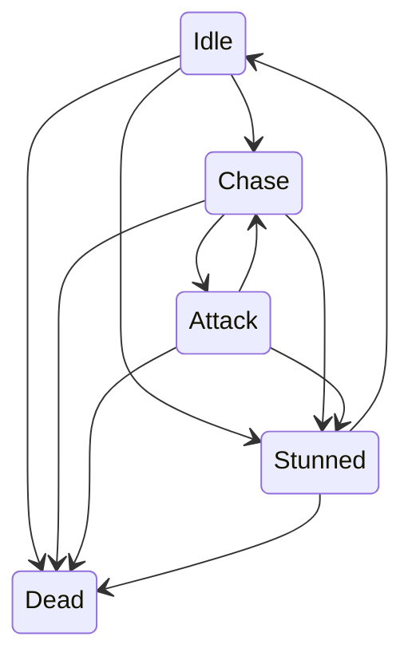
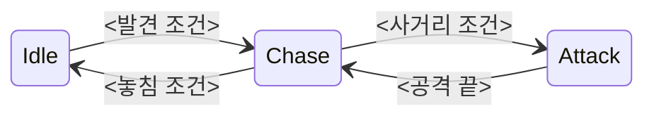
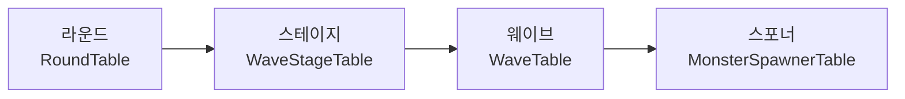

---
paths:
  - "src/**"
  - "data/**"
  - "report/**"
  - "report.md"
  - "format/**"
  - ".claude/skills/portfolio-*/**"
---

# 문서·발표 덱 작성 지침 (이 포크 전용, 항상 적용)

> 읽는 쪽: 이 레포에서 일하는 Claude Code 메인 세션과 그 하위 에이전트.
> 이 파일은 `.claude/rules/`에 있고, 위 `paths`의 파일(기술 문서·데이터·리포트·`format/`·포트폴리오 스킬)을 읽거나 고칠 때 자동으로 실린다. `/portfolio-update`의 교체 목록(`format/`·루트 `CLAUDE.md`·`.claude/skills/portfolio-*/`·렌더러)에 없으므로 원본 템플릿이 바뀌어도 남는다.
> 우선순위: 루트 `CLAUDE.md` 원칙 1~6(지어내지 않음·대신 고쳐 쓰지 않음 등) > 이 파일 > `format/`·`.claude/skills/portfolio-*`. 이 파일과 `format/`·스킬이 다르면 이 파일을 따른다(「기존 규칙과 다른 점」).

## 이 레포에서 규칙이 걸리는 자리

- 글·표·그림·코드의 정본은 `src/<폴더>/기술문서.md` 하나다.
  - 상세 문서(`doc.html`)는 그 md 전문을 그린다.
  - 발표 덱(`project.html`)은 그 md의 원문 블록(표·Mermaid·코드·그림)을 **그대로** 그린다. 빌드가 정하는 것은 장면 틀(`layout`)·어느 블록(`visuals`)·코드 줄 범위(`lines`)·장면 글(`lead`·`points`, 원문에서 고르거나 줄임)뿐이다.
  - 포트폴리오 문서(`index.html`)는 빌드가 줄인 글(`highlights` 등)이다.
- 그래서 덱이나 상세 문서에 보이는 문제는 대부분 **md 원문을 고쳐야** 풀린다. 빌드는 글을 새로 쓰지 않고, 소스에 없는 그림·표를 만들지 않는다. 필요하면 리포트에 "기술 문서에 넣을 것"으로 적는다.
- 이 레포에 "슬라이드를 새로 그리기"나 "이미지 만들기"는 없다. 그림은 원문 Mermaid 블록과 `src/<폴더>/images/`의 실제 스크린샷뿐이다.

## 적용 시점

| 상황 | 할 일 |
|---|---|
| 기술 문서를 같이 쓰거나 "고쳐 줘"를 받음 | 각 규칙의 「기술 문서 md」 기준으로 쓴다. 요청받지 않은 줄은 고치지 않는다(원칙 2) |
| `/portfolio-check` | 각 규칙의 「점검」으로 원문을 본다. 걸린 것은 `[지침 N]` 줄로 리포트에 적는다(「리포트에 적는 법」) |
| `/portfolio-build` | 장면을 고를 때 각 규칙의 「빌드·/portfolio-edit」 기준을 따른다. §7 미리보기 점검 때 「렌더 검수 방법」도 함께 돌린다 |
| `/portfolio-edit` | 요청이 규칙에 어긋나면(예: 한 동작 코드를 1/2·2/2로 나누기) 장면 카드에 그 점과 대안을 적고 사용자가 고르게 한다 |
| 하위 에이전트에게 위 일을 맡김 | 하위 에이전트는 이 대화·스킬을 못 보고, 이 파일이 실린다는 보장도 없다. 브리프에 ① "`.claude/rules/portfolio-writing.md`를 Read하라" ② 맡긴 일에 해당하는 규칙 절 전문을 붙인다. 돌아온 결과(리포트 줄·장면 선택)는 메인 세션이 이 파일의 검수 기준으로 다시 확인한 뒤 사용자에게 알린다 |

## 0. 기본 원칙

- 문장 쓰기 기준은 `.claude/CLAUDE.md` 「글쓰기 기본 지침」(핵심 먼저, "A가 아니라 B" 금지, 목적 절에 구현 금지)을 따른다. 여기에 다시 적지 않는다.
- **한 장면(한 절)은 주장 하나.** 장면 제목이 그 주장이고, 그림·코드·요점은 그 주장을 받친다. 제목과 본문이 다른 말을 하면 제목이나 고르는 블록을 바꾼다.
- **질문에 맞는 시각화.** 구성은 클래스 그림, 시간 순서는 시퀀스, 상태 오가기는 상태 그림, 갈림길은 플로우차트, 계층은 계층도, 대안 비교는 표(`format/03-diagrams.md` 첫 표).
- **여백과 밀도.** 덱 채움률 60% 이상, 글자 하한(본문 14 · 코드 12 · 라벨 11px)에 걸리지 않게. 넘치면 글자를 줄이지 말고 장면을 나누거나 덜 보인다.
- **강조는 근거가 있을 때 한 곳.** 원문이 그 대상을 핵심이라고 말할 때만 한 상태·한 클래스에 설명을 몰아준다.

---

## 1. 식별자는 이름 중간에서 줄바꿈하지 않는다

**목적.** 클래스·메서드·변수·파일 이름이 끊기면 읽는 사람이 다른 이름으로 오해하거나 검색하지 못한다.

**실제로 생기는 이유.** 덱·상세 문서 CSS는 인라인 코드와 표 칸에 `overflow-wrap: anywhere`를 쓴다(`assets/deck-theme.css`, `assets/doc.css`). 칸이 좁으면 `MonsterCorpse`가 `MonsterCor` / `pse`로 끊긴다. 덱은 원문 표를 그대로 그리므로 md를 고치면 두 페이지가 함께 고쳐진다. 렌더러 CSS는 고치지 않는다(원칙 5).

**기술 문서 md 기준**
- 식별자는 늘 백틱으로 감싼다(검수 코드가 백틱 안 이름만 잡는다).
- 한 칸에 이름이 여럿이면 `·`·`,`로 잇지 않고 `<br>`로 줄을 나눈다. 표 칸 안 `<br>`는 이 레포에서 동작한다.
- 이름이 든 열은 이름만 두고, 설명은 옆 열로 뺀다.
- 열이 4개를 넘어 칸이 좁아지면 표를 둘로 나누거나 목록으로 바꾼다.

**빌드·/portfolio-edit 기준**
- 이름이 긴 표는 큰 표 틀(`layout: "full"`)을 먼저 고른다.
- 그래도 끊기면 빌드는 글을 바꾸지 않고 리포트에 md 쪽 해법을 적는다.
- 포트폴리오 문서 `highlights` 글에 식별자를 여러 개 나열하지 않는다.

**잘못된 예** (`src/5-hive-purge/기술문서.md` 구조 표의 한 행)
```md
| `MonsterDamageFeedback`·`MonsterWeakPoint`·`MonsterCorpse` | 피격 모션·저체력 표현, 약점 판정과 명중 표시, 사망 뒤 시체 단계 |
```

**개선된 예**
```md
| `MonsterDamageFeedback`<br>`MonsterWeakPoint`<br>`MonsterCorpse` | 피격 모션·저체력 표현<br>약점 판정과 명중 표시<br>사망 뒤 시체 단계 |
```

**렌더 뒤 검수**
- 덱·상세 문서에서 두 줄로 나뉜 인라인 코드 0건(「렌더 검수 방법」 ①).
- 덱 `audit`의 `clipped` 0건, 포트폴리오 문서 `PFPage.report().overflowX` 0건.

**심각도.** 이름 끊김 = [권장]. 글자 겹침·잘림(`clipped`) = [필수].

---

## 2. 상태 머신은 전이 관계가 보이게 그린다

**목적.** 상태 목록보다 "어떤 조건에서 어디로 가는가"를 이해시킨다.

**실제로 생기는 이유.** 덱은 Mermaid 블록 하나를 1280×720에 통째로 맞춘다. 상태·전이가 많으면 선이 얽히고 글자가 작아진다(`tiny-diagram`). 장면 요점은 그림 뒤 원문 문장에서 고르므로, 원문이 한 상태(예: Attack)만 설명하면 덱도 그 상태만 말한다.

**기술 문서 md 기준**
- **기본 흐름 그림**과 **예외 전이 표**를 따로 둔다.
  - 기본 흐름: 정상 행동만 담은 Mermaid(`stateDiagram-v2` 또는 `flowchart LR`). 노드 10개 안팎, 선이 교차하지 않게.
  - 예외 전이: 기절·사망처럼 어느 상태에서나 끼어드는 전이는 표로(상태 · 들어가는 조건 · 나오는 곳).
- 전이 조건은 화살표 라벨에 짧게 쓴다. 긴 설명은 그림 밖 한 줄로.
- 그림 뒤 설명은 전이 전체를 한 줄씩 다룬다. 원문이 그 상태를 핵심이라고 말할 근거가 없으면 한 상태에 설명을 몰지 않는다.
- 전이 조건이나 우선순위를 원문·코드에서 확인할 수 없으면 지어내지 않는다. 리포트 "확인해 주세요"에 적고 사용자에게 묻는다.

**빌드·/portfolio-edit 기준**
- 기본 흐름 그림 장면 → 예외 전이 표 장면, 2장으로 둔다.
- 요점은 한 상태에 몰리지 않게 고른다. 원문에 그런 문장이 없으면 리포트에 적는다.

**잘못된 예**
````md

Attack 상태에서는 … (Attack 설명만 세 문단)
````

**개선된 예** (조건 칸은 원문·코드에 있는 것만)
````md

기본 흐름은 Idle → Chase → Attack → Chase 또는 Idle이다.

| 예외 상태 | 들어가는 조건 | 나오는 곳 |
|---|---|---|
| Stunned | <기절 조건> | 회복 뒤 <복귀 상태> |
| Dead | <사망 조건> | 없음(종료) |
````

**렌더 뒤 검수**
- `tiny-diagram` 0건.
- 선 교차·라벨 겹침은 장면을 눈으로 본다(검사 코드로 못 잡음).

**심각도.** 전이 그림이 없음 = [권장](`format/03`). 선 얽힘·한 상태 쏠림 = [참고].

---

## 3. 한 동작의 코드를 장면 여러 개로 쪼개지 않는다

**목적.** 앞뒤 장면을 오가며 코드를 맞춰 읽지 않게 한다.

**실제로 생기는 이유.** 덱 코드 참조가 20줄을 넘으면 렌더러가 "계속" 장면(1/2, 2/2)으로 자동으로 나누고 `long-code`를 남긴다. 템플릿 원본은 이것을 [참고]로만 안내한다.

**기술 문서 md 기준**
- 긴 코드 앞에 흐름을 먼저 둔다. 한 줄(예: Windup → Active → Recover → Cooldown)이나 작은 그림이면 된다. 각 단계의 뜻을 한 줄씩 붙인다.
- 상세 문서 코드 블록은 50줄 안팎까지 그대로 둔다. 전체 코드는 상세 문서가 맡는다.

**빌드·/portfolio-edit 기준**
- 코드 참조에 `lines: [시작, 끝]`(펜스 제외, 1부터)를 넣어 핵심 **20줄 이하**만 고른다(렌더러 상한 `MAXL = 20`, `assets/project-deck.js` — 21줄이면 이미 두 장면으로 나뉜다). 자동 "계속" 분할을 만들지 않는다.
- 원문에 흐름 블록(그림·목록)이 있으면 그 장면을 코드 장면 앞에 둔다.
- 두 장면이 꼭 필요하면 `/portfolio-edit` 나누기로 장면마다 다른 제목·목적을 준다(예: "단계 전환" / "취소 처리").
- 코드가 길다고 글자를 줄여 한 장에 넣지 않는다. 코드 장면에 `font-floor`가 뜨면 줄 범위를 줄인다.

**잘못된 예.** `MonsterAttack.Tick` 30줄 넘는 코드가 "3.3 공격 사이클 (1/2)"·"(2/2)" 두 장면으로 나뉘어, `switch`의 앞 case와 뒤 case를 오가며 읽어야 한다.

**개선된 예.**
- 장면 1 (흐름): "모든 공격은 Windup → Active → Recover 순서를 따른다" + 단계별 뜻 목록.
- 장면 2 (코드): `{ "kind": "code", "n": 1, "lines": [<단계 전환 핵심 시작>, <끝>] }` 20줄 이하. 전체는 상세 문서.

**렌더 뒤 검수**
- `info.notes`의 `long-code` 0건. 코드 장면의 `font-floor` 0건.

**심각도.** 자동 분할이 남음 = [권장](템플릿 원본의 [참고]보다 높임).

---

## 4. 구현 세부는 장면의 주장에 기여하는 만큼만

**목적.** 코드에 있다는 이유만으로 조건을 다 나열하면, 정말 보여 줄 설계 결정이 묻힌다.

**실제로 생기는 이유.** 빌드는 원문의 문장·표를 장면 요점과 그림으로 옮긴다. 원문 본문에 Animator 파라미터·Trigger·Exit Time 표가 있으면 그 표가 그대로 장면이 된다.

**기술 문서 md 기준**
- 본문은 "그 결정을 한 이유"와 "해결한 문제"를 먼저 쓴다.
- 설정값·세부 전이 조건 표는 그 절 끝이나 부록 절로 옮긴다. 상세 문서에는 남는다.

**빌드·/portfolio-edit 기준**
- 장면 제목의 주장에 기여하는 문장·블록만 고른다.
- 세부 설정 표는 덱 장면으로 만들지 않는다. 이것은 주장과 무관해서 빼는 것이다(장면 수를 맞추려는 빼기는 여전히 하지 않음, `.claude/CLAUDE.md` 「발표 덱 장면 수」).
- 포트폴리오 문서 `highlights`에 설정값·파라미터 이름을 넣지 않는다.

**잘못된 예.** "Animator 연동" 장면이 진입 조건 표 전체(`IsDead`·`Death` Trigger·`AttackSpeed`·`Attack` Trigger·Exit Time…)를 보여 주고, 왜 Any State 전이로 묶었는지는 없다.

**개선된 예.** 장면 주장 = "<원문이 말하는 Animator 연동의 설계 결정>". 요점 2~3개는 그 결정의 이유와 해결한 문제. 전이 조건 표는 상세 문서 절 끝에만.

**렌더 뒤 검수.** 장면 제목과 요점이 같은 주장을 하는지 눈으로 본다.

**심각도.** [참고].

---

## 5. 계층 구조는 표보다 계층도로 먼저 보여 준다

**목적.** 구성 요소 이름보다 "무엇이 무엇을 담는가"가 먼저 보여야 한다.

**실제로 생기는 이유.** 원문이 데이터 파일을 긴 표로 나열하면 덱이 그 표를 그대로 그린다. 파일명 칸이 좁아 이름이 끊기고(규칙 1과 같은 원인), 행마다 설명 길이가 달라 관계가 안 보인다.

**기술 문서 md 기준**
- 계층이 핵심이면 Mermaid `flowchart LR` 계층도를 표 **앞에** 둔다.
- 파일 표는 보조로 짧게. 행마다 같은 정보 유형(예: "무엇을 정하나" 한 가지)만, 긴 설명문은 빼거나 계층도 라벨로.
- 실제 폴더·에디터 화면이 필요하면 사용자가 찍은 스크린샷만 쓴다. 내부 구조를 추측해 그리지 않는다. 없으면 촬영을 요청한다.
- 대안 비교는 계속 표로 쓴다(`format/02` 「고민과 선택」). 표를 버리는 규칙이 아니라 계층과 비교를 구분하는 규칙이다.

**빌드·/portfolio-edit 기준**
- 계층도 블록이 있으면 그 장면을 먼저, 파일 표는 다음 장면이나 상세 문서에만.
- 원문에 계층도가 없으면 만들지 않는다. 리포트에 `format/03`의 프롬프트 틀로 제안한다.

**잘못된 예** (`src/5-hive-purge/기술문서.md` 웨이브 데이터 절)
```md
| 파일 | 내용 |
|---|---|
| `RoundTable.tsv` | 라운드에 대응되는 웨이브 라운드 번호 |
| `WaveStageTable.tsv` | 웨이브 라운드 번호에 대응해, 시작 시각에 따라 순서대로 시작하는 웨이브 스테이지들. 스테이지마다 진행할 웨이브 번호들 |
| `WaveTable.tsv` | 이 웨이브가 스테이지 시작 기준 몇 초 뒤에 실행되는지, 이 웨이브가 맡은 스포너들 |
| `MonsterSpawnerTable.tsv` | 이 스포너가 소환하는 몬스터 id, 소환 개수, 소환 방식 |
```

**개선된 예**
````md

| 단계 | 정하는 것 |
|---|---|
| 라운드 | 쓸 웨이브 라운드 번호 |
| 스테이지 | 시작 시각과 진행할 웨이브 |
| 웨이브 | 스테이지 시작 뒤 몇 초에, 어느 스포너를 |
| 스포너 | 몬스터 id·개수·소환 방식 |
````

**렌더 뒤 검수.** 규칙 1 검사(파일명 끊김 0건) + `tiny-diagram` 0건.

**심각도.** [권장].

---

## 6. AI 활용 사례는 문제 해결 과정을 생략하지 않는다

**목적.** "AI로 만들었다"가 아니라 "AI 결과를 사람이 판단하고 고쳤다"를 보여 준다. 면접관이 묻는 것은 그 판단이다.

**실제로 생기는 이유.** 원문이 최종 코드 변경만 적으면 빌드도 그것만 장면으로 만든다.

**기술 문서 md 기준** — AI가 주요 문제 해결 과정에 쓰였으면 이 6단계를 순서대로 쓴다.
1. 문제 상황: 무엇을 해결하려 했나.
2. 최초 프롬프트: AI에게 무엇을 요청했나(원문 인용).
3. AI 결과: 어떤 코드·해결책이 나왔나.
4. 발견한 문제: 적용·검토하며 무엇이 드러났나.
5. 개선 과정: 사람이 어떤 판단을 했고 어떻게 고쳤나.
6. 최종 결과: 어떻게 검증했나(테스트·측정·씬 확인).
- 타임라인이나 단계 목록으로 쓴다. 한 문단에 압축하지 않는다.
- 프롬프트·AI 답 원문은 사용자가 가진 기록(`_intake/`·대화 기록·커밋)에서만 가져온다. 확인할 수 없으면 만들지 않고 원본을 요청한다(원칙 1).

**빌드·/portfolio-edit 기준**
- 내용이 중요하면 6단계를 장면 여러 개로 나눈다. 장면 수 30~40장 권장 규칙과 같은 방향이다.
- 원문에 빠진 단계가 있으면 리포트에 적는다.

**잘못된 예.** "AI와 설계해 공격 구조를 추상 클래스 하나로 바꿨다." (최종 변경만)

**개선된 예**
```md
1. 문제: 행동 상태와 공격이 자주 바뀔 것 같았다.
2. 요청: "<사용자 기록에 있는 프롬프트 원문>"
3. AI 결과: 인터페이스 + 추상 클래스 + 팩토리 구조가 한 번에 들어왔다.
4. 발견한 문제: 커밋된 코드를 리뷰하기 어려울 만큼 범위가 넓었다.
5. 판단·수정: <사람이 정한 기준과 바꾼 내용>
6. 검증: <테스트·씬 확인 방법>
```

**렌더 뒤 검수.** 6단계가 상세 문서 절과 덱 장면에 빠짐없이 보이는지.

**심각도.** 단계 누락 = [권장]. 프롬프트 원문 없음 = "확인해 주세요".

---

## 기존 규칙과 다른 점

| 기존(템플릿 원본) | 이 포크 | 이유 |
|---|---|---|
| 덱 코드 20줄 초과 → 렌더러가 "계속" 장면으로 나눔, `long-code`는 [참고] (`format/02` 3단계, build SKILL §7) | 빌드가 `lines`로 핵심만 골라 자동 분할을 만들지 않는다. 남으면 [권장] | 규칙 3 |
| 상태 전이 그림 1개 권장(`format/03` 점검 포인트) | 상태 5개 이상이거나 선이 교차하면 "기본 흐름 그림 + 예외 표"로 나눈다 | 규칙 2 |
| 고민과 선택에 비교 표 권장(`format/02` 4단계) | 유지. 비교는 표, 계층은 계층도 | 규칙 5 |
| 이슈 해결 = 상황 → 원인 → 해결 → 결과(`format/01`) | AI가 해결 과정에 쓰였으면 규칙 6의 6단계로 넓힌다 | 규칙 6 |
| 원칙 2 "대신 고쳐 쓰지 않음" | 그대로. 각 규칙의 "개선된 예"는 리포트에서 방향을 보일 때와 "고쳐 줘"를 받았을 때만 쓴다 | — |

## 렌더 검수 방법

- 미리보기는 `.\preview.ps1 deck <폴더>` / `.\preview.ps1 doc <폴더>`(편집 서버, 포트 4600).
- ① 식별자 끊김(규칙 1·5) — 브라우저 도구의 JavaScript 실행으로, 덱이면 `await PFScene.whenReady()`, 상세 문서면 문서가 다 그려진 뒤:

```js
const brokenNames = [...document.querySelectorAll(':not(pre) > code')]
  .filter(code => code.getClientRects().length > 1)
  .map(code => ({
    scene: code.closest('.pf-scene[id^="d-"]')?.id ?? '',
    name: code.textContent,
    inTable: Boolean(code.closest('td, th')),
  }));
brokenNames;
```
  - 결과 읽기: 덱의 끊김(`scene` 있음)과 상세 문서의 표 칸 끊김(`inTable: true`)은 md로 고칠 수 있으니 `[지침 1]`로 적는다.
  - 상세 문서 **본문 문단**의 끊김(`inTable: false`)은 `assets/doc.css`의 `word-break: break-all` 때문에 줄 끝에 걸린 이름이 잘리는 것이다. 글로 막을 수 없으므로 리포트에 적지 않는다(렌더러 문제, 원칙 5).
  - 확인된 예(2026-11-11, Hive Purge 덱): `classes` 장면의 `MonsterCorpse`, `wave-data` 장면의 TSV 파일명 4개 — 이 파일 규칙 1·5의 "잘못된 예" 그대로다.
- ② 덱 지표: `PFScene.report()`의 `audit`(`clipped` 등)과 `info.notes`(`long-code`·`tiny-diagram`·`font-floor`). 포트폴리오 문서는 `PFPage.report()`의 `overflowX`.
- ③ 눈으로: 상태 그림의 선 교차·라벨 겹침(규칙 2), 장면 제목과 요점의 주장 일치(규칙 4).
- 브라우저 도구(Claude in Chrome)가 연결되지 않았으면 ①은 headless Chrome의 DevTools 프로토콜로 돌린다: Node 22 이상의 내장 `WebSocket`으로 `chrome --headless=new --remote-debugging-port=<포트> --user-data-dir=<임시 폴더>`에 붙어 페이지를 연 뒤 `Runtime.evaluate`(`awaitPromise: true`)로 위 코드를 실행한다. 스크립트는 레포 밖 임시 폴더에 둔다.
- 둘 다 안 되면 ①·③은 하지 못한다. 그때는 "렌더 확인 못 함"으로 리포트에 적고, 확인했다고 쓰지 않는다.

## 리포트에 적는 법

- 프로젝트 report(`report/<폴더>.md`, `.claude/CLAUDE.md` 「report 구조」)에 한 장면(한 절) 1줄로 적는다.
- 꼴: `[지침 N][심각도] 어디(발표 덱 몇 장·§절) — 무엇이 문제 → md에서 고칠 방향`
- 예:
  ```text
  [지침 1][권장] 발표 덱 <N>장(§<절> 구조 표) — `MonsterCorpse`가 이름 중간에서 줄바꿈됨 → 한 칸의 이름 셋을 <br>로 나누기
  ```
- 고칠 곳은 늘 소스(md·`deck-edits.json`)다. `data/`를 손으로 고치라고 하지 않는다(원칙 4).
