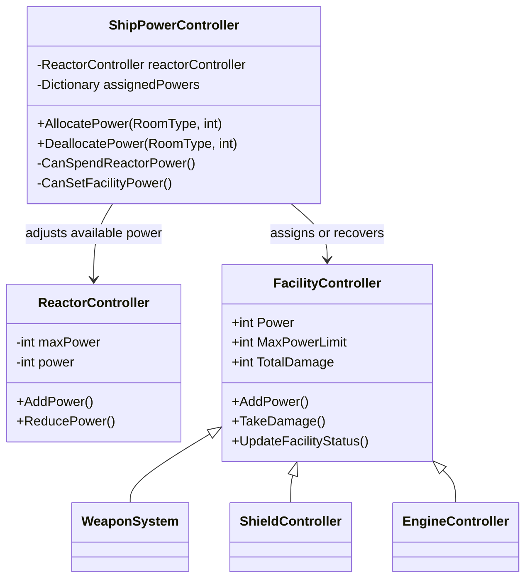
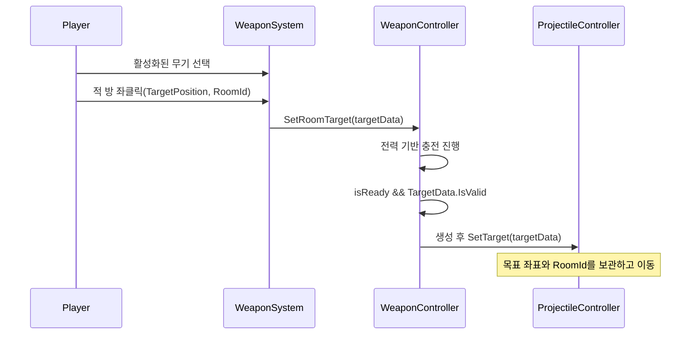
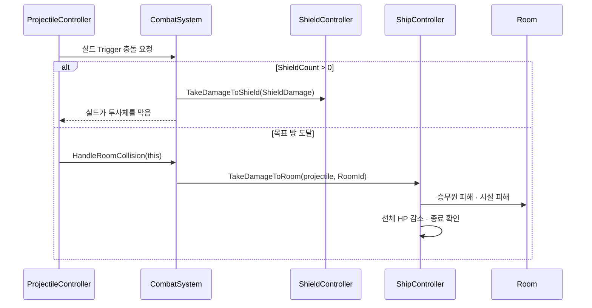
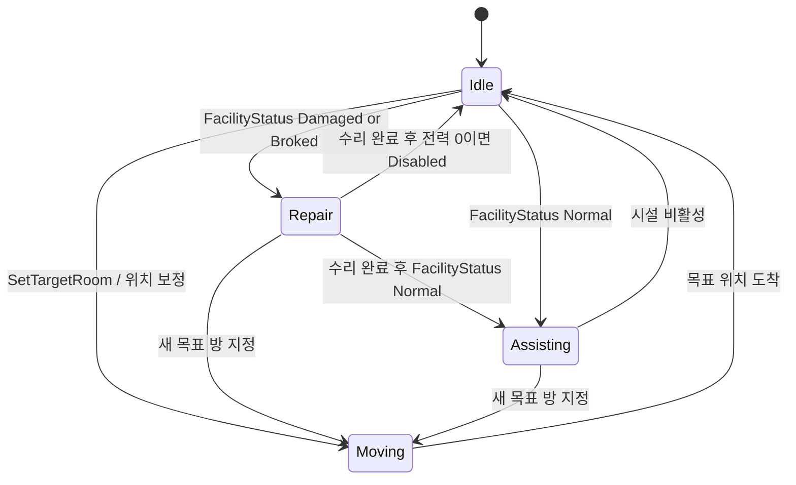
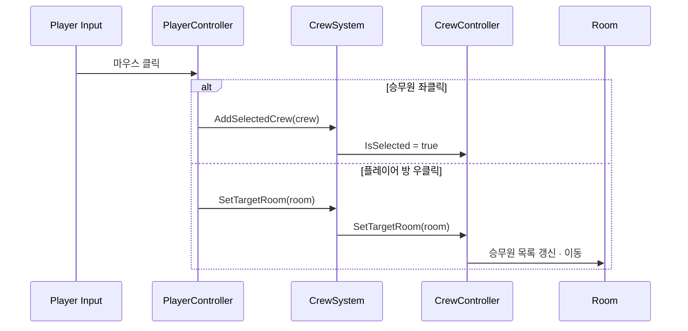

<!-- 백업: mini ftl 개편 전 프로젝트 문서의 「3. 핵심 기능」(3.1 전력 관리 · 3.2 무기 조준 · 3.3 승무원 관리 · 3.4 환경 효과와 공통 입력) 원문 그대로. 원본 전체는 git show HEAD:src/3-mini-ftl/기술문서.md. 그림 경로(images/…)는 src/3-mini-ftl 기준. -->

## 3. 핵심 기능

### 3.1 전력 관리

#### 전력 관리 기능 개요

<!-- 원천: v13 슬라이드 07 -->

제한된 반응로 전력을 무기·엔진·실드에 배분해 전투 중 가동 우선순위를 정한다.


**입력**

- 키보드 A·S·D로 전력을 공급한다.
- Shift+A·S·D로 공급한 전력을 회수한다.
- A는 실드, S는 엔진, D는 무기에 연결된다.

**시설 활성화 조건**

- 무기·엔진·실드는 전력이 1 이상 할당되었을 때 가동한다.
- 전력이 0이면 해당 시설은 비활성 상태가 된다.
- 반응로 가용 전력이 부족하면 추가 전력을 공급할 수 없다.

**시설 강화**

- 엔진은 전력에 따라 탈출 충전 속도가 상승한다.
- 실드는 전력 2당 최대 실드 1개가 충전된다.
- 무기는 전력 단계에 따라 충전 속도 배율이 높아진다.

#### 전력 관리 시스템 구조

<!-- 원천: v13 슬라이드 08 -->

반응로의 가용 전력, 시설 상태, 양쪽 값을 함께 바꾸는 요청 처리를 클래스 단위로 분리했다.



- **ReactorController** — maxPower와 현재 power를 보관한다. AddPower와 ReducePower 메소드로 power가 0~maxPower 값 사이의 유효한 값을 가질 수 있도록 한다.
- **ShipPowerController** — 시설 종류별 assignedPowers를 기록하고 AllocatePower·DeallocatePower 요청에서 반응로와 시설을 같은 양만큼 갱신한다.
- **FacilityController** — Power, MaxPowerLimit, TotalDamage와 시설 상태를 관리한다. 피해로 최대 전력이 줄어 현재 전력이 넘치면 초과분을 반응로로 되돌린다.

#### 시설 상태와 전력 바 상태

<!-- 원천: v13 슬라이드 09 -->

각 상태의 실제 전력 바 이미지와 상태 조건을 카드마다 함께 비교한다.

**활성화 · Available**


- 전력이 할당된 칸은 초록색이다.
- 시설이 정상이고 전력이 1 이상이면 활성화된다.

**고장 · Broken**


- 피해를 입은 칸은 주황색이다.
- 피해 수만큼 전력 바 칸의 상태가 Broken으로 바뀐다.

**비활성화 · UnAvailable**


- 미할당 전력 칸은 회색이다.
- Power가 0이면 시설은 비활성화된다.

**파괴 · Broked**


- 피해가 최대 전력 한계에 도달한 상태다.
- 시설 기능은 실행하지 않고 전력 칸 전체를 사용할 수 없다.

#### 전력 상호작용 코드: 반응로 ↔ 시설

<!-- 원천: v13 슬라이드 10 -->

할당과 회수는 ShipPowerController가 한 요청 안에서 시설 전력·기록값·반응로 가용 전력을 함께 갱신한다.

**AllocatePower · ShipPowerController.cs**

```csharp
public void AllocatePower(RoomType facilityType, int amount = 1)
{
    // … 입력·null 검사 생략
    FacilityController facility = FindFacility(facilityType);
    int nextPower = GetAssignedPower(facilityType) + amount;

    if (CanSpendReactorPower(amount) == false ||
        facility.CanAddPower(amount) == false ||
        CanSetFacilityPower(facility, nextPower) == false) return;

    SetAssignedPower(facilityType, nextPower);
    facility.AddPower(amount);
    reactorController.ReducePower(amount);
}
```

**DeallocatePower · ShipPowerController.cs**

```csharp
public void DeallocatePower(RoomType facilityType, int amount = 1)
{
    FacilityController facility = FindFacility(facilityType);
    int current = GetAssignedPower(facilityType);
    if (current <= 0) return;

    int recoverAmount = Mathf.Min(amount, current);
    if (CanRecoverReactorPower(recoverAmount) == false) return;

    SetAssignedPower(facilityType, current - recoverAmount);
    reactorController.AddPower(recoverAmount);
    facility.ReducePower(recoverAmount);
}
```

- **전력 할당** — 반응로 가용 전력이 1 이상이고 시설 전력 추가가 가능할 때 시설에 전력을 추가한다. 반응로 전력은 같은 양만큼 줄인다.
- **전력 회수** — 시설에 전력이 1 이상 할당되어 있는지 확인한다. 반응로가 전력을 회수할 경우 최대 전력을 넘지 않는지 확인한 뒤 전력을 회수한다.

#### 전력 유효 상태 보장 책임

<!-- 원천: v13 슬라이드 11 -->

전력이 범위를 벗어나지 않도록 반응로·시설의 상태 보장과 두 객체 사이의 전력 이동 책임을 분리했다.

**FacilityController.TakeDamage · 초과 전력 회수**

```csharp
public virtual void TakeDamage(int amount)
{
    TotalDamage = Mathf.Min(TotalDamage + amount, MaxPowerLimit);
    maxPower = MaxPowerLimit - TotalDamage;

    if (maxPower < Power)
    {
        int overflow = Power - maxPower;
        ReducePower(overflow);
        shipPowerController.DeallocatePower(type, overflow);
    }
    UpdateFacilityStatus();
}
```

**ReactorController · 값 범위 제한**

```csharp
public void AddPower(int amount)
{
    if (amount <= 0) return;
    power = Mathf.Min(power + amount, maxPower);
}

public void ReducePower(int amount)
{
    if (amount <= 0) return;
    power = Mathf.Max(power - amount, 0);
}
```

- **전력 할당 가능** — ShipPowerController는 반응로 가용 전력과 시설 전력 추가 가능 여부를 확인한 뒤 전력을 할당한다.
- **상태 유효성 검증** — ReactorController와 FacilityController에서는 각각 반응로 전력, 시설 전력 상태가 유효한지 검증한다.
- **간접 상호작용** — 전력 회수,할당 같은 상호작용이 필요하면 ShipPowerController를 통해 간접적으로 상호작용한다.

#### 전력 UI: 데이터 참조와 갱신

<!-- 원천: v13 슬라이드 12 -->

반응로·시설 뷰어는 매 프레임 참조 중인 컨트롤러의 현재 값을 읽어 UI를 갱신한다.

**FacilityPowerViewer.UpdateViewer · 시설 UI**

```csharp
protected override void UpdateViewer()
{
    int maxPower = facilitySystem.MaxPower;
    int power = facilitySystem.Power;
    int maxPowerLimit = facilitySystem.MaxPowerLimit;
    int totalDamage = facilitySystem.TotalDamage;

    UpdatePowerBars(power, maxPower, maxPowerLimit, totalDamage);
    UpdateRepairBar();
    UpdateFacilityIcon();
}
```

**ReactorViewer.UpdateViewer · 반응로 UI**

```csharp
int totalPower = reactorController.MaxPower;
int availablePower = reactorController.Power;

for (int i = 0; i < barSprites.Count; i++)
{
    if (i < availablePower)
        SetBarState(i, ReactorBarStatus.Available);
    else
        SetBarState(i, ReactorBarStatus.UnAvailable);
}
```

- **시설 데이터 참조** — FacilityPowerViewer는 FacilityController의 power, maxPower, maxPowerLimit, totalDamage를 매 프레임 읽는다. 이를 바탕으로 현재 할당량·한계·피해·시설 상태를 표시한다.
- **반응로 데이터 참조** — ReactorViewer는 ReactorController의 maxPower와 power를 읽는다. 시설로 추가 할당할 수 있는 가용 전력은 Available, 이미 사용 중인 전력은 UnAvailable로 표시한다.
- **UI 갱신** — 시설 뷰어는 전력 바 외에도 수리 진행 바와 시설 아이콘 색을 상태에 맞춰 갱신한다. 상태 변경을 전력 로직에서 직접 UI로 호출하지 않는다.

### 3.2 무기 조준

#### 무기 조준 기능 개요

<!-- 원천: v13 슬라이드 17 -->


**무기 조준 과정**

**01 무기 선택**

- 플레이어는 전력이 공급되어 활성화된 무기를 선택한다.
- 선택된 무기만 적 방 목표 데이터를 받을 수 있다.
- 무기 시설 전력이 0이면 무기 아이콘은 비활성 상태가 된다.

**02 공격 목표 지정**

- 적 함선의 방을 클릭하면 목표 좌표와 RoomId를 만든다.
- ProjectileTargetData가 이 두 값을 무기에 전달한다.
- RoomId는 투사체 도착 뒤 피해를 줄 방을 식별한다.

**03 투사체 발사**

- 활성화된 무기는 충전이 완료되고 유효한 목표가 있을 때 발사한다.
- ProjectileController는 저장한 목표 위치를 향해 이동한다.
- 발사 뒤 충전 진행도는 다시 초기화된다.

**04 피해 처리**

- 투사체가 상대 함선의 실드에 충돌하면 실드 피해를 요청한다.
- 실드에 막히지 않고 목표 방에 도달하면 방 피해를 요청한다.
- CombatSystem이 두 피해 경로를 구분해 처리한다.

#### 무기 활성화 · 충전 · 투사체 발사

<!-- 원천: v13 슬라이드 18 -->

무기 활성화부터 목표 데이터 전달과 투사체 발사까지의 핵심 로직만 시퀀스로 정리했다.



- **무기 활성화 조건** — WeaponSystem은 시설에 전력이 1 이상 공급되면 소속 WeaponController의 IsPowered를 켠다. 무기 시설에 할당된 전력값은 무기 충전 속도 배율에도 반영된다.
- **무기 충전 및 투사체 발사** — WeaponController는 충전 완료와 유효한 TargetData를 모두 확인한다. 조건을 만족하면 투사체를 생성한 뒤 TargetPosition·RoomId를 투사체의 SetTarget으로 전달한다.

#### 투사체 피해 처리 흐름

<!-- 원천: v13 슬라이드 19 -->

발사 과정은 제외하고, 실드 충돌과 목표 방 도달 뒤 피해 판정이 해결되는 경로에만 집중한다.



- **실드 충돌 요청** — ProjectileController는 적 함선 영역을 지난 뒤 실드 레이어와 충돌하면 CombatSystem.HandleShieldCollision을 호출한다. 실드가 남아 있으면 ShieldDamage를 적용하고 투사체는 제거된다.
- **목표 방 도달 요청** — 실드에 막히지 않은 투사체가 TargetPos에 도달하면 CombatSystem.HandleRoomCollision에 자신과 저장한 RoomId를 전달한다.
- **방 피해 해결** — CombatSystem은 피격 함선의 TakeDamageToRoom을 호출한다. 함선은 해당 Room의 승무원·시설에 피해를 전달하고 선체 HP를 줄인 뒤 전투 종료 조건을 확인한다.

#### 무기 핵심 코드: 선택 · 충전 · 발사 조건

<!-- 원천: v13 슬라이드 20 -->

WeaponSystem은 선택과 목표 전달을, WeaponController는 개별 무기의 충전과 발사 가능 상태를 맡는다.

**WeaponController · 목표와 발사 조건**

```csharp
public void SetRoomTarget(ProjectileTargetData targetData)
{
    TargetData.TargetPosition = targetData.TargetPosition;
    TargetData.RoomId = targetData.RoomId;
}

private bool IsReadyToFire()
{
    return TargetData.IsValid() && isReady;
}
```

**WeaponController.FireCoroutine · 목표 데이터 전달**

```csharp
GameObject projectile = Instantiate(projectilePrefab, transform.position, Quaternion.identity);
ProjectileController projectileController =
    projectile.GetComponent<ProjectileController>();
projectileController.SetTarget(targetData);
projectileController.SetRandomSeed(seed);
projectile.transform.rotation = transform.rotation;
```

- **목표 저장** — TargetPosition은 투사체가 이동할 좌표이고 RoomId는 도착 뒤 피해를 줄 방을 식별한다. 둘 중 하나라도 유효하지 않으면 발사하지 않는다.
- **충전과 보조** — 전력이 공급되면 chargeProgress가 증가한다. 시설 보조 상태는 충전 속도에 1.2배 보정을 적용해 발사 준비를 앞당긴다.

#### CombatSystem의 실드 · 방 충돌 해결

<!-- 원천: v13 슬라이드 21 -->

피격 판정은 CombatSystem에 모으고, 실드와 방 충돌은 각각의 메서드가 피격 함선·방 객체로 피해를 전달한다.

**HandleShieldCollision · 실드 충돌**

```csharp
public bool HandleShieldCollision(ProjectileController projectile)
{
    bool isPlayerProjectile = projectile.StartCol.CompareTag(Tags.PlayerShip);
    int opponentShipIndex = isPlayerProjectile ? 1 : 0;
    ShieldController shield = (ShieldController)
        ships[opponentShipIndex].GetFacilitySystemByERoomType(RoomType.Shield);

    if (shield.ShieldCount > 0)
    {
        shield.TakeDamageToShield(projectile.ShieldDamage);
        // … 피해 숫자 표시 생략
        return true;
    }
    return false;
}
```

**HandleRoomCollision · 목표 방 도달**

```csharp
public bool HandleRoomCollision(ProjectileController projectile)
{
    // … opponentShipIndex는 HandleShieldCollision과 같은 방법으로 구함
    ShipController targetShip = ships[opponentShipIndex];
    ProjectileTargetData target =
        new(projectile.TargetPos, projectile.TargetRoomId);

    targetShip.TakeDamageToRoom(projectile, target.RoomId);
    // … 피격 연출(함선 흔들기 · 피해 숫자 표시) 생략
    return true;
}

// ShipController: Room → crews / facility → ship HP
```

- **실드 충돌 해결** — CombatSystem은 투사체의 출발 함선을 기준으로 상대 ShieldController를 찾는다. ShieldCount가 1 이상일 때만 실드 피해를 적용하고 투사체를 막는다.
- **방 충돌 해결** — CombatSystem은 피격된 ShipController를 찾고 RoomId를 넘긴다. ShipController는 해당 Room 안의 시설과 승무원에 피해를 처리한 뒤 함선 체력을 감소시킨다.

### 3.3 승무원 관리

#### 승무원 기능 개요

<!-- 원천: v13 슬라이드 26 -->

승무원은 방 이동 뒤 시설 상태에 맞춰 수리·보조를 수행하며, 방 피격 시 체력 피해를 받는다.


**승무원 이동**

- 승무원을 좌클릭으로 선택한다.
- 플레이어 방을 우클릭하면 CrewSystem이 각 CrewController에 목표 방을 전달한다.
- 승무원은 목표 방의 배치 위치까지 이동한다.

**승무원 작업**

- 목표 방 도착 뒤 시설이 Damaged 또는 Broked이면 수리한다.
- 시설이 Normal이면 시설 보조 효과를 적용한다.
- 무기·실드·엔진은 보조 상태에 따라 충전 속도 보정을 받는다.

**승무원 피해**

- 방이 피격되면 Room이 내부 Crews에 피해를 전달한다.
- HP가 0이 된 승무원은 CrewSystem에서 제거된다.
- 승무원이 모두 사망하면 전투 패배 조건을 확인한다.

#### CrewStatus 상태 전이와 상태별 작업

<!-- 원천: v13 슬라이드 27 -->

CrewController.UpdateCrewStatus가 현재 방의 시설 상태를 읽고, HandleStatus가 상태별 메서드를 실행한다.



- **Moving** — 이동 명령을 받으면 SetTargetRoom이 승무원을 지금 방의 목록에서 뺀다. 그 방이 비면 시설 보조를 해제하고(AssistFacility(false)) 수리 진행도를 초기화한(ResetRepairProgressOnEmptyRoom) 뒤 Moving으로 바꾼다. 이동 중에는 목표 방의 배치 위치까지 MoveTowards로 이동하고, 도착하면 TargetRoom을 비우고 Idle로 전환한다.
- **Idle** — 매 프레임 시설 보조를 해제하고(AssistFacility(false)), 방이 비었으면 수리 진행도를 초기화한다(ResetRepairProgressOnEmptyRoom). 시설이 비활성화된 경우에도 Idle을 유지한다.
- **Repair** — Damaged 또는 Broked 시설에서 시설 보조를 해제하고(AssistFacility(false)) Room.RepairFacility를 호출한다. 수리 진행도가 RepairDuration에 도달할 때 시설 피해를 1만큼 복구한다.
- **Assisting** — Normal 시설에서 ApplyAssistEffectOnFacility(true)를 호출한다. 엔진·실드·무기별 보조 효과가 충전 속도에 반영된다.

#### 플레이어 입력과 개별 CrewController 사이의 상호작용 관리

<!-- 원천: v13 슬라이드 28 -->

PlayerController가 클릭 대상을 판별하고, CrewSystem이 선택 목록과 목표 방을 관리해 개별 CrewController에 명령을 중계한다.

**CrewSystem.cs · 선택·목표 방 중계**

```csharp
public void AddSelectedCrew(CrewController crew)
{
    if (!CanRunCrewLogic()) return;
    crew.IsSelected = true;
    selectedCrews.Add(crew);
}

public void SetTargetRoom(Room room)
{
    if (selectedCrews.Count == 0) return;
    targetRoom = room;
    SetTargetToCrew();
}
```

**PlayerController.cs · 클릭 입력 분기**

```csharp
if (isPlayerCrewSelected)
{
    crewSystem.AddSelectedCrew(crew);
}

if (roomCol != null)
{
    Room room = GetRoomByPositionOrNull(roomCol.transform.position);
    crewSystem.SetTargetRoom(room);
}
```

- **입력 수집과 선택** — PlayerController는 좌클릭한 플레이어 승무원을 찾아 CrewSystem.AddSelectedCrew로 전달한다. 선택 상태는 CrewController와 selectedCrews 목록에 함께 기록된다.
- **이동 명령 전달** — 방 우클릭 시 PlayerController가 Room을 찾아 CrewSystem.SetTargetRoom을 호출한다. CrewSystem은 방 정원이 찼는지 확인한 뒤 선택된 승무원에게 SetTargetRoom을 전달한다.

#### CrewStatus 전환 조건

<!-- 원천: v13 슬라이드 29 -->

UpdateCrewStatus 외에도 SetTargetRoom, MoveToTargetRoom, TakeDamage가 상태와 승무원 생존 흐름에 직접 영향을 준다.

- **Moving** — SetTargetRoom이 목표 방을 저장하고 crewStatus를 Moving으로 바꾼다. 이동 중에는 UpdateCrewStatus가 다른 작업 상태로 덮어쓰지 않는다.
- **Idle** — MoveToTargetRoom이 목표 위치에 도착하면 Idle이 된다. 시설이 Disabled이거나 배치 위치를 맞추는 과정이 끝난 뒤에도 Idle 상태가 된다.
- **Repair** — 이동이 아닌 상태에서 현재 방 시설이 Damaged 또는 Broked이면 UpdateCrewStatus가 Repair로 전환한다. HandleStatus는 수리 진행도를 누적한다.
- **Assisting** — 현재 방 시설이 Normal이면 Assisting으로 전환한다. HandleStatus가 보조를 적용하며, 새 이동 명령이나 시설 상태 변화가 있으면 다음 프레임에 다시 판단한다.

#### 방 · 승무원 · 함선의 상호작용 코드

<!-- 원천: v13 슬라이드 30 -->

Room은 작업 단위, CrewController는 상태별 실행자, ShipController는 방 피격 뒤 함선 전체 피해를 처리하는 경계다.

**Room.cs · 시설 수리**

```csharp
public void RepairFacility()
{
    float repairDuration = FacilitySystem.RepairDuration;
    float newRepairProgress = FacilitySystem.RepairProgress;
    newRepairProgress = Mathf.Min(repairDuration, newRepairProgress + Time.deltaTime);

    if (newRepairProgress == repairDuration)
    {
        FacilitySystem.Repair(1);
        newRepairProgress = 0f;
    }

    FacilitySystem.RepairProgress = newRepairProgress;
}
```

**CrewController.cs · 상태별 작업**

```csharp
private void HandleStatus()
{
    switch (crewStatus)
    {
        case CrewStatus.Moving:
            MoveToTargetRoom();
            break;
        case CrewStatus.Idle:
            AssistFacility(false);
            ResetRepairProgressOnEmptyRoom(CurrentRoom);
            break;
        case CrewStatus.Repair:
            AssistFacility(false);
            RepairFacilityInRoom();
            break;
        case CrewStatus.Assisting:
            AssistFacility(true);
            ResetRepairProgressOnEmptyRoom(CurrentRoom);
            break;
    }
}
```

**ShipController.cs · 방 피해**

```csharp
public void TakeDamageToRoom(int damage, int crewDamage, int roomId)
{
    Room room = GetRoomByIdOrNull(roomId);
    room.TakeDamageToCrews(crewDamage);
    StartCoroutine(SetRoomHitCoroutine(room));
    if (room.HasFacility) room.TakeDamageToFacility(damage);
    TakeDamage(damage);
    CheckGameOver();
}
```

- **Room** — 승무원이 수리할 때 진행도를 누적하고 완료 시 FacilityController.Repair를 호출한다. Room은 승무원 목록과 시설 참조를 함께 보관한다.
- **CrewController** — Moving·Idle·Repair·Assisting에 따라 이동, 보조 해제, 수리, 보조 적용 메서드를 나눠 실행한다.
- **ShipController** — RoomId로 피격 방을 찾고 승무원·시설 피해, 선체 HP 감소, 게임 종료 확인을 한 흐름으로 처리한다.

#### 승무원 선택 · 이동 · 작업 · 피해 흐름

<!-- 원천: v13 슬라이드 31 -->

CombatSystem은 제외하고, 플레이어 입력부터 CrewSystem·CrewController·Room 사이의 순서만 표현했다.



- **이동** — 좌클릭으로 승무원을 선택한 뒤 플레이어 방을 우클릭하면 CrewSystem이 선택 목록을 순회해 각 CrewController의 목표 방을 설정한다. 방의 승무원 목록과 배치 위치도 갱신된다.
- **작업** — 도착 뒤 CrewController는 Room의 FacilityStatus를 확인한다. 손상·파괴 시설은 수리하고, 정상 시설은 보조해 시설별 충전·효과를 돕는다.
- **피해** — 방 피격 시 Room.TakeDamageToCrews가 내부 승무원에게 피해를 전달한다. 사망한 승무원은 CrewSystem.HandleCrewDeath를 거쳐 목록과 방에서 제거된다.

### 3.4 환경 효과와 공통 입력

#### 환경 효과

<!-- 원천: v13 슬라이드 32 -->

소행성과 태양 플레어 이벤트가 전투 중 임의의 방에 피해를 주는 상황을 만든다.

**환경 효과를 넣은 이유** — 전투가 벌어지는 환경을 다양하게 연출하고, 플레이에 역동성을 더하기 위해서다.


**ASTEROID**

- 무작위로 고른 방을 목표로 투사체를 생성한다.
- 투사체는 일반 공격과 같이 목표 위치까지 이동한다.
- 도착 시 CombatSystem의 방 충돌 처리로 이어진다.

**SOLAR FLARE**

- 플레어 연출 뒤 선택된 방에 직접 피해를 적용한다.
- ShipController.TakeDamageToRoom을 직접 호출한다.
- 전투가 끝나면 환경 효과 코루틴도 멈춘다.

#### 환경 효과 핵심 코드

<!-- 원천: v13 슬라이드 33 -->

환경 코루틴은 전투 상태와 스테이지 유형을 확인한 뒤, 일정 시간마다 소행성 또는 태양 플레어 효과를 실행한다.

**EnvironmentController.cs · 이벤트 주기**

```csharp
private IEnumerator EnvironmentCoroutine()
{
    while (true)
    {
        if (!GameManager.Instance.CanRunCombat) break;
        if (isSunStage)
        {
            yield return new WaitForSeconds(effectInterval - solarFlareController.FlareDuration);
            solarFlareController.ApplyFlareEffect();
            yield return new WaitForSeconds(solarFlareController.FlareDuration);
            ApplyEnvironmentEffect();
        }
        else
        {
            yield return new WaitForSeconds(effectInterval);
            ApplyEnvironmentEffect();
        }
    }
}
```

**환경별 피해 경로**

```text
Asteroid
  → ProjectileController 생성 · 목표 방으로 이동
  → 도착 시 CombatSystem.HandleRoomCollision()

Solar flare
  → ShipController.TakeDamageToRoom(roomDamage, crewDamage, room.Id)
  → CombatSystem.SetFloatingText(...)
```

- **전투 상태 확인** — GameManager.Instance.CanRunCombat이 false가 되면 코루틴을 중단한다. 전투가 끝난 뒤 환경 효과가 계속 실행되지 않게 한다.
- **피해 처리** — 소행성은 투사체로 이동한 뒤 충돌 처리를 요청한다. 태양 플레어는 ShipController.TakeDamageToRoom을 직접 호출한다. 두 경우 모두 방·시설·승무원·함선 체력 처리로 이어진다.

#### 공통 입력: 승무원 선택과 적 방 조준

<!-- 원천: v13 슬라이드 34 -->

PlayerController는 클릭 위치의 방·함선 소속·승무원 콜라이더를 판별해 무기 조준 또는 승무원 명령으로 전달한다.

**입력 대상 판별**

```csharp
Collider2D[] clickCols =
    Physics2D.OverlapPointAll(worldPoint, clickableLayer);

foreach (Collider2D col in clickCols)
{
    ReadClickedCollider(col, roomLayer, shipLayer, crewLayer,
        ref roomCol, ref shipSide, ref crew);
}
```

**좌·우클릭 결과 분기**

```csharp
// 좌클릭: 적 방 → WeaponSystem, 플레이어 승무원 → CrewSystem
if (isEnemyRoomSelected)
    WeaponController.SetSelectedRoomTarget(targetData);
if (isPlayerCrewSelected)
    crewSystem.AddSelectedCrew(crew);

// 우클릭: 플레이어 방 → 선택된 승무원의 목표 방
crewSystem.SetTargetRoom(room);
```

- **레이어 기반 판별** — 같은 마우스 위치의 콜라이더를 수집한 뒤 Room·Ship·Crew 레이어와 소속 ShipSide를 확인한다. 적 방과 플레이어 승무원이 다른 명령으로 분기되는 기준이다.
- **명령 경계** — 무기 조준은 적 방의 좌표·RoomId를 WeaponSystem에 전달한다. 승무원 이동은 플레이어 방 객체만 CrewSystem에 전달해 선택 목록을 통해 실행한다.

