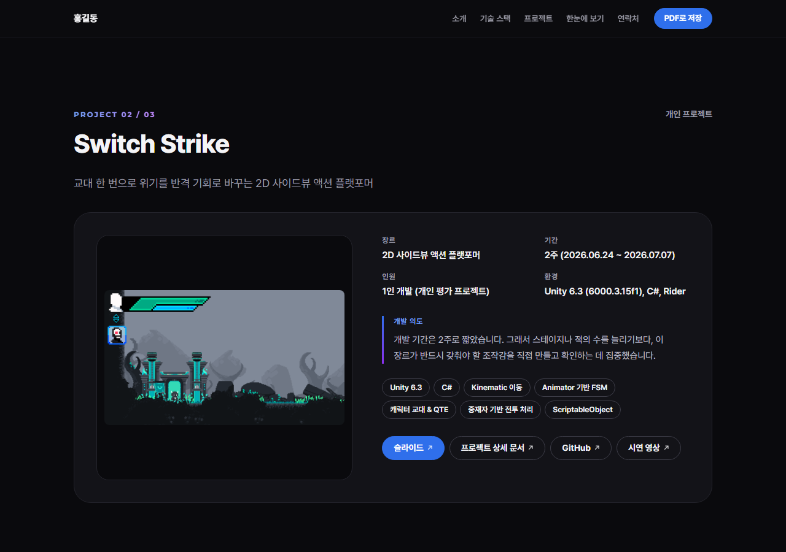
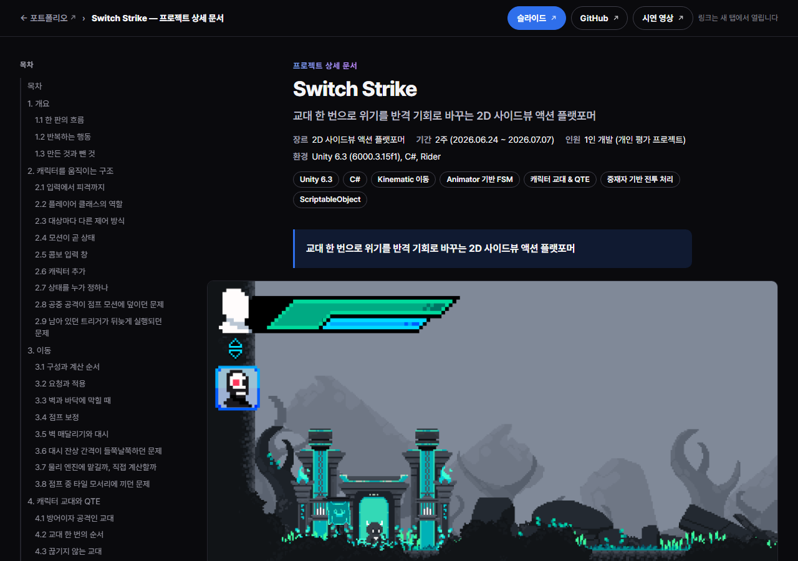
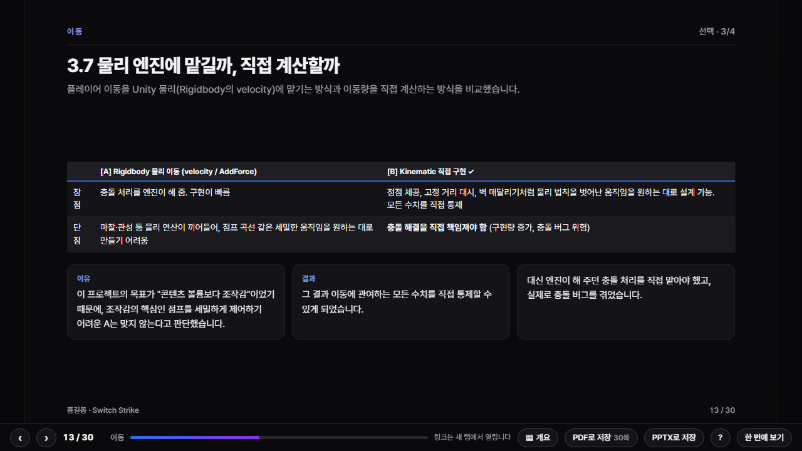

# 포트폴리오와 프로젝트 문서

포트폴리오에 **무엇을, 왜** 써야 하는지를 설명합니다. 만드는 순서는 [전체 흐름](2-workflow.md), 쓰는 요령은 [프로젝트 문서 쓰는 법](3-writing.md)에 있습니다.

이 문서의 바탕은 「[유니티 개발자 취업·기술 문서 작성 가이드 v2](https://koohoo-dev.github.io/edu-lecture-portfolio-guide/)」의 Part 1(취업 문서)입니다.

## 취업 서류 세 가지

| 서류 | 하는 일 |
|---|---|
| 이력서 | 핵심 역량을 한눈에 요약합니다 |
| 자기소개서 | 직무에 맞는 사람임을 이야기로 설득합니다 |
| **포트폴리오** | **실제로 만든 결과물로 실력을 증명합니다** |

셋의 중심은 포트폴리오입니다. 이력서와 자기소개서가 "할 줄 안다"는 **주장**이라면, 포트폴리오는 "이렇게 했다"는 **증거**입니다.

이 템플릿은 포트폴리오만 다룹니다. 이력서와 자기소개서는 가이드 원문의 [Part 1](https://koohoo-dev.github.io/edu-lecture-portfolio-guide/guide.html#1)을 보세요.

## 포트폴리오는 세 부분입니다

| 부분 | 읽는 사람이 하는 일 | 이 템플릿에서 |
|---|---|---|
| **요약 문서** | 한눈에 파악합니다 | **포트폴리오 페이지** — 아래로 읽는 한 페이지, 제출용 PDF |
| **시연 영상** | 실제로 동작하는 것을 봅니다 | 직접 찍어 올리고 링크만 넣습니다 (5분 이내) |
| **프로젝트 상세 문서** | 읽고 검증합니다 | **프로젝트 상세 문서** — 내가 쓴 프로젝트 문서 전문 |
| (선택) 슬라이드 | 그림·표·코드로 빠르게 봅니다 | **슬라이드** — 상세 문서를 16:9 슬라이드로 |

세 부분의 역할은 다릅니다. 요약 문서에서 관심이 생긴 사람이 상세 문서를 읽고, 영상으로 확인합니다.

| 포트폴리오 페이지 | 프로젝트 상세 문서 | 슬라이드 |
|---|---|---|
|  |  |  |

**세 페이지의 재료는 하나입니다.** 프로젝트마다 **프로젝트 문서** 한 편을 쓰면, 이 템플릿이 그 문서에서 요약을 뽑아 포트폴리오 페이지를 만들고, 그림·표·코드를 골라 슬라이드를 만들고, 전문을 상세 문서로 보여 줍니다. 그래서 여러분이 할 일은 **프로젝트 문서를 잘 쓰는 것** 하나입니다.

## 읽는 사람은 무엇을 보나요

동작하는 게임과 매끄러운 문서는 이제 누구나 낼 수 있습니다. 포트폴리오가 보여 줘야 하는 것은 "만들었다"가 아니라 두 가지입니다.

- **판단** — 무엇을 문제로 보았고, 어떤 방법들 가운데 무엇을 골랐고, 무엇을 버렸는가
- **검증** — 그것이 맞는지 어떻게 확인했는가

AI 도구를 쓰는 것도 마찬가지입니다. 결과물만이 아니라 **AI에게 무엇을 맡겼고, 무엇을 직접 판단했고, 결과를 어떻게 확인했는지**를 봅니다.

읽는 사람이 프로젝트 문서에서 찾는 답은 여섯 가지입니다. 점검도 이 여섯 가지로 합니다.

| # | 읽는 사람의 질문 | 문서의 어디에 |
|---|---|---|
| 1 | 무엇을 만들었고 왜 만들었나 | 개요 |
| 2 | 어떤 경험을 목표로 했고, 그것은 어떻게 됐나 | 개요 · 회고 |
| 3 | 핵심 기능은 무엇이고 어떻게 만들었나 | 기능 단위 (코드로 설명해도, 게임 디자인으로 설명해도 됩니다) |
| 4 | 무엇을 고민했고, 어떤 방법들 가운데 무엇을 골랐나 | 고민과 선택 |
| 5 | AI와 어떻게 일했나 | AI와 일한 방식 |
| 6 | 이 프로젝트에서 무엇을 겪었고 무엇을 알게 됐나 | 회고 |

> 공고와 전형은 회사마다, 시기마다 다릅니다. 지원하려는 회사의 최신 공고를 직접 확인하세요.

**GitHub 레포도 포트폴리오의 일부입니다.** 문서를 읽은 사람은 레포를 열어 그 내용이 맞는지 확인합니다. 문서에 나온 클래스·메서드 이름이 레포에 그대로 있어야 하고, 문서의 코드는 레포의 지금 코드와 맞아야 합니다.

## 프로젝트 문서란

프로젝트를 **만든 뒤에** 쓰는, **채용 담당자가 읽는** 문서입니다. 무엇을 만들었는지보다 **무엇을 왜 그렇게 정했는지**가 본체입니다.

| 문서 | 언제 쓰나 | 누가 읽나 | 담는 것 |
|---|---|---|---|
| 기획서 | 만들기 전 | 같이 만드는 사람 | 무엇을 만들 것인가 |
| 레포의 README | 만드는 중 | 코드를 받아 실행할 사람 | 실행 방법, 폴더 구조 |
| **프로젝트 문서** | **만든 뒤** | **채용 담당자 · 면접관** | **무엇을 왜 그렇게 정했고, 어떻게 확인했나** |

기획서를 그대로 옮기거나 기능을 나열한 문서는 프로젝트 문서가 아닙니다. 기능 목록은 "만들었다"만 말하고, 판단과 검증을 말하지 않기 때문입니다.

프로젝트 문서의 뼈대는 이렇습니다. 자세한 것은 [프로젝트 문서 쓰는 법](3-writing.md)에 있습니다.

```
개요 (무엇을 · 왜 · 목표한 경험)
기능 단위 — 구조 · 기능 · 고민과 선택   ← 깊게 쓸 기능 2~4개
AI와 일한 방식
회고
```

## 왜 직접 써야 하나요

프로젝트 문서의 목적은 *"내가 만든 것을 설명할 줄 안다"* 를 보여 주는 것입니다. 면접에서는 이 문서에 쓴 내용으로 질문을 받습니다. 남이 써 준 문장은 내가 설명할 수 없는 문장입니다.

그래서 이 템플릿에서 Claude는 문서를 **써 주지 않습니다.**

| Claude가 하는 일 | Claude가 하지 않는 일 |
|---|---|
| 코드와 발표 자료에서 **확인되는 사실**을 뽑아 줍니다 | 무엇을 왜 만들었는지, 무엇을 고민했는지를 대신 씁니다 |
| 문서를 점검하고 **무엇이 부족한지, 어떤 자료가 필요한지** 알려 줍니다 | 부족한 문장을 고쳐 씁니다 |
| 문서를 읽어 세 페이지를 만들고, 줄인 문장을 **"확인해 주세요"** 로 알려 줍니다 | 문서에 없는 사실·수치·성과를 지어냅니다 |

## 용어

| 말 | 뜻 |
|---|---|
| **프로젝트 문서** | 프로젝트마다 내가 직접 쓰는 글 한 편(`src/<폴더>/프로젝트문서.md`). 세 페이지의 재료입니다 |
| **포트폴리오 페이지** | 요약 페이지(`index.html`). 자기소개, 기술 스택, 프로젝트마다 소개와 기능 소개. A4로 인쇄하면 제출용 PDF |
| **프로젝트 상세 문서** | 프로젝트 문서 전문을 읽기 좋게 보여 주는 페이지(`doc.html`) |
| **슬라이드** | 프로젝트 문서의 그림·표·코드를 16:9 슬라이드로 보여 주는 페이지(`project.html`) |
| **뼈대** | 모든 프로젝트 문서가 갖는 구성: 개요 → 기능 단위 → AI와 일한 방식 → 회고 |
| **기능 단위** | 깊게 설명하는 기능 하나. 구조 · 기능 · 고민과 선택으로 이루어집니다. 코드로 만든 것도, 직접 설계한 규칙·밸런스·레벨도 됩니다 |
| **모듈** | 해당할 때만 뼈대에 붙이는 부분: 팀과 내 역할, 플레이 소개와 코어 루프, 일정 |
| **목표한 경험** | 이 프로젝트로 유저가 무엇을 느끼거나 할 수 있기를 바랐는지. 개요에 한 문장으로 쓰고 회고에서 돌아봅니다 |
| **고민과 선택** | 다른 방법과 비교해 왜 이 방법을 골랐는지. 읽는 사람이 가장 보고 싶어 하는 부분입니다 |
| **회고** | 문서의 마지막. 무엇을 겪었고, 무엇을 알게 됐고, 다음에는 무엇을 다르게 할지 |
| **점검 리포트** | Claude가 문서를 기준에 비춰 본 결과(`report.md`). 필수 · 권장 · 참고로 나뉩니다 |
| **재료집** | Claude가 내 레포에서 뽑은 사실과, 내가 답할 질문을 모은 메모. 문서가 아니라 문서를 쓰기 위한 재료입니다 |

## 다음에 읽을 것

1. [전체 흐름](2-workflow.md) — 재료 모으기부터 제출까지, 단계마다 무엇을 하는지
2. [프로젝트 문서 쓰는 법](3-writing.md) — 칸마다 좋은 예와 나쁜 예, 쓴 글이 페이지에서 어떻게 보이는지
