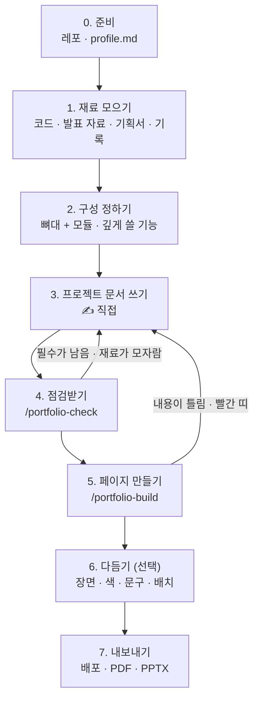

# 포트폴리오 만들기 가이드 — 재료에서 제출까지

[도구 문서](tools/README.md)가 **설명서**(명령마다 자세한 사용법)라면, 이 문서는 **길 안내**입니다.
포트폴리오가 무엇이고 무엇을 써야 하는지는 [포트폴리오와 프로젝트 문서](1-portfolio.md)를 먼저 읽으세요.
무엇을 어떤 순서로 하는지, 단계마다 무엇이 들어가고 무엇이 나오는지, 그 단계가 끝났는지 어떻게 아는지를 적었습니다.



가장 오래 걸리고 가장 중요한 곳은 **3 ↔ 4의 반복**입니다. 나머지 단계는 명령 한두 번이면 끝납니다.

---

## 먼저 알아 둘 것

### 누가 무엇을 하나요

| 하는 일 | 내가 | Claude가 |
|---|---|---|
| 프로젝트 문서 | **직접 씁니다** | 점검하고, 모자란 자료를 알려 줍니다. 대신 써 주지 않습니다 |
| 재료 | 질문에 답합니다 | 코드·커밋·발표 자료에서 **확인되는 사실**만 뽑습니다 |
| 페이지 데이터(`data/`) | "확인해 주세요"를 읽습니다 | 문서를 읽어 만듭니다. 없는 내용은 지어내지 않습니다 |
| 디자인 | 고릅니다 | 색·모양·배치를 입힙니다 |

Claude가 문서를 써 주지 않는 이유는 하나입니다. 이 문서의 목적이 *"내가 만든 것을 설명할 줄 안다"* 를 보여 주는 것이기 때문입니다.

### 고칠 곳은 언제나 소스입니다

| 바꾸고 싶은 것 | 고칠 곳 | 그다음 |
|---|---|---|
| 페이지에 나온 사실·설명 | `src/<폴더>/프로젝트문서.md` | `/portfolio-build` 다시 |
| 이름·연락처·자기소개·강조색 | `profile.md` | `/portfolio-build` 다시 |
| 슬라이드 장면의 배치(틀·그림 고르기·나누기·숨기기) | `/portfolio-edit` | 자동 반영 |
| 버튼·절 이름 문구 | `theme/strings.tsv` | 새로 고침 |
| 색·모양·글꼴 | `/portfolio-theme` | 새로 고침 |

`data/`와 렌더러(`index.html`·`project.html`·`doc.html`·`assets/`)는 직접 고치지 않습니다. 다시 만들면 사라집니다.

### 공개되는 것과 내 PC에만 남는 것

| 공개됩니다 (GitHub에 올라감) | 내 PC에만 남습니다 |
|---|---|
| `profile.md`, `src/<폴더>/`의 프로젝트 문서·`images/`·`code/`, `data/` | `src/<폴더>/_intake/`(재료집·내가 넣은 자료), `report.md`, `report-intake.md` |

기획서·회의록·AI 대화 기록처럼 남의 이름이 섞일 수 있는 자료는 `_intake/자료/`에 두세요.

---

## 0단계. 준비

- **하는 일**: 이 레포를 Fork해서 내 레포를 만들고, `profile.md`에 이름·연락처·자기소개를 씁니다([profile.md 채우기](tools/build.md#profilemd-채우기)).
- **끝났는지 확인**: 레포 폴더에서 Claude Code를 열었을 때 `/portfolio-`로 시작하는 명령이 보입니다.
- 샘플 프로젝트 4개는 구조를 참고하는 용도입니다. 내 프로젝트를 넣은 뒤에 지웁니다([샘플 프로젝트](3-writing.md#샘플-프로젝트)).

## 1단계. 재료 모으기

프로젝트 문서의 칸마다 필요한 자료가 다릅니다. 가진 것부터 모읍니다.

| 가진 자료 | 쓰이는 칸 | 넣는 법 |
|---|---|---|
| GitHub 레포(소스코드) | 개요 표 · 구조 · 핵심 코드 · 문제 해결 후보 | `/portfolio-intake <레포 주소>` — 직접 입력해야 실행됩니다 |
| 발표 자료(PPTX) | 개요 · 기능 설명 · 화면 | `/portfolio-intake <발표.pptx>` |
| 컨셉기획서·제안서 | 개요(왜 · 목표한 경험) · 플레이 소개 | `src/<폴더>/_intake/자료/`에 넣기 |
| 밸런스 표 · 레벨 배치 · 규칙 문서 | 기획 단위(규칙·수치의 관계) | 〃 |
| 회의록 · 비교 메모 · 커밋 메시지 | 고민과 선택 | 〃 |
| AI 대화 기록 · 프롬프트 파일 | AI 협업 | 〃 |
| 플레이테스트 메모 · 발표 피드백 | 회고 | 〃 |
| 스크린샷 · GIF · 시연 영상 | 화면 | `src/<폴더>/images/`에 넣기. 영상은 올리고 주소만 |

- 전체 표와 "자료가 없을 때 대신할 방법"은 [format/07-materials.md](../format/07-materials.md)에 있습니다.
- `/portfolio-intake`는 **재료집**(확인된 사실 + 내가 답할 질문)과 **촬영 목록**을 만듭니다. 문서를 만들어 주지는 않습니다([재료 모으기](tools/intake.md#재료-모으기)).
- **끝났는지 확인**: `/portfolio-check <폴더>`를 실행하면 **재료 점검표**가 나옵니다. 문서를 쓰기 전에도 실행할 수 있습니다. 필수 칸(왜 만들었는지 · 고민과 선택 · 회고, 팀이면 내 역할)에 "없음"이 없으면 다음 단계로 갑니다.

## 2단계. 구성 정하기

모든 문서는 같은 **뼈대**를 갖습니다.

```
개요 (무엇을 · 왜 · 목표한 경험)
기능 단위 — 구조 · 기능 · 고민과 선택   ← 기능 수만큼 반복
AI와 일한 방식
회고
```

여기에 아래 질문에 "예"인 것만 붙입니다.

| 질문 | 예라면 붙는 것 | 어디에 |
|---|---|---|
| 혼자 만들지 않았나요? | 팀 구성 · 내 역할 · 담당 파트 (**꼭 써야 합니다**) | 개요 뒤 |
| 무엇을 만들지를 내가 정했나요? | 한 판의 흐름 · 되풀이하는 행동 (선택) | 개요 뒤 |
| 계획을 세우고 중간에 바꾼 기록이 있나요? | 계획 대비 실제 · 범위를 줄인 결정 (선택) | 회고 안 |

그다음 **깊게 쓸 기능을 2~4개** 고릅니다.

- 가장 큰 기능이 아니라 **다르게 만들 수도 있었던 기능**을 고릅니다. 선택이 없었던 기능은 깊게 쓸 내용이 없습니다.
- 코드로 만든 기능이어도 되고, 직접 설계한 규칙·밸런스·레벨이어도 됩니다.
- 나머지 기능은 표 한 줄로 정리합니다. 기능마다 장을 하나씩 주면 문서도 슬라이드도 길어집니다.
- **끝났는지 확인**: 장 제목을 한 줄씩 적어 봤고, 장마다 "여기서 내가 정한 것"을 한 마디로 말할 수 있습니다.

## 3단계. 프로젝트 문서 쓰기

`src/<폴더>/프로젝트문서.md`에 직접 씁니다. 기준은 [format/02-tech-document.md](../format/02-tech-document.md), 견본은 [src/00-example-crafting/프로젝트문서.md](../src/00-example-crafting/프로젝트문서.md)입니다.

**권하는 순서** — 본문을 먼저 쓰고 개요를 나중에 쓰면 개요가 짧고 정확해집니다.

1. 기능 단위: 구조(그림 한 장)와 기능(코드 또는 규칙, 그리고 내 설명)
2. 고민과 선택: 대안 두 가지 이상과, 그때 왜 이 방법을 골랐는지
3. 문제 해결 사례: 그 문제가 생긴 기능의 장 안에
4. 개요: 무엇을 · 왜 만들었는지와 목표한 경험
5. AI와 일한 방식: 맡긴 것, 직접 판단한 것, 어떻게 확인했는지
6. 회고: 겪은 일 → 알게 된 것 → 다음에는

**쓰면서 지킬 것**

- **개요는 게임 개발을 모르는 사람도 읽을 수 있게** 씁니다. "What", "Why" 같은 소제목으로 나누지 말고 글로 풀어 씁니다.
- **제목은 내용의 이름으로** 짓습니다. "3.2 핵심 기능"이 아니라 "3.2 제작 한 번의 흐름"처럼요. 재료집의 절 이름은 질문을 묶은 틀일 뿐입니다.
- **같은 내용은 한 곳에만** 쓰고, 다른 곳에서는 "(3.2 참고)"처럼 가리킵니다.
- **코드는 핵심만** 보이고 왜 이 순서·이 구조인지 내 말로 설명합니다.
- **회고는 이 프로젝트에서 있었던 일로** 씁니다. 다른 프로젝트 문서에 그대로 붙여도 말이 되는 문장이면 다시 씁니다.
- **끝났는지 확인**: 4단계로 넘어가 점검을 받습니다. 다 쓴 뒤가 아니라 쓰는 중에 여러 번 받는 편이 좋습니다.

## 4단계. 점검받기

```text
/portfolio-check 1-my-game
```

"프로젝트 문서 점검해 줘"라고 말해도 됩니다. 결과는 `report.md`에 쓰입니다([쓰는 중에 점검받기](tools/check.md#쓰는-중에-점검받기)).

**리포트 읽는 순서**

1. **재료 점검표** — 칸마다 있음 · 부족 · 없음. "없음"인 칸은 무엇을 가져오면 되는지와 구하는 법이 적혀 있습니다.
2. **필수** — 없으면 포트폴리오의 목적을 이루지 못하는 것. 전부 고칩니다.
3. **권장** — 있으면 확실히 좋아지는 것. 할 수 있는 만큼 고칩니다.
4. **참고** — 다듬기. 슬라이드에서 작아질 그림이나 나뉠 코드도 여기서 미리 알려 줍니다.

- Claude는 **어디가, 무엇이 부족하고, 어떤 방향으로**까지만 알려 줍니다. 고친 문장을 대신 써 주지 않습니다.
- **끝났는지 확인**: 필수가 0건이고, 재료 점검표의 필수 칸에 "없음"이 없습니다. 아니면 3단계로 돌아갑니다.

## 5단계. 페이지 만들기

```text
/portfolio-build 1-my-game
```

"포트폴리오 만들어 줘"라고 말해도 됩니다. `data/`와 `report.md`가 만들어지고 미리보기가 열립니다([포트폴리오 데이터 만들기](tools/build.md#포트폴리오-데이터-만들기) · [미리보기](tools/build.md#미리보기)).

**만든 뒤 볼 것 세 가지**

1. **"확인해 주세요"** — Claude가 내 문서를 줄여 만든 문장 목록입니다. 내 의도와 다르면 문서를 고치고 다시 빌드합니다.
2. **장면 점검** — 슬라이드의 빨간 띠(잘린 내용, 원문을 찾지 못한 그림)는 필수입니다. 글자가 작은 다이어그램, 40장을 넘는 슬라이드는 참고(이 포크는 30~40장 권장)입니다.
3. **세 페이지를 직접 열어 보기** — 포트폴리오 페이지, 슬라이드, 프로젝트 상세 문서.

- 내용이 틀렸으면 `data/`를 고치지 말고 **문서를 고친 뒤 다시 빌드**합니다.
- **끝났는지 확인**: 필수 0건, "확인해 주세요"를 모두 읽었고, 세 페이지에 깨진 그림이 없습니다.

## 6단계. 다듬기 (선택)

| 하고 싶은 일 | 도구 |
|---|---|
| 슬라이드 장면 하나의 배치를 바꾸기 | [`/portfolio-edit`](tools/edit.md#슬라이드-장면-고치기) |
| 강조색 바꾸기 | `profile.md`의 강조색 → 다시 빌드 |
| 버튼·절 이름 문구 바꾸기 | [`theme/strings.tsv`](tools/design.md#문구-바꾸기) |
| 다른 사이트 느낌으로 (색·모양·글꼴) | [`/portfolio-theme`](tools/design.md#다른-사이트-느낌으로-바꾸기) |
| 다른 사이트의 배치를 따라 하기 | [`/portfolio-layout`](tools/design.md#다른-사이트-배치-따라-하기) → [`/portfolio-custom`](tools/design.md#나만의-디자인-새로-만들기) |

장면을 고친 내용은 다시 빌드해도 남습니다. 다만 그 장면이 다루는 **절의 제목을 바꾸면** 풀리므로, 제목은 5단계 전에 정해 두는 편이 좋습니다.

## 7단계. 내보내기

| 내보낼 곳 | 방법 |
|---|---|
| 웹 주소 | commit · push 뒤 GitHub Pages 켜기 ([배포하기](tools/export.md#배포하기)) |
| 제출용 PDF | 포트폴리오 페이지의 [PDF로 저장] ([PDF로 제출하기](tools/export.md#pdf로-제출하기)) |
| PowerPoint | 슬라이드의 [PPTX로 저장] ([PPTX로 저장하기](tools/export.md#슬라이드를-pptx로-저장하기)) |

**내보내기 전 확인**

- [ ] `profile.md`가 예시 값(홍길동, you@example.com)이 아니다
- [ ] 샘플 프로젝트를 지웠다
- [ ] GitHub·시연 영상 링크가 실제로 열린다
- [ ] 리포트의 필수가 0건이고 "확인해 주세요"를 읽었다
- [ ] 배포된 주소에서 세 페이지를 열어 봤다 (그림 파일 이름의 대소문자가 다르면 배포된 곳에서만 깨집니다)

PPTX에서 고친 내용은 문서로 돌아오지 않습니다. 내용을 바꿀 일이 남았으면 문서를 먼저 고칩니다.

## 그 뒤

- **문서를 고쳤으면** `/portfolio-build`를 다시 실행하고 commit · push합니다.
- **템플릿이 새로 나왔으면** `/portfolio-update`를 직접 입력합니다. 렌더러·명령·기준만 바뀌고 내 문서와 데이터는 그대로입니다([템플릿 업데이트 받기](tools/update.md#템플릿-업데이트-받기)). 기준이 바뀌었을 수 있으니 받은 뒤 `/portfolio-check`를 한 번 더 실행합니다.

---

## 막혔을 때

| 상황 | 할 일 |
|---|---|
| 무엇부터 써야 할지 모르겠다 | `/portfolio-check <폴더>` — 재료 점검표가 가장 먼저 채울 칸을 알려 줍니다 |
| 리포트에 "고민과 선택 없음" | 기능마다 "다르게 만들 수 있었던 방법 두 가지"를 적어 봅니다([format/07](../format/07-materials.md)) |
| 회고가 "일반론"이라고 나온다 | 문서 앞에서 다룬 일 하나를 골라, 그 일에서 알게 된 것과 다음에 다르게 할 것을 씁니다 |
| AI를 쓰지 않았다 | "쓰지 않았다"고 한 줄 적으면 됩니다 |
| 페이지에 나온 내용이 틀렸다 | 문서를 고치고 `/portfolio-build` 다시 |
| 슬라이드에 빨간 띠가 있다 | 문서 제목이나 그림을 바꾼 뒤라면 `/portfolio-build` 다시. 고친 장면이라면 `/portfolio-edit` |
| 다이어그램 글자가 너무 작다 | 문서에서 그림을 둘로 나누거나 방향(LR ↔ TD)을 바꿉니다. 장면 틀을 바꿔서는 커지지 않습니다 |
| 슬라이드가 40장을 넘는다 | 필요한 장면이면 그대로 둡니다. 줄이려면 `/portfolio-edit`로 숨기거나 합칩니다(이 포크 규칙) |
| 페이지가 빈 화면이다 | 파일을 더블클릭하지 말고 미리보기로 엽니다([문제 해결](troubleshooting.md#문제-해결)) |

## 자주 하는 실수

- **모든 기능을 같은 깊이로 씁니다.** 기능 목록이 되고, 정작 판단이 보이지 않습니다.
- **재료집의 절 이름을 그대로 제목으로 씁니다.** "시스템 구조", "핵심 기능", "What", "Why"는 질문을 묶은 틀입니다.
- **개요에서 한 말을 기능 장과 회고에서 다시 합니다.** 한 곳에 쓰고 가리킵니다.
- **회고에 "많이 배웠다", "협업이 중요했다"만 씁니다.** 무슨 일이 있었는지가 빠져 있습니다.
- **`data/`를 직접 고칩니다.** 다음 빌드에서 사라집니다.
- **다 쓴 뒤에 한 번만 점검받습니다.** 쓰는 중에 받아야 방향을 일찍 고칩니다.
