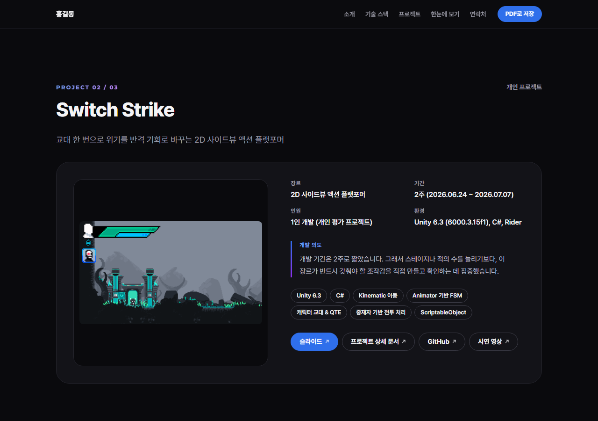
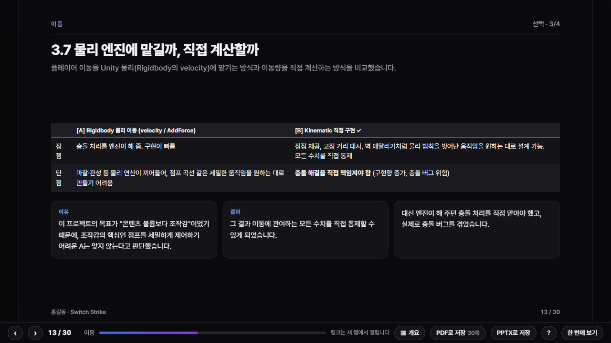
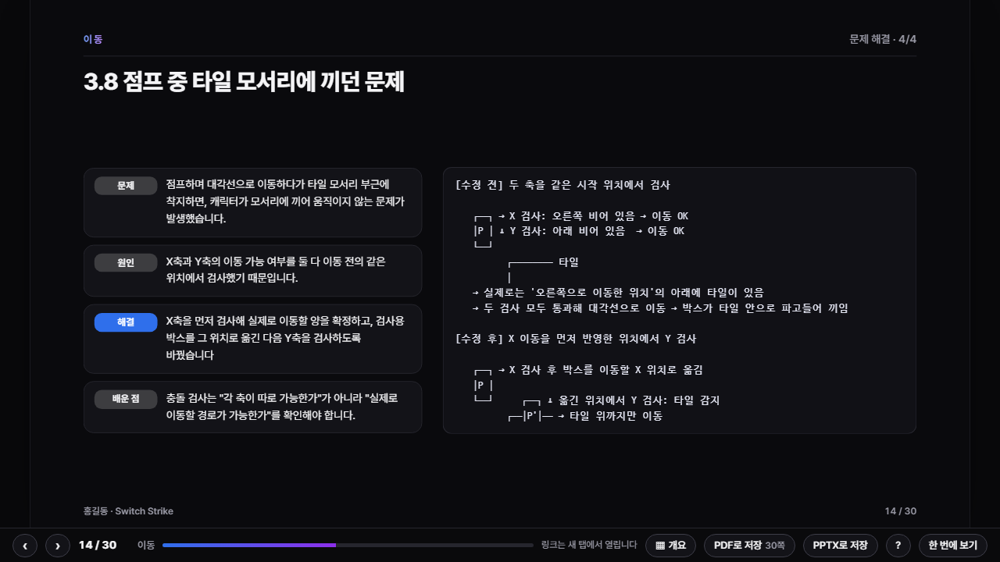
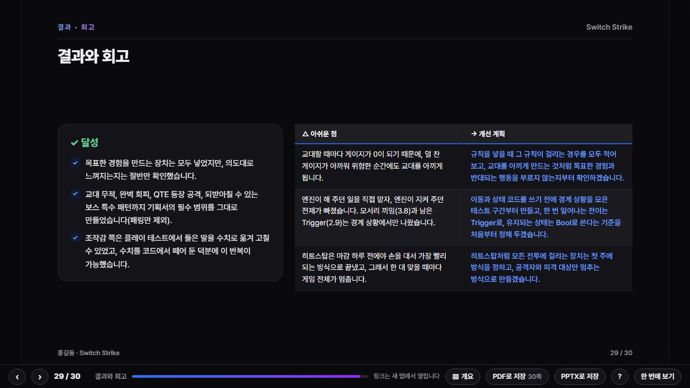

# 프로젝트 문서 쓰는 법

프로젝트 문서를 어떤 뼈대로 쓰는지, 칸마다 어떻게 쓰면 좋은지, 쓴 글이 페이지에서 어떻게 보이는지를 모았습니다.
프로젝트 문서가 무엇이고 왜 직접 쓰는지는 [포트폴리오와 프로젝트 문서](1-portfolio.md)에, 판정 기준 전체는 [format/02-tech-document.md](../format/02-tech-document.md)에 있습니다.

## 프로젝트 문서와 소스 넣기

```
src/
└── 1-my-game/              ← 프로젝트 하나 = 폴더 하나 (앞 번호로 순서 정렬)
    ├── 프로젝트문서.md      ← 프로젝트 문서 (폴더 바로 아래 .md 하나. README.md여도 됩니다. 예전 이름 기술문서.md도 그대로 읽습니다)
    ├── images/             ← 스크린샷·GIF (4~6장 권장)
    ├── code/               ← (선택) 핵심 소스코드 .cs — 문서의 코드와 실제 코드가 맞는지 점검에 씀
    └── deck-edits.json     ← (자동) /portfolio-edit로 슬라이드 장면을 고치면 생김. 지우지 말고 함께 커밋
```

- **폴더 이름이 페이지 주소가 됩니다**(`project.html?p=1-my-game`). 영문 소문자·숫자·하이픈을 권하고, 링크를 공유한 뒤에는 바꾸지 마세요.
- 이름이 `_`로 시작하는 폴더(예: `src/_draft/`)는 무시됩니다. 초안 보관용으로 쓰세요.
- 프로젝트 문서가 아직 없다면 → [재료 모으기](tools/intake.md#재료-모으기) · 쓰는 중에 점검받으려면 → [점검받기](tools/check.md#쓰는-중에-점검받기)

## 뼈대

모든 프로젝트 문서는 같은 뼈대를 갖습니다. 가장 짧은 견본은 [src/00-example-crafting/프로젝트문서.md](../src/00-example-crafting/프로젝트문서.md)입니다.

| 칸 | 무엇을 쓰나요 |
|---|---|
| 개요 | 무엇을 · 왜 만들었나. **목표한 경험** 한 문장. 장르·기간·인원·환경·링크를 담은 개요 표 |
| 기능 단위 — 구조 | 어떻게 구성했나. 그림 한 장 |
| 기능 단위 — 기능 | 어떻게 동작하나. 코드(또는 규칙·수치)와 내 설명 |
| 기능 단위 — 고민과 선택 | 왜 이 방법인가. 다른 방법과 비교 |
| AI와 일한 방식 | AI에게 맡긴 것과 직접 판단한 것, 결과를 어떻게 확인했는지 (쓰지 않았으면 한 줄) |
| 회고 | 무엇을 겪었고, 무엇을 알게 됐고, 다음에는 무엇을 다르게 할지. 목표한 경험이 어떻게 됐는지 |

- **기능 단위는 기능 수만큼 반복**합니다. 다만 모든 기능을 깊게 쓰지 않습니다. **다르게 만들 수도 있었던 기능 2~4개**만 깊게 쓰고 나머지는 표 한 줄로 정리합니다.
- 기능은 **코드로 설명해도, 게임 디자인(규칙·수치·플레이 화면)으로 설명해도** 됩니다.

여기에 해당하는 것만 붙입니다.

| 붙이는 것 | 언제 | 무엇을 더 쓰나요 |
|---|---|---|
| 팀과 내 역할 | 혼자 만들지 않았다 (**해당하면 꼭**) | 팀 구성 · 내 역할 · 담당 파트. 기능은 내가 만든 부분만 |
| 플레이 소개와 코어 루프 | 무엇을 만들지를 내가 정했다 (선택) | 한 판의 흐름 · 되풀이하는 행동. 기능마다 목표한 경험과의 연결 한 줄 |
| 일정 | 계획을 세우고 중간에 바꾼 기록이 있다 (선택) | 회고 안에 계획 대비 실제 · 범위를 줄인 결정 |

선택으로 붙이는 두 가지는 **붙였을 때만 점검**합니다. 안 붙여도 지적받지 않습니다.

## 칸마다 쓰는 법

### 개요

게임 개발을 모르는 사람도 읽을 수 있게 씁니다. "What", "Why" 같은 소제목으로 나누지 말고 글로 풀어 씁니다.

👎 틀의 이름이 제목과 괄호에 드러나고, 구현 용어로 시작합니다.

```markdown
### 1.1 무엇을 만들었나 (What)
이 문서는 유니티(C#) 생존 게임의 아이템 크래프팅 시스템을 설계·구현한 과정을 설명합니다.

### 1.2 왜 만들었나 (Why)
초기에는 제작 로직이 UI 코드 안에 뒤섞여 있어 … 테스트하기 어려웠습니다. (문제)
이를 해결하기 위해 제작 로직을 UI와 분리하고 … 구조를 도입했습니다. (목적)
```

👍 무엇을, 왜, 무엇을 목표로 했는지가 글 안에서 이어집니다.

```markdown
유니티(C#) 생존 게임에 들어가는 아이템 제작(크래프팅) 시스템입니다.
플레이어가 가진 재료를 써서, 레시피에 정해진 결과물을 확률적으로 만듭니다.

처음에는 제작 규칙을 처리하는 코드가 화면(UI) 코드 안에 섞여 있었습니다. 그래서 새 레시피를
추가할 때마다 화면 코드를 고쳐야 했고, 확률과 실패 처리가 맞게 동작하는지 테스트하기 어려웠습니다.

목표는 두 가지였습니다. 레시피를 추가하는 사람은 화면 코드를 건드리지 않고 데이터만 넣으면 되고,
플레이어는 제작에 실패해도 재료의 절반은 지킬 수 있어야 합니다.
```

- **목표한 경험**은 장르 이름이나 기능 목록이 아닙니다. "퍼즐 게임" ✗ → "쫓기는 긴장 속에서 한 수 앞을 읽는 재미" ○
- 게임이 아닌 시스템·툴이라면 '유저'는 그것을 쓰는 사람(플레이어나 다른 개발자)입니다.

### 기능 단위 — 구조와 기능

- **구조는 그림 한 장과 "왜 이렇게 나눴는지"** 입니다. "MVC를 썼다" ✗ → "UI 변경이 잦아 로직과 분리했다" ○
- **코드는 핵심만** 보입니다(한 블록 50줄 안팎). 수백 줄을 붙여 넣지 않고, 왜 이 순서·이 구조인지 내 말로 설명합니다. 코드 안에 이유를 주석으로 남겨도 좋습니다.

```csharp
// (Why) 소비 전에 먼저 검증 → 재료 유실 없이 안전하게 중단
if (!inventory.HasIngredients(recipe.Ingredients))
```

- **직접 설계한 규칙·밸런스·레벨**을 설명할 때는 코드 대신 규칙과 수치의 관계(표·그림)와 플레이에서 보이는 모습(화면·영상)을 씁니다.

### 고민과 선택

읽는 사람이 가장 보고 싶어 하는 부분입니다. 틀려도 괜찮고, **판단의 근거**가 중요합니다.

👎 "결과 전파에는 이벤트를 사용했습니다." — 무엇과 비교했는지, 왜 골랐는지가 없습니다. "그냥", "검색에 나와서", "AI가 그렇게 짜 줘서"도 같습니다.

👍 대안을 나란히 놓고, 이 프로젝트의 사정으로 고른 이유와 치른 대가를 씁니다.

```markdown
| | 대안 A. Manager가 UI를 직접 갱신 | 대안 B. 이벤트 발행 |
|---|---|---|
| 장점 | 구현이 직관적이고 빠름 | Manager는 "결과가 나왔다"만 알림 → 구독자만 추가하면 됨 |
| 단점 | 결과를 쓰는 곳이 늘 때마다 Manager 수정 | 흐름이 코드에 직접 안 보여 추적이 조금 어려움 |

**대안 B(이벤트)를 선택했습니다.** 제작 결과를 소비할 대상이 UI 하나로 끝나지 않고
(연출·사운드·업적 등) 늘어날 것으로 판단했기 때문입니다.
'이벤트 흐름 추적의 어려움'이라는 대가는, 구독·해제를 짝지어 관리하는 규칙으로 상쇄했습니다.
```

### 문제 해결 사례

그 문제가 생긴 **기능의 장 안에** 씁니다. 문제 → 원인 → 해결 → 달라진 점 순서입니다.

```markdown
| 문제 | 제작 실패 시에도 재료가 100% 사라짐 |
| 원인 | 확률 판정 결과와 무관하게 소비율을 `1.0f` 고정으로 넘기고 있었음 |
| 해결 | `success ? 1.0f : 0.5f`로 소비율을 분기하고, 이 규칙을 테스트로 고정 |
| 결과 | 실패 페널티(50% 소비) 규칙이 의도대로 동작, 회귀 방지 |
```

### AI와 일한 방식

👎 "AI를 활용해 효율적으로 개발했습니다." — 무엇을 맡겼는지도, 무엇을 직접 판단했는지도 없습니다.

👍 맡긴 것, 직접 판단한 것, 확인한 방법, 잘 된 것과 안 된 것을 씁니다.

```markdown
| 맡긴 것 | 확률 성공·실패 경로의 단위 테스트 초안 |
| 직접 판단한 것 | 결과를 이벤트로 알린다는 결정, 실패하면 재료를 50%만 소비한다는 규칙 |
| 확인한 방법 | AI가 쓴 테스트를 한 줄씩 읽고, 고정값을 넣어 성공·실패 경로를 직접 실행 |
```

AI를 쓰지 않았으면 "쓰지 않았다"고 한 줄 적으면 됩니다.

### 회고

형식은 자유입니다. **이 프로젝트에서 있었던 일**로 씁니다.

👎 "협업의 중요성을 느꼈다." · "많이 배웠다."

👍 "씬 파일 병합 충돌이 마감 주에 몰렸다. 다음에는 씬을 담당자별로 나누고 시작하겠다."

스스로 점검하는 질문은 하나입니다. **"이 문장을 다른 프로젝트 문서에 그대로 붙여도 말이 되는가?"** 말이 되면 다시 씁니다.

목표한 경험이 어떻게 됐는지도 여기서 돌아봅니다. 확인하지 못했으면 못 했다고 씁니다.

### 제목

제목은 **내용의 이름**으로 짓습니다. 재료집이나 이 문서의 칸 이름("핵심 기능", "고민과 선택")은 점검하는 틀의 이름이지 제목이 아닙니다.

| 👎 | 👍 |
|---|---|
| 1.1 무엇을 만들었나 (What) · 1.2 왜 만들었나 (Why) | (소제목 없이 개요 글 안에 풀어 씀) |
| 2. 기능 A - 물리 기반 염동력 | 2. 기능 - 염동력 |
| 2.2 사용법 - 조작 입력과 물체 상태 | 2.2 조작과 물체 상태 |
| 2.3 핵심 기능 - 화면 중심 기반 타겟 선택 | 2.3 조준과 선택 |

같은 내용은 한 곳에만 쓰고, 다른 곳에서는 "(3.2 참고)"처럼 가리킵니다.

## 이렇게 쓰면 이렇게 보입니다

| 프로젝트 문서에 쓴 것 | 포트폴리오 페이지 | 슬라이드 |
|---|---|---|
| 제목 바로 아래의 `> 한 줄 소개` | 프로젝트 소개의 한 줄 | 표지 |
| 개요 표 (장르·기간·인원·환경·링크) | 프로젝트 소개의 정보 칸 | 표지의 정보 |
| 왜 만들었는지를 쓴 글 | **개발 의도** | 표지의 개발 의도 |
| `` | 프로젝트 소개의 큰 그림 | 표지 |
| 기능 장과 그 안의 고민과 선택 | **기능 소개** 2~4개 | 구조 · 구현 · 선택 장면 |
| 문제 해결 사례 | — | 문제 해결 장면 |
| 회고 | — | 결과와 회고 장면 |
| `##` 제목 | — | 슬라이드의 장과 목차 |

| 프로젝트 소개 (한 줄 소개 · 정보 · 개발 의도) | 선택 장면 (비교 표 + 선택 이유) |
|---|---|
|  |  |

| 문제 해결 장면 | 결과와 회고 장면 |
|---|---|
|  |  |

페이지가 잘 나오게 하는 요령입니다.

- **한 줄 소개**: 문서 제목 바로 아래에 `> 한 줄 소개` 인용문을 두면 그대로 실립니다(없으면 Claude가 "무엇을 만들었는지"를 줄여 만들고 "확인해 주세요"에 올림).
- **개요 표**: 장르 · 개발 기간 · 개발 인원 · 개발 환경 · 링크를 표로 두면 프로젝트 소개의 정보 칸이 됩니다.
- **대표 이미지**: ``처럼 대체 글을 "대표 이미지"로 쓰면 그 그림이 대표 이미지가 됩니다(없으면 문서의 첫 그림).
- **이미지 경로**: ``처럼 **상대경로**로, 파일 이름의 **대소문자까지 정확히** 씁니다(GitHub Pages는 `Cover.png`와 `cover.png`를 다르게 봅니다).
- **링크**: GitHub·시연 영상 링크는 실제 주소로 씁니다(`#`이나 빈 링크는 리포트에 나옵니다). 영상은 YouTube 등에 올리고 짧은 주소(`youtu.be/…`)를 쓰면 PDF에서도 읽기 편합니다.
- **다이어그램**: ` ```mermaid ` 코드 블록으로 쓰면 세 페이지가 그대로 그려 줍니다(그림 파일로 바꿀 필요 없음). 노드는 10개 이하를 권하고, 위아래로 너무 길면 슬라이드에서 글자가 작아집니다.
  종류는 설명하는 것에 맞춥니다 — 데이터와 필드는 **ERD**, 여러 클래스를 차례로 부르는 흐름은 **시퀀스**, 한 규칙 안의 갈림길은 **플로우차트**, 상태가 바뀌는 것은 **상태**, 상속·역할 분담은 **클래스**([format/03](../format/03-diagrams.md)). 상속을 보이는 클래스 그림에는 상속 관계에 있는 클래스만 넣습니다.
- **코드**: 20줄을 넘는 코드 블록은 슬라이드에서 두 장면으로 나뉩니다(상세 문서에는 전체가 그대로). 발표에서 보일 핵심이 어디인지 생각해 두세요.
- **팀 프로젝트**: "내 역할 / 담당"을 꼭 적으세요(없으면 리포트 **필수**).
- 슬라이드의 장은 문서의 `##` 제목 순서로 만들어집니다. 기능마다 장을 하나씩 주면 슬라이드도 길어집니다.

## 샘플 프로젝트

`src/`에 들어 있는 **샘플 프로젝트 4개는 참고용**입니다. 내 프로젝트를 넣었다면 **모두 지우세요**.

| 샘플 | 참고할 점 |
|---|---|
| `00-example-crafting/` | 가이드 관통 예제. 가장 짧은 **뼈대(기능 하나)** + `code/` 폴더 예시 |
| `0-Tidy-Mommy/` | 선배 수강생 작품 — **뼈대(기능별 반복)**, 고민과 선택 비교 표 |
| `1-action-platformer/` | 선배 수강생 작품 — **뼈대(기능별 반복)**, 문제 해결 사례·스크린샷 구성 |
| `2-Yggdrasil/` | 선배 수강생 작품 — **뼈대 + 팀과 내 역할**, 내 역할 분리 |

> 선배 수강생 작품은 **작성자의 동의를 받아** 싣습니다. 구조와 서술 방식을 참고하되, 내용을 베끼지 마세요.

탐색기에서 네 폴더를 지운 뒤 `/portfolio-build`를 실행하면 `data/projects/`의 샘플 데이터도 함께 정리됩니다(지우기 전에 목록을 알려 줍니다). 터미널로 지우려면:

```bash
git rm -r -q src/00-example-crafting src/0-Tidy-Mommy src/1-action-platformer src/2-Yggdrasil
```
