# 참고

## 세 페이지 자세히

이 README에서 부르는 이름(슬라이드·프로젝트 상세 문서·결과와 회고·[슬라이드 열기] 등)은 **기본 문구**입니다. [문구 바꾸기](tools/design.md#문구-바꾸기)로 바꾸면 세 페이지에 함께 바뀝니다.

### 포트폴리오 페이지

`index.html` — 아래로 읽는 한 페이지이고, A4로 인쇄하면 **제출용 PDF**가 됩니다.

| 맨 위 — 이름·정체성·연락처 | 프로젝트 소개 |
|---|---|
| 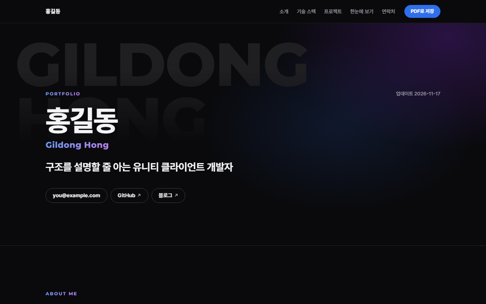 | 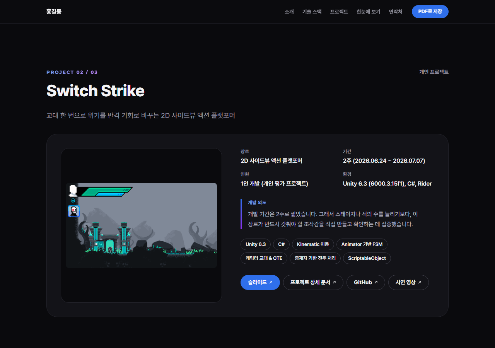 |

| 기능 소개 | 휴대폰 화면 |
|---|---|
| 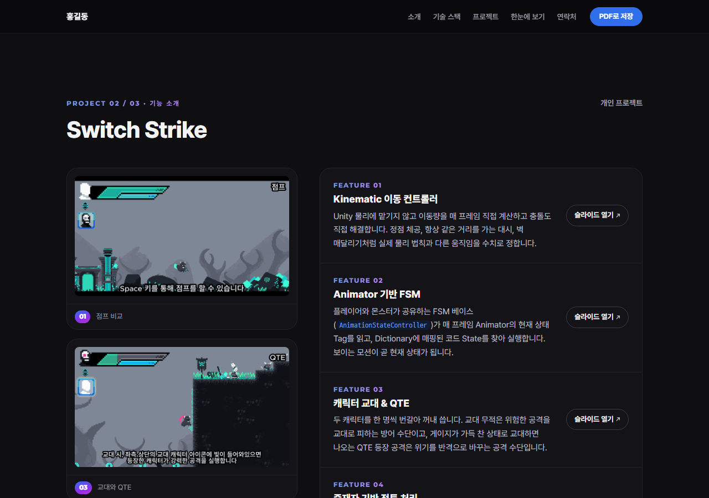 | 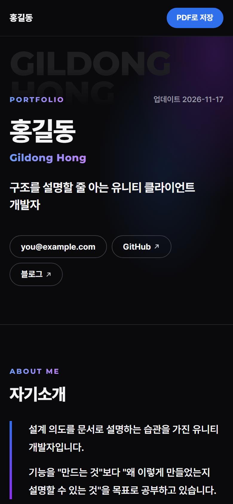 |

#### 순서와 구성

- 순서: 머리(이름·정체성·연락처) → 자기소개 → 기술 스택(근거 프로젝트와 함께) → 프로젝트마다 **소개 · 기능 소개** → 한눈에 보기(프로젝트 요약) → 연락처.
- **소개**: 대표 이미지, 장르·기간·인원·환경 같은 정보, 개발 의도, 태그, 링크, **[슬라이드]**·**[프로젝트 상세 문서]** 버튼.
- **기능 소개**: 화면을 왼쪽에 모으고, 기능 설명과 <b>[슬라이드 열기 ↗]</b>를 오른쪽 목록에 둡니다(프로젝트 문서에 핵심 구현 절이 없으면 소개만).
- 머리 막대에서 절로 바로 갈 수 있고, 주소창의 `#<절 id>`(예: `#p-1-my-game`)까지 복사하면 그 절로 가는 링크가 됩니다. 예전 슬라이드형 포트폴리오 페이지의 주소(`#s=…`)도 같은 절로 열립니다.

> **이력서·자기소개서 절은 아직 없습니다.** 여러분이 직접 쓴 원천이 생기면 나중에 포트폴리오 페이지에 추가됩니다(작성 방법은 추후 안내).
> 그전까지 Claude가 대신 써 넣거나 빈 자리를 만들지 않습니다.

### 슬라이드

`project.html?p=<폴더 이름>` — 프로젝트 문서를 바탕으로 한 **발표용** 16:9 슬라이드입니다.

| 표지 | 구조·흐름 (그림 + 번호 카드) |
|---|---|
| 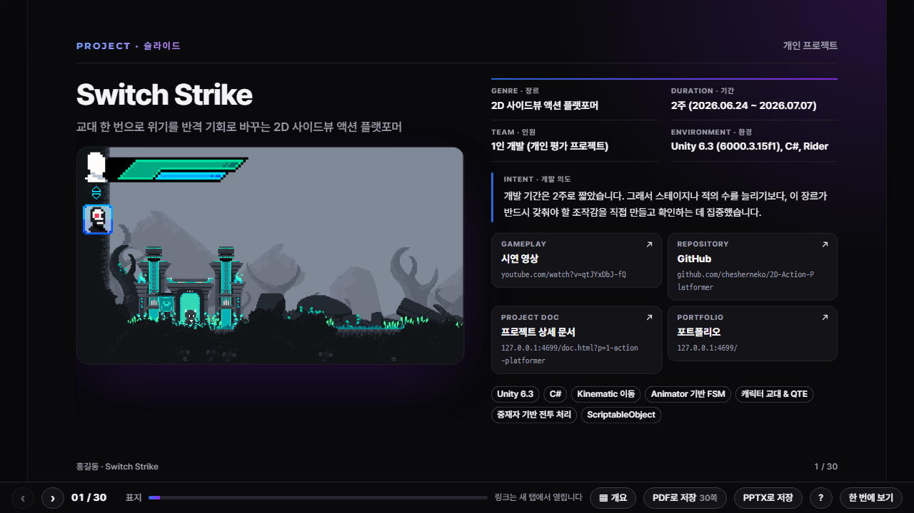 | 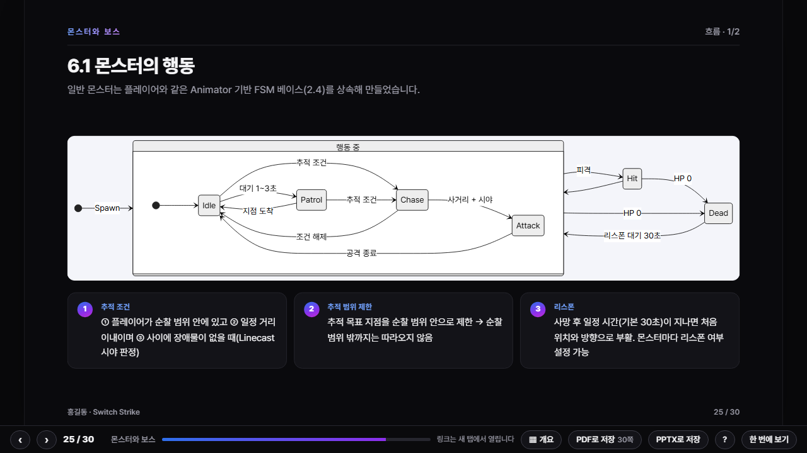 |

| 구현 (코드 + 설명) | 고민과 선택 (비교 표) |
|---|---|
| 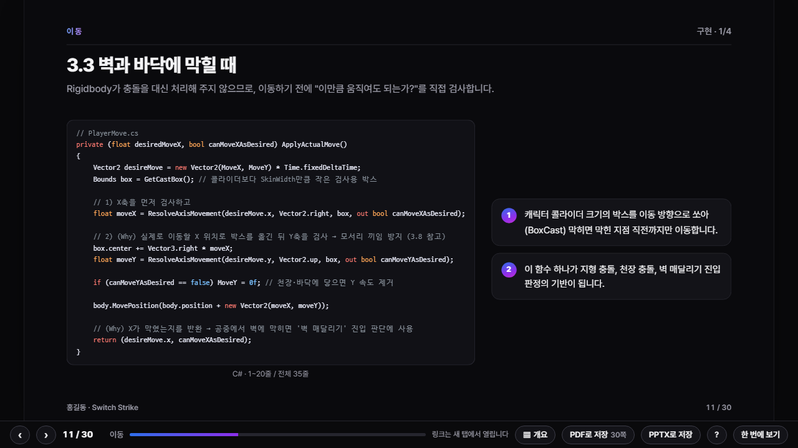 | 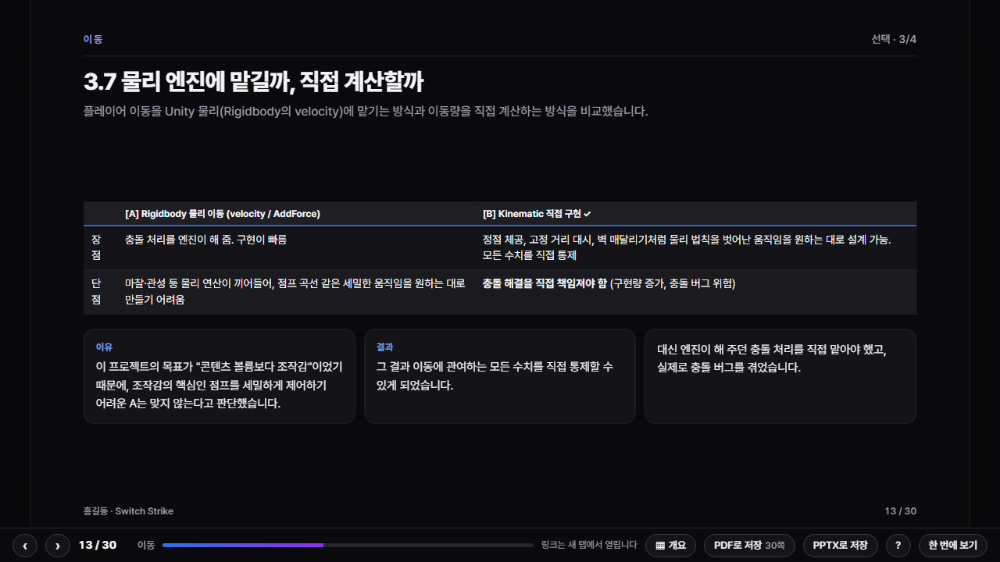 |

| 문제 해결 | 결과와 회고 |
|---|---|
| 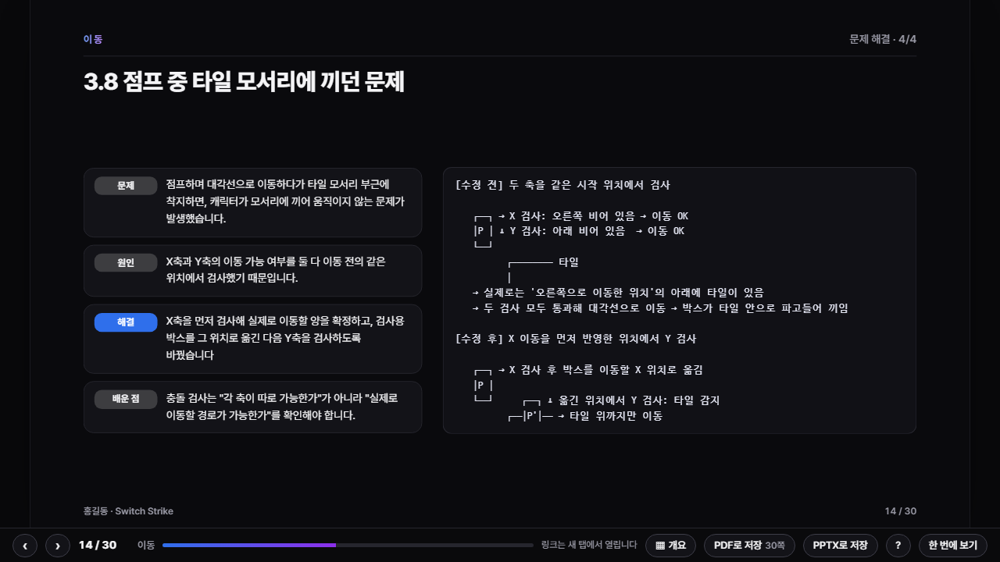 | 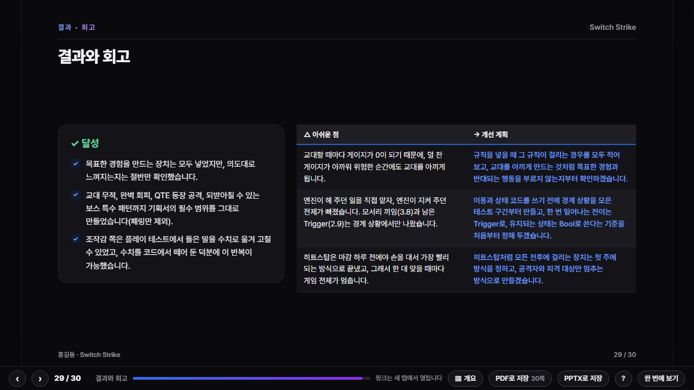 |

#### 장면 순서와 구성

- 순서: 표지 → 목차 → 장마다 [장 표지 → 그 장의 장면들] → 결과와 회고 → 맺음.
- 장의 순서는 프로젝트 문서의 장(`##`) 순서와 같고, 그림·코드·표는 프로젝트 문서 원문 그대로 가져옵니다(옮겨 적지 않음). 어느 절을 어떤 장면으로 만들지는 `/portfolio-build`가 프로젝트 문서를 읽고 고르며, 15~30장을 목표로 합니다. 장이나 절이 많아 넘칠 때는 장면을 줄이되, 이미 커밋한(공유했을 수 있는) 판이 30장 이하였으면 그 장면 주소를 모두 남깁니다. 긴 코드·표·회고가 한 장에 안 들어가 두 장으로 나뉜 것은 장면이 늘어난 것이 아니라서 이 30장에 세지 않습니다.
- 20줄이 넘는 코드나 큰 표는 "계속" 장면으로 나뉩니다. 내용이 적은 장면은 세로 가운데에 놓입니다.
- 프로젝트 상세 문서로 가는 링크는 **표지와 맺음 장면에만** 있습니다.

아래 띠에는 지금 장 번호(`03 / 12`)·섹션 이름·진행 막대가 보이고, 이런 버튼이 있습니다.

| 버튼 | 하는 일 |
|---|---|
| **개요** (▦) | 모든 장면을 격자로 보고 골라서 이동합니다(장면마다 id도 보입니다) |
| **한 번에 보기** | 모든 장면을 세로로 이어서 봅니다. `Ctrl+F` 찾기가 모든 장에 닿습니다. 고른 보기는 다음에 열 때도 유지됩니다 |
| **PDF로 저장** | 프로젝트별 16:9 PDF(장면 1개 = 1쪽) → [PDF로 제출하기](tools/export.md#pdf로-제출하기) |
| **PPTX로 저장** | PowerPoint에서 글·표·코드를 하나씩 고칠 수 있는 파일 → [슬라이드를 PPTX로 저장하기](tools/export.md#슬라이드를-pptx로-저장하기) |

#### 넘기기 · 장면 주소 · 좁은 화면

| 기기 | 방법 |
|---|---|
| 키보드 | `→` · `↓` · `Space` · `PageDown` 다음 / `←` · `↑` · `Shift+Space` · `PageUp` 이전 / `Home` · `End` 처음 · 끝 / `O` 개요 / `F` 전체 화면 |
| 마우스 · 트랙패드 | 휠을 한 번 굴리면(트랙패드를 한 번 밀면) 한 장 넘어갑니다. 아래 띠의 `‹` `›`나 슬라이드 바깥 여백을 눌러도 됩니다. 슬라이드 위를 누르는 것으로는 넘어가지 않습니다(글자를 고를 수 있게) |
| 휴대폰 · 태블릿 | 좌우로 밀기. 세로 화면에서는 위아래로 밀어도 됩니다(위로 밀면 다음). 슬라이드 왼쪽 30%를 탭하면 이전, 나머지를 탭하면 다음. 가로로 돌리면 더 크게 보입니다 |

- 주소창의 `#s=…`까지 복사하면 그 장면으로 바로 가는 링크가 됩니다. 같은 절을 다루는 장면은 다시 빌드해도 주소가 유지됩니다. 장면 고치기로 **숨긴** 장면의 주소는 같은 절의 남은 장면 → 그 장의 장 표지 → 목차 순으로 가까운 곳이 열리고, 다시 빌드로 **없어진** 장면(절이 없어지거나 장면 구성이 바뀜)의 주소는 목차가 열립니다.
- 휴대폰처럼 좁은 화면(폭 760px 이하)에서는 섹션 이름이 숨고(더 좁으면 진행 막대, `?`(저장 안내) 단추, PDF 버튼의 쪽 수, PPTX 버튼도), 버튼이 ▦(개요) · 전체(한 번에 보기, 한 번에 보기 중에는 슬라이드) · PDF(PDF로 저장) · PPTX(PPTX로 저장)로 짧게 보입니다.

### 프로젝트 상세 문서

`doc.html?p=<폴더 이름>` — `src/`의 프로젝트 문서 전문을 읽기 좋게 보여 주는 긴 문서입니다. 본문은 프로젝트 문서를 직접 읽으므로, 프로젝트 문서 본문을 고치면 다시 빌드하지 않아도 새로고침만으로 바뀝니다(머리의 제목 등은 `data/`에서 오므로 다시 빌드해야 바뀝니다).

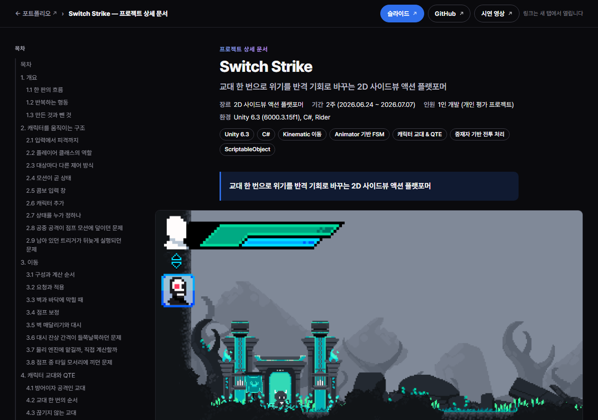

- 넓은 화면에서는 목차가 옆에 붙고, 휴대폰에서는 한 단으로 보입니다.
- 머리에 **[슬라이드 ↗]** 버튼이 있습니다.
- `Ctrl+P`로 A4 문서처럼 인쇄할 수 있습니다.

### 세 페이지 사이의 링크

- 포트폴리오 페이지 기능 소개의 <b>[슬라이드 열기 ↗]</b>는 그 기능을 다루는 장면으로 바로 갑니다(그 장면을 장면 고치기로 숨겼으면 그 장의 장 표지, 같은 절을 다루는 장면이 없으면 슬라이드 표지).
- 다른 페이지나 외부 사이트로 가는 링크(↗ 표시)는 **새 탭**에서 열립니다. 같은 페이지 안의 이동(목차·절 이동, 슬라이드 넘기기)은 지금 탭에서 움직입니다.

## 폴더 구조

### 레포의 폴더와 파일 — 누가 쓰고, 무엇이 배포되나

```
├── profile.md            ✍ 내 정보 (직접 작성)
├── src/                  ✍ 프로젝트 소스 (직접 작성)
│   └── <번호-이름>/       ·  프로젝트문서.md · images/ · code/ · deck-edits.json(/portfolio-edit) · _intake/(/portfolio-intake의 재료집 + 내가 넣은 자료/, git 제외)
├── theme/theme.css       🎨 내 테마 (/portfolio-theme가 씀, 비어 있으면 기본 테마)
├── theme/strings.tsv     ✍ 문구 표 — 절 이름·버튼·라벨 문구 (맨 끝 "내 문구" 칸을 직접 고침)
├── theme/layout.json     🎨 배치 레퍼런스 (/portfolio-layout이 씀, /portfolio-custom이 읽음 · 선택)
├── data/                 🤖 /portfolio-build가 생성 (직접 고치지 않기, 커밋은 함)
├── custom/               🎨 /portfolio-custom 결과 (선택)
├── index.html            🖥 포트폴리오 페이지 (아래로 읽는 한 페이지, A4 인쇄 = 제출용 PDF)
├── project.html          🖥 슬라이드 (?p=폴더 이름)
├── doc.html              🖥 프로젝트 상세 문서 (?p=폴더 이름)
├── assets/               🖥 세 페이지의 스타일·스크립트 (고치지 않기)
├── format/               📏 가이드 판정 기준 — Claude가 점검할 때 읽는 기준표 (사람이 읽어도 좋습니다)
├── .claude/skills/       ⚙ Claude 명령 정의 (portfolio-build · check · edit · theme · layout · custom · intake · update)
├── docs/                 📘 사람이 읽는 문서 — 전체 흐름 · 문서 쓰는 법 · 도구 설명 · 문제 해결
├── CLAUDE.md             ⚙ Claude가 지키는 규칙
├── report.md             📋 점검 리포트 (git에 올라가지 않음)
└── report-intake.md      📋 /portfolio-intake 리포트 (git에 올라가지 않음)
```

✍ 내가 쓰는 것 · 🤖 Claude가 만드는 것 · 🎨 디자인 · 🖥 렌더러(템플릿 업데이트로 바뀜) · 📏 ⚙ 기준과 규칙 · 📋 내 PC에만

## 스킬 구성 (.claude/skills/)

명령 하나가 스킬 폴더 하나입니다. 폴더 안의 `SKILL.md`가 Claude가 따르는 절차이고, 스크립트는 그 절차 안에서 Claude가 실행합니다(직접 실행할 일은 없습니다).

| 스킬 폴더 | 실행 | 들어 있는 파일 | 필요한 것 | 쓰는 파일 |
|---|---|---|---|---|
| `portfolio-intake` | ✋ 직접 입력 | `SKILL.md` · `templates.md`(재료집·촬영목록·발표자료 형식) · `pptx-extract.py`(.pptx에서 꺼내기) | Git(레포일 때) · Python(.pptx일 때) | `src/<폴더>/code/`·`_intake/`, `report-intake.md` |
| `portfolio-check` | 말로도 | `SKILL.md` | — | `report.md` |
| `portfolio-build` | 말로도 | `SKILL.md` · `schema.md`(`data/` 형식) · `deck-edits.py`(장면 고치기 반영) | Python(권장) · 미리보기 | `data/`, `report.md` |
| `portfolio-edit` | 말로도 | `SKILL.md`(build 폴더의 `deck-edits.py`·`schema.md`를 씀) | Python(필요) · 미리보기 | `src/<폴더>/deck-edits.json`, `data/projects/<폴더>.json` |
| `portfolio-theme` | 말로도 | `SKILL.md` · `rules.md`(손잡이·뽑는 규칙) · `sample-colors.py` · `check-theme.py` · `theme-template.css` · `theme-default.css` | Python(점검) · 미리보기 | `theme/theme.css` |
| `portfolio-layout` | 말로도 | `SKILL.md` · `measure-layout.js`(레퍼런스 페이지에서 배치 재기) | 브라우저 도구(주소일 때) | `theme/layout.json` |
| `portfolio-custom` | ✋ 직접 입력 | `SKILL.md` | 미리보기 | `custom/index.html` |
| `portfolio-update` | ✋ 직접 입력 | `SKILL.md` | Git | 렌더러·명령·기준 + 업데이트 커밋 1개 |

## 기준 문서 (format/)

| 파일 | 내용 |
|---|---|
| [01-portfolio.md](../format/01-portfolio.md) | 세 페이지에 무엇이 들어가는지, 체크리스트 |
| [02-tech-document.md](../format/02-tech-document.md) | 프로젝트 문서 5단 구조(뼈대), 선택 모듈 [팀]·[기획]·[일정], 있으면 좋은 항목, 리포트 등급 |
| [03-diagrams.md](../format/03-diagrams.md) | 다이어그램 고르기·점검, 다이어그램 요청 문장 틀 |
| [04-layout-patterns.md](../format/04-layout-patterns.md) | 장면 틀·문서 패턴과 레이아웃 원칙 |
| [05-custom-page-prompts.md](../format/05-custom-page-prompts.md) | `/portfolio-custom` 규칙 |
| [06-deploy.md](../format/06-deploy.md) | GitHub Pages 배포·문제 해결 |
| [07-materials.md](../format/07-materials.md) | 뼈대 칸마다 필요한 자료와 자료가 없을 때 대신할 방법, 재료 점검표 형식 |

## 지키는 원칙

- **지어내지 않습니다.** 페이지의 모든 내용은 `profile.md`·프로젝트 문서·코드에서 찾을 수 있는 사실입니다. 없으면 비워 두고 리포트로 알립니다.
- **이해 없이 복붙 금지.** Claude가 줄인 문장은 "확인해 주세요"에 올라가고, 내가 이해·검증한 뒤에 씁니다.
- **고칠 곳은 소스.** 페이지가 마음에 안 들면 `src/`·`profile.md`를 고치고 다시 빌드합니다. 슬라이드 장면의 배치만 바꾸고 싶으면 `/portfolio-edit`(결과도 `src/`에 남음). PPTX로 저장해 PowerPoint에서 고친 것은 웹 페이지로 돌아오지 않습니다. 절 이름·버튼 문구는 `theme/strings.tsv`, 색·모양은 `/portfolio-theme` — 렌더러(`assets/`)는 고치지 않습니다.
- **법칙이 아닙니다.** `format/`의 기준은 목적(잘 읽히는 문서로 역량 증명)을 위한 수단입니다.

## 문서의 스크린샷 다시 찍기

`docs/img/`의 스크린샷은 샘플 프로젝트로 만든 실제 페이지를 찍은 것입니다. 렌더러나 샘플 데이터가 바뀌면 템플릿 유지관리자가 다시 찍습니다(수강생 레포에서는 실행할 필요가 없습니다).

```bash
node docs/img/capture.mjs
```

- Node 22 이상과 Chrome 또는 Edge가 필요합니다. 페이지가 다 그려진 뒤에 찍으며, 이름을 주면 그 화면만 다시 찍습니다(예: `node docs/img/capture.mjs deck-code`).
- 찍을 화면 목록은 스크립트 맨 위의 `SHOTS`에 있습니다. 테마를 입힌 화면은 `docs/img/theme-sample.css`(문서용 견본 테마)로 찍고, 실제 `theme/theme.css`는 건드리지 않습니다.
