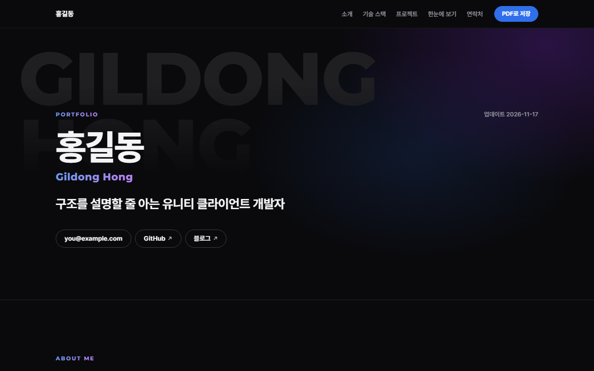
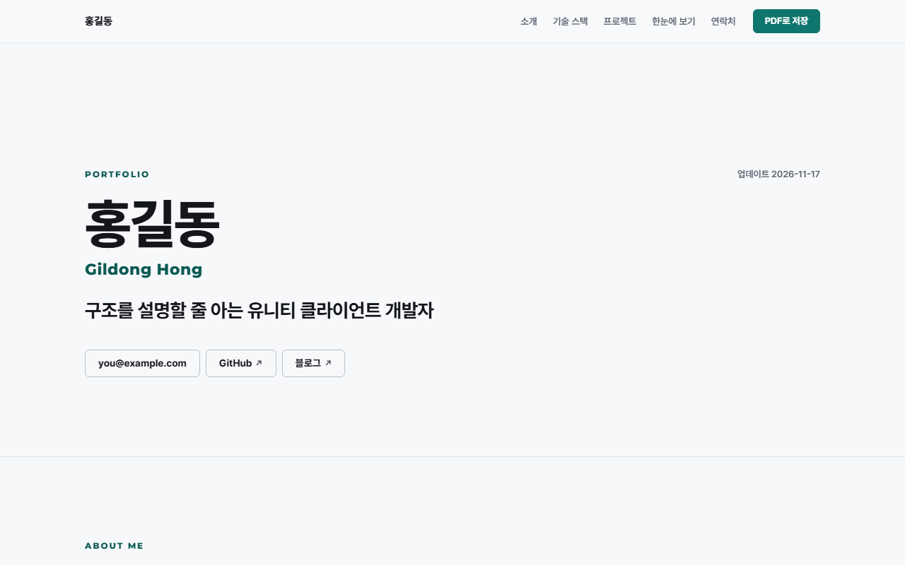

# 디자인 바꾸기

가벼운 것부터 순서대로 고르세요.

| 원하는 것 | 방법 |
|---|---|
| 색만 바꾸기 | `profile.md`의 **강조색** → `/portfolio-build` (세 페이지 모두에 적용. 테마에 강조색을 넣었다면 테마 색이 먼저) |
| 절 이름·버튼 문구 바꾸기 | `theme/strings.tsv`(문구 표)의 맨 끝 **"내 문구"** 칸 → 저장·새로고침. 다시 빌드할 필요 없음 → [문구 바꾸기](#문구-바꾸기) |
| 다른 사이트 느낌으로 | 마음에 드는 웹페이지 스크린샷을 첨부하고 `/portfolio-theme` → 색·모서리·영문 라벨 글꼴·광채를 세 페이지에 함께 입힘. 배치는 그대로 → [다른 사이트 느낌으로 바꾸기](#다른-사이트-느낌으로-바꾸기) |
| 다른 사이트 배치로 | 레퍼런스 주소(또는 스크린샷)와 함께 `/portfolio-layout` → 배치 확인 → `/portfolio-custom` → `custom/index.html`. 포트폴리오 페이지·제출 PDF는 그대로 → [다른 사이트 배치 따라 하기](#다른-사이트-배치-따라-하기) |
| 완전히 새 디자인 | `/portfolio-custom [디자인 요청]` → `custom/index.html` 생성. 배치까지 새로 → [나만의 디자인 새로 만들기](#나만의-디자인-새로-만들기) |

> 렌더러(`index.html`·`project.html`·`doc.html`·`assets/`)는 직접 고치지 마세요. 템플릿을 업데이트하면 고친 것이 사라지고, 슬라이드는 글자 크기를 재서 장면을 나누므로 쉽게 깨집니다.

## 문구 바꾸기

| | |
|---|---|
| **방법** | `theme/strings.tsv` 파일 · 저장 → 새로고침만 하면 됨(다시 빌드 불필요) |
| **언제 쓰나** | 절 이름·버튼·라벨의 문구를 내 말로 바꾸고 싶을 때 |
| **바뀌는 것** | `theme/strings.tsv` 한 파일 (커밋·push해야 배포에 보입니다) |
| **되돌리기** | "내 문구" 칸을 비우면 기본 문구로 돌아갑니다 |

페이지의 **절 이름·버튼·라벨 문구**(예: "슬라이드", "자기소개", "결과와 회고", "ABOUT ME")는 게임의 스트링 테이블처럼 `theme/strings.tsv` 한 파일에 모여 있습니다. 렌더러를 고치지 않고 이 표만 고치면 세 페이지(포트폴리오 페이지·슬라이드·상세 문서)에 함께 반영됩니다. 프로젝트 **내용**(사실·설명)은 여기가 아니라 `src/`의 프로젝트 문서에서 고칩니다.

| 키 | 보이는 곳 (권장 길이) | 기본 문구 | 내 문구 |
|---|---|---|---|
| `name.deck` | 공통 · 슬라이드의 이름(버튼·링크·탭 제목) · 8자 | 슬라이드 | 프레젠테이션 |
| `page.glance` | 포트폴리오 페이지 · 한눈에 보기 절 제목 · 12자 | 프로젝트 요약 | |

1. `theme/strings.tsv`를 Rider·VS Code에서 엽니다. 칸은 **탭**으로 나뉩니다(GitHub에서는 표로 보입니다).
2. 바꿀 줄의 **맨 끝 "내 문구" 칸**에 씁니다. 줄 끝에 탭이 미리 들어 있으므로 줄 끝으로 가서 글자만 치면 됩니다. 비워 두면 기본 문구가 나옵니다.
3. 저장 → 미리보기 새로고침(예전 모습이 남아 있으면 **Ctrl+F5**). 다시 빌드하지 않아도 됩니다.
4. 마음에 들면 `theme/strings.tsv`를 커밋·push하세요.

### 자리표시 { } · 영문 라벨 · 엑셀 · 점검 받기

- `{name.deck}`처럼 <b>점이 있는 `{ }`</b>는 다른 줄의 문구를 끌어 씁니다. 그래서 `name.deck` 한 줄만 바꿔도 "슬라이드 열기"·"슬라이드 전체" 같은 버튼이 함께 바뀝니다. 이름을 바꿔 조사가 어색해지면 그 문장 줄의 "내 문구"만 고치세요(예: `name.doc`을 "기술 설명"으로 바꾸면 맺음 장면 제목이 "기술 설명와 링크"가 되므로, `deck.end-title`의 내 문구에 `{name.doc}과 링크`).
- `{n}`처럼 <b>점이 없는 `{ }`</b>는 페이지가 숫자 등을 넣는 자리이므로 지우지 마세요(예: `장면 {n}장`).
- `en.`으로 시작하는 줄은 영문 라벨 자리입니다. 영문 글꼴에는 한글이 없어서 한글을 쓰면 다른 글꼴로 보입니다.
- 키·보이는 곳·기본 문구 칸은 고치지 않습니다. 줄을 지우면 그 자리는 기본 문구로 나옵니다.
- 엑셀로 열고 저장해도 페이지는 읽지만, 엑셀 형식(CP949·UTF-16)으로 저장되면 GitHub에서 한글이 깨져 보일 수 있습니다. 편집기에서 고치는 것을 권합니다.
- 문구가 너무 길거나, 칸 사이 탭이 공백으로 바뀐 줄이 있으면 Claude에게 <b>"문구 표 점검해 줘"</b>라고 하세요. 줄 번호와 고칠 점을 알려 줍니다. 직접 고치기 어려우면 "이 줄 내 문구를 ○○로 고쳐 줘"라고 해도 됩니다(그 줄의 "내 문구" 칸만 고칩니다).
- 템플릿을 업데이트(`/portfolio-update`)해도 내 표는 그대로 남고, 새로 생긴 문구 자리가 있으면 알려 줍니다.

## 다른 사이트 느낌으로 바꾸기

| | |
|---|---|
| **명령** | `/portfolio-theme [요청 \| 되돌리기]` · 말로 해도 됨 — "이 사이트 느낌으로", "버튼 덜 둥글게" |
| **언제 쓰나** | 색·모서리·영문 글꼴을 마음에 드는 사이트의 느낌으로 바꾸고 싶을 때. 배치와 내용은 그대로입니다 |
| **바뀌는 것** | `theme/theme.css` 한 파일 (커밋·push해야 배포에 보입니다) |
| **되돌리기** | `/portfolio-theme 되돌리기` — 기본 테마로 돌아갑니다. |

마음에 드는 웹페이지(게임 회사 소개 페이지, 다른 사람의 포트폴리오 사이트 등)의 **색·모양·영문 글꼴·효과**를 내 세 페이지(포트폴리오 페이지·슬라이드·상세 문서)에 함께 입힙니다. 배치와 내용은 그대로이고 겉모습만 바뀝니다.

| 기본 테마 | 테마를 입힌 뒤 (밝은 바탕 · 청록 강조 · 각진 모서리의 예) |
|---|---|
|  |  |

1. 마음에 드는 페이지의 첫 화면을 캡처합니다. 여러 장을 주면 공통된 인상을 뽑습니다. 웹페이지가 아니라 게임 화면·일러스트여도 됩니다.
2. Claude Code에 스크린샷을 첨부하고 `/portfolio-theme`를 입력합니다. 덧붙일 요청이 있으면 함께 적습니다. 예: `/portfolio-theme 강조색은 내 색 유지, 광채는 약하게`
3. Claude가 정해진 규칙으로 값을 뽑아 **`theme/theme.css` 한 파일**에 쓰고, 글자가 잘 읽히는지(바탕과의 대비) 점검한 뒤 세 페이지를 열어 확인합니다. 끝나면 어떤 값을 화면의 어디에서 가져왔는지 표로 알려 줍니다.
4. 미리보기를 새로고침해 직접 봅니다(예전 모습이 남아 있으면 **Ctrl+F5**).
5. 마음에 들면 `theme/theme.css`를 커밋·push하세요. 배포된 페이지에도 적용됩니다(Claude는 커밋하지 않습니다).

- **레퍼런스의 로고·회사 이름·문구·그림은 옮기지 않습니다.** 남의 브랜드처럼 보이는 포트폴리오가 되지 않도록 색·모양·글꼴의 인상만 가져옵니다.
- 테마는 **배치**(단 나눔·카드 격자)를 바꾸지 않습니다. 배치를 따라 하려면 → [다른 사이트 배치 따라 하기](#다른-사이트-배치-따라-하기)

### 입력 방법 더 보기 · 이어서 다듬는 말

- 스크린샷을 **파일 경로**로 주면(예: `C:\Users\나\Pictures\ref.png`) Claude가 실제 픽셀 색을 읽어 더 정확합니다. 대화에 바로 붙여 넣은 그림은 눈으로 보고 고릅니다.
- 사이트 주소만 줘도 되고(브라우저 도구가 있으면 열어 봄), "네온 느낌 다크 테마"처럼 말로만 해도 됩니다.
- 입힌 뒤에는 아래처럼 말로 이어서 다듬습니다.

| 이렇게 말하면 | 바뀌는 것 |
|---|---|
| "버튼 덜 둥글게" · "버튼 네모로" | 버튼·태그 모서리 |
| "카드 더 각지게" · "더 둥글게" | 카드·판 모서리 |
| "광채 빼 줘" · "은은하게" | 배경에 번지는 빛 |
| "뒤에 큰 영어 이름 없애 줘" | 포트폴리오 페이지 머리 뒤 장식 글자 |
| "그러데이션 말고 단색으로" | 영문 라벨 글자·번호 배지 |
| "강조색은 내 색으로" | `profile.md`의 강조색으로 돌아감 |
| "글씨 더 진하게" | 본문·보조 글자 대비 |
| "영문 글꼴 바꿔 줘" | PORTFOLIO·CHAPTER 같은 영문 라벨 글꼴 |
| "밝은 테마로" · "어두운 테마로" | 색 전체 |

### 테마로 바뀌는 것과 그대로인 것

| 테마로 바뀌는 것 | 그대로인 것 |
|---|---|
| 바탕·카드 색, 글자색(제목·본문·보조), 구분선, 강조색과 그러데이션, 카드·버튼 모서리, 그림자, 영문 라벨 글꼴, 광채·장식 글자 | 배치·글자 크기·간격(슬라이드는 글자 크기를 재서 장면을 나누므로 테마로 바꾸지 않습니다), 한글 글꼴(Pretendard), 코드 판(늘 어둡게)·다이어그램 판(늘 밝게), 제출 PDF 인쇄(늘 흰 종이, 강조색만 테마를 따름) |

- `theme/theme.css`를 직접 고쳐도 됩니다. 값마다 무엇이 바뀌는지 주석이 달려 있습니다(저장 → 새로고침). 전체 설명은 [.claude/skills/portfolio-theme/rules.md](../../.claude/skills/portfolio-theme/rules.md)에 있습니다.
- 템플릿을 업데이트(`/portfolio-update`)해도 `theme/theme.css`는 그대로 남습니다.
- 옛 템플릿으로 만든 레포라서 `/portfolio-theme` 명령이 없거나 "먼저 템플릿을 업데이트해 주세요"라는 안내가 나오면, [템플릿 업데이트 받기](update.md#템플릿-업데이트-받기)로 `/portfolio-update`를 먼저 실행하세요.

## 다른 사이트 배치 따라 하기

| | |
|---|---|
| **명령** | `/portfolio-layout <레퍼런스 주소 \| 스크린샷 첨부> [요청 \| 되돌리기]` · 말로 해도 됨 — "이 사이트처럼 배치해 줘" |
| **언제 쓰나** | 다른 페이지의 배치(첫 화면 크기, 단 나눔, 카드 격자)를 따라 하고 싶을 때 |
| **바뀌는 것** | `theme/layout.json` 한 파일. 포트폴리오 페이지(`index.html`)와 제출 PDF의 배치는 그대로입니다(A4 인쇄·슬라이드 측정이 고정 배치에 맞춰져 있음). |
| **되돌리기** | `/portfolio-layout 되돌리기` — 배치 레퍼런스를 지웁니다(이미 만든 `custom/index.html`은 그대로). |

마음에 드는 페이지의 **배치**(첫 화면 크기, 2단·카드 격자 같은 나눔, 그림이 놓이는 쪽, 콘텐츠 폭)를 재서, 내 포트폴리오의 절마다 빌려 올 배치를 `theme/layout.json`에 적습니다. 그 배치로 실제 페이지를 그리는 것은 [`/portfolio-custom`](#나만의-디자인-새로-만들기)입니다.

1. Claude Code에 레퍼런스 주소를 주거나(브라우저 도구가 있으면 열어서 잼) 위에서부터 캡처한 스크린샷 2~3장을 첨부하고 `/portfolio-layout`을 입력합니다.
2. Claude가 레퍼런스의 띠마다 배치를 한 줄 그림으로 보여 주고, 내 절(머리·자기소개·기술 스택·프로젝트 소개·기능 소개·한눈에 보기·연락처)마다 어떤 배치를 빌려 올지 표로 묻습니다. **네**라고 해야 씁니다.
3. `/portfolio-custom`을 직접 입력하면 그 배치로 `custom/index.html`을 만듭니다. 색·분위기는 뒤에 덧붙여 말합니다(예: `/portfolio-custom 다크 톤, 강조색은 내 색`).

- **레퍼런스의 글·그림·로고·이름은 가져오지 않습니다.** 상자의 위치·크기 같은 숫자만 잽니다. 절의 순서와 내용도 내 포트폴리오 그대로입니다.

### 한 줄 그림 읽는 법 · 재지 못할 때 · 색은 어디서

이 템플릿의 포트폴리오 페이지를 잰 예입니다.

```text
 2 hero    [≡≡≡≡≡≡≡≡≡≡≡≡≡≡≡≡              ]   한 단 · 큰 글자 4.8배 · 배경 그림·그러데이션 · 높이 0.65화면
 4 list    [─────┼─────────────────────] ×3줄  줄마다 2단 20:80 × 3줄 · 배경색 다름 · 높이 0.86화면
 5 split   [■■■■■■■■■■■■■■|·················] 2단 45:55 · 그림 왼쪽 · 높이 0.99화면
```

- `■`는 그림 칸, `·`·`≡`는 글 칸, `▢`는 카드, `─┼─`는 줄마다 나뉜 목록입니다. 비율은 넓은 화면(1440px)에서 잰 폭입니다.
- 주소를 열 수 없거나(로그인이 필요한 페이지, 한 화면짜리 앱) 브라우저 도구가 없으면 스크린샷을 보고 어림합니다. "첫 화면 크게, 프로젝트는 카드 3열로"처럼 말로만 정해도 됩니다.
- 색·모서리·영문 글꼴은 [다른 사이트 느낌으로 바꾸기](#다른-사이트-느낌으로-바꾸기)(`/portfolio-theme`)나 `/portfolio-custom`의 디자인 요청으로 정합니다. 둘을 함께 써도 됩니다.
- `theme/layout.json`은 템플릿을 업데이트해도 그대로 남습니다. 커밋해 두면 다음에 `/portfolio-custom`을 다시 실행해도 같은 배치를 씁니다.

## 나만의 디자인 새로 만들기

| | |
|---|---|
| **명령** | `/portfolio-custom [디자인 요청]` · ✋ **직접 입력할 때만** |
| **언제 쓰나** | 고정 디자인 대신 배치까지 새로 그린 페이지를 원할 때 |
| **바뀌는 것** | `custom/index.html` 한 파일. 주소는 `https://<아이디>.github.io/<레포>/custom/` 입니다. 요청을 비우면 "취업용답게 깔끔하고 절제된" 디자인으로 만듭니다. |
| **되돌리기** | `custom/index.html`을 지우면 됩니다. 포트폴리오 페이지(`index.html`)는 그대로입니다 |

```text
/portfolio-custom 다크 톤으로, 첫 화면은 이름만 크게
```

- `theme/layout.json`(배치 레퍼런스)이 있으면 그 배치를 따릅니다 → [다른 사이트 배치 따라 하기](#다른-사이트-배치-따라-하기)
- 포트폴리오 페이지와 <b>같은 데이터(`data/`)</b>를 읽어 그리므로 내용은 같고 겉모습만 다릅니다. 다음에 `/portfolio-build`만 다시 하면 이 페이지도 최신 내용이 됩니다.
- **실행할 때마다 결과가 달라질 수 있습니다.** 화면을 직접 확인하고, 다듬고 싶으면 "방금 만든 페이지에서 [이 부분]을 [이렇게] 바꿔줘"처럼 이어서 말하세요.

### 링크·문구·메인으로 쓰기

- 프로젝트 페이지는 새로 만들지 않고 기존 슬라이드·프로젝트 상세 문서로 링크합니다. 문구는 문구 표(`theme/strings.tsv`)를 따릅니다.
- 메인으로 쓰려면 이력서의 링크를 `…/custom/`으로 바꾸고, 기본 포트폴리오 페이지는 백업으로 남겨 두세요. 제출용 PDF는 A4 인쇄가 맞춰진 포트폴리오 페이지(`index.html`)에서 저장하는 것을 권합니다.
- 기준은 [format/05-custom-page-prompts.md](../../format/05-custom-page-prompts.md)에 있습니다.
