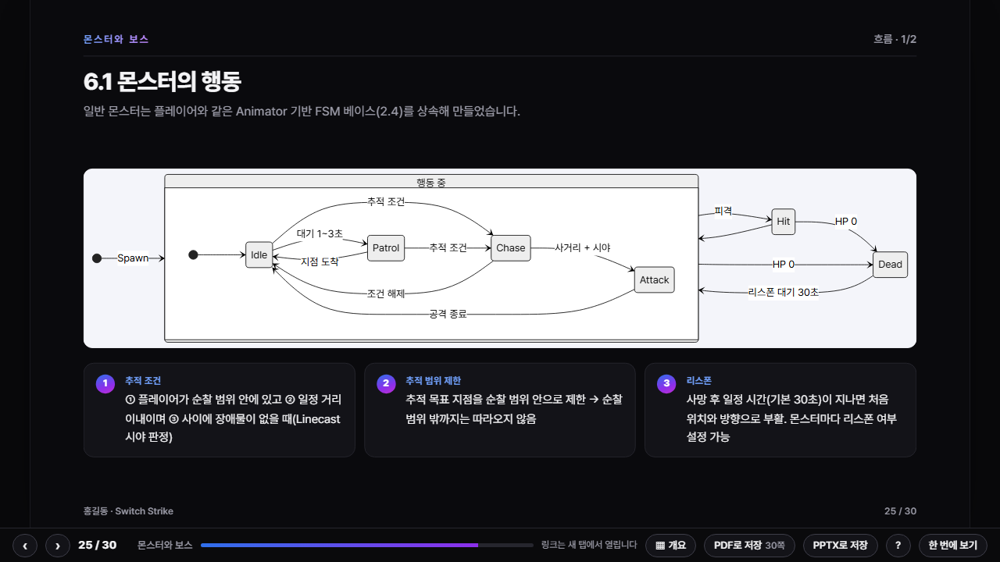
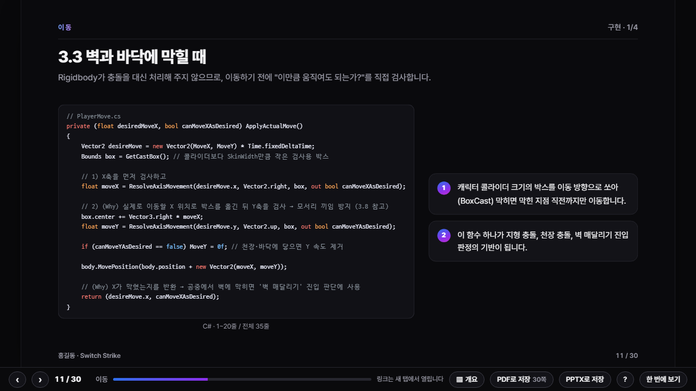
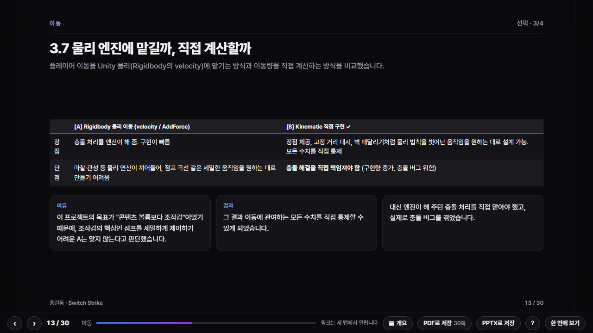
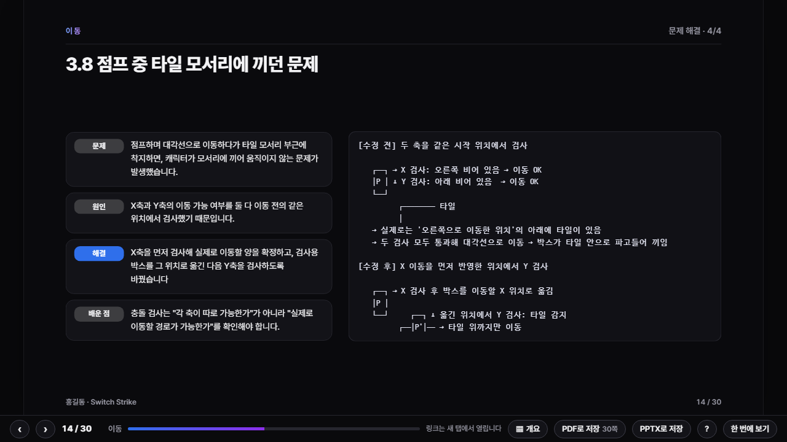

# 슬라이드 장면 고치기

| | |
|---|---|
| **명령** | `/portfolio-edit [폴더] [장면] [요청]` · 말로 해도 됨 — "이 장면 둘로 나눠 줘" · 장면 카드로 **확인받은 뒤에만** 고침 |
| **언제 쓰나** | 슬라이드의 특정 장면만 다르게 보이고 싶을 때 — 그림을 크게, 다른 그림으로, 둘로 나누기, 빼기, 순서 바꾸기 |
| **바뀌는 것** | `deck-edits.json`과 `data/projects/<프로젝트>.json` **두 파일**. 둘 다 커밋·push해야 배포에 보입니다. 되돌린 뒤에도 `data/projects/<프로젝트>.json`은 줄 모양이 달라 바뀐 파일로 보일 수 있습니다(내용은 같음). 함께 커밋하세요. |
| **되돌리기** | `/portfolio-edit <폴더> <장면> 되돌리기` (전체는 "되돌리기 전체"). 나누거나 합친 장면은 두 장면이 함께 원래대로 돌아갑니다 |

슬라이드의 장면은 `/portfolio-build`가 프로젝트 문서를 읽고 고릅니다. 특정 장면이 마음에 들지 않으면 **그 장면만** 고칠 수 있고,
고친 내용은 `src/<프로젝트>/deck-edits.json`에 남아 **다시 빌드해도 유지**됩니다(그 절의 제목을 바꾸지 않는 한).

1. 고칠 장면을 열고 주소창의 `#s=d-…`를 복사합니다(**개요** 격자에도 장면마다 id가 보입니다). 장면 제목 일부나 "12번째 장면"이라고 해도 됩니다.
2. Claude에게 말합니다. 예: `/portfolio-edit 1-my-game #s=d-arch 다이어그램만 크게`, "이 장면 코드를 다음 장으로 나눠 줘", "이 장면은 빼 줘", "이 장면을 앞 장면 뒤로".
3. Claude가 **지금 장면과 고친 뒤 모습**(그 절에 있는 다른 그림·코드·표, 쓸 수 있는 장면 틀)을 장면 카드로 보여 주고 "이렇게 고칠까요?"라고 묻습니다. **네**라고 해야 고칩니다. 여러 장면을 한 번에 부탁해도 됩니다.
4. 미리보기를 새로고침해 확인합니다. 되돌리려면 "`/portfolio-edit 1-my-game d-arch 되돌리기`"(전체는 "되돌리기 전체"). 나누거나 합친 장면은 두 장면이 함께 원래대로 돌아갑니다.

| 장면 고치기로 할 수 있는 것 | 프로젝트 문서를 고쳐야 하는 것 |
|---|---|
| 장면 틀 바꾸기, 원문의 어느 그림·코드·표를 보일지, 코드 줄 범위, 나누기 · 합치기 · 빼기 · 순서 바꾸기, 빌드가 고르지 않은 절을 **새 장면으로 추가**, 탭·제목 줄이기, 도입·요점을 **원문의 다른 문장으로** 바꾸거나 줄이기 | 사실·수치·설명이 틀렸거나 보태고 싶을 때, 다이어그램·코드 **내용**, 장 제목, 원문에 없는 문장 — 슬라이드에 새 내용을 쓰지 않습니다. 프로젝트 문서에 쓰고 다시 빌드하세요 |

## 장면 틀 6가지와 알아 둘 것

| 틀 | 모양 |
|---|---|
| 글 중심 (`overview`) | 개요·설명 글과 요점 |
| 그림 + 번호 카드 (`visual`) | 다이어그램·그림과 그 옆의 요점 |
| 코드 + 설명 (`code`) | 코드가 주인공 |
| 큰 그림·표 하나 (`full`) | 큰 다이어그램·비교 표·As-Is/To-Be 표 |
| 화면 2~3장 (`screens`) | 스크린샷·GIF를 나란히 |
| 문제 해결 흐름 (`problem`) | 문제 → 원인 → 해결 → 결과 |

| 그림 + 번호 카드 (`visual`) | 코드 + 설명 (`code`) |
|---|---|
|  |  |

| 큰 그림·표 하나 (`full`) | 문제 해결 흐름 (`problem`) |
|---|---|
|  |  |

- 표지·목차·장 표지·회고·맺음 장면은 고칠 수 없습니다. 그 내용은 프로젝트 문서(장 제목·회고 절)와 `profile.md`에서 옵니다.
- 장에 하나뿐인 장면을 숨기면 그 **장 표지와 목차 항목도 사라집니다**.
- 세로로 긴 다이어그램은 `full`로 바꾸면 오히려 작아질 수 있습니다. 그럴 때 Claude가 미리 알려 주고, 다이어그램을 둘로 나누는 것은 프로젝트 문서 쪽 일이라고 안내합니다.
- Claude가 줄인 문장은 `report.md` "확인해 주세요"에 남습니다. 직접 확인하세요.
- **고친 장면이 풀리는 경우**: 그 장면이 다루는 프로젝트 문서의 **절 제목을 바꾸거나 절을 없애면**, 다시 빌드할 때 고친 내용이 원래 장면을 찾지 못해 반영되지 않습니다(리포트에 "원래 장면을 잃었습니다"로 알림). 그때는 `/portfolio-edit`로 다시 고치세요.
- 포트폴리오 페이지(제출 PDF)는 장면 고치기 대상이 아닙니다. 대표 이미지는 프로젝트 문서에 "대표 이미지"로 지정하고, 프로젝트 순서는 `profile.md`에서 정합니다.
