# mini ftl 기술 문서

<!-- 원천: v13 슬라이드 01·02 -->

> **탑다운 우주 전략 프로젝트**

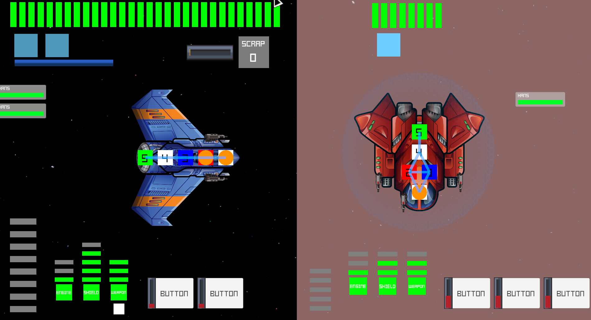

| 항목    | 내용                                                                                           |
| ----- | -------------------------------------------------------------------------------------------- |
| 플랫폼   | PC Windows                                                                                   |
| 개발 인원 | 1                                                                                            |
| 엔진    | Unity 6000.3.15f1                                                                            |
| 개발 기간 | 2026.06.16 — 07.06 (기획·설계·에셋 준비 1주 + 구현 2주)                                                 |
| 링크    | [GitHub](https://github.com/KooHoo-Dev/3rd-2D-Project-MountainHS) · 시연 영상: ✍ 직접 작성: 시연 영상 링크 |

---

## 1. 개요

### 1.1 프로젝트 소개

<!-- 원천: v13 슬라이드 02 -->

**플레이어가 함선과 승무원을 직접 조작해 상대 우주선과 전투하는 1인 제작 PC 게임**

이 프로젝트는 'FTL: Faster Than Light'에서 영감을 받은 탑다운 전략 게임으로, 전력 관리·무기 조준·승무원 이동 세 시스템을 핵심으로 개발했다.

처음 Unity로 만든 학습용 프로젝트다. 좋은 디자인 패턴을 먼저 정해 두기보다 할 수 있는 만큼 직접 구현해 보고, 그 과정에서 드러난 구조적 문제를 통해 왜 디자인 패턴과 객체지향 설계가 필요한지 깨닫는 것을 목표로 했다.

- 플레이어는 함선의 전력을 무기·엔진·실드에 나누어 공급하고, 승무원을 방으로 이동시켜 시설 수리와 시설 보조를 지시한다.
- 전력이 공급된 무기를 선택한 뒤 적 함선의 방을 직접 조준하면, 충전이 끝난 무기가 목표 방을 향해 투사체를 발사한다.
- 전투가 끝나면 상점에서 반응로 업그레이드, 함선 수리, 승무원 치료를 진행하고 다음 전투를 준비한다.

### 1.2 왜 만들었나

1. **핵심 플레이 경험의 재현 가능성 검증**
   - 평소 즐겨 하던 로그라이크·시뮬레이션 게임에서 핵심적인 재미를 만드는 요소가 무엇인지 탐구하는 것이 목적이었다.
   - 특히 《FTL》의 핵심 시스템만 추려 최소한의 전투 루프로 구현했을 때도, 원작과 유사한 플레이 경험을 제공할 수 있는지 실험하고자 했다.

2. **직접 부딪히며 객체지향 설계의 필요성 깨닫기**
   - 익숙하지 않았던 객체지향 설계를 실제 게임 개발에 적용하고, 여러 시스템의 역할과 상호작용을 직접 설계하는 경험을 쌓고자 했다.
   - 처음 만드는 Unity 프로젝트라 디자인 패턴을 미리 적용하기보다, 할 수 있는 만큼 거칠게 먼저 구현했다. 구현하면서 드러난 구조적 문제를 기록하고 "이래서 이런 디자인 패턴과 객체지향 원칙을 쓰는구나"를 직접 확인하는 것을 목표로 했다(§5.5).
   - 전력·무기·승무원 핵심 시스템은 AI 없이 직접 구현했다. AI는 프로젝트 구조 평가와 일부 기능(적 랜덤 스폰·환경 피해) 작업에 보조로 썼다.

### 1.3 전투 중 관리하는 세 시스템

<!-- 원천: v13 슬라이드 03 -->

세 기능은 같은 전투 상황에서 서로 다른 플레이어 판단을 요구한다.

**01 전력 관리**

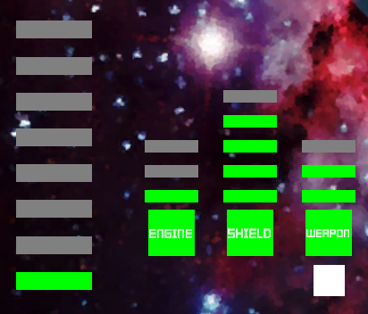

- 제한된 반응로 전력을 무기·엔진·실드에 배분하고 회수한다.
- 전력이 1 이상이면 시설이 가동한다.
- 엔진·실드·무기는 전력량에 따라 강화 효과가 달라진다.

**02 무기 조준**

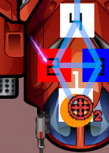

- 활성화된 무기를 선택하고 적 방을 직접 목표로 지정한다.
- 무기가 충전되고 목표가 유효하면 투사체를 발사한다.
- 투사체가 실드와 충돌하거나 방에 도달하면 피해 처리를 한다.

**03 승무원 관리**

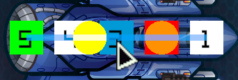

- 승무원을 이동시켜 시설을 수리하거나 작동을 보조하게 한다.
- 승무원은 이동한 방의 시설 상태에 따라 손상된 시설은 수리하고, 정상 시설에서는 시설을 보조한다.

### 1.4 핵심 루프

<!-- 원천: v13 슬라이드 04 -->

플레이어의 행동과 적 자동 공격이 반복되고, 결과에 따라 다음 전투 준비 상태로 전환된다.

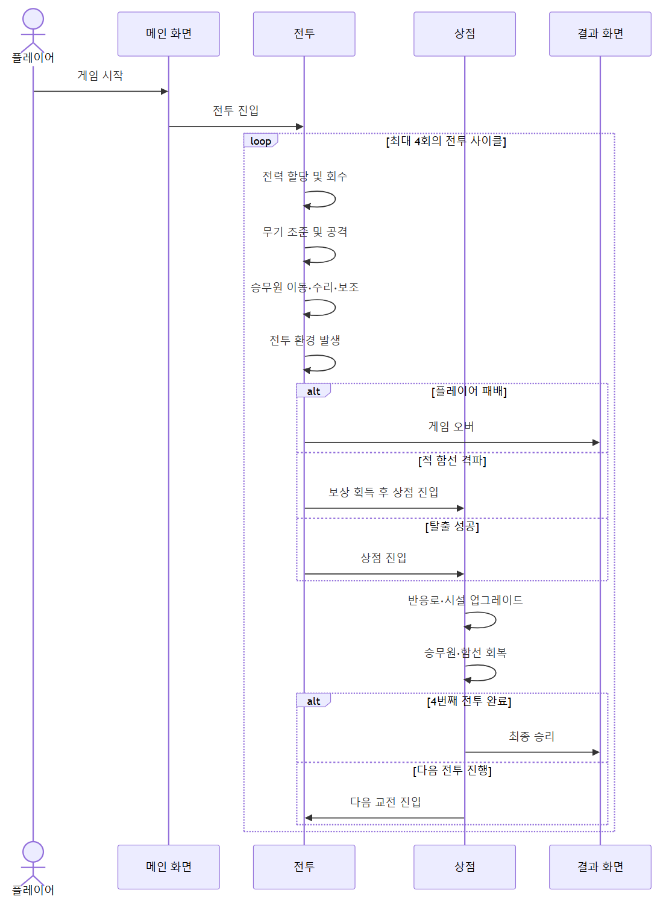

**BATTLE STATE TRANSITION**

1. 전력 배분 · 승무원 작업 · 무기 조준
2. 적 함선 자동 조준 · 공격
3. 함선 체력 · 승무원 생존 · 도망 상태 확인
4. 승리 · 패배 · 도망 처리
5. 상점에서 반응로 강화 · 함선 수리 · 승무원 치료

---

## 2. 시스템 구조

### 2.1 전체 시스템 구조 (초안)

<!-- 원천: v13 슬라이드 05 -->

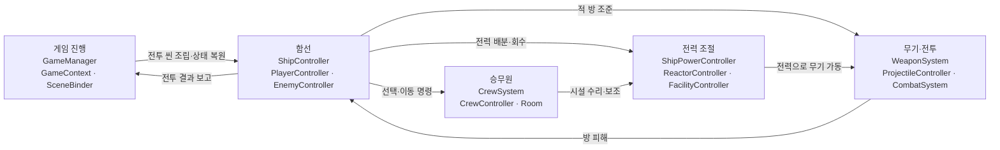

- **화살표 근거** — 전투 씬 조립·상태 복원: 전투 씬이 로드되면 GameManager가 `SceneBinder.BindSceneObjects`(환경이 있는 스테이지는 `BindSceneObjectsWithEnvironment`)로 PlayerController 상태를 복원하고 적을 배치(§2.2). 전투 결과 보고: 함선이 파괴되거나 승무원이 모두 사망하면 `ShipController.DeadCoroutine` → `GameManager.HandleBattleResult`. 전력 배분·회수: `ShipController.RequestAllocatePower` → `ShipPowerController.AllocatePower`. 적 방 조준: PlayerController → `WeaponSystem.SetSelectedRoomTarget`. 선택·이동 명령: PlayerController → `CrewSystem.AddSelectedCrew`·`SetTargetRoom`. 전력으로 무기 가동: `WeaponSystem`은 `FacilityController`를 상속. 방 피해: `CombatSystem` → `ShipController.TakeDamageToRoom`. 시설 수리·보조: `Room.RepairFacility`·`ApplyAssistEffectOnFacility` → 시설.
- **그림에서 뺀 것** — WeaponController(무기 하나의 충전·발사, §3.2), ShieldController·EngineController(FacilityController 상속, §3.1), EnvironmentController(환경 효과, §3.4)
- **나눈 이유** — 게임의 핵심 루프에 맞춰 나눴다. 전투에 들어가면 플레이어는 전력을 조절하고(전력 조절), 승무원을 움직이고(승무원), 무기를 상대 함선의 방에 조준해(무기·전투) 전투를 진행한다. 이 조작은 모두 함선(ShipController)을 거쳐 각 시스템에 전달된다. 전투에서 살아남으면 결과가 게임 진행(GameManager)에 보고되고, 상점에서 함선 체력 회복·전력 강화 같은 준비를 한 뒤 다음 전투 씬이 조립된다(§1.4).

### 2.2 전투 씬의 시스템 조립 구조

<!-- 원천: v13 슬라이드 06 -->

GameContext가 저장한 상태를 SceneBinder가 읽어 전투 씬의 플레이어·적·전투 시스템을 조립한다.

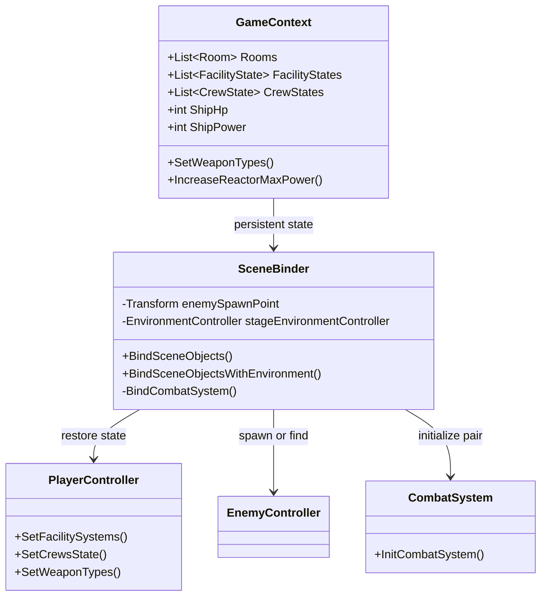

- **GameContext** — Rooms, FacilityStates, CrewStates와 함선 HP·반응로 용량·보유 전력을 저장한다.
- **SceneBinder** — 플레이어의 HP·전력·시설·승무원·무기 상태를 복원하고, EnemyType에 맞는 적 프리팹을 생성하거나 씬의 적을 찾는다.
- **전투 씬 → 상점 씬** — 전투 결과가 확정되면 현재 함선·시설·승무원 상태를 GameContext에 보관한다. 상점은 그 상태를 읽어 수리·치료·업그레이드의 기준으로 사용한다.
- **상점 씬 → 전투 씬** — 갱신된 GameContext를 SceneBinder가 받아 플레이어 상태를 적용하고 적·CombatSystem·스테이지 환경을 초기화한다.

---

## 3. 핵심 기능

### 3.1 전력 관리

#### 전력 관리 기능 개요

<!-- 원천: v13 슬라이드 07 -->

제한된 반응로 전력을 무기·엔진·실드에 배분해 전투 중 가동 우선순위를 정한다.

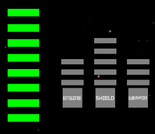

**입력**

- 키보드 A·S·D로 전력을 공급한다.
- Shift+A·S·D로 공급한 전력을 회수한다.
- A는 실드, S는 엔진, D는 무기에 연결된다.

**시설 활성화 조건**

- 무기·엔진·실드는 전력이 1 이상 할당되었을 때 가동한다.
- 전력이 0이면 해당 시설은 비활성 상태가 된다.
- 반응로 가용 전력이 부족하면 추가 전력을 공급할 수 없다.

**시설 강화**

- 엔진은 전력에 따라 탈출 충전 속도가 상승한다.
- 실드는 전력 2당 최대 실드 1개가 충전된다.
- 무기는 전력 단계에 따라 충전 속도 배율이 높아진다.

#### 전력 관리 시스템 구조

<!-- 원천: v13 슬라이드 08 -->

반응로의 가용 전력, 시설 상태, 양쪽 값을 함께 바꾸는 요청 처리를 클래스 단위로 분리했다.

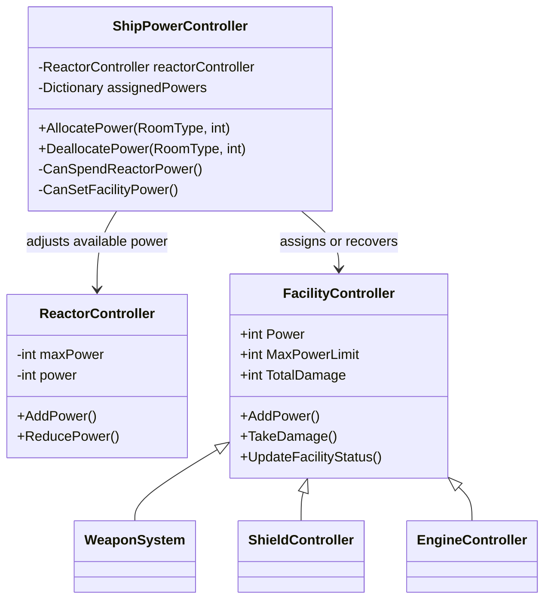

- **ReactorController** — maxPower와 현재 power를 보관한다. AddPower와 ReducePower 메소드로 power가 0~maxPower 값 사이의 유효한 값을 가질 수 있도록 한다.
- **ShipPowerController** — 시설 종류별 assignedPowers를 기록하고 AllocatePower·DeallocatePower 요청에서 반응로와 시설을 같은 양만큼 갱신한다.
- **FacilityController** — Power, MaxPowerLimit, TotalDamage와 시설 상태를 관리한다. 피해로 최대 전력이 줄어 현재 전력이 넘치면 초과분을 반응로로 되돌린다.

#### 시설 상태와 전력 바 상태

<!-- 원천: v13 슬라이드 09 -->

각 상태의 실제 전력 바 이미지와 상태 조건을 카드마다 함께 비교한다.

**활성화 · Available**

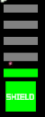

- 전력이 할당된 칸은 초록색이다.
- 시설이 정상이고 전력이 1 이상이면 활성화된다.

**고장 · Broken**


- 피해를 입은 칸은 주황색이다.
- 피해 수만큼 전력 바 칸의 상태가 Broken으로 바뀐다.

**비활성화 · UnAvailable**


- 미할당 전력 칸은 회색이다.
- Power가 0이면 시설은 비활성화된다.

**파괴 · Broked**


- 피해가 최대 전력 한계에 도달한 상태다.
- 시설 기능은 실행하지 않고 전력 칸 전체를 사용할 수 없다.

#### 전력 상호작용 코드: 반응로 ↔ 시설

<!-- 원천: v13 슬라이드 10 -->

할당과 회수는 ShipPowerController가 한 요청 안에서 시설 전력·기록값·반응로 가용 전력을 함께 갱신한다.

**AllocatePower · ShipPowerController.cs**

```csharp
public void AllocatePower(RoomType facilityType, int amount = 1)
{
    // … 입력·null 검사 생략
    FacilityController facility = FindFacility(facilityType);
    int nextPower = GetAssignedPower(facilityType) + amount;

    if (CanSpendReactorPower(amount) == false ||
        facility.CanAddPower(amount) == false ||
        CanSetFacilityPower(facility, nextPower) == false) return;

    SetAssignedPower(facilityType, nextPower);
    facility.AddPower(amount);
    reactorController.ReducePower(amount);
}
```

**DeallocatePower · ShipPowerController.cs**

```csharp
public void DeallocatePower(RoomType facilityType, int amount = 1)
{
    FacilityController facility = FindFacility(facilityType);
    int current = GetAssignedPower(facilityType);
    if (current <= 0) return;

    int recoverAmount = Mathf.Min(amount, current);
    if (CanRecoverReactorPower(recoverAmount) == false) return;

    SetAssignedPower(facilityType, current - recoverAmount);
    reactorController.AddPower(recoverAmount);
    facility.ReducePower(recoverAmount);
}
```

- **전력 할당** — 반응로 가용 전력이 1 이상이고 시설 전력 추가가 가능할 때 시설에 전력을 추가한다. 반응로 전력은 같은 양만큼 줄인다.
- **전력 회수** — 시설에 전력이 1 이상 할당되어 있는지 확인한다. 반응로가 전력을 회수할 경우 최대 전력을 넘지 않는지 확인한 뒤 전력을 회수한다.

#### 전력 유효 상태 보장 책임

<!-- 원천: v13 슬라이드 11 -->

전력이 범위를 벗어나지 않도록 반응로·시설의 상태 보장과 두 객체 사이의 전력 이동 책임을 분리했다.

**FacilityController.TakeDamage · 초과 전력 회수**

```csharp
public virtual void TakeDamage(int amount)
{
    TotalDamage = Mathf.Min(TotalDamage + amount, MaxPowerLimit);
    maxPower = MaxPowerLimit - TotalDamage;

    if (maxPower < Power)
    {
        int overflow = Power - maxPower;
        ReducePower(overflow);
        shipPowerController.DeallocatePower(type, overflow);
    }
    UpdateFacilityStatus();
}
```

**ReactorController · 값 범위 제한**

```csharp
public void AddPower(int amount)
{
    if (amount <= 0) return;
    power = Mathf.Min(power + amount, maxPower);
}

public void ReducePower(int amount)
{
    if (amount <= 0) return;
    power = Mathf.Max(power - amount, 0);
}
```

- **전력 할당 가능** — ShipPowerController는 반응로 가용 전력과 시설 전력 추가 가능 여부를 확인한 뒤 전력을 할당한다.
- **상태 유효성 검증** — ReactorController와 FacilityController에서는 각각 반응로 전력, 시설 전력 상태가 유효한지 검증한다.
- **간접 상호작용** — 전력 회수,할당 같은 상호작용이 필요하면 ShipPowerController를 통해 간접적으로 상호작용한다.

#### 전력 UI: 데이터 참조와 갱신

<!-- 원천: v13 슬라이드 12 -->

반응로·시설 뷰어는 매 프레임 참조 중인 컨트롤러의 현재 값을 읽어 UI를 갱신한다.

**FacilityPowerViewer.UpdateViewer · 시설 UI**

```csharp
protected override void UpdateViewer()
{
    int maxPower = facilitySystem.MaxPower;
    int power = facilitySystem.Power;
    int maxPowerLimit = facilitySystem.MaxPowerLimit;
    int totalDamage = facilitySystem.TotalDamage;

    UpdatePowerBars(power, maxPower, maxPowerLimit, totalDamage);
    UpdateRepairBar();
    UpdateFacilityIcon();
}
```

**ReactorViewer.UpdateViewer · 반응로 UI**

```csharp
int totalPower = reactorController.MaxPower;
int availablePower = reactorController.Power;

for (int i = 0; i < barSprites.Count; i++)
{
    if (i < availablePower)
        SetBarState(i, ReactorBarStatus.Available);
    else
        SetBarState(i, ReactorBarStatus.UnAvailable);
}
```

- **시설 데이터 참조** — FacilityPowerViewer는 FacilityController의 power, maxPower, maxPowerLimit, totalDamage를 매 프레임 읽는다. 이를 바탕으로 현재 할당량·한계·피해·시설 상태를 표시한다.
- **반응로 데이터 참조** — ReactorViewer는 ReactorController의 maxPower와 power를 읽는다. 시설로 추가 할당할 수 있는 가용 전력은 Available, 이미 사용 중인 전력은 UnAvailable로 표시한다.
- **UI 갱신** — 시설 뷰어는 전력 바 외에도 수리 진행 바와 시설 아이콘 색을 상태에 맞춰 갱신한다. 상태 변경을 전력 로직에서 직접 UI로 호출하지 않는다.

### 3.2 무기 조준

#### 무기 조준 기능 개요

<!-- 원천: v13 슬라이드 17 -->


**무기 조준 과정**

**01 무기 선택**

- 플레이어는 전력이 공급되어 활성화된 무기를 선택한다.
- 선택된 무기만 적 방 목표 데이터를 받을 수 있다.
- 무기 시설 전력이 0이면 무기 아이콘은 비활성 상태가 된다.

**02 공격 목표 지정**

- 적 함선의 방을 클릭하면 목표 좌표와 RoomId를 만든다.
- ProjectileTargetData가 이 두 값을 무기에 전달한다.
- RoomId는 투사체 도착 뒤 피해를 줄 방을 식별한다.

**03 투사체 발사**

- 활성화된 무기는 충전이 완료되고 유효한 목표가 있을 때 발사한다.
- ProjectileController는 저장한 목표 위치를 향해 이동한다.
- 발사 뒤 충전 진행도는 다시 초기화된다.

**04 피해 처리**

- 투사체가 상대 함선의 실드에 충돌하면 실드 피해를 요청한다.
- 실드에 막히지 않고 목표 방에 도달하면 방 피해를 요청한다.
- CombatSystem이 두 피해 경로를 구분해 처리한다.

#### 무기 활성화 · 충전 · 투사체 발사

<!-- 원천: v13 슬라이드 18 -->

무기 활성화부터 목표 데이터 전달과 투사체 발사까지의 핵심 로직만 시퀀스로 정리했다.

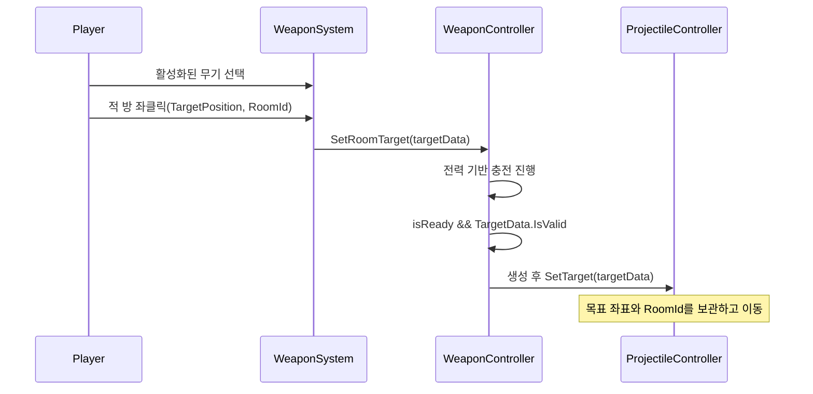

- **무기 활성화 조건** — WeaponSystem은 시설에 전력이 1 이상 공급되면 소속 WeaponController의 IsPowered를 켠다. 무기 시설에 할당된 전력값은 무기 충전 속도 배율에도 반영된다.
- **무기 충전 및 투사체 발사** — WeaponController는 충전 완료와 유효한 TargetData를 모두 확인한다. 조건을 만족하면 투사체를 생성한 뒤 TargetPosition·RoomId를 투사체의 SetTarget으로 전달한다.

#### 투사체 피해 처리 흐름

<!-- 원천: v13 슬라이드 19 -->

발사 과정은 제외하고, 실드 충돌과 목표 방 도달 뒤 피해 판정이 해결되는 경로에만 집중한다.

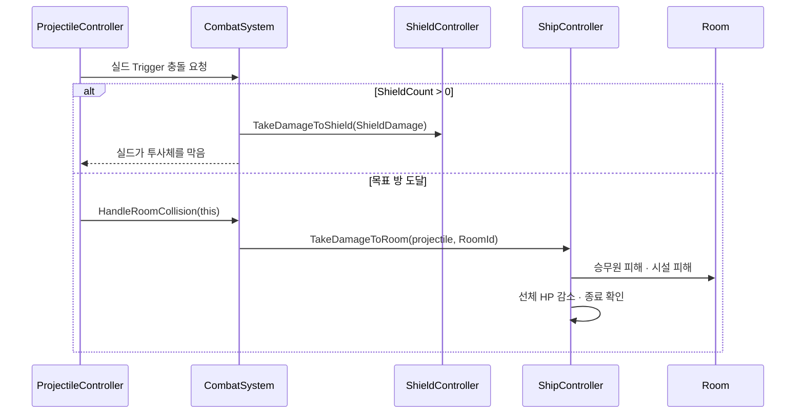

- **실드 충돌 요청** — ProjectileController는 적 함선 영역을 지난 뒤 실드 레이어와 충돌하면 CombatSystem.HandleShieldCollision을 호출한다. 실드가 남아 있으면 ShieldDamage를 적용하고 투사체는 제거된다.
- **목표 방 도달 요청** — 실드에 막히지 않은 투사체가 TargetPos에 도달하면 CombatSystem.HandleRoomCollision에 자신과 저장한 RoomId를 전달한다.
- **방 피해 해결** — CombatSystem은 피격 함선의 TakeDamageToRoom을 호출한다. 함선은 해당 Room의 승무원·시설에 피해를 전달하고 선체 HP를 줄인 뒤 전투 종료 조건을 확인한다.

#### 무기 핵심 코드: 선택 · 충전 · 발사 조건

<!-- 원천: v13 슬라이드 20 -->

WeaponSystem은 선택과 목표 전달을, WeaponController는 개별 무기의 충전과 발사 가능 상태를 맡는다.

**WeaponController · 목표와 발사 조건**

```csharp
public void SetRoomTarget(ProjectileTargetData targetData)
{
    TargetData.TargetPosition = targetData.TargetPosition;
    TargetData.RoomId = targetData.RoomId;
}

private bool IsReadyToFire()
{
    return TargetData.IsValid() && isReady;
}
```

**WeaponController.FireCoroutine · 목표 데이터 전달**

```csharp
GameObject projectile = Instantiate(projectilePrefab, transform.position, Quaternion.identity);
ProjectileController projectileController =
    projectile.GetComponent<ProjectileController>();
projectileController.SetTarget(targetData);
projectileController.SetRandomSeed(seed);
projectile.transform.rotation = transform.rotation;
```

- **목표 저장** — TargetPosition은 투사체가 이동할 좌표이고 RoomId는 도착 뒤 피해를 줄 방을 식별한다. 둘 중 하나라도 유효하지 않으면 발사하지 않는다.
- **충전과 보조** — 전력이 공급되면 chargeProgress가 증가한다. 시설 보조 상태는 충전 속도에 1.2배 보정을 적용해 발사 준비를 앞당긴다.

#### CombatSystem의 실드 · 방 충돌 해결

<!-- 원천: v13 슬라이드 21 -->

피격 판정은 CombatSystem에 모으고, 실드와 방 충돌은 각각의 메서드가 피격 함선·방 객체로 피해를 전달한다.

**HandleShieldCollision · 실드 충돌**

```csharp
public bool HandleShieldCollision(ProjectileController projectile)
{
    bool isPlayerProjectile = projectile.StartCol.CompareTag(Tags.PlayerShip);
    int opponentShipIndex = isPlayerProjectile ? 1 : 0;
    ShieldController shield = (ShieldController)
        ships[opponentShipIndex].GetFacilitySystemByERoomType(RoomType.Shield);

    if (shield.ShieldCount > 0)
    {
        shield.TakeDamageToShield(projectile.ShieldDamage);
        // … 피해 숫자 표시 생략
        return true;
    }
    return false;
}
```

**HandleRoomCollision · 목표 방 도달**

```csharp
public bool HandleRoomCollision(ProjectileController projectile)
{
    // … opponentShipIndex는 HandleShieldCollision과 같은 방법으로 구함
    ShipController targetShip = ships[opponentShipIndex];
    ProjectileTargetData target =
        new(projectile.TargetPos, projectile.TargetRoomId);

    targetShip.TakeDamageToRoom(projectile, target.RoomId);
    // … 피격 연출(함선 흔들기 · 피해 숫자 표시) 생략
    return true;
}

// ShipController: Room → crews / facility → ship HP
```

- **실드 충돌 해결** — CombatSystem은 투사체의 출발 함선을 기준으로 상대 ShieldController를 찾는다. ShieldCount가 1 이상일 때만 실드 피해를 적용하고 투사체를 막는다.
- **방 충돌 해결** — CombatSystem은 피격된 ShipController를 찾고 RoomId를 넘긴다. ShipController는 해당 Room 안의 시설과 승무원에 피해를 처리한 뒤 함선 체력을 감소시킨다.

### 3.3 승무원 관리

#### 승무원 기능 개요

<!-- 원천: v13 슬라이드 26 -->

승무원은 방 이동 뒤 시설 상태에 맞춰 수리·보조를 수행하며, 방 피격 시 체력 피해를 받는다.


**승무원 이동**

- 승무원을 좌클릭으로 선택한다.
- 플레이어 방을 우클릭하면 CrewSystem이 각 CrewController에 목표 방을 전달한다.
- 승무원은 목표 방의 배치 위치까지 이동한다.

**승무원 작업**

- 목표 방 도착 뒤 시설이 Damaged 또는 Broked이면 수리한다.
- 시설이 Normal이면 시설 보조 효과를 적용한다.
- 무기·실드·엔진은 보조 상태에 따라 충전 속도 보정을 받는다.

**승무원 피해**

- 방이 피격되면 Room이 내부 Crews에 피해를 전달한다.
- HP가 0이 된 승무원은 CrewSystem에서 제거된다.
- 승무원이 모두 사망하면 전투 패배 조건을 확인한다.

#### CrewStatus 상태 전이와 상태별 작업

<!-- 원천: v13 슬라이드 27 -->

CrewController.UpdateCrewStatus가 현재 방의 시설 상태를 읽고, HandleStatus가 상태별 메서드를 실행한다.

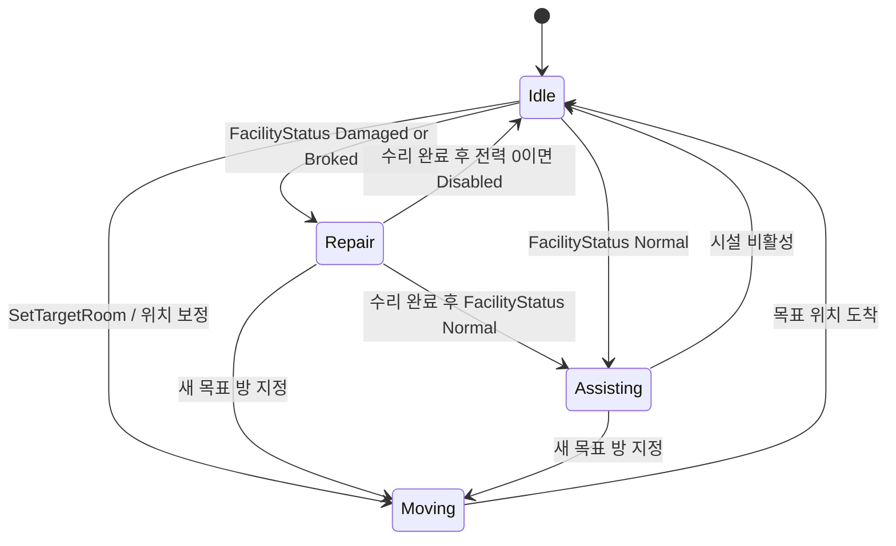

- **Moving** — 이동 명령을 받으면 SetTargetRoom이 승무원을 지금 방의 목록에서 뺀다. 그 방이 비면 시설 보조를 해제하고(AssistFacility(false)) 수리 진행도를 초기화한(ResetRepairProgressOnEmptyRoom) 뒤 Moving으로 바꾼다. 이동 중에는 목표 방의 배치 위치까지 MoveTowards로 이동하고, 도착하면 TargetRoom을 비우고 Idle로 전환한다.
- **Idle** — 매 프레임 시설 보조를 해제하고(AssistFacility(false)), 방이 비었으면 수리 진행도를 초기화한다(ResetRepairProgressOnEmptyRoom). 시설이 비활성화된 경우에도 Idle을 유지한다.
- **Repair** — Damaged 또는 Broked 시설에서 시설 보조를 해제하고(AssistFacility(false)) Room.RepairFacility를 호출한다. 수리 진행도가 RepairDuration에 도달할 때 시설 피해를 1만큼 복구한다.
- **Assisting** — Normal 시설에서 ApplyAssistEffectOnFacility(true)를 호출한다. 엔진·실드·무기별 보조 효과가 충전 속도에 반영된다.

#### 플레이어 입력과 개별 CrewController 사이의 상호작용 관리

<!-- 원천: v13 슬라이드 28 -->

PlayerController가 클릭 대상을 판별하고, CrewSystem이 선택 목록과 목표 방을 관리해 개별 CrewController에 명령을 중계한다.

**CrewSystem.cs · 선택·목표 방 중계**

```csharp
public void AddSelectedCrew(CrewController crew)
{
    if (!CanRunCrewLogic()) return;
    crew.IsSelected = true;
    selectedCrews.Add(crew);
}

public void SetTargetRoom(Room room)
{
    if (selectedCrews.Count == 0) return;
    targetRoom = room;
    SetTargetToCrew();
}
```

**PlayerController.cs · 클릭 입력 분기**

```csharp
if (isPlayerCrewSelected)
{
    crewSystem.AddSelectedCrew(crew);
}

if (roomCol != null)
{
    Room room = GetRoomByPositionOrNull(roomCol.transform.position);
    crewSystem.SetTargetRoom(room);
}
```

- **입력 수집과 선택** — PlayerController는 좌클릭한 플레이어 승무원을 찾아 CrewSystem.AddSelectedCrew로 전달한다. 선택 상태는 CrewController와 selectedCrews 목록에 함께 기록된다.
- **이동 명령 전달** — 방 우클릭 시 PlayerController가 Room을 찾아 CrewSystem.SetTargetRoom을 호출한다. CrewSystem은 방 정원이 찼는지 확인한 뒤 선택된 승무원에게 SetTargetRoom을 전달한다.

#### CrewStatus 전환 조건

<!-- 원천: v13 슬라이드 29 -->

UpdateCrewStatus 외에도 SetTargetRoom, MoveToTargetRoom, TakeDamage가 상태와 승무원 생존 흐름에 직접 영향을 준다.

- **Moving** — SetTargetRoom이 목표 방을 저장하고 crewStatus를 Moving으로 바꾼다. 이동 중에는 UpdateCrewStatus가 다른 작업 상태로 덮어쓰지 않는다.
- **Idle** — MoveToTargetRoom이 목표 위치에 도착하면 Idle이 된다. 시설이 Disabled이거나 배치 위치를 맞추는 과정이 끝난 뒤에도 Idle 상태가 된다.
- **Repair** — 이동이 아닌 상태에서 현재 방 시설이 Damaged 또는 Broked이면 UpdateCrewStatus가 Repair로 전환한다. HandleStatus는 수리 진행도를 누적한다.
- **Assisting** — 현재 방 시설이 Normal이면 Assisting으로 전환한다. HandleStatus가 보조를 적용하며, 새 이동 명령이나 시설 상태 변화가 있으면 다음 프레임에 다시 판단한다.

#### 방 · 승무원 · 함선의 상호작용 코드

<!-- 원천: v13 슬라이드 30 -->

Room은 작업 단위, CrewController는 상태별 실행자, ShipController는 방 피격 뒤 함선 전체 피해를 처리하는 경계다.

**Room.cs · 시설 수리**

```csharp
public void RepairFacility()
{
    float repairDuration = FacilitySystem.RepairDuration;
    float newRepairProgress = FacilitySystem.RepairProgress;
    newRepairProgress = Mathf.Min(repairDuration, newRepairProgress + Time.deltaTime);

    if (newRepairProgress == repairDuration)
    {
        FacilitySystem.Repair(1);
        newRepairProgress = 0f;
    }

    FacilitySystem.RepairProgress = newRepairProgress;
}
```

**CrewController.cs · 상태별 작업**

```csharp
private void HandleStatus()
{
    switch (crewStatus)
    {
        case CrewStatus.Moving:
            MoveToTargetRoom();
            break;
        case CrewStatus.Idle:
            AssistFacility(false);
            ResetRepairProgressOnEmptyRoom(CurrentRoom);
            break;
        case CrewStatus.Repair:
            AssistFacility(false);
            RepairFacilityInRoom();
            break;
        case CrewStatus.Assisting:
            AssistFacility(true);
            ResetRepairProgressOnEmptyRoom(CurrentRoom);
            break;
    }
}
```

**ShipController.cs · 방 피해**

```csharp
public void TakeDamageToRoom(int damage, int crewDamage, int roomId)
{
    Room room = GetRoomByIdOrNull(roomId);
    room.TakeDamageToCrews(crewDamage);
    StartCoroutine(SetRoomHitCoroutine(room));
    if (room.HasFacility) room.TakeDamageToFacility(damage);
    TakeDamage(damage);
    CheckGameOver();
}
```

- **Room** — 승무원이 수리할 때 진행도를 누적하고 완료 시 FacilityController.Repair를 호출한다. Room은 승무원 목록과 시설 참조를 함께 보관한다.
- **CrewController** — Moving·Idle·Repair·Assisting에 따라 이동, 보조 해제, 수리, 보조 적용 메서드를 나눠 실행한다.
- **ShipController** — RoomId로 피격 방을 찾고 승무원·시설 피해, 선체 HP 감소, 게임 종료 확인을 한 흐름으로 처리한다.

#### 승무원 선택 · 이동 · 작업 · 피해 흐름

<!-- 원천: v13 슬라이드 31 -->

CombatSystem은 제외하고, 플레이어 입력부터 CrewSystem·CrewController·Room 사이의 순서만 표현했다.

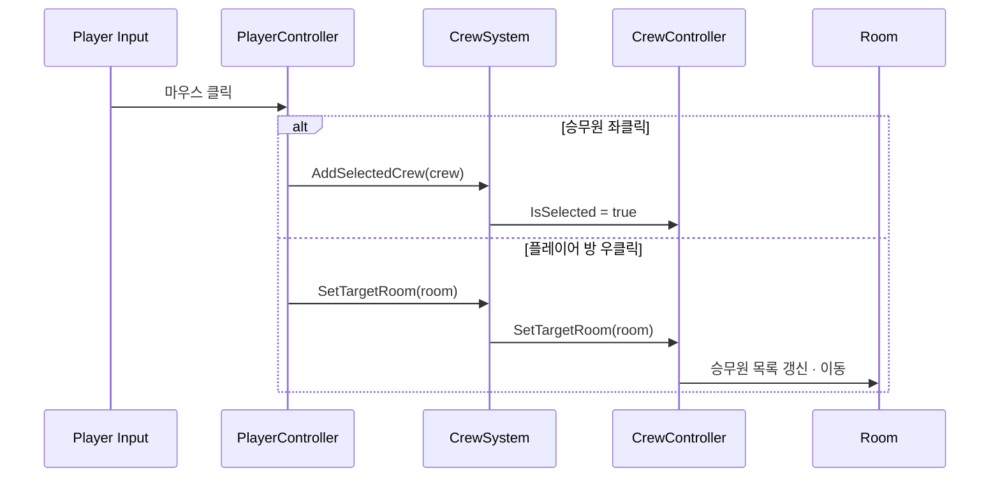

- **이동** — 좌클릭으로 승무원을 선택한 뒤 플레이어 방을 우클릭하면 CrewSystem이 선택 목록을 순회해 각 CrewController의 목표 방을 설정한다. 방의 승무원 목록과 배치 위치도 갱신된다.
- **작업** — 도착 뒤 CrewController는 Room의 FacilityStatus를 확인한다. 손상·파괴 시설은 수리하고, 정상 시설은 보조해 시설별 충전·효과를 돕는다.
- **피해** — 방 피격 시 Room.TakeDamageToCrews가 내부 승무원에게 피해를 전달한다. 사망한 승무원은 CrewSystem.HandleCrewDeath를 거쳐 목록과 방에서 제거된다.

### 3.4 환경 효과와 공통 입력

#### 환경 효과

<!-- 원천: v13 슬라이드 32 -->

소행성과 태양 플레어 이벤트가 전투 중 임의의 방에 피해를 주는 상황을 만든다.

**환경 효과를 넣은 이유** — 전투가 벌어지는 환경을 다양하게 연출하고, 플레이에 역동성을 더하기 위해서다.

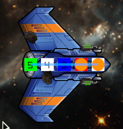

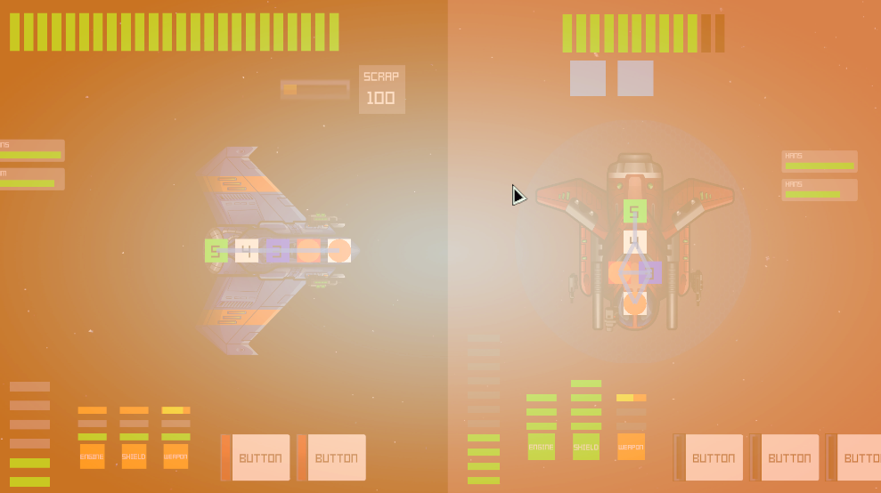

**ASTEROID**

- 무작위로 고른 방을 목표로 투사체를 생성한다.
- 투사체는 일반 공격과 같이 목표 위치까지 이동한다.
- 도착 시 CombatSystem의 방 충돌 처리로 이어진다.

**SOLAR FLARE**

- 플레어 연출 뒤 선택된 방에 직접 피해를 적용한다.
- ShipController.TakeDamageToRoom을 직접 호출한다.
- 전투가 끝나면 환경 효과 코루틴도 멈춘다.

#### 환경 효과 핵심 코드

<!-- 원천: v13 슬라이드 33 -->

환경 코루틴은 전투 상태와 스테이지 유형을 확인한 뒤, 일정 시간마다 소행성 또는 태양 플레어 효과를 실행한다.

**EnvironmentController.cs · 이벤트 주기**

```csharp
private IEnumerator EnvironmentCoroutine()
{
    while (true)
    {
        if (!GameManager.Instance.CanRunCombat) break;
        if (isSunStage)
        {
            yield return new WaitForSeconds(effectInterval - solarFlareController.FlareDuration);
            solarFlareController.ApplyFlareEffect();
            yield return new WaitForSeconds(solarFlareController.FlareDuration);
            ApplyEnvironmentEffect();
        }
        else
        {
            yield return new WaitForSeconds(effectInterval);
            ApplyEnvironmentEffect();
        }
    }
}
```

**환경별 피해 경로**

```text
Asteroid
  → ProjectileController 생성 · 목표 방으로 이동
  → 도착 시 CombatSystem.HandleRoomCollision()

Solar flare
  → ShipController.TakeDamageToRoom(roomDamage, crewDamage, room.Id)
  → CombatSystem.SetFloatingText(...)
```

- **전투 상태 확인** — GameManager.Instance.CanRunCombat이 false가 되면 코루틴을 중단한다. 전투가 끝난 뒤 환경 효과가 계속 실행되지 않게 한다.
- **피해 처리** — 소행성은 투사체로 이동한 뒤 충돌 처리를 요청한다. 태양 플레어는 ShipController.TakeDamageToRoom을 직접 호출한다. 두 경우 모두 방·시설·승무원·함선 체력 처리로 이어진다.

#### 공통 입력: 승무원 선택과 적 방 조준

<!-- 원천: v13 슬라이드 34 -->

PlayerController는 클릭 위치의 방·함선 소속·승무원 콜라이더를 판별해 무기 조준 또는 승무원 명령으로 전달한다.

**입력 대상 판별**

```csharp
Collider2D[] clickCols =
    Physics2D.OverlapPointAll(worldPoint, clickableLayer);

foreach (Collider2D col in clickCols)
{
    ReadClickedCollider(col, roomLayer, shipLayer, crewLayer,
        ref roomCol, ref shipSide, ref crew);
}
```

**좌·우클릭 결과 분기**

```csharp
// 좌클릭: 적 방 → WeaponSystem, 플레이어 승무원 → CrewSystem
if (isEnemyRoomSelected)
    WeaponController.SetSelectedRoomTarget(targetData);
if (isPlayerCrewSelected)
    crewSystem.AddSelectedCrew(crew);

// 우클릭: 플레이어 방 → 선택된 승무원의 목표 방
crewSystem.SetTargetRoom(room);
```

- **레이어 기반 판별** — 같은 마우스 위치의 콜라이더를 수집한 뒤 Room·Ship·Crew 레이어와 소속 ShipSide를 확인한다. 적 방과 플레이어 승무원이 다른 명령으로 분기되는 기준이다.
- **명령 경계** — 무기 조준은 적 방의 좌표·RoomId를 WeaponSystem에 전달한다. 승무원 이동은 플레이어 방 객체만 CrewSystem에 전달해 선택 목록을 통해 실행한다.

---

## 4. 고민과 선택

### 4.1 설계 고민: 전력 상태 유효성 보장 위치

<!-- 원천: v13 슬라이드 13 -->

반응로에서 시설 전력을 할당·회수하거나, 시설 피해로 최대 전력보다 현재 할당량이 커질 때 유효성을 어디에서 보장할지 정해야 했다.

**PROBLEM**

- 반응로 가용 전력과 시설 할당 전력을 동시에 바꿀 때, 최대 전력 초과·0 미만·피해 후 초과 전력을 일관된 흐름으로 막아야 했다.
- 시설 피해로 maxPower가 감소했을 때 이미 할당된 전력이 남아 있으면 초과분을 회수해야 했다.
- 이때 반응로와 시설 값을 같은 요청 안에서 바꾸면서도, 각 객체가 자신의 범위를 벗어나지 않게 해야 했다.
- 전력 할당·회수 시 반응로와 시설 전력의 변화 흐름을 직관적으로 파악하면서 빠르게 구현하기 위해, 단일 전력 관리자로 구현할지, 반응로·시설·상호작용 객체 세 개로 분리할지 고민했다.

**DECISION BASIS**

| 선택지 | 전력 유효성 보장 | 할당,회수 책임 | 규칙 추가 시 수정 범위 | 흐름 확인 |
|---|---|---|---|---|
| **단일 전력 관리자**<br>한 객체가 반응로의 가용 전력과 시설별 전력, 피해에 따른 최대 전력 한계를 함께 갱신한다. | 단일 전력 관리 객체에서 자체적으로 시설, 반응로 전력 유효성을 보장한다. | 전력 할당, 회수 같은 상호작용과 상태 변경을 단일 객체가 모두 처리한다. | 반응로 과부하나 시설 상태 규칙이 늘면 중앙 객체의 여러 분기를 함께 수정해야 한다. | 호출자는 하나만 보면 되지만, 어떤 규칙이 어떤 값을 바꾸는지는 내부 분기를 따라 확인해야 한다. |
| **상태,상호작용 분리**<br>ReactorController와 FacilityController가 각자 현재 전력과 최대 전력 한계를 보관한다. | 반응로 객체와 시설 객체에서 각각 자기 전력 값이 유효한지 보장한다. | ShipPowerController가 전력 할당, 회수 같은 상호작용의 가능 여부를 확인하고 두 객체에 변경을 요청한다. | 반응로 규칙은 ReactorController에, 시설 규칙은 FacilityController에 각각 추가할 수 있다. | 할당,회수 시 세 객체의 호출 순서를 따라가야 하지만, 상태 변경 책임은 각 객체에서 바로 확인할 수 있다. |

### 4.2 현재 구조: 상태와 전력 이동 분리

<!-- 원천: v13 슬라이드 14 -->

ReactorController와 FacilityController는 각 전력 값을 관리하고, ShipPowerController가 할당·회수 흐름을 조정한다.

**SELECTED SOLUTION**

- ReactorController와 FacilityController가 각각 자기 전력 상태를 관리한다.
- ShipPowerController가 두 객체 사이의 전력 할당,회수 요청을 조정한다.

**장점**

- 반응로와 시설의 각 전력 상태 유효성을 검증하는 위치를 나눠 책임을 명확히 분리한다.
- 기능 추가나 유지보수 시 전력 규칙을 봐야 할 지점을 명확히 할 수 있다.
- 반응로 과부하 같은 반응로 규칙은 ReactorController에, 시설 임시 통제 불가 같은 시설 규칙은 FacilityController에 추가할 수 있다.
- 반응로 전력과 시설 전력을 함께 바꾸는 할당,회수는 ShipPowerController가 가능 여부를 확인한 뒤 실행해 두 상태 객체의 강한 결합을 막는다.

**단점**

- 단일 전력 관리자와 달리 전력 할당을 확인하려면 반응로, 시설, 상호작용 객체를 여러 개 준비해야 한다.
- 테스트도 세 객체가 전력을 확인하고 변경하는 순서까지 함께 검증해야 한다.
- 작은 규칙만 있는 현재 범위에서는 한 객체 안에서 값을 확인하는 방식보다 초기 구현과 호출 흐름 파악에 시간이 더 든다.

**다시 만든다면**

현재 구현 범위에서는 시설 전력 한계와 시설 피해 뒤 달라지는 최대 전력만 전력 관리 규칙에 관여한다. 따라서 단일 전력 관리 객체로 먼저 구현한다.

- 예시 1. 시설별 이온 피해나 해킹 상태
- 예시 2. 반응로 과부하와 공급 제한

확장 가능성만 예상해 미리 분리하기보다 실제 규칙 증가로 책임이 갈라지는 시점에 리팩터링한다.

### 4.3 설계 고민: 전력 UI 갱신 책임

<!-- 원천: v13 슬라이드 15 -->

전력 할당·회수, 피해로 인한 한계 변화가 화면에 반영될 때 UI 호출을 어느 위치에 둘지 비교했다.

**PROBLEM**

- 전력 할당·회수뿐 아니라 시설 피해, 수리, 최대 전력 한계와 시설 상태 변화도 전력 UI에 반영해야 했다.
- 전력 UI는 현재 할당 전력, 최대 전력 한계, 시설 피해, 시설 활성 또는 비활성 상태를 함께 표시한다.
- 따라서 상태가 변경될 때마다 전력 로직이 UI 갱신을 직접 요청할지, UI가 현재 상태를 주기적으로 확인해 스스로 갱신할지 결정해야 했다.

**DECISION BASIS**

| 선택지 | UI 갱신 누락 가능성 | 전력 로직과 UI 결합 | 변경 시 수정 범위 | 조회 비용과 확장성 |
|---|---|---|---|---|
| **전력 로직이 직접 갱신**<br>상태 변경 메서드 마지막에서 PowerViewer.Refresh()를 직접 호출한다. | 피해, 수리, 상태 전환, 초기화 경로마다 호출을 빠뜨리면 화면만 이전 상태로 남을 수 있다. | 전력 상태 객체가 구체적인 Viewer의 갱신 시점도 알아야 하므로 두 객체의 결합도가 높아진다. | UI에 영향을 주는 상태 변경 경로가 늘 때마다 각 메서드와 테스트에 Refresh 호출을 추가한다. | 매 프레임 조회 비용은 없지만, 여러 객체가 반응하거나 초기 동기화가 필요하면 호출 경로 관리가 복잡해진다. |
| **뷰어가 상태를 조회**<br>FacilityPowerViewer와 ReactorViewer가 LateUpdate에서 주요 상태를 읽고 전력 바를 다시 표시한다. | 뷰어가 현재 상태를 직접 읽으므로 전력 로직에서 UI 호출을 빠뜨릴 가능성이 낮다. | Viewer가 공개 상태를 읽지만 전력 로직은 구체적인 UI 객체를 직접 참조하지 않는다. | 상태 변경 경로가 추가되어도 Viewer가 같은 상태를 참조하면 별도 갱신 호출을 넣지 않는다. | 시설은 3개이고 전력 바도 최대 8개여서 현재 조회와 표시 비용은 작다. 시설과 UI 수가 크게 늘면 다시 확인해야 한다. |
| **상태 변경 이벤트 사용**<br>전력 또는 시설 상태가 바뀔 때 이벤트를 발생시키고 UI가 이를 구독해 갱신한다. | 이벤트 발생과 구독이 모두 정확하면 직접 호출보다 갱신 누락을 줄일 수 있다. | 전력 로직은 UI 객체 대신 이벤트 계약에 의존하므로 구체적인 뷰어와는 분리된다. | 사운드나 로그처럼 새 반응 객체는 구독을 추가할 수 있지만, 이벤트 발생 지점과 초기 동기화를 함께 관리해야 한다. | 매 프레임 조회는 없지만 이벤트 등록, 해제, 초기 상태 반영이 추가되어 현재 규모에서는 복잡성이 커진다. |

### 4.4 현재 구현: 뷰어의 매 프레임 갱신

<!-- 원천: v13 슬라이드 16 -->

FacilityPowerViewer와 ReactorViewer는 LateUpdate에서 현재 전력·피해 값을 읽어 전력 바를 다시 표시한다.

**SELECTED SOLUTION**

- FacilityPowerViewer와 ReactorViewer가 매 프레임 현재 상태를 읽는다.
- 현재 할당 전력과 최대 전력 한계, 피해, 활성 상태를 기준으로 전력 바를 다시 표시한다.

**장점**

- 전력 UI의 변경 원인이 전력 할당,회수 하나로 한정되지 않기 때문이다.
- 시설 피해, 수리, 상태 전환, 초기화처럼 UI에 영향을 주는 경로가 늘어도 뷰어는 현재 할당 전력, 최대 전력 한계, 피해, 활성 상태를 같은 방식으로 확인한다.
- 직접 호출 방식과 달리 각 상태 변경 메서드에서 Refresh 호출을 기억할 필요가 없다.
- 시설은 3개이고 시설당 전력 바도 최대 8개여서, 정수와 상태 값 몇 개를 읽고 표시하는 비용은 현재 규모에서 크지 않다고 판단했다.

**단점**

- 상태가 변하지 않아도 매 프레임 주요 필드를 조회하고 전력 바의 색상과 활성 상태를 다시 설정한다.
- UI는 시설 객체가 공개하는 상태 구조에 의존한다.
- 시설과 UI 수가 크게 늘어나면 지속적인 조회와 표시 비용도 함께 증가할 수 있다.

**다시 만든다면**

현재처럼 시설 수가 적고 상태 변화를 보는 대상이 UI 하나라면, 매 프레임 조회 방식을 다시 사용한다.

- 예시 1. 시설 수나 UI 복잡도가 증가해 매 프레임 조회 비용이 실제 성능 문제로 측정되는 경우
- 예시 2. 사운드, 튜토리얼, 로그처럼 UI 외 객체도 같은 상태 변화에 반응해야 하는 경우

모든 UI 변경이 하나의 중앙 메서드를 반드시 거친다면, 상태 변경 직후 Refresh를 직접 호출하는 방식도 다시 검토한다.

### 4.5 설계 고민: 적 무기가 공격할 플레이어 방 정보 제공자 선정 문제

<!-- 원천: v13 슬라이드 22 -->

적 무기가 어떤 플레이어 방을 목표로 삼을지 결정하는 규칙을 무기 시스템 내부에 둘지, 별도 제공자로 분리할지 비교했다.

**PROBLEM**

- 플레이어가 무기의 목표 지점을 정해주는 것과 달리, 적은 자체적으로 공격할 목표 지점을 알려주는 시스템이 필요했다.
- 공격할 함선이 몇 개의 방으로 구성되어 있는지에 대한 방 정보를 어디에 저장하고, 누가 무기에게 목표 지점을 알려줄지 정해야 했다.
- 특정 시설이 있는 방만 공격할지, 랜덤으로 방 하나를 선택할지 목표 지점 선택 방식도 다양하게 해야 했다.

**DECISION BASIS**

| 선택지 | 목표 정보 유효성 | 조준 책임 위치 | 공격 규칙 추가 시 수정 | 요청 흐름 |
|---|---|---|---|---|
| **WeaponSystem 직접 보관**<br>WeaponSystem이 대상 함선의 Room 목록을 직접 보관하고 공격할 방 선택 규칙도 실행한다. | 무기 객체가 Room 목록과 선택 결과를 함께 확인해야 하므로 방 정보와 무기 상태가 한곳에 섞인다. | WeaponSystem이 무기 충전, 발사 외에 적이 공격할 방을 고르는 책임도 가진다. | 특정 시설 우선이나 랜덤 선택 규칙을 더하면 WeaponSystem의 방 정보와 선택 코드를 함께 수정해야 한다. | 목표 생성과 발사가 한 객체에서 이어져 짧지만, 무기 상태와 방 선택 규칙이 결합된 흐름을 확인해야 한다. |
| **ITargeting 주입**<br>ITargeting 구현체가 대상 함선의 Room 목록에서 목표 방을 고르고 무기에 필요한 정보를 제공한다. | Targeter가 유효한 Room을 반환하고 WeaponController가 RoomId와 목표 좌표를 만들어 투사체에 전달한다. | RandomTargeter 같은 제공 객체가 조준 규칙을 담당하고 WeaponSystem은 목표 정보 사용과 발사만 맡는다. | 새 조준 규칙은 ITargeting 구현체를 추가하거나 교체해 적용하므로 무기 충전과 발사 코드를 수정하지 않는다. | EnemyController가 Targeter를 만들고 WeaponSystem에 주입하는 초기화 흐름은 별도로 따라가야 한다. |

### 4.6 선택한 해결책: ITargeting 주입

<!-- 원천: v13 슬라이드 23 -->

무기 시스템은 조준 규칙을 직접 알지 않고, 초기화 시 연결된 ITargeting 구현체에서 목표 방 정보를 받는다.

**SELECTED SOLUTION**

- ITargeting 구현체가 적이 공격할 플레이어 방을 선택한다.
- EnemyController가 해당 객체를 만들고 WeaponSystem에 주입하면, WeaponSystem이 각 WeaponController에 전달한다.

**장점**

- WeaponSystem이 Room 목록이나 방 선택 규칙을 직접 보관하지 않고, 충전과 발사에 필요한 목표 정보만 사용한다.
- RandomTargeter는 Room 하나를 선택하고, 특정 시설 우선 공격처럼 다른 규칙이 필요하면 같은 ITargeting 인터페이스를 구현한 제공자로 교체할 수 있다.
- 무기 충전, 발사 조건, 조준 규칙의 수정 위치가 나뉘므로 조준 규칙을 추가해도 WeaponSystem의 발사 코드를 함께 바꾸지 않아도 된다.

**단점**

- WeaponSystem이 방 정보를 직접 보관하는 방식보다 EnemyController의 초기화와 ITargeting 주입 흐름을 추가로 확인해야 한다.
- 새 조준 방식을 추가하면 구현체가 반환한 Room에서 만든 RoomId와 목표 좌표가 무기와 투사체가 기대하는 값인지 별도로 테스트해야 한다.
- 조준 규칙이 무기 코드 밖에 있으므로 목표가 없거나 잘못 주입된 경우에는 제공 객체까지 추적해야 한다.

### 4.7 설계 고민: 투사체 피해 판정 시점 고민

<!-- 원천: v13 슬라이드 24 -->

투사체가 발사된 뒤 실드 상태가 바뀔 수 있으므로, 발사 시점과 도착 시점 중 언제 피해를 확정할지 정해야 했다.

**PROBLEM**

- 여러 투사체가 비행하는 동안 먼저 도착한 투사체가 실드를 제거할 수 있다.
- 피해 경로는 실드 피해와 방 피해로 나뉘며, 각 투사체는 실제 충돌 순서에 맞는 한 경로만 실행해야 했다.
- 발사 시점에 피해를 확정하면 도착 순간의 실드·방 상태를 반영하지 못한다.

**DECISION BASIS**

| 선택지 | 현재 실드,방 상태 반영 | 피해 판정 책임 | 규칙 변경 시 수정 범위 | 흐름 확인 |
|---|---|---|---|---|
| **발사 직후 확정**<br>WeaponController가 투사체를 발사할 때 CombatSystem에 실드 또는 방 피해 판정을 요청한다. | CombatSystem은 발사 순간의 상태를 기준으로 판정하므로, 뒤에 바뀐 실드와 방 상태는 피해 결과에 반영되지 않는다. | WeaponController는 투사체 발사와 CombatSystem 판정 요청 시점을 맡고, CombatSystem이 실드 또는 방 피해를 처리한다. | 실드 규칙이나 투사체 도착 순서가 바뀌면 발사 시점의 판정 요청과 CombatSystem의 피해 처리 조건을 함께 수정해야 한다. | WeaponController에서 CombatSystem으로 요청한 뒤 투사체는 화면에 이동하지만, 피해 결과는 이미 발사 시점에 확정된다. |
| **도착 시점 판정**<br>ProjectileController가 실드 충돌 또는 목표 방 도달 시 CombatSystem에 현재 상태 판정을 요청한다. | 도착 순간의 실드 수와 목표 방 상태를 확인하므로 앞선 투사체가 바꾼 상태를 반영한다. | 투사체는 이동과 충돌 요청을 맡고 CombatSystem이 실드 또는 방 피해 경로를 결정한다. | 피해 규칙은 CombatSystem의 충돌 처리 경계에서 바꾸므로 무기 충전과 투사체 이동 코드를 건드리지 않는다. | 투사체에서 CombatSystem으로 요청이 이어지며, 이동, 트리거, 도착 순서를 포함해 확인해야 한다. |

### 4.8 선택한 해결책: 투사체 도착 시 피해 판정

<!-- 원천: v13 슬라이드 25 -->

투사체는 이동과 충돌 요청 시점을 책임지고, CombatSystem은 도착 순간의 현재 실드·방 상태를 기준으로 피해를 해결한다.

**SELECTED SOLUTION**

- 실드 충돌 또는 목표 방 도달 시 ProjectileController가 CombatSystem에 현재 상태 판정을 요청한다.
- CombatSystem은 도착 순간의 실드 상태를 확인한 뒤 실드 피해 또는 방 피해를 처리한다.

**장점**

- 먼저 도착한 투사체가 실드를 제거하면 뒤이어 도착한 투사체는 현재 상태를 다시 확인해 방에 도달할 수 있다.
- 발사 시점에 미래 실드 상태를 예측하거나 피해 결과를 예약하지 않아도 된다.
- 투사체는 목표 위치까지의 이동과 충돌 요청에 집중하고, 실드와 방의 피해 규칙은 CombatSystem에서 함께 확인할 수 있다.

**단점**

- WeaponController가 발사 시점에 CombatSystem 판정을 요청하는 방식보다 WeaponController, ProjectileController, CombatSystem, 실드 또는 방으로 이어지는 호출 흐름이 길다.
- 이동, 트리거, 도착 순서 오류가 피해 판정 오류로 이어질 수 있어 시간 경과와 여러 투사체 순서를 포함한 통합 테스트가 필요하다.
- 충돌 시점의 현재 상태를 확인하므로 디버깅할 때도 무기 발사부터 전투 시스템 요청까지의 흐름을 함께 봐야 한다.

### 4.9 승무원 이동 범위: 직접 이동으로 최소 루프를 완성한 이유

<!-- 원천: v13 슬라이드 35 -->

그래프 기반 최단 경로는 후순위로 두고, 선택·이동·수리·보조·피해가 이어지는 최소 기능을 먼저 구현했다.

**CREW MOVEMENT · SCOPE DECISION**

| 문제 정의 | 적용한 범위 |
|---|---|
| 필요한 전투 연결 | 승무원 선택, 목표 방 지정, 방 인원 제한, 이동, 시설 수리·보조, 피격 피해와 사망 |
| 후순위로 둔 기능 | 방 연결 정보를 이용한 BFS 최단 경로, 화재 진압, 적 승무원 이동 AI |
| 현재 이동 방식 | CrewController가 목표 방의 배치 위치를 향해 직접 이동하고, 도착 뒤 시설 상태에 따라 작업을 결정 |

**왜 문제가 됐나**

승무원 이동에 경로 탐색까지 포함하면 방 연결 데이터와 탐색, 재명령 처리까지 함께 검증해야 했다. 전력·무기·적 자동 공격·전투 결과를 연결해야 하는 일정에서는 이동 자체를 전투 루프에 먼저 포함시키는 것이 우선이었다.

**무엇을 적용했나**

CrewSystem이 선택된 승무원에게 목표 방을 전달하고, CrewController는 Vector3.MoveTowards로 목표 방의 배치 위치까지 이동하게 했다. 도착 후에는 방의 FacilityStatus를 읽어 손상된 시설은 수리하고 정상 시설은 보조한다.

**결과와 개선 방향**

직접 이동으로 선택→이동→작업→피해·사망 흐름을 기간 내 연결할 수 있었다. 다만 방 연결관계가 전투 규칙이 되는 확장에서는 RoomGraph 기반 경로 탐색을 별도 테스트 환경에서 검증한 뒤 추가해야 한다.

### 4.10 승무원과 방의 상태를 함께 관리한 이유

<!-- 원천: v13 슬라이드 36 -->

승무원의 위치·작업과 방의 정원·피해·시설 상호작용을 현재 상태를 기준으로 연결했다.

**CREW · ROOM · FACILITY STATE FLOW**

| 상태가 필요한 이유 | 현재 적용 구조 |
|---|---|
| 승무원 위치와 목표 | CrewController가 CurrentRoom과 TargetRoom을 유지해 이동과 도착 후 작업의 기준으로 사용 |
| 방 인원과 피해 | Room이 Crews 목록과 MaxCrewCapacity를 관리하고, 방 피격 시 내부 승무원과 시설에 피해 전달 |
| 명령 중계 | PlayerController의 입력은 CrewSystem이 선택 목록과 목표 방으로 정리해 개별 CrewController에 전달 |

**왜 문제가 됐나**

승무원은 현재 방을 알아야 수리·보조를 수행하고, 방은 인원 제한과 피격 피해 처리를 위해 소속 승무원을 알아야 했다. 플레이어 입력에서 개별 승무원까지 직접 연결하면 명령 종류가 늘어날수록 플레이어 쪽에 세부 로직이 쌓일 수 있었다.

**무엇을 적용했나**

CrewSystem을 명령 중계 지점으로 두고, CrewController와 Room은 객체 상호작용에 필요한 일부 정보만 서로 참조하게 했다. CrewController는 현재 위치한 CurrentRoom을 유지하고, Room은 현재 방에 있는 Crews 목록을 저장한다. 이 정보를 기준으로 이동, 정원 확인, 수리·보조, 방 피격 처리를 연결하며, 그 밖의 방·승무원 정보는 CrewSystem을 통해 얻는다.

**결과와 설계 판단**

Room과 CrewController가 서로 직접 참조해 결합도가 높아졌다. 다만 객체 상호작용에 필수적인 정보인 방에 있는 승무원 목록과 승무원이 위치한 방만 직접 참조하고, 이외의 방·승무원 정보는 CrewSystem을 통해 얻도록 했다. 필요한 연결은 유지하면서 결합이 지나치게 높아지는 것을 막는 구조로 정리했다.

---

## 5. 결과 및 배운 점

### 5.1 최소 전투 루프와 실제 제작 범위

<!-- 원천: v13 슬라이드 42 -->

핵심 기능을 하나의 전투 루프로 연결하고, 실제 작업에서 소요된 설정·UI·시각 피드백까지 제작 범위로 다시 정의했다.

**MINIMUM LOOP · FINAL IMPLEMENTATION SCOPE**

| 구분        | 최종 구현과 확인 범위                                           |
| --------- | ------------------------------------------------------ |
| 핵심 전투 루프  | 전력 배분, 무기 조준·피해, 적 자동 공격, 승리·패배·도망, 전투 준비와 다음 전투 연결    |
| 승무원 최소 기능 | 선택, 직접 이동, 시설 수리·보조, 방 인원 제한, 피격 피해·사망 처리 · BFS 이동은 제외 |
| 시각 피드백    | 환경 효과, 플로팅 텍스트, 흔들림, 해상도 UI 대응을 추가해 전투 상태 변화를 읽기 쉽게 보완 |

**완성한 결과**

승무원의 BFS 이동을 제외하고, 전력·무기·승무원 기능을 적 자동 공격과 전투 결과까지 연결했다. 한 기능의 구현 완료를 개별 코드 작성이 아니라 실제 플레이 가능한 전투 흐름으로 확인했다.

**실제 제작 흐름**

7일차 계획에 비해 실제 제작에는 기획·설계·에셋 준비 1주를 포함해 총 21일이 소요됐다. 전력·시설 연결은 4일, 승무원 최소 기능과 전투 준비 연결은 각각 3일, 통합 테스트·UI 대응·시각 피드백은 6일이 걸렸다.

**범위를 다시 정의한 기준**

코드 구현만으로 작업 단위를 계산하지 않았다. 데이터 설정, Unity 오브젝트 계층과 참조, UI 연결, 시각 효과, 통합 테스트까지 완료돼야 하나의 기능이 플레이어에게 전달된다고 판단했다.

### 5.2 트러블슈팅

#### 트러블슈팅: 씬 로드 시 싱글톤이 이전 데이터를 받지 못함

<!-- 원천: v13 슬라이드 37 -->

**문제 상황** — 싱글톤 클래스 간 Awake 순서, 즉 초기화 순서가 제대로 보장되지 않아 문제가 발생했다.

**수정 전 · SingletonBase.cs / ShipController.InitRooms**

```csharp
namespace Utilities
{
    public abstract class SingletonBase<T> : MonoBehaviour
        where T : MonoBehaviour
    // … 클래스 본문 생략
}

// ShipController.InitRooms()
crewSystem.Rooms = Rooms;
```

**수정 후 · 실행 순서 지정 / Start로 이동**

```csharp
namespace Utilities
{
    [DefaultExecutionOrder(-1000)]
    public abstract class SingletonBase<T> : MonoBehaviour
        where T : MonoBehaviour
    // … 클래스 본문 생략
}

// ShipController
protected virtual void Start()
{
    crewSystem.Rooms = Rooms;
}
```

- **원인** — 초기화 중 의존 관계가 있는 클래스 간에 명시적인 순서 지정을 해 놓지 않았다.
  - 싱글톤끼리 순서를 보장할 필요는 없었고, 일부 PlayerController·ShipController 객체와 싱글톤 객체 사이의 순서 보장이 문제였다.
- **해결과 결과** — 일단 빠르게 해결하기 위해 `DefaultExecutionOrder`를 지정해 해결했다. 고친 뒤에는 핵심 플레이 루프(전투 → 상점 → 다음 전투)를 반복해 이상이 없는 것을 확인했다. 다만 나중에 싱글톤 간 의존 관계가 더 생긴다면 의존 순서가 복잡해질 수 있다. 의존 순서를 클래스 간 호출이 아니라 각 클래스의 `DefaultExecutionOrder`를 보고 확인해야 해서다. 또한 자주 반복되는 Update 류의 실행 순서를 고정하는 것이 아니라 초기화할 때의 의존 순서를 고정하는 것이라 좋은 해결 방식은 아니다. 이 일로, 초기화 순서를 실행 순서 설정에 맡기기보다 코루틴이나 비동기 호출로 의존 관계가 코드에 명확히 드러나도록 작업하는 것이 좋다는 것을 깨달았다.

#### 트러블슈팅: 함선 사망 코루틴 중복 실행

<!-- 원천: v13 슬라이드 38 -->

**문제 상황** — 게임오버 뒤 사망 코루틴이 비정상적으로 여러 번 실행되어, 씬을 불러올 때 콘솔이 에러 로그로 도배되었다. 원래는 사망 연출이 끝난 뒤 씬을 정리하고 새 씬을 불러와야 하는데, 여러 번 실행된 사망 코루틴이 정리되지 않은 채 실행되는 도중에 씬이 정리되어 에러가 발생했다.

**수정 전 · ShipController.CheckGameOver**

```csharp
if (crewSystem.IsAllCrewDead)
{
    EBattleResult battleResult = (Ownership.ShipSide == EShipSide.Player)
        ? EBattleResult.PlayerAllCrewDead
        : EBattleResult.EnemyAllCrewDead;
    StartCoroutine(DeadCoroutine(DEAD_ANIMATION_TIME, battleResult));
}

if (IsDead)
{
    EBattleResult battleResult = (Ownership.ShipSide == EShipSide.Player)
        ? EBattleResult.PlayerShipDestroyed
        : EBattleResult.EnemyShipDestroyed;
    StartCoroutine(DeadCoroutine(DEAD_ANIMATION_TIME, battleResult));
}
```

**수정 후 · 한 번만 시작**

```csharp
EBattleResult battleResult = EBattleResult.None;
bool isGameOver = IsDead || crewSystem.IsAllCrewDead;
if (isGameOver == false || isDeadCoroutineActivated == true)
{
    return;
}

// … battleResult 결정 (수정 전과 같음, 생략)

StartCoroutine(DeadCoroutine(DEAD_ANIMATION_TIME, battleResult));

// DeadCoroutine 첫 줄
isDeadCoroutineActivated = true;
```

- **원인** — 코루틴이 한 번만 실행되도록 보장해야 하는데, 해당 처리가 빠져 있었다.
- **해결과 결과** — 코루틴 실행 상태를 저장하는 클래스 멤버를 추가해 한 번만 실행되도록 보장했다. 고친 뒤에는 결과 화면이 한 번만 뜨는 것을 확인했다.

#### 트러블슈팅: 투사체 발사 방향과 회전이 어긋남

<!-- 원천: v13 슬라이드 40 -->

**문제 상황** — 적 함선의 가운데가 아닌 방을 조준하면, 투사체가 목표 방으로 날아가면서도 머리는 함선 가운데를 향해 비스듬히 날아가는 현상이 있었다.

**수정 전 · CombatSystem.MoveToEnemyArea**

```csharp
Vector3 spawnPos = GetRandomPositionOnColliderEdge(
    nextShipCol, projectile.transform.position.z);

projectile.SetEndCol(nextShipCol);
projectile.transform.position = spawnPos;
Vector3 direction = nextShipCol.bounds.center - spawnPos;
direction.z = projectile.transform.position.z;
projectile.transform.right = direction;
```

**수정 후 · 목표 좌표 기준**

```csharp
Vector3 spawnPos = GetRandomPositionOnColliderEdge(
    nextShipCol, projectile.transform.position.z);
Vector3 targetPos = projectile.TargetPos;

projectile.SetEndCol(nextShipCol);
projectile.transform.position = spawnPos;
Vector3 direction = targetPos - spawnPos;
direction.z = projectile.transform.position.z;
projectile.transform.right = direction;
```

- **원인** — 공격하는 방의 목표 지점(`targetPos`)을 향하게 했어야 했는데, 함선의 중심 지점을 바라볼 지점으로 착각해 문제가 발생했다.
- **해결과 결과** — 함선 중심 지점 대신, 투사체가 가지고 있던 이동할 방의 목표 지점을 바라보도록 회전 방향을 바꾸니 문제가 해결되었다. 고친 뒤에는 투사체 스프라이트가 바라보는 방향이 목표 지점과 일치하는 것을 확인했다.

#### 트러블슈팅: 조준 중 일시정지하면 마우스 커서가 사라짐

<!-- 원천: v13 슬라이드 41 -->

**문제 상황** — 조준 중 메인 메뉴 키를 눌러 게임 상태가 멈출 때, 커서 UI와 무기 조준 UI가 제대로 초기화되지 않는 문제가 있었다.

- 이 수정에서 일시정지가 처음 들어갔다. 전투 씬에서 Esc로 메뉴를 열면 `GameManager.ToggleMenu`가 `SetCombatPaused(true)`를 호출하고, `Time.timeScale = 0`으로 전투를 멈춘다.
- 마우스 커서는 OS 커서를 숨기고(`Cursor.visible = false`) `CursorController`의 SpriteRenderer로 그린다. 무기를 고르면 `WeaponSystem.SetSelectedWeapon`이 `CursorController.SetCursorAim(index)`로 커서를 그 무기의 조준 스프라이트로 바꾼다.
- 수정 전 `ResetSelectedWeapon`은 `selectedWeapon = null`만 했다. 커서 스프라이트, 무기 조준점 스프라이트, 무기에 저장된 목표(`TargetData`)는 되돌리지 않았다.
- 수정 후 `ResetSelectedWeapon`은 조준점 스프라이트(`ResetWeaponTargetSprite`), 커서 스프라이트(`ResetMouseSprite`), 무기의 목표(빈 `ProjectileTargetData`, RoomId -1)를 함께 되돌린다.
- Esc 입력 처리(`ResetSelectedWeapon`, `ResetSelectedCrews`)를 `PlayerController.Update`의 조작 가능 검사(`CanControlShip`)보다 앞으로 옮겼다. 그래서 일시정지 중에도 Esc를 누르면 선택한 무기와 승무원이 초기화된다.
- 같은 수정에서 `WeaponSystem`의 `Update`, 무기 선택, 목표 지정이 `CanRunFacilityLogic()`(일시정지·전투 종료면 false) 검사를 거치게 됐고, 전투가 끝나면 `ShipController.StopCombatFunctions`가 선택한 무기를 초기화한다.

**수정 전 · WeaponSystem.ResetSelectedWeapon**

```csharp
public void ResetSelectedWeapon()
{
    selectedWeapon = null;
}
```

**수정 후**

```csharp
public void ResetSelectedWeapon()
{
    ProjectileTargetData emptyData = new ProjectileTargetData(Vector2.zero, -1);
    ResetWeaponTargetSprite(selectedWeapon);
    CursorController.Instance.ResetMouseSprite();
    if (selectedWeapon == null)
    {
        Debug.LogWarning("Selected Weapon is null. Reset failed.");
        return;
    }
    selectedWeapon.SetRoomTarget(emptyData);
    selectedWeapon = null;
}
```

- **원인** — 일시정지할 때 가지고 있는 무기 정보만 초기화할 것이 아니라, 연결된 UI(무기 조준점 스프라이트, 커서 스프라이트 등)도 같이 초기화했어야 했는데 관련 지점이 누락됐다.
- **해결과 결과** — 무기 조준 정보와 더불어 UI 초기화 로직도 추가하니 해결됐다. 고친 뒤에는 Esc처럼 조준을 해제하는 동작을 했을 때 커서 상태와 조준 스프라이트 상태가 함께 맞춰지는 것을 확인했다.

### 5.3 일정 추정과 실제 진행

<!-- 원천: v13 슬라이드 43 -->

실제 제작 기간은 기획·설계·에셋 준비 1주를 포함해 2026-06-16부터 07-06까지였고, 후반부에는 통합 테스트·UI 대응·시각 피드백 작업이 많았다.

**PLAN VS ACTUAL · MILESTONE DURATION**

| 구분          | 기간  |
| ----------- | --- |
| 계획한 1~7일차   | 7일  |
| 실제 작업 기록 합계(준비 1주 포함) | 21일 |

| 단계            | 실제 일수 |
| ------------- | ----- |
| 1일차 · 기반/데이터  | 1일    |
| 2일차 · 전력/시설   | 4일    |
| 3일차 · 무기 조준   | 2일    |
| 4일차 · 적 공격/종료 | 2일    |
| 5일차 · 승무원     | 3일    |
| 6일차 · 전투 준비   | 3일    |
| 7일차 · 통합/피드백  | 6일    |

**예상보다 오랜 시간이 걸렸던 일**

익숙하지 않은 ScriptableObject 기반 데이터베이스 설정, UI 오브젝트 계층 구성·연결, 프리팹·컴포넌트 주입 확인에 코드 작성보다 많은 시간이 소요됐다.

**실제 기록**

전력·시설 연결은 1일 계획에 비해 4일이 걸렸다. 통합 테스트, UI 대응, 시각 피드백을 다룬 마지막 단계는 6일이 걸렸다.

**느낀점**

기능 단위를 코드만으로 잡지 않는다. 데이터 설정, 씬 설정, UI, 시각 효과, 통합 테스트까지 한 작업 단위에 포함한다.

### 5.4 반복된 판단 패턴과 다음 개발 기준

<!-- 원천: v13 슬라이드 44 -->

속도와 설계 안정성 사이의 기준을 세우고, 최소 루프를 완성하는 방식으로 개발 과정을 조정했다.

**REPEATED DECISION PATTERNS**

- **30분 구현 규칙** — 완벽한 설계를 찾기 위해 오래 고민하기보다, 30분 안에 결론을 내리지 못하면 가장 단순한 구현으로 먼저 검증했다. 이 기준은 전력→무기→승무원 순으로 핵심 기능을 연결하는 데 도움이 됐다.
- **사용자 기준 테스트** — 모든 경우를 과도하게 확인하기보다 플레이어가 실제로 수행하는 행동과 전투 루프에 직접 영향을 주는 핵심 테스트케이스를 우선 선정했다. 테스트 범위를 조절해 구현 속도를 유지할 수 있었다.
- **문제 정의와 범위** — 무엇을 정적으로 두고 무엇을 동적으로 만들지, 핵심 재미 루프가 어디까지인지, 프로젝트 범위를 어디에서 멈출지를 먼저 정하는 일이 이후 설계와 개발 속도를 크게 좌우했다.

**느낀점**

- **속도와 안정성의 절충** — 확장 가능성만으로 구조를 늘리기보다, 현재 루프를 완성하는 데 필요한 안정성을 우선했다. 실제 규칙이 늘어나는 지점에서 책임 분리와 리팩터링을 다시 검토할 기준을 세울 수 있었다.
- **작은 변경의 복구 가능성** — 기능 단위로 커밋을 나눠 실수가 발생했을 때 변경을 되돌리고 다시 시도하기 쉬웠다. 빠른 구현 과정에서도 실험의 비용을 낮출 수 있는 작업 방식이라는 점을 깨달았다.

**개선점**

- **기본 테스트케이스 보완** — 핵심 테스트케이스에 집중하는 과정에서 전력 UI 상태처럼 경계값 검증을 빠뜨린 경우가 있었다. 다음에는 기능별 최소 테스트 목록에 정상·오류·경계값을 함께 포함한다.
- **기획 단계의 선행 분류** — 정적 배치와 동적 생성의 경계, UI·연출의 구현 범위, 원작에서 가져올 시스템의 깊이를 초기에 정한다. 문제 정의가 선명해야 설계 고민과 구현 시간을 필요한 곳에 집중할 수 있다.

### 5.5 구현하며 드러난 구조 문제와 다음 구현 방향

게임 루프에 필요한 기능을 먼저 동작하게 만든 뒤, 실제 코드에서 드러난 구조 문제와 다음에 바꿀 방향을 정리했다. 전력 상태·전력 UI·적 조준·피해 판정처럼 비교와 trade-off를 정리한 선택은 §4에 두고, 여기에는 그 밖에 드러난 문제만 적었다.

| 기능 | 게임 루프에서 필요했던 것 | 실제 구현 | 드러난 구조 문제 | 다음에 만든다면 |
|---|---|---|---|---|
| 승무원 작업 상태 | 승무원이 방에 도착하면 시설 상태에 따라 수리하거나 보조한다. | `CrewStatus` enum과 `HandleStatus`의 switch가 매 프레임 상태별 메서드를 호출한다(§3.3). | 상태가 바뀌는 순간 한 번 해야 할 일(보조 해제·수리 진행도 초기화)이 매 프레임 호출과 `SetTargetRoom`에 나뉘어, 어디서 처리되는지 찾기 어렵다. Idle·Assisting의 초기화 호출은 실제로는 아무 일도 하지 않는다. | 상태마다 진입·갱신·이탈을 나누는 상태 패턴을 쓴다. 한 번 할 일은 진입·이탈에, 매 프레임 할 일은 갱신에 둔다. |
| 방을 떠나는 승무원 | 승무원이 이동하거나 사망해 방이 비면 그 방 시설의 보조와 수리 진행도를 정리한다. | 이동은 `CrewController.SetTargetRoom`, 사망은 `CrewSystem.HandleCrewDeath`가 각각 방 목록에서 승무원을 뺀다. | 사망 경로는 목록에서 빼기만 하고 보조 해제·수리 진행도 초기화를 부르지 않는다. 같은 일을 두 곳에서 다르게 처리한다. | 방 목록에서 빠지는 일을 Room의 메서드 하나로 모으고, 방이 비었을 때의 정리도 그 안에서 한다. |
| 씬 사이 상태 유지 | 전투 → 상점 → 다음 전투로 넘어가도 함선·승무원 상태가 이어진다. | `SingletonBase<T>`로 만든 싱글톤과 `DefaultExecutionOrder`로 초기화 순서를 맞췄다(§5.2). | 의존 순서가 클래스 사이의 호출이 아니라 각 클래스에 붙은 실행 순서 값에 숨어 있다. | 코루틴이나 비동기 초기화로, 의존하는 객체가 준비된 뒤 이어서 초기화되는 흐름이 코드에 드러나게 한다. |
