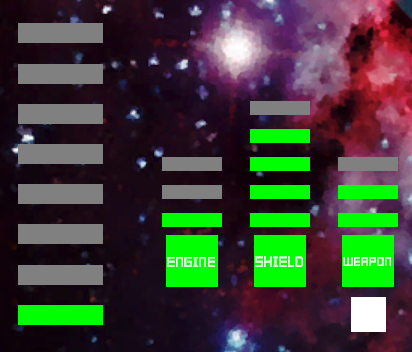
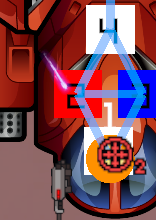
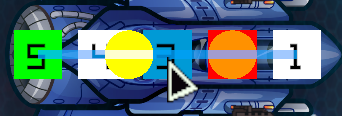
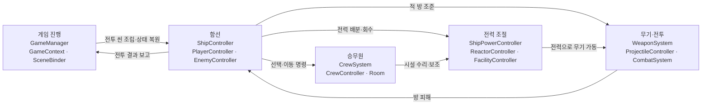
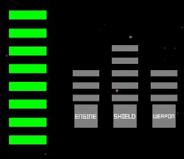
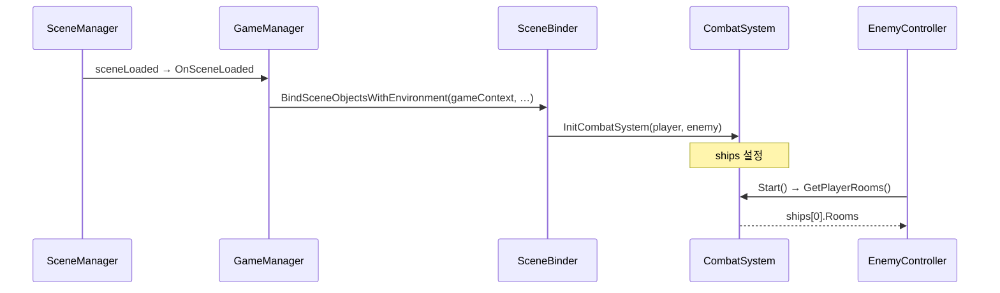
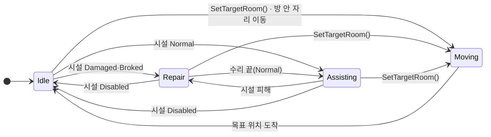

# Mini FTL — 첫 Unity 프로젝트에서 배운 설계와 검증의 기준

<!-- 원천: v13 슬라이드 01·02 -->

> **탑다운 우주 전략 프로젝트**


| 항목    | 내용                                                                                           |
| ----- | -------------------------------------------------------------------------------------------- |
| 플랫폼   | PC Windows                                                                                   |
| 개발 인원 | 1                                                                                            |
| 엔진    | Unity 6000.3.15f1                                                                            |
| 개발 기간 | 2026.06.16 — 07.06                                                 |
| 링크    | [GitHub](https://github.com/KooHoo-Dev/3rd-2D-Project-MountainHS) · 시연 영상: ✍ 직접 작성: 시연 영상 링크 |

---

## 1. 개요

### 1.1 프로젝트 소개

<!-- 원천: v13 슬라이드 02 -->

**플레이어가 함선과 승무원을 직접 조작해 상대 우주선과 전투하는 1인 제작 PC 게임**

《FTL: Faster Than Light》를 참고해, 플레이어가 함선 전력을 배분하고 승무원을 지휘하며 적 함선의 방을 직접 조준해 싸우는 2D 전략 게임을 제작했다.

### 1.2 왜 만들었나

1. **핵심 플레이 경험의 재현 가능성 검증**
   - 《FTL》의 핵심 시스템만 추려 최소한의 전투 루프로 구현했을 때도, 원작과 유사한 플레이 경험을 제공할 수 있는지 실험하고자 했다.

2. **직접 부딪히며 객체지향 설계의 필요성 깨닫기**
   - 익숙하지 않았던 객체지향 설계를 실제 게임 개발에 적용하고, 여러 시스템의 역할과 상호작용을 직접 설계하는 경험을 쌓고자 했다.
   - 처음 만드는 Unity 프로젝트라 디자인 패턴을 미리 적용하기보다, 할 수 있는 만큼 거칠게 먼저 구현했다. 구현하면서 드러난 구조적 문제를 기록하고 "이래서 이런 디자인 패턴과 객체지향 원칙을 쓰는구나"를 직접 확인하는 것을 목표로 했다.

### 1.3 핵심 경험 — 함장으로서 내리는 전략적 판단

플레이어가 함장이 되어 함선을 지휘하고, 피해를 최소화하면서 적의 약점을 공략하는 전략적 판단을 핵심 경험으로 삼았다.

- **피해 최소화:** 적의 공격을 실드로 막고, 피해 입은 시설은 승무원을 보내 수리한다.
- **약점 공략:** 적 함선의 어느 방을 먼저 무너뜨릴지 골라 무기로 노린다.
- **한정된 자원의 배분:** 반응로 전력은 모든 시설을 동시에 최대로 가동할 만큼 넉넉하지 않다. 공격과 방어 중 어디에 힘을 실을지 계속 고른다.

<!-- 촬영: 전투 중 전력·무기·승무원을 함께 다루는 장면 -->

### 1.4 핵심 루프

<!-- 원천: v13 슬라이드 04 -->

플레이어는 적 함선과 전투하고, 이기면 상점에서 함선을 정비한 뒤 다음 전투로 나아간다.


- **적 함선과 전투:** 플레이어 함선과 적 함선이 실시간으로 서로의 방을 공격한다. 적은 자동으로 조준해 공격하고, 플레이어는 전력·무기·승무원을 직접 관리한다.
- **상점에서 정비:** 반응로를 강화하고, 함선을 수리하고, 승무원을 치료해 다음 전투에 대비한다.

| 게임 승패 | 언제 |
|---|---|
| 승리 | 전투 4번 동안 생존 |
| 패배 | 어느 전투에서든 플레이어 함선이 파괴되거나 승무원이 모두 사망했을 때 |

전투를 거칠수록 더 강한 적 함선과 소행성·태양 플레어 같은 환경 위험이 더해진다. 적 함선을 파괴하거나 적 승무원을 모두 쓰러뜨리면 상점에서 쓸 고철을 얻고, 도망치면 보상 없이 상점으로 간다.

### 1.5 전투에서 플레이어가 하는 세 가지 판단

<!-- 원천: v13 슬라이드 03 -->

이 판단은 전투 중 세 가지 조작으로 이어진다. 한정된 전력을 어디에 쓸지, 적 함선의 어느 방을 노릴지, 승무원을 어디로 보낼지다.

**01 전력 관리**



- 제한된 반응로 전력을 무기·엔진·실드에 배분하고 회수한다.
- 전력이 1 이상이면 시설이 가동한다.
- 엔진·실드·무기는 전력량에 따라 강화 효과가 달라진다.

**02 무기 조준**



- 활성화된 무기를 선택하고 적 방을 직접 목표로 지정한다.
- 무기가 충전되고 목표가 유효하면 투사체를 발사한다.
- 투사체가 실드와 충돌하거나 방에 도달하면 피해 처리를 한다.

**03 승무원 관리**



- 승무원을 이동시켜 시설을 수리하거나 작동을 보조하게 한다.
- 승무원은 이동한 방의 시설 상태에 따라 손상된 시설은 수리하고, 정상 시설에서는 시설을 보조한다.

---

## 2. 시스템 구조

<!-- 원천: v13 슬라이드 05 -->

게임의 핵심 루프에 맞춰 시스템을 나눴다. 전투에 들어가면 플레이어는 전력을 조절하고(전력 조절), 승무원을 움직이고(승무원), 무기를 상대 함선의 방에 조준해(무기·전투) 전투를 진행한다. 

이 조작은 모두 함선(ShipController)을 거쳐 각 시스템에 전달된다. 전투에서 살아남으면 결과가 게임 진행(GameManager)에 보고되고, 상점에서 함선 체력 회복·전력 강화 같은 준비를 한 뒤 다음 전투 씬이 조립된다.



개발하며 가장 크게 부딪힌 곳은 이 그림의 전력 조절, 전투 씬을 다시 조립하는 게임 진행, 승무원이었다.

---

## 3. 개발 과정의 주요 사례

### 3.1 전력 관리 — 책임을 나누면 구현도 쉬워질 것이라는 판단

#### 문제와 첫 설계

FTL 전투의 핵심 조작 중 하나는 제한된 반응로 전력을 무기·엔진·실드에 나누어 공급하는 것이다. 시설에 전력을 할당하면 반응로의 가용 전력은 줄어들고, 회수하면 다시 늘어난다. 시설이 피해를 입으면 사용할 수 있는 최대 전력도 감소한다. 따라서 **반응로 가용 전력과 각 시설의 할당 전력이 서로 맞아야 하고, 피해로 바뀐 전력 한계도 반영해야 했다.**

처음에는 두 방식을 고려했다.

| 대안 | 생각했던 장점 | 예상한 부담 |
| --- | --- | --- |
| 하나의 전력 관리자가 모든 값을 보관하고 변경 | 전력 증감 흐름을 한 클래스에서 따라갈 수 있고, 필요한 객체가 적다 | 새로운 시설 규칙이 생기면 중앙 클래스에 분기가 늘 수 있다 |
| 반응로·시설·전력 이동 책임을 분리 **(실제 선택)** | 각 객체가 자기 상태를 관리해 역할이 명확해지고, 향후 규칙 추가에 대응하기 쉬울 것이라고 판단했다 | 여러 객체를 연결해야 하고 전력 이동을 따라가려면 여러 클래스를 확인해야 한다 |

당시에는 이온 피해처럼 시설의 전력 사용을 제약하는 기능까지 염두에 두고 있었다. 프로젝트에서 실제로 구현할 범위보다 **미래에 추가할 수 있는 규칙**을 더 크게 고려해, 처음부터 역할을 분리하는 방식을 선택했다.

#### 실제 구현 — 상태는 각자, 전력 이동은 중간 관리자가 처리

- `ReactorController`: 반응로의 최대 전력과 가용 전력 관리
- `FacilityController`: 시설별 할당 전력, 피해량, 사용 가능한 최대 전력 및 상태 관리
- `ShipPowerController`: 전력 할당·회수 가능 여부를 검사하고, 두 객체의 값을 변경

전력 할당 흐름은 다음과 같다.

```csharp
// ShipPowerController.AllocatePower — 핵심 부분
int currentPower = GetAssignedPower(facilityType);
int nextPower = currentPower + amount;
if (CanSpendReactorPower(amount) == false ||
    facility.CanAddPower(amount) == false ||
    CanSetFacilityPower(facility, nextPower) == false)
{
    return;
}

SetAssignedPower(facilityType, nextPower);
facility.AddPower(amount);
reactorController.ReducePower(amount);
```

이 구조는 반응로·시설·전력 이동의 역할을 구별할 수 있다는 장점이 있었다. 하지만 실제로 전력이 어떻게 바뀌는지 확인하려면 `ShipPowerController`가 보관한 할당량, `FacilityController.Power`, `ReactorController.Power`를 함께 따라가야 했다. **클래스의 역할을 구분하는 것과, 하나의 동작을 이해하기 쉽게 만드는 것은 같은 문제가 아니었다.**

#### 실제 겪은 문제 — 설계의 복잡성이 테스트 비용으로 돌아옴

전력 기능을 테스트하려면 Unity에서 반응로와 무기·실드·엔진 등 관련 컴포넌트를 준비하고 참조를 연결해야 했다. 값을 확인하거나 디버깅할 때도 여러 객체 사이를 이동해야 했다. 단일 전력 관리자라면 한곳에서 확인할 수 있었을 전력 증감 흐름이 여러 클래스로 나뉘면서, 단순한 기능을 검증하는 데 예상보다 시간이 들었다.

이처럼 전력 변경 책임이 여러 객체에 나뉜 상태에서는 작은 실수를 발견하고 수정하는 일도 번거로웠다. 실제로 시설 피해 처리 과정에서 `FacilityController.TakeDamage()`가 초과 전력을 직접 줄인 뒤 `ShipPowerController.DeallocatePower()`를 호출해, 시설 전력이 중복 감소하는 버그가 있었다. **중복된 `ReducePower()` 호출을 제거하고, `DeallocatePower()`가 전력 회수를 한 번만 처리하도록 수정했다.**

개발을 마치고 보니 처음 예상했던 이온 피해 등 추가 규칙은 실제 프로젝트에 들어가지 않았다. 미리 분리한 구조가 장기적으로 얼마나 이익을 줄 수 있는지 검증할 만큼 기능을 확장하지도 않았다. 반면 객체 연결과 전력 흐름 추적의 비용은 즉시 발생했다.

#### 시설 상태 UI — 상태의 의미를 명확히 정하지 않고 UI를 구현



전력 UI에는 전력 미할당, 전력 할당, 시설 피해, 완전 파괴 상태를 표현해야 했다. 초기에는 상태별 `if/else` 분기로 표시를 정했지만, **완전히 파괴되어 빨간색이어야 할 시설이 회색으로 표시되는 문제**를 겪었다. 이 문제를 확인하고 수정하는 데 약 2~3시간을 사용했다.

원인은 하나의 시설이 동시에 여러 조건을 만족할 수 있다는 사실을 충분히 고려하지 않은 데 있었다. 예를 들어 완전히 파괴된 시설은 전력이 0일 수도 있다. 이때 '전력 0 → 비활성' 조건을 우선하면 '완전 파괴'라는 더 중요한 상태가 가려진다. **당시에는 상태 간 우선순위만 명확히 정하면 `if/else` 분기만으로도 간단하게 해결할 수 있다고 판단했고, 실제로 조건 판정의 우선순위를 조정해 수정했다.**

최종 코드에서는 시설 상태를 다음 순서로 판정한다.

```csharp
// FacilityController.UpdateFacilityStatus — 최종 코드
if (TotalDamage == MaxPowerLimit)
    facilityStatus = FacilityStatus.Broked;
else if (TotalDamage > 0 && TotalDamage < MaxPowerLimit)
    facilityStatus = FacilityStatus.Damaged;
else if (Power == 0)
    facilityStatus = FacilityStatus.Disabled;
else if (TotalDamage == 0)
    facilityStatus = FacilityStatus.Normal;
```

또한 `FacilityPowerViewer`는 시설 상태를 기준으로 아이콘 색을 정하고, 전력 바는 할당 전력·피해량을 바탕으로 별도 표시한다. 즉, **시설 자체의 상태**와 **전력 바 각 칸의 상태**를 구분했다.

이 UI 문제는 **상태 조건의 중첩과 표시 우선순위를 먼저 정의하지 않은 실수**였다.

#### 결과와 배운 점

최종적으로 전력 할당·회수와 피해에 따른 시설 상태 변경, UI 표시까지 연결했고, 피해 시 중복 감소 문제와 UI 상태 우선순위 문제도 수정했다. 다만 처음 기대한 확장성의 효과는 확인하지 못했고, 시스템을 작게 구현하고 검증하는 데 드는 비용을 충분히 고려하지 못했다.

이 경험을 통해 세 가지 기준을 얻었다.

1. **책임 분리는 미래에 추가할지 모르는 기능보다 현재 존재하는 규칙과 변경 요구를 기준으로 한다.** 작은 프로토타입에서는 단일 관리자로 시작한 뒤, 실제로 독립적인 규칙이 생겼을 때 분리하는 방식도 고려할 수 있다.
2. **여러 객체의 상태가 함께 변하는 기능은 개별 값의 유효성뿐 아니라 객체 사이의 일관성까지 검증한다.** 전력 할당·회수·피해를 하나의 동작 단위로 보고 검증할 필요가 있다.
3. **상태를 화면에 표시하기 전에 상태의 의미와 우선순위를 먼저 정의한다.** 특히 여러 조건이 동시에 성립하는 경우 어느 상태를 보여줄지 명시하고, 그 규칙을 기준으로 테스트한다.

다시 같은 규모의 프로토타입을 만든다면 우선 한곳에서 전력 이동을 추적하고 테스트할 수 있는 단순한 구조로 시작하겠다. 이후 이온 피해처럼 서로 다른 시설의 독립 규칙이 실제로 필요해질 때 책임을 분리할 것이다. 다만 **단일 관리자가 무조건 더 낫다는 결론은 아니다.** 이번 프로젝트에서는 미래의 확장성에 대한 기대에 비해, 분리된 구조의 초기 구현·검증 비용이 더 분명하게 드러났다는 것이 핵심이다.

### 3.2 씬 전환과 초기화 — 객체가 존재하는 것과 준비된 것은 다르다

#### 문제와 초기 설계

이 프로젝트의 전투 루프는 `전투 → 상점 → 다음 전투` 순서로 반복된다. 따라서 씬이 바뀌더라도 함선 체력, 승무원 상태, 반응로 전력 등의 정보를 유지하고, 새로운 전투 씬의 함선에 다시 적용해야 했다.

처음에는 `GameManager`, `CombatSystem`처럼 여러 시스템에서 사용하는 객체를 싱글톤으로 관리하고, `DontDestroyOnLoad`를 이용해 씬 전환 후에도 유지하는 방식을 사용했다.

하지만 이 구조에는 두 가지 초기화 문제가 있었다.

- 씬을 구성하는 객체들이 서로의 초기화 결과에 의존했지만, 어떤 객체가 먼저 준비되어야 하는지 명확하게 보장하지 않았다.
- `CombatSystem`은 씬을 넘어 유지되지만, 내부에서 참조하는 플레이어·적 함선은 씬이 바뀔 때 파괴되고 다시 생성된다.

#### 실제 문제 1 — 초기화 순서에 따라 적 함선 로직이 중단됨

Unity에서 여러 컴포넌트의 `Awake`가 실행되는 순서를 고려하지 않고 초기화 코드를 작성했다. 그러다 초기화 순서가 꼬이면 적 함선의 일부 로직에서 오류가 발생해 게임이 정상적으로 진행되지 않는 문제를 겪었다.

새 전투 씬이 열리면 아래 순서로 준비돼야 적 함선이 플레이어 방을 조준할 수 있다.



`EnemyController.Start`가 `InitCombatSystem`보다 먼저 돌면 `ships`가 비어 있어 조준 초기화가 깨진다.

최종 코드에서도 객체 사이의 초기화 의존 관계를 확인할 수 있다.

```csharp
// EnemyController.Start()
targetingSystem = new RandomTargeter(
    CombatSystem.Instance.GetPlayerRooms()
);

// CombatSystem.GetPlayerRooms()
public List<Room> GetPlayerRooms()
{
    return ships[0].Rooms;
}
```

`EnemyController`는 적의 자동 조준을 초기화하면서 `CombatSystem`에서 플레이어 방 목록을 가져온다. 그런데 `ships`는 `CombatSystem.InitCombatSystem()`에서 설정되므로, 해당 초기화가 끝나기 전에 접근하면 정상적으로 동작할 수 없다.

#### 당시 해결 — 실행 순서 지정과 초기화 시점 변경

당시에는 빠르게 문제를 해결하기 위해 두 가지 방법을 적용했다.

**첫째, 싱글톤의 초기화 순서를 먼저 실행하도록 지정했다.**

```csharp
[DefaultExecutionOrder(-1000)]
public abstract class SingletonBase<T> : MonoBehaviour
    where T : MonoBehaviour
```

**둘째, 다른 객체의 초기화 결과에 의존하는 일부 코드를 `Awake`에서 `Start`로 이동했다.**

```csharp
// ShipController
protected virtual void Start()
{
    crewSystem.Rooms = Rooms;
}
```

이 변경으로 다른 객체가 준비되기 전에 참조하는 문제를 줄였다. 수정 후에는 전투에서 상점으로 이동하고 다음 전투에 진입하는 루프를 반복하며 문제가 재발하지 않는지 확인했다.

다만 이 해결책에는 한계가 있었다.

`DefaultExecutionOrder`는 Unity가 실행 순서를 관리하도록 설정하는 방법이지, 객체가 필요한 데이터를 모두 갖췄는지 보장하는 명시적인 초기화 절차는 아니다. 클래스 사이의 의존 관계가 코드의 호출 순서에 직접 드러나지 않고 실행 순서 설정에 숨게 되었다.

당시에는 문제를 해결하는 데 효과적이었지만, 시스템이 늘어날수록 어떤 객체가 먼저 초기화되어야 하는지 추적하기 어려워질 수 있다고 판단했다.

#### 관련 문제 — 씬을 넘어 유지되는 CombatSystem의 참조

초기화 순서 외에도 객체의 생명주기에 관한 문제가 있었다.

`CombatSystem`은 `DontDestroyOnLoad`로 유지되지만 내부의 `ships`, `shipAreas` 등은 전투 씬의 객체를 참조한다. 전투 씬이 종료되면 해당 객체들이 사라지므로, 다음 전투에서 기존 참조를 그대로 사용할 수 없다.

이를 해결하기 위해 `GameManager`가 씬 로드 완료를 감지하고, `SceneBinder`가 새로 생성된 함선 객체들을 찾아 `CombatSystem.InitCombatSystem()`으로 다시 연결하도록 구현했다.

결과적으로 씬 전환 후에도 전투 시스템을 사용할 수 있게 되었지만, 개발 후에는 **CombatSystem 자체가 씬을 넘어 유지될 필요가 있었는가?**라는 의문이 남았다.

`CombatSystem`의 주요 참조는 전투 씬의 함선과 콜라이더에 종속되어 있었다. 따라서 매 전투 씬에서 새로 생성하도록 했다면 이전 씬의 참조를 복원하는 과정 자체가 필요하지 않았을 것이다.

#### 결과와 배운 점

최종적으로 초기화 순서 문제를 수정했고, 전투 씬이 바뀔 때 필요한 객체를 다시 연결해 전투 루프를 동작시켰다. 하지만 싱글톤으로 객체를 유지하는 방식과 초기화 순서를 강제로 조정하는 방식이 모든 문제를 해결하는 것은 아니라는 사실을 경험했다.

이 경험에서 얻은 기준은 다음과 같다.

1. **객체의 생성과 사용 가능한 상태를 구분해야 한다.** 다른 객체의 초기화 결과가 필요하다면 해당 객체의 준비가 완료된 뒤에 사용하도록 초기화 흐름을 구성해야 한다.
2. **씬을 넘어 유지할 데이터와 씬에 종속된 객체를 구분해야 한다.** 함선의 체력과 승무원 상태처럼 유지할 데이터는 별도로 보관하되, 전투 씬의 객체를 참조하는 시스템까지 반드시 유지할 필요는 없다.
3. **실행 순서 설정은 간단한 해결책이지만 의존 관계를 감출 수 있다.** 여러 시스템이 서로의 초기화 결과에 의존한다면 초기화 순서를 한곳에서 명시적으로 제어하는 방식도 고려해야 한다.

다시 구현한다면 `GameContext`처럼 씬 사이에 유지해야 할 상태와 `CombatSystem`처럼 전투 씬에서 사용하는 객체를 먼저 분류하겠다. 그리고 새 전투 씬을 구성할 때 필요한 객체를 준비한 뒤, 명시적인 초기화 메서드를 호출해 의존 관계를 코드에서 확인할 수 있도록 만들겠다.

**이번 경험의 핵심은 싱글톤이나 실행 순서 지정 자체가 잘못됐다는 것이 아니라, 객체의 생명주기와 초기화 의존성을 먼저 이해하지 않고 사용한 데 있었다.**

### 3.3 승무원과 방 — 상태를 변경하는 책임이 여러 곳에 흩어진 문제

#### 초기 설계 — 승무원과 방이 서로를 참조

승무원은 지정된 방으로 이동하고, 그 방에 있는 시설의 상태에 따라 수리하거나 보조하는 기능이 필요했다. 또한 방이 공격받으면 내부의 승무원도 피해를 받아야 했다.

이를 구현하기 위해 승무원은 자신의 `CurrentRoom`을, 방은 소속된 승무원의 `Crews` 목록을 보관하도록 했다.

이 방식은 구현이 직관적이었다. 승무원이 방의 시설에 접근하거나, 방에서 승무원들에게 피해를 전달하기 위해 별도의 객체를 거칠 필요가 없었다.

하지만 개발 당시 **승무원과 방이 서로를 강하게 참조하는 구조가 언제 문제가 되는가, 이러한 상호작용을 별도 관리자가 담당해야 하는가**라는 의문점이 커졌다.

#### 실제 구현 — 승무원 이동과 사망의 처리 경로

승무원이 이동할 때는 `CrewController.SetTargetRoom()`에서 기존 방의 승무원 목록을 갱신한다.

```csharp
TargetRoom = room;
CurrentRoom.ReduceCrew(this);

if (CurrentRoom.IsEmptyCrew())
{
    AssistFacility(false);
    ResetRepairProgressOnEmptyRoom(CurrentRoom);
}

TargetRoom.AddCrew(this);
CurrentRoom = TargetRoom;
crewStatus = CrewStatus.Moving;
```

반면 승무원이 사망할 때는 `CrewSystem.HandleCrewDeath()`가 승무원을 찾아 방 목록에서 제거한다.

```csharp
// CrewSystem.HandleCrewDeath — 핵심 부분
ship.Crews.Remove(crew);
crews.Remove(crew);

// 승무원이 속한 Room을 검색
room.ReduceCrew(crew);
```

이동과 사망 모두 승무원이 방에서 빠지는 동작이지만, 후처리 방식이 달랐다.

- 이동 시: 승무원을 제거하고 방이 비었으면 시설 보조를 해제하고 수리 진행도를 초기화한다.
- 사망 시: 승무원을 목록에서 제거하지만 같은 후처리는 호출하지 않는다.

즉, **방이 비었을 때 필요한 정리 작업을 방 자체가 보장하지 않고, 방을 변경하는 각각의 호출자가 따로 처리했다.**

#### 개발 후 검토에서 발견한 문제

소스코드를 다시 검토하면서 두 가지 불일치 가능성을 확인했다.

**첫째, 승무원 사망 시 시설 상태의 후처리가 누락될 수 있다.**

마지막 승무원이 사망하더라도 이동할 때와 같은 보조 해제 및 수리 진행도 초기화가 실행되지 않는다. 이는 이동과 사망의 처리 경로가 분리되어 있기 때문에 발생하는 문제다.

**둘째, 승무원의 실제 위치와 소속 방 정보가 일치하지 않을 수 있다.**

`SetTargetRoom()`은 승무원의 이동이 끝나기 전에 `CurrentRoom`을 목적지로 변경한다. 실제 이동은 이후 `MoveToTargetRoom()`에서 `MoveTowards`로 진행된다.

따라서 이동 중 승무원의 시각적 위치는 출발지와 목적지 사이지만, 데이터상 소속 방은 이미 목적지다. 방을 기준으로 승무원 피해를 판정해 실제 위치와 다르게 처리되는 버그가 있었다.

#### 원인 분석 — 데이터의 책임과 상태 변경의 책임을 구별하지 않음

처음에는 승무원과 방이 서로를 참조하면 필요한 기능을 간단하게 구현할 수 있다고 생각했다.

이 판단 자체가 잘못된 것은 아니었다. 문제는 **상태를 참조하는 책임과 상태 변경의 일관성을 보장하는 책임을 구분하지 않았다는 점**이었다.

`Room`은 승무원 목록을 가지고 있지만, 승무원이 나간 뒤 시설 상태를 어떻게 정리해야 하는지는 `CrewController`가 판단하고 있었다. 이 때문에 새로운 제거 경로인 승무원 사망 처리에서는 같은 규칙이 적용되지 않았다.

승무원의 작업 상태도 `UpdateCrewStatus()`와 `HandleStatus()`에서 매 프레임 판정·실행되며, 상태 전환 시 한 번만 필요한 작업과 계속 수행할 작업이 명확히 구분되지 않았다.



이 그림에서 볼 것은 상태를 바꾸는 곳이 `SetTargetRoom`·`UpdateCrewStatus`·`MoveToTargetRoom` 세 군데라는 점이다.

#### 다시 구현한다면

승무원이 현재 위치한 방에서 나갈때 이루어지는 작업을 `Room`의 단일 메서드로 모을 것이다. 이 메서드는 승무원 목록을 변경하고, 마지막 승무원이 나간 경우 시설 보조 해제와 수리 진행도 초기화를 함께 처리하도록 한다.

또한 이동 명령의 목적지인 `TargetRoom`과 실제 소속 방인 `CurrentRoom`의 의미를 명확히 정하겠다. 실제 이동 중 어느 방에 속한 것으로 취급할지 게임 규칙을 먼저 정의한 뒤 데이터 갱신 시점을 결정할 것이다.

승무원의 상태 처리 역시 무조건 별도 상태 패턴 클래스로 분리하기보다는, 우선 기존 enum과 switch를 유지하면서 상태 진입·갱신·이탈 시의 책임을 구분하는 방법을 검토하겠다.

#### 배운 점

이 사례에서 얻은 기준은 **객체 사이의 참조 관계뿐 아니라 상태를 변경하는 모든 경로에서 같은 규칙이 적용되는지 확인해야 한다**는 것이다.

데이터를 소유한 객체와 상태 변경을 요청하는 객체의 책임을 구분하고, 여러 경로에서 공통으로 수행해야 하는 후처리는 한곳에서 보장해야 한다.

이렇게 하면 새로운 상태 변경 경로가 추가되더라도 동일한 정리 작업을 빠뜨릴 가능성을 줄일 수 있다.

### 3.4 핵심 루프 구현과 플레이 경험 — 기능을 줄이는 것만으로는 핵심 재미를 남길 수 없었다

#### 목표 — FTL의 핵심 시스템만으로 전투 경험 재현

평소 즐겨 하던 로그라이크·시뮬레이션 게임의 핵심 재미를 작은 프로젝트에서 재현할 수 있는지 확인하고 싶었다. 《FTL: Faster Than Light》에서 전력 배분, 무기 조준, 승무원 관리라는 세 가지 조작을 추려 최소 전투 루프를 구성했다.

초기 기획서에서는 플레이어가 함장이 되어 함선을 지휘하고, 피해를 최소화하며 적의 약점을 공략하는 전략적 판단을 핵심 경험으로 정의했다. 이를 위해 **전력 배분 → 공격·수리 → 전투 결과 → 상점에서 정비 → 다음 전투**가 이어지는 반복 구조를 우선 구현하기로 했다.

#### 실제 구현 결과 — 루프는 완성했지만 선택의 폭이 좁았다

전력 관리, 무기 발사와 피해 판정, 승무원의 수리·보조, 적 자동 공격, 전투 결과 및 상점으로 이어지는 기본 구조를 구현했다. 계획했던 승무원의 BFS 기반 경로 이동은 제외했고, 이동은 보다 단순한 방식으로 처리했다. 전투의 시각적 단조로움을 보완하기 위해 소행성·태양 플레어 등의 환경 효과와 피격 연출도 추가했다.

그러나 기능을 완성하는 과정에서 초기에 세운 가정의 한계가 드러났다. 처음에는 눈에 잘 보이는 조작 세 가지만 구현해도 원작과 비슷한 전략적 재미가 생길 것으로 생각했다. 개발 후에는 원작의 재미가 개별 조작뿐 아니라 다음 요소의 상호작용에서 나온다는 점을 재평가했다.

- 다양한 무기·시설이 만들어 내는 전투별 선택지
- 화재·산소 고갈·강습 등 예기치 못한 함선 내부 상황
- 텍스트 이벤트와 선택지가 제공하는 항해 맥락과 몰입

내 프로젝트에서는 이러한 선택의 폭과 사건의 변화가 제한적이었다. 전력 배분이나 조준 기능 자체는 동작했지만, 플레이어가 상황에 따라 전략을 크게 바꿀 이유는 충분하지 않았다. **기능을 재현한 것과 기능들이 결합해 만드는 플레이 경험을 재현한 것은 다른 목표였다.**

#### 또 다른 판단 오류 — 구현해야 할 일의 범위를 코드 중심으로 추정

최초 일정은 핵심 기능을 순서대로 구현하는 7단계 계획이었다. 하지만 실제 작업은 약 3주가 걸렸고, 전력·시설 단계는 4일, 최종 통합·피드백 단계는 6일이 걸렸다.

특히 `ScriptableObject` 데이터 설정, 프리팹과 컴포넌트 참조 연결, UI 계층 구성, 상점 및 전투 화면의 정보 표시, 시각 효과 등의 작업을 처음에는 별도의 개발 비용으로 충분히 계산하지 않았다. 처음 접하는 Unity 에디터 작업과 데이터 연결에 예상보다 많은 시간을 사용했다.

또한 새로운 시스템을 계속 추가하는 데 집중해 기존 기능을 한 번 더 검증하고 플레이 경험을 다듬는 시간이 부족했다. 작은 기능도 메인 전투 씬에서 바로 테스트했기 때문에 프로젝트 후반으로 갈수록 재현과 확인에 걸리는 시간도 증가했다.

#### 결과와 다음 프로젝트에서 적용할 기준

프로젝트를 통해 전투·정비 루프의 최소 동작을 구현하는 목표는 달성했다. 반면 원작과 유사한 전략적 경험을 제공했는지는 검증하지 못했다. 돌아보면 플레이어가 고를 수 있는 선택지가 적었고, 조작 안내도 부족했다.

다음에는 기능 목록을 줄이기 전에 **남길 핵심 경험과 그 경험을 만드는 상호작용**을 먼저 정의하겠다. 예를 들어 전력 배분의 재미를 검증하려면 전력을 옮기는 조작만이 아니라, 서로 다른 위협 때문에 공격·방어 중 무엇에 투자할지 갈등하는 상황이 필요하다.

또한 개발 완료 기준을 코드 구현에서 끝내지 않고, 씬·프리팹 설정, UI 안내, 피드백, 최소 플레이 테스트까지 포함하겠다. 새로운 시스템을 넓게 추가하기 전에 이미 구현한 한 사이클을 실제 플레이어가 이해하고 판단할 수 있는 수준으로 완성하는 것이 우선이다.

## 4. 결과와 회고

### 4.1 돌아보며 — 반복된 판단과 배운 점

<!-- 원천: v13 슬라이드 44 -->

속도와 설계 안정성 사이의 기준을 세우고, 최소 루프를 완성하는 방식으로 개발 과정을 조정했다.

**반복된 판단 패턴**

- **30분 구현 규칙** — 완벽한 설계를 찾기 위해 오래 고민하기보다, 30분 안에 결론을 내리지 못하면 가장 단순한 구현으로 먼저 검증했다. 이 기준은 전력→무기→승무원 순으로 핵심 기능을 연결하는 데 도움이 됐다.
- **사용자 기준 테스트** — 모든 경우를 과도하게 확인하기보다 플레이어가 실제로 수행하는 행동과 전투 루프에 직접 영향을 주는 핵심 테스트케이스를 우선 선정했다. 테스트 범위를 조절해 구현 속도를 유지할 수 있었다.
- **문제 정의와 범위** — 무엇을 정적으로 두고 무엇을 동적으로 만들지, 핵심 재미 루프가 어디까지인지, 프로젝트 범위를 어디에서 멈출지를 먼저 정하는 일이 이후 설계와 개발 속도를 크게 좌우했다.

**느낀점**

- **작은 변경의 복구 가능성** — 기능 단위로 커밋을 나눠 실수가 발생했을 때 변경을 되돌리고 다시 시도하기 쉬웠다. 빠른 구현 과정에서도 실험의 비용을 낮출 수 있는 작업 방식이라는 점을 깨달았다.

**개선점**

- **기본 테스트케이스 보완** — 핵심 테스트케이스에 집중하는 과정에서 전력 UI 상태처럼 경계값 검증을 빠뜨린 경우가 있었다. 다음에는 기능별 최소 테스트 목록에 정상·오류·경계값을 함께 포함한다.
- **기획 단계의 선행 분류** — 정적 배치와 동적 생성의 경계, UI·연출의 구현 범위, 원작에서 가져올 시스템의 깊이를 초기에 정한다. 문제 정의가 선명해야 설계 고민과 구현 시간을 필요한 곳에 집중할 수 있다.

### 4.2 무기 쪽에서 겪은 시행착오

#### 적 조준 규칙 분리 — 기획한 범위보다 큰 설계

적 무기가 공격할 플레이어 방을 고르는 규칙을 무기 시스템 밖으로 빼기 위해 `ITargeting` 인터페이스를 두었다. 특정 시설이 있는 방만 공격하거나 랜덤으로 방 하나를 고르는 등, 조준 규칙을 여러 가지로 바꿔 끼울 것으로 예상했기 때문이다.

- **실제로 만든 것:** 조준 규칙은 랜덤으로 방 하나를 고르는 `RandomTargeter` 하나였다. 규칙을 바꿔 끼울 일이 생기지 않아 분리의 이점은 쓰이지 않았다.
- **남은 비용:** `EnemyController`가 Targeter를 만들어 `WeaponSystem`에 주입하는 초기화 흐름을 따로 따라가야 했다. 목표가 없거나 잘못 주입되면 제공 객체까지 추적해야 했다.
- **배운 점:** 전력 관리 사례와 같은 교훈이다. 기획 범위에 비해 미리 나눈 구조는 실제 구현량보다 추적 비용을 먼저 키웠다. 인터페이스는 두 번째 규칙이 실제로 필요해질 때 나눠도 늦지 않다.

#### 투사체 피해 판정 시점 — 통합 테스트가 필요한 이유

투사체가 날아가는 동안 실드 상태가 바뀔 수 있어, 발사 시점과 도착 시점 중 언제 피해를 확정할지 정해야 했다. 먼저 도착한 투사체가 실드를 없애면 뒤의 투사체는 방에 닿아야 하는데, 발사 시점에 확정하면 이 변화를 반영하지 못한다.

- **선택:** `ProjectileController`가 실드에 부딪히거나 목표 방에 닿을 때 `CombatSystem`에 현재 상태 판정을 요청하게 했다.
- **대가:** 호출 흐름이 `WeaponController` → `ProjectileController` → `CombatSystem` → 실드·방으로 길어졌다. 이동·트리거·도착 순서가 어긋나면 곧 피해 판정 오류가 된다.
- **배운 점:** 시간에 따라 상태가 바뀌는 판정은 기능 하나만 따로 확인해서는 검증되지 않는다. 여러 투사체의 도착 순서를 포함한 통합 테스트가 필요하다.

### 4.3 그 밖에 겪은 문제

#### 함선 사망 코루틴 중복 실행

- **문제:** 게임오버 뒤 사망 코루틴이 여러 번 실행되어, 씬을 불러올 때 콘솔이 에러 로그로 도배되었다.
- **원인:** 승무원 전멸과 함선 파괴를 각각 검사해 코루틴을 시작했고, 코루틴이 한 번만 실행되도록 보장하는 처리가 빠져 있었다.
- **해결:** 코루틴 실행 상태를 저장하는 멤버를 추가해 한 번만 실행되도록 했다. 고친 뒤 결과 화면이 한 번만 뜨는 것을 확인했다.

#### 투사체 발사 방향과 회전이 어긋남

- **문제:** 적 함선의 가운데가 아닌 방을 조준하면, 투사체가 목표 방으로 날아가면서도 머리는 함선 가운데를 향해 비스듬히 날아갔다.
- **원인:** 회전 방향을 공격하는 방의 목표 지점(`targetPos`)이 아니라 함선의 중심 지점으로 계산했다.
- **해결:** 투사체가 가진 목표 지점을 바라보도록 회전 방향을 바꿨다. 고친 뒤 스프라이트가 바라보는 방향이 목표 지점과 일치하는 것을 확인했다.

#### 조준 중 일시정지하면 마우스 커서가 사라짐

- **문제:** 조준 중 메뉴를 열어 게임이 멈출 때, 커서 UI와 무기 조준 UI가 초기화되지 않았다.
- **원인:** 선택 해제(`ResetSelectedWeapon`)가 무기 정보만 비우고, 연결된 커서 스프라이트·조준점 스프라이트·무기에 저장된 목표는 되돌리지 않았다.
- **해결:** 선택 해제에서 조준점·커서 스프라이트와 무기의 목표를 함께 되돌리고, Esc 입력 처리를 조작 가능 검사보다 앞으로 옮겼다. 고친 뒤 조준을 해제하면 커서와 조준 스프라이트 상태가 함께 맞춰지는 것을 확인했다.

### 4.4 처음 가정과 실제, 이후 기준

네 사례를 통해 처음 세웠던 네 가지 가정을 수정했다.

| 초기 가정 | 실제로 확인한 점 | 이후 적용할 기준 |
| --- | --- | --- |
| 객체 책임을 미리 분리하면 확장과 구현이 쉬울 것이다 | 현재 규모에서는 객체 연결·호출 추적·검증 비용도 증가했다 | 실제 변경 요구에 맞춰 분리하고 공통 상태 변경 경로를 검증한다 |
| 싱글톤과 실행 순서를 지정하면 씬 초기화 문제를 해결할 수 있다 | 초기화 순서와 씬에 종속된 참조의 생명주기는 별도 문제였다 | 지속 데이터, 씬 객체, 초기화 의존 관계를 구분한다 |
| 승무원과 방이 서로 참조하면 상태 변경도 자연스럽게 관리된다 | 이동·사망 경로에서 후처리가 달랐고 위치와 소속 정보도 어긋났다 | 공통 상태 전이와 후처리를 한 책임 경계에서 보장한다 |
| 핵심 기능 몇 개를 구현하면 핵심 재미도 재현될 것이다 | 기능 간 상호작용과 선택지·정보 전달이 부족했다 | 기능보다 먼저 검증할 플레이 경험을 정의하고 통합 테스트까지 일정에 포함한다 |

### 4.5 남은 검증과 개선 과제

- 전력, 승무원 등 상태 변경 로직은 정상 상황뿐 아니라 객체 간 불변 조건을 확인하는 최소 테스트를 별도로 구성한다.
- 전투 씬 초기화는 명시적인 조립 순서를 실험하고, 씬 유지가 불필요한 시스템을 분리하는 설계를 검토한다.
- 승무원의 실제 방 소속 판정 시점과 방의 공통 퇴장 처리를 수정하고 이동·사망 경로를 함께 검증한다.
- 튜토리얼, 조작 안내, 전략적 선택을 유발하는 상황을 포함한 플레이 테스트로 핵심 경험을 평가한다.
- 승무원 작업 상태는 상태마다 진입·갱신·이탈을 나누는 상태 패턴으로 바꿔, 상태가 바뀔 때 한 번 할 일과 매 프레임 할 일을 나눈다.
