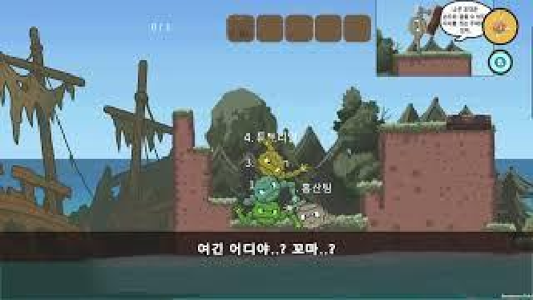
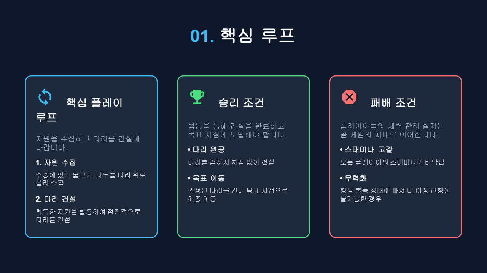
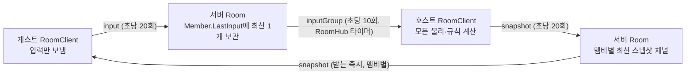
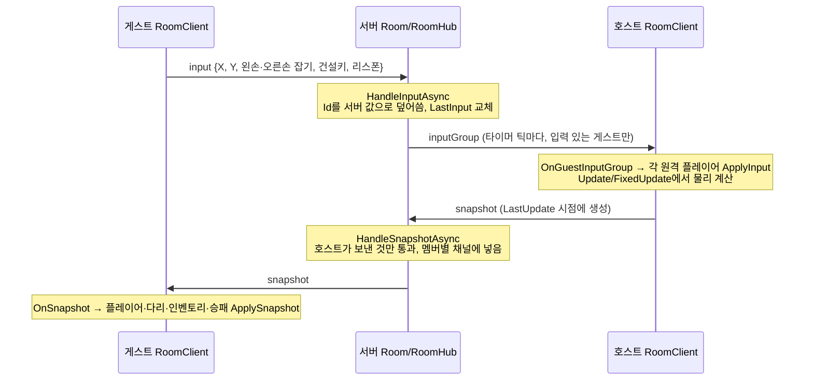
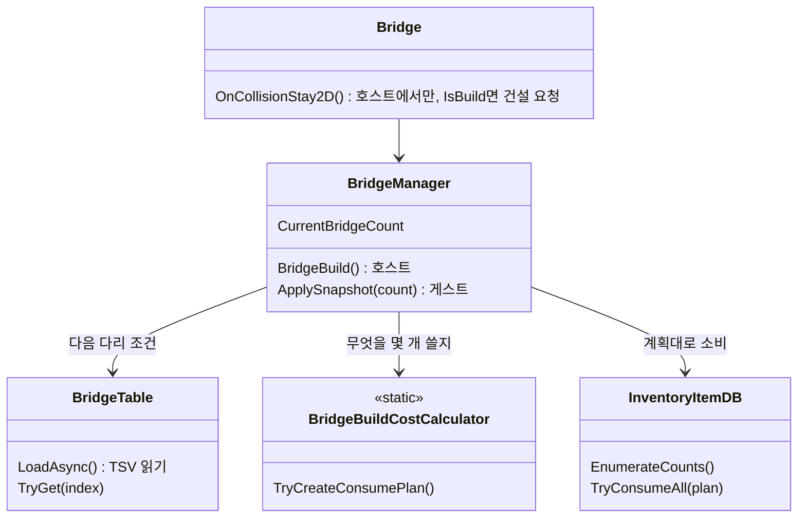
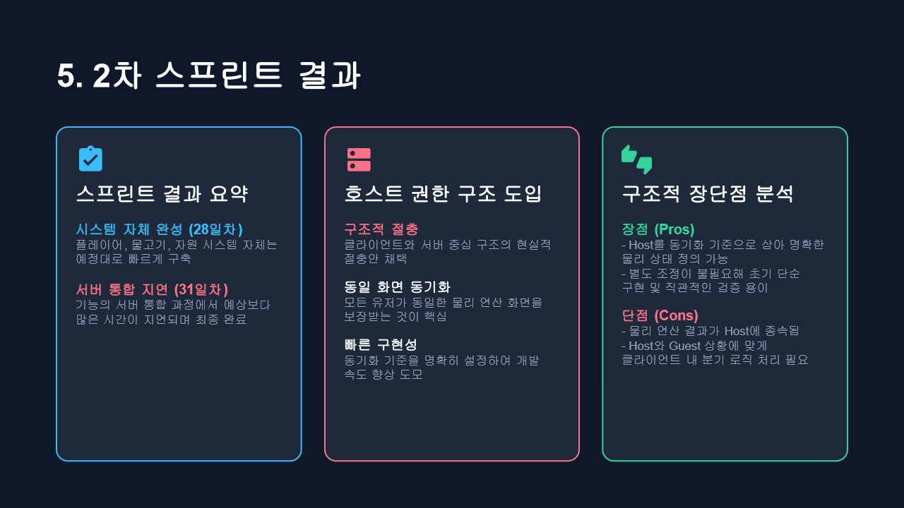
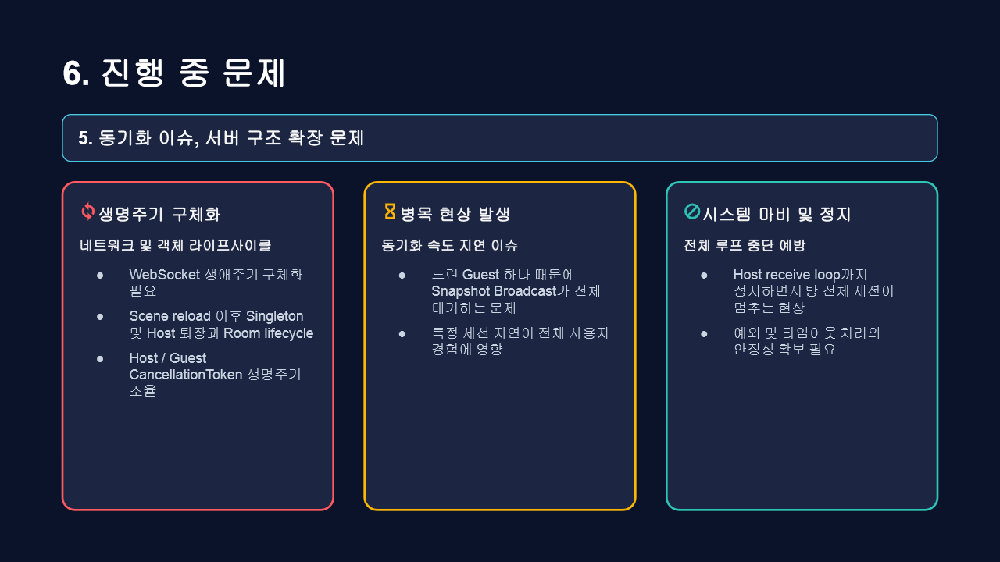
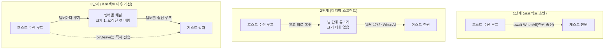

# We Got One 기술 문서

> **서로 붙잡고 자원을 모아 다리를 짓는 4인 협동 물리 생존 게임**



| 항목    | 내용                                                                                                                                    |
| ----- | ------------------------------------------------------------------------------------------------------------------------------------- |
| 플랫폼   | PC Windows                                                                                                                            |
| 개발 인원 | 4 (팀 프로젝트)                                                                                                                            |
| 내 역할  | 팀장·PM, 서버 환경 구축, 호스트 권한형 입력 중계 서버와 동기화 뼈대, 승패 판정, 다리 건설 조건 개편                                                                       |
| 엔진    | Unity 6000.3.15f1 (UniTask, Newtonsoft.Json, Multiplayer Play Mode)                                                                   |
| 서버    | ASP.NET Core 웹 앱, .NET 10, WebSocket + System.Text.Json                                                                                |
| 개발 기간 | 2026.08.14 — 09.14                                                                            |
| 링크    | [GitHub(클라이언트)](https://github.com/KooHoo-Dev/3rd-TeamProject-HS) · [GitHub(서버)](https://github.com/KooHoo-Dev/3rd-TeamProject-HS-Server) · [시연 영상](https://www.youtube.com/watch?v=8Kuv8hg5q3Y) |

---

## 1. 개요 · 팀 · 역할

### 1.1 프로젝트 소개

**플레이어들이 서로의 몸을 붙잡아 바닷속 자원을 모으고, 그 자원으로 다리를 지어 육지까지 가는 2D 협동 물리 생존 게임**

- 방 코드를 입력해 최대 4명이 한 방에 들어간다.
- 조작은 WASD로 팔 방향, 마우스 좌·우 클릭으로 왼손·오른손 잡기다.
- 승리는 다리를 끝까지 짓고 모두 목표 지점에 도착하는 것, 패배는 모든 플레이어의 스태미나가 바닥나 무력화되는 것이다.



이 문서는 게임 전체가 아니라 내가 맡은 두 부분을 다룬다.

1. **클라이언트·서버 네트워크 동기화의 뼈대** — 강사 제공 서버 뼈대를 호스트 권한형 입력 중계 서버로 바꾸고, 팀원들이 각자 기능을 네트워크에 붙일 수 있게 한 구조
2. **다리 건설 조건 개편** — 나무만 쓰던 다리 건설을 물고기까지 포함하는 조건으로 바꾸고, 다리마다의 조건을 TSV 표로 관리하게 한 작업

팀장·PM으로서 한 협업 운영(리뷰 방식, 직접 통합)도 5장에서 함께 다룬다.

### 1.2 왜 만들었나

1. **개인 프로젝트로는 하기 어려운 네트워크 멀티플레이에 도전하기**
   - 강사님의 팀 프로젝트 주제 조언을 바탕으로, 네트워크를 사용하는 멀티플레이 게임을 주제로 골랐다.
   - 네트워크 게임은 서버를 직접 만들고, 여러 명이 동시에 접속해 테스트해야 문제가 드러난다. 혼자서는 이 테스트 환경을 만들기 어렵기 때문에, 팀 프로젝트일 때 도전할 가치가 크다고 판단했다.
   - 상용 네트워크 솔루션 없이 직접 만든 .NET 서버로 동기화를 구현하면, 동기화가 왜 어려운지와 어떤 구조로 풀어야 하는지를 직접 겪어 볼 수 있다.

2. **경쟁보다 협동 게임**
   - 팀원 모두 경쟁 게임보다 협동 게임을 선호했다.
   - 협동 게임은 "모두가 같은 화면을 보고 함께 문제를 푼다"는 경험이 핵심이라, 네트워크 동기화의 품질이 곧 게임의 재미가 된다. 동기화를 맡은 내 입장에서는 기술적 목표가 분명해지는 주제였다.

### 1.3 팀과 내 역할

| 팀원     | 맡은 일 (1차 스프린트 기준)      | 네트워크 동기화에서 맡은 기능                                   |
| ------ | ---------------------- | -------------------------------------------------- |
| 팀원 A   | 플레이어 조작, 스태미나          | 플레이어 물리 상태 동기화                                     |
| 팀원 B   | 다리 연결, 자원 획득, 인벤토리     | 다리 상태 동기화                                          |
| 팀원 C   | 레벨 디자인, 물고기 AI         | 물고기 Replica, 자원 상태, 낮/밤 동기화                        |
| 나      | 서버 환경 구축, 승패 판정, 팀장·PM | 중계 서버, 게임 상태·종료 동기화, 중간 입장, 나무 동기화, 디버그 도구, 연동 가이드 |

- 다루지 않는 것: 플레이어 관절 조작, 물고기 FSM, 다리 기본 건설, 튜토리얼, 사운드 등 팀원이 만든 부분이다.
- 클라이언트의 네트워크 창구인 `RoomClient`는 팀원과 같이 작업한 파일이다. 이 문서의 RoomClient 코드는 내가 설계한 송수신 흐름 부분만 발췌했다.

---

## 2. 담당 파트 개요

### 2.1 받은 것과 내가 한 것

- **받은 것**: 강사 제공 서버 뼈대 `HelloServer`와 Unity 쪽 기초 클라이언트 코드. 뼈대는 "클라이언트가 자기 좌표를 보내면 서버가 모아서 주기마다 전원에게 뿌리는" 위치 동기화 + 채팅 구조였다.
- **내가 한 것**: 뼈대의 방 관리 구조(`RoomHub`/`Room`)는 그대로 두고, 메시지 처리를 "게스트 입력 중계 + 호스트 스냅샷 중계"로 바꿨다. 서버 `Room.cs`는 대부분 다시 썼고, `RoomHub.cs`는 주기 작업 하나만 바꿨다.
- 서버 작업은 처음 계획보다 크게 늘었다. 서버 Epic이 처음 계획 1개에서 17개가 되었고, 기능을 서버에 통합하는 과정에서 예상보다 많은 시간이 걸렸다.

### 2.2 담당 파트 1: 호스트 권한형 입력 중계 서버와 동기화 뼈대

- 게스트는 위치를 보내지 않고 **입력만** 보낸다. 서버는 게스트 입력을 모아 일정 주기로 호스트에게 보낸다.
- 호스트가 모든 물리를 계산한 결과를 **스냅샷**으로 보내면, 서버가 게스트들에게 전달한다.
- 방 수명 규칙: 처음 들어온 사람이 호스트, 4명 초과 입장 거부, 호스트가 나가면 방 전체 종료.
- 팀원들이 각자 기능을 네트워크에 붙일 수 있도록 연동 방법을 가이드로 정리해 공유했다(4.0).
- 동기화 상태를 화면에서 바로 보는 네트워크 디버그 도구를 만들었다.

### 2.3 담당 파트 2: 다리 건설 조건 개편

- 원래 다리는 나무만 소비했다(팀원 구현). 나는 이것을 물고기까지 포함하는 조건으로 바꾸고, 다리 15칸의 조건을 TSV 표로 관리하게 했다.
- 데이터는 `TSV → DTO → Ref → 게임 사용` 순서로 흐른다. 표(`BridgeData.tsv`)를 읽는 `BridgeTable`, 무엇을 몇 개 쓸지 계산하는 `BridgeBuildCostCalculator`, 그 계획대로 소비하는 `BridgeManager`로 나뉜다.

---

## 3. 시스템 구조

### 3.1 구성요소와 책임

| 구성요소          | 위치          | 책임 (그리고 하지 않는 일)                                                                     |
| ------------- | ----------- | ------------------------------------------------------------------------------------ |
| `Program`     | 서버          | `/room?code=` WebSocket 요청을 받아 방 코드를 정규화하고 `RoomHub`에 넘김. 입력 중계 주기 루프를 시작함               |
| `RoomHub`     | 서버          | 방 코드 → 방 찾기/만들기/지우기, 인원 제한, 모든 방에 "게스트 입력 보내기"를 주기마다 시킴. 메시지 내용은 모름                   |
| `Room`        | 서버          | 한 방의 멤버 관리, 메시지 종류별 처리(input/snapshot), 송신. 언제 보낼지는 RoomHub 타이머와 호스트 송신이 정함              |
| `Room.Member` | 서버          | 접속자 1명: 소켓, 마지막 입력(`LastInput`), 송신 잠금(`SendLock`), 최신 스냅샷 채널(`LatestSnapshotChannel`) |
| `Protocol`    | 서버·클라이언트 각각 | 메시지 클래스. `TypeOnly`로 종류를 먼저 읽고 맞는 클래스로 다시 역직렬화                                       |
| `RoomClient`  | 클라이언트       | 클라이언트 쪽 유일한 네트워크 창구. 접속, 수신 분기, 호스트면 스냅샷 생성·송신, 게스트면 입력 송신                            |
| 스냅샷 반영 대상     | 클라이언트 매니저들  | 게스트일 때 `RoomClient.OnSnapshot`이 `BridgeManager`·`InventoryItemDB`·`GameManager` 등의 `ApplySnapshot`을 부름 |

### 3.2 왜 이렇게 나눴나

- `RoomHub`는 "방 목록", `Room`은 "방 하나 안의 사람과 메시지"만 안다. 뼈대의 이 나눔을 그대로 둔 덕분에 방 생성·삭제 코드는 거의 건드리지 않고 동기화 방식만 바꿀 수 있었다.
- 클라이언트에서 소켓을 아는 클래스는 `RoomClient` 하나다. 다른 매니저는 `ApplySnapshot(값)`만 받는다. 그래서 다리·인벤토리 코드는 소켓을 모른다.
- 같은 생각을 데이터에도 적용했다. 인벤토리 UI가 값을 직접 바꾸는 것이 아니라 DB 값이 따로 있고 UI는 그것을 참조·구독하게 해야 확장에 유리하다.

### 3.3 전체 통신 흐름

이 그림에서 볼 것은 **게스트는 입력만 보내고, 화면에 보이는 결과는 모두 호스트가 계산한 스냅샷**이라는 점이다.



- 초당 횟수는 저장소의 설정값이다. 게스트·호스트 송신 `sendPerSecond: 20`, 서버 입력 전달 `BroadcastPerSecond: 10`.

### 3.4 게스트 입력 1회가 게스트 화면에 반영되기까지



---

## 4. 핵심 기능

> 코드는 핵심 흐름만 발췌했다. 코드 블록 안의 `// (Why)` 주석은 이 문서를 쓰면서 덧붙인 설명이고, 원본 주석은 길어서 일부 줄였다.

### 4.0 사용법: RoomClient API와 팀원용 연동 가이드

다른 클래스가 네트워크를 쓰려면 `RoomClient`의 아래 멤버만 알면 된다.

| 호출 | 하는 일 |
|---|---|
| `RoomClient.Instance.Join(code, nickName, color)` | 접속 시작. 접속에 성공하면 인게임 씬을 불러오고 hello를 보낸다 |
| `RoomClient.Instance.Me.IsHost` | 이 클라이언트가 호스트인지. 게임 로직은 이 값으로 "확정할지, 결과만 받을지"를 고른다 |
| `RoomClient.Instance.RequestRespawn()` | 게스트의 리스폰 요청을 다음 입력 메시지에 실어 보낸다 |
| `RoomClient.Instance.QuitGame()` | 정상 종료 핸드셰이크 후 정리 |

새 기능을 동기화하는 순서는 세 단계다. 이 순서를 팀원용 연동 가이드로 정리해 공유했다.

1. `Protocol`의 `SnapshotMessage`에 필드를 추가한다.
2. 호스트 쪽 `SendSnapshotOrInputMessage`에서 그 필드를 채운다.
3. 게스트 쪽 `OnSnapshot`에서 그 값을 반영한다.

서버는 메시지 규약으로 쓴다. 첫 메시지는 반드시 `hello`이고, 이후 `input`(게스트) 또는 `snapshot`(호스트)만 처리한다.

### 4.1 게스트 입력 모아서 호스트에게 보내기

1. 게스트 입력이 올 때마다 그 멤버의 `LastInput`을 최신 값으로 덮어쓴다. 쌓지 않는다.
2. `RoomHub` 타이머가 틱마다 모든 방의 `SendGuestInputsToHostAsync`를 동시에 부른다.
3. 방은 게스트마다 `LastInput`을 "꺼내면서 비우고", 입력이 하나라도 있으면 묶어서 호스트에게 보낸다.

```csharp
public async Task SendGuestInputsToHostAsync()
{
    Member host = GetHost();
    // (Why) hello 처리 전에 타이머가 먼저 돌 수 있다. 호스트가 없으면 이번 틱은 건너뛴다.
    //       원본 주석: "이거 처리 안해줘서 처음에 가끔 의문사 당했구나... 서순 문제"
    if (host == null) return;

    GuestInputGroupMessage inputGroup = new GuestInputGroupMessage();
    foreach (Member member in members.Values)
    {
        if (member.User.IsHost) continue;

        // (Why) 읽기와 비우기를 한 번에(원자적으로) 한다.
        //       예전에는 읽고 → await 송신 → 나중에 전부 null로 비웠는데,
        //       송신을 기다리는 사이 들어온 새 입력까지 지워졌다. (6.2-1)
        GuestInputMessage input =
            Interlocked.Exchange(ref member.LastInput, null);

        if (input != null)
            inputGroup.Inputs.Add(input);
    }

    // (Why) 아무도 입력하지 않은 틱은 보내지 않는다.
    if (inputGroup.Inputs.Count == 0) return;

    LogGuestInputGroup(host, inputGroup);
    await SendAsync(host, inputGroup);
}
```

예외·보안 경로
- 호스트가 보낸 input은 무시한다. 호스트는 자기 입력을 로컬에서 바로 쓰기 때문이다.
- 클라이언트가 보낸 Id는 믿지 않고 서버가 정한 Id로 덮어쓴다.

"최신 입력 1개만 남기는" 방식은 키를 꾹 누르고 있어 입력이 매번 갱신되는 상황에서는 잘 작동했다. 반대로 튜토리얼 시작 버튼처럼 한 번만 정확히 전달해야 하는 입력에는 불필요한 오버헤드가 많이 생겼다(6.3).

### 4.2 멤버별 "최신 스냅샷 1개" 채널

- 호스트 스냅샷이 오면 서버는 직접 보내지 않고, 호스트를 뺀 멤버마다 있는 채널에 넣기만 한다.
- 멤버마다 송신 전담 루프가 하나씩 돌며 자기 채널에서 꺼내 보낸다.
- 채널 크기는 1이고, 꽉 차면 오래된 것을 버린다. 느린 멤버에게는 밀린 스냅샷이 쌓이지 않고 가장 최신 것만 간다.

```csharp
// Member 안: 멤버마다 크기 1짜리 채널
public readonly Channel<BroadcastWorkItem> LatestSnapshotChannel =
    Channel.CreateBounded<BroadcastWorkItem>(
        new BoundedChannelOptions(1)
        {
            SingleReader = true,                          // (Why) 읽는 쪽은 그 멤버의 송신 루프 하나뿐
            FullMode = BoundedChannelFullMode.DropOldest  // (Why) 스냅샷은 '현재 상태'라 최신 1개면 충분. 밀린 건 버린다
        });

// 받기 쪽: 넣기만 하고 바로 돌아간다 → 호스트 수신 루프가 송신을 기다리지 않음
private void EnqueueSnapshot(object message, string exceptId = null)
{
    foreach (Member member in members.Values)
    {
        if (member.User.Id == exceptId)
            continue;

        if (member.LatestSnapshotChannel.Writer.TryWrite(new BroadcastWorkItem(message, exceptId)) == false)
            Console.Error.WriteLine($"[{code}] 종료된 방송 큐에 메시지를 넣으려 했습니다.");
    }
}

// 보내기 쪽: 멤버마다 하나씩 독립 실행 → 느린 게스트는 자기 것만 늦는다
private async Task SendMemberChannelLoopAsync(Member member)
{
    await foreach (BroadcastWorkItem work in member.LatestSnapshotChannel.Reader.ReadAllAsync())
    {
        try
        {
            await SendAsync(member, work.Message);
        }
        catch (Exception e)
        {
            // (Why) 한 번 실패해도 루프는 계속. 끊긴 멤버는 SendRawAsync가 SendFailed로 막는다.
            Console.Error.WriteLine($"[{code}] 방송 처리 예외: {e}");
        }
    }
}
```

- join·leave처럼 한 번만 일어나고 놓치면 안 되는 메시지는 이 채널을 쓰지 않고 `BroadcastNowAsync`로 바로 보낸다. 크기 1 + 오래된 것 버림 채널에 넣으면 스냅샷에 밀려 버려질 수 있기 때문이다.
- 이 구조는 프로젝트 이후 개선한 결과다. 여기에 이르기까지의 변화와 이유는 5.2에서 다룬다.

### 4.3 방 수명과 연결 예외 처리

방 입장과 인원 제한(`RoomHub`)

```csharp
lock (gate) // (Why) 여러 접속이 동시에 같은 방 코드로 들어와도 인원 수를 정확히 세기 위해
{
    bool hasCode = entries.TryGetValue(code, out Entry entry);
    if (hasCode == false || entry.Users < MaxRoomMember) // MaxRoomMember = 4
    {
        if (hasCode == false)
        {
            entry = new Entry() {Room = new Room(code, logMovesPerSecond), Users = 0};
            entries.Add(code, entry);
        }
        entry.Users++;
        return entry.Room;
    }
}
Console.WriteLine($"[Rejected][{code}] 방이 꽉차서 연결 거부");
return null; // (Why) 호출자 HandleAsync가 "Room Member Limit" 사유로 소켓을 닫는다
```

- 호스트 결정: 방이 비어 있을 때 들어온 사람이 호스트다. 입장 처리는 `gate`(SemaphoreSlim)로 한 번에 한 명씩 한다.
- 호스트 퇴장: 호스트가 나가면 `roomExpired = true`와 취소 토큰으로 남은 멤버의 수신 대기를 모두 깨워 연결을 닫는다. 클라이언트도 연결이 끊기면 메인 메뉴 씬으로 돌아간다.
- 호스트 승계는 계획했지만 하지 않았다. 승계하려면 호스트 변경 메시지를 새로 만들어 서버가 그 상황에 보내고, 클라이언트에 그 메시지를 처리하는 로직을 추가해야 했다. 일정이 짧았고, 네트워크를 최대한 단순하게 두고 인게임 핵심 루프의 완성도에 집중하고 싶었다. 짧은 테스트 기간을 생각하면 유의미한 기능이 아니라고 판단했다.

송신 타임아웃과 실패 표시(`Room`)

```csharp
private async Task SendRawAsync(Member member, string json)
{
    if (member.Socket.State != WebSocketState.Open ||
        Volatile.Read(ref member.SendFailed) != 0) return;

    // (Why) 응답 없는 소켓 하나가 SendLock을 영원히 잡지 않도록 9초 제한
    using CancellationTokenSource sendTimeout =
        new CancellationTokenSource(SendTimeoutMilliseconds); // 9000
    bool lockTaken = false;
    try
    {
        // (Why) 한 소켓에 동시에 두 번 보내면 안 된다. await 안에서는 lock을 못 써서 SemaphoreSlim 사용
        await member.SendLock.WaitAsync(sendTimeout.Token);
        lockTaken = true;
        // ... 다시 상태 확인 후 SendAsync
    }
    catch (OperationCanceledException) { MarkSendFailed(member, "송신 제한 시간 초과"); }
    catch (WebSocketException)          { MarkSendFailed(member, "소켓 송신 실패"); }
    finally { if (lockTaken) member.SendLock.Release(); }
}

private void MarkSendFailed(Member member, string reason)
{
    // (Why) 여러 송신이 동시에 실패해도 Abort와 로그는 딱 한 번
    if (Interlocked.Exchange(ref member.SendFailed, 1) != 0) return;
    Console.Error.WriteLine($"[{code}] {member.User.NickName}({member.User.Id}) {reason}");
    member.Socket.Abort();
}
```

소켓 연결 중 예외로 한쪽이 비정상 종료되면 반대편도 이상해질 수 있어, 송신 실패는 반드시 한 곳에서 처리하게 했다.

### 4.4 RoomClient: 받는 시점과 보내는 시점 고정

한 프레임 안에서 "네트워크 값 반영 → 게임 로직 → 결과 송신" 순서가 항상 같도록, 받기는 Update 직전, 보내기는 LastUpdate로 옮겼다.

```csharp
// 수신 루프
result = await socket
    .ReceiveAsync(new ArraySegment<byte>(buffer), destroyCancellationToken)
    .AsUniTask();
// (Why) 호스트가 게스트 입력을 받든, 게스트가 스냅샷을 받든
//       반영 시점을 Update 직전으로 고정 → 이번 프레임 로직이 최신 값을 쓴다
await UniTask.Yield(PlayerLoopTiming.Update);

// 송신 루프
await UniTask.Delay(delay, cancellationToken: token);   // delay = 1000 / sendPerSecond
// (Why) 물리·게임 로직이 끝난 뒤의 상태로 스냅샷을 만들기 위해 LastUpdate까지 기다린다.
//       원본 주석: "WhenAll로하면 Delay가 나중에 완료되어서 PostLateUpdate 시점에 실행될거라 보장할 수 없음"
await UniTask.Yield(PlayerLoopTiming.LastUpdate);
if (Me == null) continue;   // welcome 전에는 보낼 것이 없다
await SendSnapshotOrInputMessage();
```

- 호스트/게스트 분기: `SendSnapshotOrInputMessage`는 호스트면 플레이어 5부위 Transform, 물고기·나무, 인벤토리, 다리 개수, 낮/밤, 튜토리얼 상태를 모아 스냅샷을 보내고, 게스트면 입력만 보낸다.
- 게스트 쪽 물리 끄기: 게스트 화면의 모든 플레이어 Rigidbody2D를 Kinematic으로 바꾸고, 내 것이 아닌 플레이어의 입력 컴포넌트를 끈다.
- 수신 안전장치: 게스트가 inputGroup을 받으면 서버 버그로 보고 경고만 남긴다.

### 4.5 다리 건설 조건 개편과 비용 계산



**왜 "가치 합 + 꼭 필요한 재료 + 최소 낭비"인가**

- 다리 조건으로 두 가지를 동시에 만족시키고 싶었다. 하나는 꼭 모아야 할 재료를 정해 플레이어에게 탐험을 강제하는 것, 다른 하나는 그 외에는 플레이어가 스스로 낚시해 모은 자원으로 자유롭게 채우는 재미를 잃지 않게 하는 것이다.
- 그래서 다리마다 **꼭 필요한 재료**(탐험 강제), **필요 가치 합**(자유롭게 채우기), **최소 낭비**(모은 자원을 아끼기) 세 규칙을 두었다. 셋 중 하나가 빠지면 이 문제를 풀기 어렵다고 판단했다.
- AI 도구는 내가 정한 명세대로 `BridgeManager`에서 쓸 가치 연산 모듈(`BridgeBuildCostCalculator`)을 만들고, TSV → DTO → Ref 데이터 파이프라인을 구축하는 데 썼다. 두 모듈 모두 `BridgeManager`만 사용한다.

**데이터 흐름**

- TSV(`BridgeData.tsv`) → `BridgeDto` → `BridgeRef`(아이템 참조로 바꾼 것) → 게임에서 사용.
- 표는 다리 번호, 필요 가치 합(`RequiredValue`), 꼭 필요한 재료(`MinimumItems`)로 되어 있다. 예를 들어 4번째 다리는 필요 가치 9, 꼭 필요한 재료 `0:1,1:2,2:1`(아이템 0을 1개, 1을 2개, 2를 1개)이다.
- 표 데이터가 잘못되면(범위 밖 번호, 중복 ItemId, null) `BridgeTable` 생성 시 예외를 던지고, `BridgeManager.Start`가 로그로 남긴다.

**건설 흐름: 계획을 먼저 세우고 소비한다**

```csharp
public void BridgeBuild() // 호스트에서만 불림 (Bridge.OnCollisionStay2D)
{
    if (IsEnd) return;

    int nextBridgeIndex = currentBridgeCount + 1;
    if (bridgeTable.TryGet(nextBridgeIndex, out BridgeRef bridgeRef) == false)
        return;

    // (Why) 먼저 '무엇을 몇 개 쓸지' 계획을 세우고, 계획이 서야만 소비한다 → 재료가 반만 빠지는 일 없음
    if (BridgeBuildCostCalculator.TryCreateConsumePlan(
            bridgeRef, inventoryItemDB.EnumerateCounts(), itemManager.Items,
            out IReadOnlyDictionary<int, int> consumePlan) == false ||
        inventoryItemDB.TryConsumeAll(consumePlan) == false)
    {
        return;
    }

    StartCoroutine(BuildParticle(currentBridgeCount)); // 연출 후 다리 오브젝트 활성화
    // (Why) 개수는 연출과 상관없이 즉시 올린다. 예전엔 켜진 다리 수를 세서 연출 시간만큼 늦게 올랐다 (6.2-4)
    currentBridgeCount++;
    OnBridgeBuild?.Invoke();
}
```

**비용 계산 `TryCreateConsumePlan`의 세 단계**

1. 꼭 필요한 재료를 먼저 확보한다. 하나라도 모자라면 실패한다.
2. 남은 가치를 채울 조합을 찾는다. "가치 합 → 그 합을 만드는 개수 배열"을 표로 넓혀 가는 방식(배낭 문제 형태의 동적 계획법)이다.
3. 필요 가치 이상인 합 중 가장 작은 합을 고른다. 같은 합이면 가치가 낮은 아이템을 더 많이 쓰는 쪽을 고른다. 즉 "덜 낭비하고, 비싼 재료는 아낀다"는 규칙이다.

---

## 5. 고민과 선택

### 5.1 동기화 모델: 무엇을 누가 계산할 것인가

게임의 핵심 재미는 "서로 붙잡고 뜻대로 안 되는 물리"였다. 받은 뼈대처럼 각 클라이언트가 자기 위치를 계산해 보내는 방식에서는, 여러 몸이 얽힌 물리 결과가 클라이언트마다 갈릴 수 있는 구조였다. 2차 스프린트에서 팀이 후보 3개를 놓고 논의했다.

| 대안 | 장점 | 단점 |
|---|---|---|
| A. 클라이언트 권한형 — 각자 계산한 결과를 보냄 (받은 뼈대 방식) | 이미 동작하는 코드. 내 캐릭터는 입력 지연이 없음 | 붙잡기·물고기처럼 여러 몸이 얽힌 물리는 결과가 갈림. 누구 결과가 맞는지 정할 주인이 없음 |
| B. 호스트 권한형 — 게스트는 입력만, 호스트가 전부 계산, 서버는 중계 | 물리·랜덤·승패의 정답이 한 곳. Unity 물리를 서버로 옮길 필요 없음. 기준이 분명해 초기 구현과 검증이 단순 | 물리 결과가 호스트에 종속됨. 호스트/게스트 분기 코드가 생김(5.5). 호스트가 나가면 상태가 사라짐 |
| C. 서버 권한형 — 서버가 받은 입력으로 직접 계산 | 가장 공정하고 호스트 이탈 문제가 없음 | Unity 2D 물리(관절)를 .NET 서버에 다시 만들어야 함. 2주 일정으로는 불가능에 가까움 |

**최종 결정: B. 호스트 권한형.** "모든 유저가 동일한 물리 연산 화면을 보장받는 것"을 목표로, 클라이언트와 서버 중심 구조의 현실적 절충안을 골랐다.



**클라이언트 예측을 뺀 이유**

- 처음 안은 "호스트가 물리 처리 + 클라이언트는 미리 자체 이동 후 호스트 결과가 오면 보간"(클라이언트 예측 포함)이었다.
- 다만 예측까지 한 번에 구현하지 않고, "기본 호스트 기반 동기화 → 부자연스러우면 보간 추가 → 그래도 부자연스러우면 예측 추가" 순서로 단계를 밟기로 했다.
- 플레이어와 물체 모두 보간만 넣어도 생각보다 상당히 자연스러웠다. 그래서 클라이언트 예측은 중간에 덜어냈고, 게스트는 스냅샷만 따른다.

### 5.2 스냅샷을 어떻게 보낼 것인가 — 3단계 변화

호스트가 초당 20번 보내는 스냅샷을 최대 3명의 게스트에게 어떻게 전달할지가 문제였다. 발표에서 정리한 문제는 두 가지였다.



- **병목**: 느린 게스트 하나 때문에 스냅샷 브로드캐스트 전체가 대기한다.
- **시스템 정지**: 호스트 수신 루프까지 멈추면서 방 전체 세션이 멈춘다.



| 대안 | 장점 | 단점 |
|---|---|---|
| A. 받는 즉시 전원에게 WhenAll로 송신 (1단계) | 코드가 가장 짧고 흐름이 바로 보임 | 호스트 수신 루프가 가장 느린 게스트 송신이 끝날 때까지 다음 메시지를 못 읽음 → 방 전체가 멈춤 |
| B. 방 단위 큐 + 송신 워커 1개 + 송신 타임아웃 (2단계) | 수신과 송신이 분리되어 호스트 수신 루프가 막히지 않음. 9초 타임아웃으로 죽은 소켓을 끊음 | 큐 크기 제한이 없어 오래된 스냅샷이 쌓임. 워커가 여전히 WhenAll이라 느린 게스트 한 명이 방 전체 송신을 늦춤 |
| C. 멤버별 크기 1 채널 + 오래된 것 버림 + 멤버별 송신 루프 (3단계, 현재) | 느린 게스트는 자기 것만 늦고, 쌓이지 않고 최신 상태만 받음 | 중간 스냅샷이 버려지므로 한 번만 일어나는 일을 실으면 놓칠 수 있음 → join/leave는 채널에서 뺌. 멤버 수만큼 비동기 루프가 생겨 종료 관리가 필요함 |

**최종 결정: C.** 스냅샷은 "지금 상태"라 밀린 과거 값을 보내는 것은 의미가 없다고 보고, 수신 루프 정지(2단계)와 느린 게스트 하나가 전체를 늦추는 문제(3단계)를 차례로 풀었다. 3단계는 구조상 느린 게스트 한 명이 다른 게스트의 송신을 기다리지 않게 바꾼 것이고, 단계별 지연 측정은 아직 하지 않았다.

주기가 짧은 작업 안에 await가 여러 번 나뉘면(WhenAll 포함), 송신·수신을 기능에 맞게 나눠야 한다는 것이 이 과정에서 얻은 기준이다.

### 5.3 모든 상태를 스냅샷 하나에 vs 스냅샷 + 이벤트 분리

위치처럼 계속 변하는 값과, 다리 건설·승패·이펙트처럼 한 번 일어나는 일을 같은 메시지로 보낼지 정해야 했다.

| 대안 | 장점 | 단점 |
|---|---|---|
| A. 스냅샷 하나에 전부 (실제 구현) | 메시지 종류가 하나라 서버·클라이언트 코드가 단순. 늦게 들어온 사람도 다음 스냅샷 하나로 현재 상태를 모두 받음 | "언제 일어났는지"가 사라짐. 게스트는 이전 값과 비교해서 연출을 틀어야 함. 효과음·이펙트처럼 상태가 아닌 사건은 표현하기 어려움 |
| B. 스냅샷(연속 값) + 이벤트(한 번 일어나는 변화) 분리 (처음 계획) | 획득·건설·승패를 사건으로 정확히 한 번 전달. 게스트 연출이 쉬움 | 메시지 종류와 처리 코드가 늘어남. 이벤트 유실·순서 처리를 따로 고민해야 함 |

**최종 결정: A로 구현했다.** 급하게 개발하느라 모든 내용을 스냅샷에 넣었고, 이벤트 분리는 작업으로 올렸지만 끝내지 못했다.

- A의 장점은 실제로 쓰였다. 중간 입장한 게스트는 별도 초기 메시지 없이, 스냅샷이 전체 상태를 담고 있어서 다음 스냅샷 하나로 현재 상태를 따라잡는 구조다.
- 단점도 그대로 드러났다. 생명주기가 다른 데이터들을 구분하지 못해 클라이언트 구현 때 혼동이 많았고, 이펙트·효과음까지 들어가자 스냅샷만으로는 완벽히 구현할 수 없었다(6.4).

### 5.4 스냅샷 반영 지점: RoomClient 한곳에서 vs 각 매니저가 직접

게스트가 받은 스냅샷을 누가 각 시스템에 반영할지 고민했다.

| 대안 | 장점 | 단점 |
|---|---|---|
| A. `RoomClient.OnSnapshot`이 각 매니저의 `ApplySnapshot`을 차례로 부름 | 스냅샷 반영 흐름을 한 메서드에서 다 볼 수 있음. 반영 순서를 정할 수 있음 | RoomClient가 모든 매니저를 알아야 함. 기능이 늘 때마다 RoomClient를 고침 |
| B. 각 매니저가 `RoomClient.SnapshotMessage`를 직접 읽어 처리 | RoomClient가 매니저를 몰라도 됨. 기능 담당자가 자기 파일만 고치면 됨 | 누가 언제 스냅샷을 읽는지 한눈에 안 보임. 읽는 시점이 클래스마다 달라질 수 있음 |

**결과: 두 방식이 섞인 채로 끝났다.** A로 모으는 리팩토링 작업을 올렸지만 프로젝트 안에 끝내지 못했다. 지금 다시 한다면 두 방식의 장점을 합쳐, 각 매니저가 처음에 `RoomClient`의 델리게이트를 구독하고 `OnSnapshot`에서는 Invoke만 하도록 바꾸겠다(6.4).

### 5.5 호스트/게스트 코드를 어떻게 나눌 것인가 (협업 이슈)

같은 게임 객체가 호스트에서는 "계산", 게스트에서는 "결과 반영"만 해야 했다. 동기화 기능을 기능별로 팀원에게 나눠 맡겼기 때문에(1.3), 이 결정이 팀 전체의 작업 방식이 되었다.

| 대안 | 장점 | 단점 |
|---|---|---|
| A. 한 클래스 안에서 `RoomClient.Instance.Me.IsHost`로 분기 + 연동 가이드 공유 (실제 구현) | 파일이 늘지 않고, 기존 싱글 플레이 코드에 분기만 더하면 됨. 2주 일정에 맞음 | 한 객체가 "호스트 / 호스트 화면 속 게스트 플레이어 / 게스트" 세 상황을 다 품어 읽기 어려움. `IsHost`를 검사하는 스크립트가 14개, 같은 판정 속성이 4곳에 복사됨 |
| B. 역할별로 책임을 나눈 코드(호스트 로직 / 게스트 적용 로직)와 세부 명세를 먼저 제공 | 팀원이 새 기능을 만들 때 "호스트에서 무엇을 하고, 스냅샷에 무엇을 넣고, 게스트에서 무엇을 반영하는지" 바로 알 수 있음 | 초기 설계·문서 비용이 큼. 이미 만든 기능을 다시 나눠야 함 |

**최종 결정: A.** 해결 시도로 연동 가이드를 썼다. 가이드에는 플레이어와 인벤토리를 예로 "호스트는 무엇을, 게스트는 무엇을" 하는지 적었다.

- 그래도 연동 과정의 시행착오가 컸다. 호스트 / 호스트 안의 게스트 / 게스트(스냅샷 반영) 세 경우를 나눈 명세가 없으면, 서버 구조를 모르는 사람은 일을 잘할 수가 없었다.
- 빌드가 급해지자 PM이면서 네트워크 담당인 내가 팀원 기능의 네트워크 연동에 직접 뛰어들었고, 일이 난잡하게 진행됐다.
- 회고에서 대안 B, 즉 Player·Fish 같은 핵심 객체에 대한 역할별 명세가 사전에 필요했다고 정리했다.

### 5.6 PR 리뷰를 얼마나 엄격하게 할 것인가 (PM)

4명이 한 저장소에서 일할 때 코드 검토를 어떤 단위로 할지 정해야 했다.

| 대안 | 장점 | 단점 |
|---|---|---|
| A. 모든 변경을 PR로, 팀원 간 코드 리뷰를 엄격하게 (1차 스프린트 방식) | 변경 이력과 품질 관리가 확실함. 과제의 Git 운영 규칙(main 직접 push 금지, PR 기반)과 맞음 | 세밀한 PR 진행으로 거시적 관점이 결여되고(코드 수준 리뷰에 치중), 코드 검토와 디버깅이 과다해 개발 속도가 지연됨 |
| B. 3~4일 스프린트 단위 리뷰 + main 푸시 제한만 유지 | 진행 속도가 빨라지고, 리뷰가 구조 단위로 올라감 | 개별 변경의 검토가 약해짐 |

**최종 결정: B로 바꿨다.** 함께 도구도 정리했다. Asana를 메인 작업 채널로 두고 Discord는 가벼운 소통, 문서 도구는 제출 문서 검토 때만 쓰기로 했다. 목표는 "코드와 커밋 자체가 문서가 되는 것"이었다.

- 프로젝트 마지막에 버그가 크게 늘었는데, 리뷰를 느슨하게 바꾼 것보다는 물고기 시스템의 리팩토링 부실과 작업 규칙의 부실이 원인이었다고 본다.

---

## 6. 결과 및 배운 점

### 6.1 결과

- 4명까지 같은 방에서 호스트 1명이 계산한 물리·인벤토리·다리·승패를 게스트가 따라가는 구조로 최종 빌드와 발표 시연까지 마쳤다.
- 실제 플레이어 20명이 동시에 플레이한 테스트에서 별 문제가 없었다.
- 서버는 받은 뼈대의 방 관리 구조를 유지하면서 동기화 방식만 바꿨다.
- 협업 지표(Asana 기준): 팀 전체 작업 383개 중 324개 완료(85%), 완료한 작업 중 목표일 안 완료 91%(295/324). 내 작업은 108개 중 104개 완료(96%).
- 서버 Epic은 처음 계획 1개에서 17개로 늘었다. 네트워크 연동이 처음 예상보다 훨씬 큰 일이었다.
- 지연 시간(ms) 같은 동기화 수치는 아직 재지 않았다. 서버를 다시 올려 5.2의 단계별 지연과 게스트 화면 반영 지연을 잴 예정이다.

### 6.2 문제 해결 경험

#### 6.2-1 게스트 입력이 가끔 사라짐 (서버)

- **문제**: 서버와 클라이언트가 게스트를 다르게 인식하는 버그로 드러났다.
- **원인**: 입력을 읽어 묶음에 넣고 → `await` 송신 → 그 뒤에 모든 게스트의 `LastInput`을 null로 비웠다. 송신을 기다리는 사이 새로 들어온 입력도 같이 지워졌다.
- **해결**: `Interlocked.Exchange(ref member.LastInput, null)`로 꺼내기와 비우기를 한 번에 한다(4.1).
- **배운 점**: 한 줄 단위 원자성은 `Interlocked`, 여러 줄 단위 원자성은 `lock`으로 구분해야 한다.

#### 6.2-2 접속 직후 가끔 원인 모를 끊김 (서버)

- **문제**: 방에 처음 들어온 직후 가끔 이유 없이 연결이 끊겼다.
- **원인**: 입력 중계 타이머(`RoomHub`)와 접속 처리(hello)가 서로 다른 흐름으로 동시에 돈다. 호스트는 hello를 받은 뒤에야 정해지는데, 그 전에 타이머가 먼저 방에 들어가 호스트가 없는 상태로 송신을 시도했다.
- **해결**: 두 흐름의 순서를 강제로 맞추는 대신, 순서가 어긋나도 안전하게 만들었다.
  - 멤버는 hello를 받고 `gate` 안에서 호스트 여부가 정해진 **뒤에야** 멤버 목록에 들어간다.
  - 타이머 쪽 `SendGuestInputsToHostAsync`와 입력 처리 `HandleInputAsync`는 둘 다 `GetHost()`가 null이면 그 틱·그 입력을 버린다.
- **배운 점**: 방 입장·퇴장, 공유 데이터 읽기·쓰기처럼 여러 흐름이 같은 자원을 만지는 곳은 race condition을 먼저 의심해야 한다.

#### 6.2-3 스냅샷에 호스트 플레이어가 두 번 들어감 (클라이언트)

- **원인**: 플레이어 목록 `remotes`에 자기 자신도 들어 있는데, 스냅샷을 만들 때 `Me`를 따로 한 번 더 넣었다.
- **해결**: 별도 추가를 지우고 `remotes`만 순회한다.

#### 6.2-4 다리 개수가 늦게 오르고 게스트와 어긋남 (클라이언트)

- **원인**: 개수를 "켜진 다리 오브젝트 수"로 셌는데 다리는 연출 2초 뒤에 켜졌고, 게스트는 매 스냅샷마다 0번부터 다시 켰다.
- **해결**: 개수를 필드로 즉시 올리고, 게스트는 늘어난 칸만 켠다(4.5).
- **배운 점**: 인게임 오브젝트(뷰)로 개수를 추적하지 않고 자체 데이터로 증감해야 처리가 일관되고, 변경과 확장에도 쉽다.

#### 6.2-5 게임이 끝난 뒤 다시 들어가면 종료 상태가 남음 (클라이언트)

- **문제**: 게임 종료 후 같은 방으로 다시 들어가면 이전 판의 종료 상태가 그대로 보였다.
- **해결**: welcome을 받을 때 플레이어 목록과 승패 집계 등 매니저의 주요 멤버를 모두 초기화한다(`ClearInfo`, `GameManager.ResetNetworkPlayerCounts`).

#### 6.2-6 강의실 키보드가 동시에 2~3키만 인식함 (환경)

- **문제**: 기존 조작(WASD + 왼쪽 Shift + 오른쪽 Shift)은 여러 키를 동시에 눌러야 했는데, 강의실 키보드가 동시 입력을 2~3개만 인식했다.
- **해결**: 잡기를 마우스 좌·우 클릭으로 바꿨다. 네트워크 메시지 필드 이름(`IsLeftShiftHold`, `IsRightShiftHold`)은 그대로 두고 값만 마우스 버튼에서 채운다.
- **배운 점**: 기획 단계의 입력 설계가 실제 실행 환경에서 그대로 동작하는지 먼저 확인해야 한다.

### 6.3 아쉬운 점 (기술 부채)

- **클라이언트·서버 Protocol 불일치**: 두 저장소에 같은 `Protocol.cs`를 손으로 복사해 맞춘다. 클라이언트에만 추가된 필드(`IsRespawnPressed` 등)는 서버가 스냅샷을 자기 클래스로 다시 직렬화할 때 사라진다. 빌드 테스트에서 게스트 리스폰이 제대로 되지 않고, 게스트가 계속 처음 리스폰 위치에서만 스폰되던 문제가 이 때문이었다.
- **한 번만 일어나는 입력도 덮어쓰기 채널로 보냄**: 4.1의 "최신 입력 1개" 방식에 리스폰·튜토리얼 시작 같은 이벤트성 입력까지 실어서, 클라이언트 쪽 보정 코드와 오버헤드가 늘었다.
- **모든 상태를 스냅샷 하나에**: 생명주기가 다른 데이터를 구분하지 못해 연출·효과음 동기화가 어려웠다(5.3).
- **보간이 고정 간격 기준**: 이론상 스냅샷 간격은 일정하지만 실제 지연은 변동이 훨씬 크다. 지금 보간은 고정 간격(1/20초)으로 계산해, 실제 스냅샷 간격을 반영하지 못한다.
- **호스트/게스트 분기의 중복**: 같은 판정 속성이 여러 클래스에 복사되어 있다(5.5).
- **소비 검증의 단일 의존**: `InventoryItemDB.TryConsumeAll`의 검증 코드가 주석 처리되어 있어 계산기가 만든 계획만 믿고 뺀다. 다른 곳에서 부르면 수량이 음수가 될 수 있다.
- **멤버별 송신 루프 종료 시점**: 방이 서버에 정리되지 않고 남던 문제는 프로젝트 중 지적을 받고 해결했다. 다만 3단계 구조에서는 마지막 멤버가 나간 뒤 채널 종료가 아무 멤버에게도 불리지 않아, 멤버별 송신 루프가 끝나지 않고 남을 수 있어 보인다. 코드를 읽고 추정한 것이고 측정으로 확인하지는 않았다.
- **입력 필드 이름과 실제 입력이 다름**: `IsLeftShiftHold`에 마우스 왼쪽 버튼 값이 들어가 읽는 사람이 헷갈린다(6.2-6).
- 호스트 승계는 인게임 플레이에 집중하기 위해 뺐다(4.3). `RoomClient`의 반복 코드도 난잡하지만 잘 동작하고 재사용하지 않는 코드라 우선순위를 낮게 두었다.

### 6.4 향후 개선 계획

- 메시지를 "상태 스냅샷"과 "사건 이벤트"로 나눈다. 획득·건설·승패·이펙트, 그리고 리스폰 같은 이벤트성 입력은 이벤트 메시지로 보낸다.
- 스냅샷 반영은 각 매니저가 `RoomClient`의 델리게이트를 구독하고 `OnSnapshot`에서 Invoke만 하는 구조로 바꾼다(5.4).
- 호스트 로직 / 게스트 적용 로직을 나누고, 중복된 판정 속성을 한곳으로 모은다(5.5).
- `Protocol.cs`를 한 곳에서만 관리한다. 서버가 스냅샷을 원문 그대로 중계할지, 지금처럼 검증 후 다시 직렬화할지도 비교해 정한다.
- 보간을 고정 간격이 아니라 실제 스냅샷 도착 간격 기준으로 계산한다.
- 멤버가 나갈 때 그 멤버의 채널을 바로 닫아 송신 루프를 확실히 끝낸다.

### 6.5 배운 점

- 비동기 서버에서 한 줄짜리 원자성(`Interlocked`)과 여러 줄 원자성(`lock`/`SemaphoreSlim`)을 구분해 써야 한다는 것을 직접 버그로 배웠다(6.2-1, 6.2-2).
- 주기가 짧은 작업 안에 await가 여러 번 있으면 받기와 보내기를 나눠야 하고, 느린 상대 하나가 전체를 막지 않게 상대별로 나눠야 한다(5.2).
- 데이터의 생명주기(최신 값이면 되는 것 vs 한 번 일어나는 것)를 먼저 정하지 않으면 메시지 설계가 꼬인다(5.3).
- 네트워크처럼 모두가 붙어야 하는 구조는 코드보다 역할별 명세와 의존관계 정리가 먼저다. PM으로서 스프린트마다 구조적 논의를 위한 멈춤의 시간을 가지고, 동기화 데이터 설계를 깊이 고민해야 한다는 것을 깨달았다(5.5).
- 입력 설계는 실제 실행 환경에서 먼저 확인해야 한다(6.2-6).
