# We Got One 기술 문서

> **서로 붙잡고 자원을 모아 다리를 짓는 4인 협동 물리 탐험 게임**

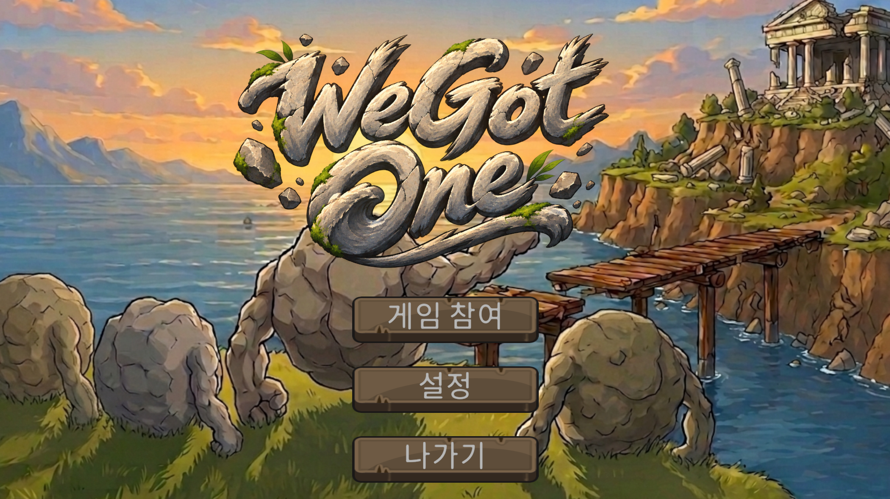

| 항목    | 내용                                                                                                                                    |
| ----- | ------------------------------------------------------------------------------------------------------------------------------------- |
| 플랫폼   | PC Windows                                                                                                                            |
| 개발 인원 | 4 (팀 프로젝트)                                                                                                                            |
| 내 역할  | 팀장·PM, 서버 환경 구축, 호스트 권한형 입력 중계 서버와 동기화 뼈대, 승패 판정, 다리 건설 조건 개편                                                                       |
| 엔진    | Unity 6000.3.15f1 (UniTask, Newtonsoft.Json, Multiplayer Play Mode)                                                                   |
| 서버    | ASP.NET Core 웹 앱, .NET 10, WebSocket + System.Text.Json                                                                                |
| 개발 기간 | 2026.08.14 — 09.10                                                                            |
| 링크    | [GitHub(클라이언트)](https://github.com/KooHoo-Dev/3rd-TeamProject-HS) · [GitHub(서버)](https://github.com/KooHoo-Dev/3rd-TeamProject-HS-Server) · [시연 영상](https://youtu.be/FIbzJOO5Ahc) · [쇼츠](https://youtube.com/shorts/MQfqdbiIR6I) |

---

## 1. 개요

### 1.1 프로젝트 소개

**플레이어들이 서로의 몸을 붙잡아 바닷속 자원을 모으고, 그 자원으로 다리를 지어 육지까지 가는 2D 협동 물리 탐험 게임**

### 1.2 주제 선정 배경 및 기획 의도

#### 1.2.1 핵심 경험 선정 — 협동과 불협화음

주제 선정 당시 팀원 모두 협동 게임을 선호했습니다. 그래서 기획 초기에는 협동 게임에서 제공하는 플레이어 간 상호작용, 경험에 집중했습니다.

- 《Overcooked》: 각자 맡은 역할을 수행하며 톱니바퀴처럼 맞물려 돌아가는 **협동의 재미**
- 《Mount Your Friends》, 《WASD》: 의도적으로 불편한 조작과 물리적 제약에서 발생하는 **혼란**

토의 결과, 협동과 불협화음이 가장 인상적인 경험으로 의견이 모아졌고 이 프로젝트의 핵심 경험으로 정하게 되었습니다.
불편한 조작과 물리적 제약은 수단이고, 그 제약 때문에 플레이어들의 행동이 서로 충돌하고, 이를 극복하려고 소통하고 협력하는 순간을 느끼게 하고 싶었습니다.

따라서 **서로 의지해야 하지만 동시에 서로의 행동을 방해할 수도 있는 상호작용**을 만들어내는 것을 기획의 출발점으로 삼았습니다.

#### 1.2.2 주제 선정 — 인간 낚싯대로 함께 물고기를 잡고 운반

협동과 불협화음을 만들어내기 위해, 플레이어들이 서로의 몸을 붙잡아 하나의 긴 인간 낚싯대처럼 움직이며 물고기를 포획하고 운반하는 협동 낚시 게임을 기획했습니다.

플레이 방식은 《Heave Ho》의 물리 기반 협동 조작을 참고했습니다. **《Heave Ho》는 플레이어가 양팔을 움직여 지형이나 다른 플레이어를 붙잡고, 몸을 흔들며 목표 지점까지 이동하는 물리 기반 협동 게임입니다.** 서로를 붙잡으면 혼자서는 도달하기 어려운 곳까지 이동할 수 있지만, 각자의 움직임이 서로에게 영향을 미치므로 방향이나 타이밍이 어긋나면 오히려 이동을 방해하게 됩니다.

이러한 구조를 바닷속 물고기 포획과 운반에 적용했습니다.

초기 기획에서는 타이밍 입력을 통한 낚시 미니게임과 플레이어 간 물고기 전달 방식을 검토했습니다. 하지만 우리가 제공하려는 핵심 경험은 서로의 몸을 붙잡고 뜻대로 움직이지 않는 물리적 제약을 함께 극복하는 과정이었습니다. 별도의 미니게임은 이러한 경험을 강화하기보다 단절시킨다고 판단했습니다. 팀 논의를 거쳐 물고기의 포획부터 제압과 운반까지 동일한 물리 조작 체계로 해결하는 방향을 선택했습니다.

- **포획:** 깊은 곳의 물고기를 잡기 위해 플레이어들이 서로 연결되어 협동합니다. 이 과정에서 각자의 움직임이 서로 간섭하며 예측하기 어려운 상황이 발생합니다.
    
- **제압·운반:** 붙잡힌 물고기는 도망치려고 저항합니다. 플레이어들은 물고기를 놓치지 않으면서 저항을 제압하고, 서로의 움직임을 조율해 다리 위까지 운반해야 합니다.
    
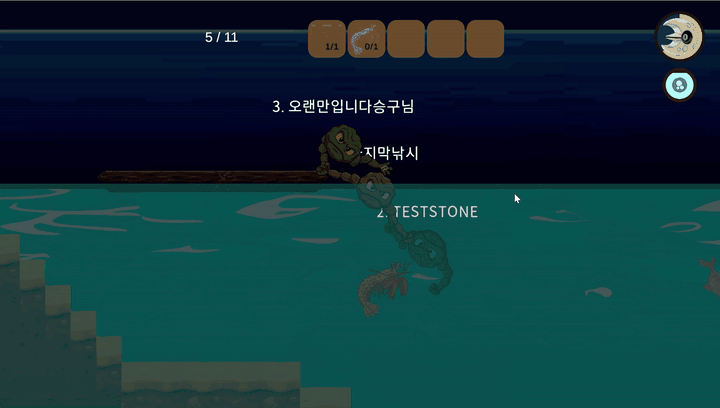

핵심은 **서로를 돕기 위한 행동이 동시에 다른 플레이어를 방해할 수 있다는 점**입니다. 물고기를 잡고 운반하는 과정에서 각자의 행동이 충돌하며 불협화음이 발생하고, 이를 극복하기 위해 역할을 분담하고 호흡을 맞추면서 협동의 성취감과 유대감이 형성되도록 의도했습니다.

이러한 포획과 운반을 반복하는 공동의 장기 목표로 **다리 건설**을 설정했습니다. 플레이어들은 물고기와 나무를 모아 다리를 조금씩 확장하고, 최종적으로 육지에 도달하는 것을 목표로 합니다. 이를 통해 매번의 자원 수집과 협력이 공동의 진행 상황으로 이어지도록 했습니다.

### 1.3 핵심 플레이 경험

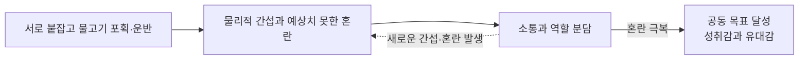

프로젝트의 핵심 경험은 **서로의 행동이 충돌하며 발생하는 불협화음을 함께 극복하고, 공동의 목표를 달성하면서 느끼는 성취감과 유대감**입니다.

플레이어들은 서로의 몸을 붙잡고 물고기를 포획하고 운반합니다. 이 과정에서 각자의 움직임과 물고기의 저항이 서로에게 영향을 미치며 예상하지 못한 혼란이 발생합니다.

플레이어들은 소통과 역할 분담으로 이러한 상황을 극복하고, 함께 목표를 달성하는 경험을 반복하게 됩니다. 혼란을 해결하려고 행동을 조율하는 과정에서도 또 다른 물리적 간섭이 생길 수 있고, 플레이어들은 이런 상황을 반복해서 마주하고 해결하며 점차 호흡을 맞춥니다.


여기에 제한된 스태미나와 자원 확보에 따른 위험을 더해, **현재의 성과를 안전하게 가져갈지 더 큰 성과를 위해 도전할지 선택하는 긴장감**을 보조적으로 제공하고자 했습니다.

| 경험 | 다이어그램에서 | 자세한 설명 |
|---|---|---|
| 불협화음 | 물리적 간섭과 혼란 / 협동 중 다시 혼란으로 돌아가는 점선 | 1.3.1 |
| 유대감 | 혼란을 극복하고 공동 목표를 달성 | 1.3.2 |
| 탐욕과 도전 | 스태미나 관리와 자원 확보의 위험 | 1.3.3 |

#### 1.3.1 불협화음 — 예측하지 못한 혼란과 극복

**의도한 경험**

플레이어들이 같은 목표를 향해 행동하더라도 뜻대로 움직이지 않고, 서로의 행동이 의도하지 않은 결과로 이어지면서 발생하는 혼란과 웃음을 제공하고자 했습니다.

다른 플레이어와 물리 환경의 영향을 받으며 발생하는 예측하기 어려운 상황에 주목했습니다.

이러한 실수와 돌발 상황을 **플레이어들이 함께 웃고 대화하며 기억할 만한 사건**으로 만들고자 했습니다.

**의도한 플레이어의 행동**

플레이어들은 서로를 붙잡거나 주변 지형과 물체를 이용해 이동하며 자원을 수집합니다.

이 과정에서 누군가 반대 방향으로 움직이거나 손을 놓으면 연결된 다른 플레이어까지 함께 끌려가고, 잡으려던 물고기를 놓치거나 예상하지 못한 방향으로 튕겨 나갈 수 있습니다.

물고기를 붙잡은 이후에도 상황은 쉽게 통제되지 않습니다. 도망치려는 물고기가 이리저리 몸부림치면서 플레이어들의 움직임을 방해하고, 플레이어들은 물고기를 놓치지 않으면서 저항을 줄이기 위해 서로의 행동을 조율해야 합니다. 이 과정에서 처음 계획했던 움직임이 어긋나거나 다른 플레이어를 방해하는 등 돌발 상황이 발생합니다.

**협력하려는 행동이 오히려 혼란을 만들고, 그 혼란을 다시 협력으로 극복하는 과정**이 불협화음의 핵심입니다.

#### 1.3.2 유대감 — 서로 의지하며 목표를 달성하는 성취감

**의도한 경험**

플레이어들이 혼자서는 달성하기 어려운 목표에 함께 도전하고, 서로의 행동에 의지하며 성공하는 경험을 제공하고자 했습니다.

처음에는 각자의 움직임이 충돌하지만, 반복해서 함께 플레이하면서 서로의 행동을 예측하고 호흡을 맞추게 됩니다.

그 과정에서 **공동의 목표를 달성하는 성취감**을 느끼도록 의도했습니다.

**의도한 플레이어의 행동**

혼자서는 닿기 어려운 바닷속 자원에 도달하려면 플레이어들이 서로의 몸을 붙잡고 움직여야 합니다.

물고기를 붙잡는 데 성공하더라도 저항하는 물고기를 혼자 운반하기 어려울 수 있습니다. 여러 플레이어가 물고기를 제압하고 함께 다리 위로 끌어올리면서 공동의 성취를 만들어냅니다.

처음에는 서로를 끌어당기며 이동조차 어려워하던 플레이어들이 점차 역할을 분담하고 하나의 몸처럼 움직이게 되는 과정에서 유대감이 형성됩니다.

#### 1.3.3 탐욕과 도전 — 위험을 감수하며 더 큰 성과를 노리는 긴장감

**의도한 경험**

플레이어가 제한된 상황에서 더 많은 자원을 얻기 위해 위험을 감수할지, 현재의 성과에 만족하고 돌아갈지 고민하도록 했습니다.

**어디까지 도전할 것인지 플레이어 스스로 판단하는 경험**을 제공하고자 했습니다.

**의도한 플레이어의 행동**

플레이어는 바닷속에 머무르는 동안 제한된 스태미나를 소모합니다. 멀리 떨어져 있거나 깊은 곳에 있는 자원을 확보하려면 더 오랫동안 탐색하고 협력해야 합니다.

또한 낮과 밤에 등장하는 물고기의 종류가 달라지므로, 원하는 자원을 얻기 위해 탐색 시점과 대상을 선택하게 됩니다.

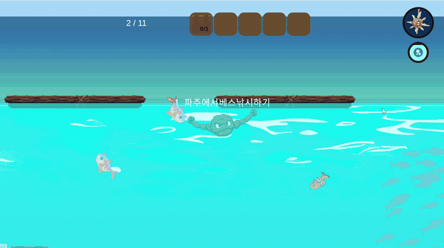

플레이어들은 현재 확보한 자원을 안전하게 다리로 운반할지, 남은 스태미나를 감수하고 추가로 물고기를 잡으러 갈지 판단해야 합니다. 이러한 선택은 자원 확보에 대한 욕심과 스태미나 소진 위험 사이에서 긴장감을 만들어냅니다.

### 1.4 핵심 게임 루프

게임의 반복 구조는 **협력하여 자원을 확보하고, 확보한 자원으로 다리를 확장하며, 새로운 구역을 탐험하는 과정**으로 이루어집니다.

다리 건설은 플레이어들이 물리적 협동을 반복할 이유와 공동의 진행 목표를 제공합니다.

#### 1.4.1 핵심 플레이 루프 — 협력하여 물고기 포획 및 운반

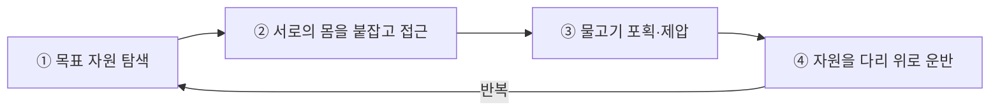

- **① 목표 자원 탐색:** 플레이어들은 바닷속에서 필요한 물고기와 나무를 찾습니다. 혼자서 접근하기 어려운 위치라면 다른 플레이어와 협력하여 접근 방법을 결정합니다.
- **② 서로의 몸을 붙잡고 자원에 접근:** 플레이어들은 서로의 몸이나 지형을 붙잡으며 목표물에 접근합니다. 각자의 움직임이 연결된 플레이어에게 영향을 미치므로 위치와 타이밍을 조율해야 합니다.
- **③ 물고기 포획 및 제압:** 목표 물고기를 붙잡은 뒤, 몸부림치는 물고기의 저항을 상쇄하거나 지형에 물고기를 부딪치게해 물고기를 제압합니다. 이 과정에서 서로를 방해하거나 예상치 못한 움직임에 휘말리는 혼란스러운 상황이 발생합니다.
- **④ 확보한 자원을 다리 위로 운반:** 플레이어들은 물고기를 놓치지 않도록 협력하여 다리 위로 끌어올립니다. 자원을 안전하게 운반하는 데 성공하면 공동의 성취를 얻습니다.


#### 1.4.2 전체 게임 루프 — 자원 수집과 다리 확장

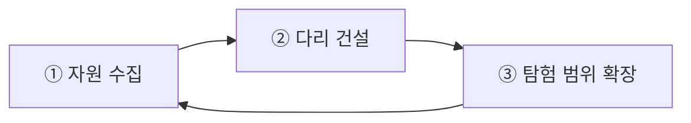

- **① 자원 수집:** 플레이어들은 협력하여 바닷속 물고기와 나무를 모읍니다.
- **② 다리 건설:** 확보한 자원을 사용하여 공동의 목표인 다리를 조금씩 확장합니다.
- **③ 탐험 범위 확장:** 다리가 확장되면서 새로운 구역으로 이동할 수 있게 되고, 다음 단계의 자원을 수집할 기회가 생깁니다.

| 종료 조건 | 언제 |
|---|---|
| 승리 | 다리를 끝까지 짓고, 완성된 다리를 건너 모두 목표 지점에 도착했을 때 |
| 패배 | 어느 단계에서든 모든 플레이어의 스태미나가 바닥났을 때 |

| 승리 화면 | 패배 화면 |
|---|---|
| 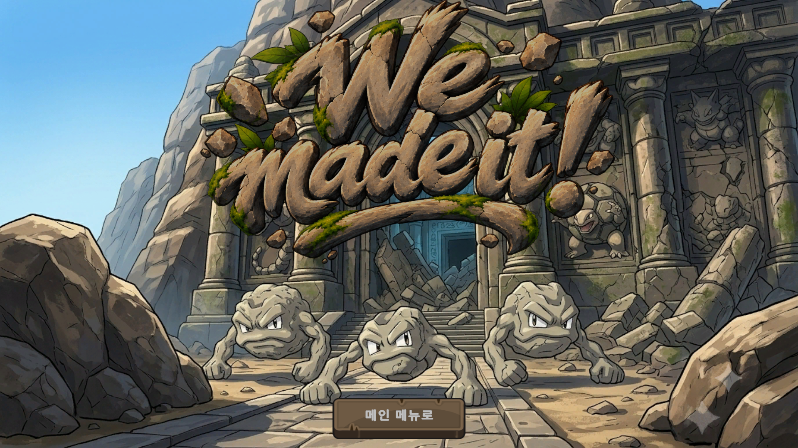 | 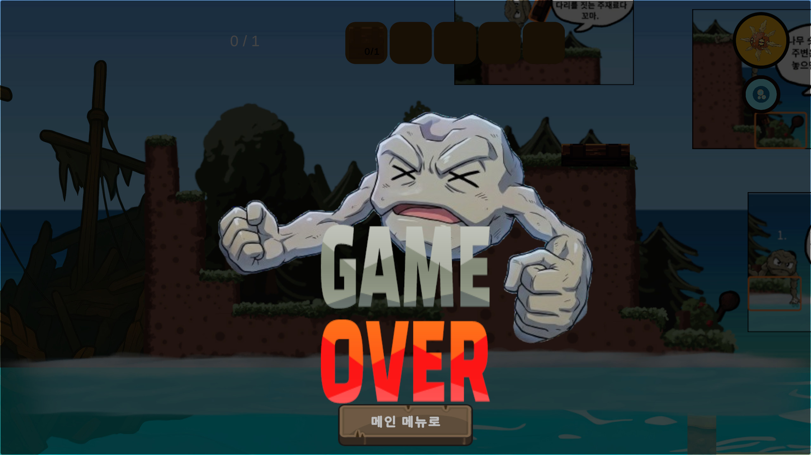 |

#### 1.4.3 정리

이 게임에서는 자원을 확보하는 과정 자체가 유대감과 불협화음이 발생하는 핵심 플레이 경험입니다.

- **자원 수집:** 서로 의지하고 방해하는 물리적 상호작용이 발생하는 구간
- **포획 및 운반:** 혼란 속에서 협력하고 공동의 성취를 얻는 구간
- **다리 건설:** 협력의 결과가 공동의 목표 달성으로 이어지는 구간
- **탐험 확장:** 새로운 자원을 찾아 같은 협동 경험에 다시 도전하도록 만드는 구간

따라서 프로젝트의 핵심은 **혼란스러운 물리적 상호작용을 협력으로 극복하는 경험을 반복하고, 그 결과를 다리 건설이라는 공동의 성취로 연결하는 것**입니다.

개발 과정에서는 이 의도를 실제 플레이 경험으로 구현하기 위해 어떤 기능을 만들고, 각 기능을 어떻게 연결하며, 무엇을 검증해야 하는지 고민했습니다.


---

## 2. 프로젝트 진행 및 협업

기획한 기능을 각각 구현하는 것만으로 의도한 플레이 경험이 만들어지지는 않았습니다.

팀원마다 만든 기능을 하나의 멀티플레이 게임으로 통합해야 했고(2.4), 실제로 플레이해 보며 처음 의도한 경험이 나타나는지도 확인해야 했습니다(2.5). 이 두 과제를 거치며 작업 방식과 게임의 기획 방향을 조정해 나갔습니다.

### 2.1 팀 구성 및 역할 분담

역할은 기능 영역별로 나눴습니다. 

핵심 플레이 루프(1.4.1)로 보면, 플레이어 조작은 서로 붙잡고 접근하는 구간, 레벨 디자인과 물고기 AI는 자원을 찾고 포획하는 구간, 자원 획득·인벤토리·다리 연결은 운반과 다리 건설 구간에 해당합니다. 네트워크 동기화는 모든 구간에 걸쳐 있어, 팀원마다 자기 기능의 동기화도 함께 맡았습니다(표 오른쪽 열).

| 팀원    | 맡은 일                                | 네트워크 동기화에서 맡은 기능                                   |
| ----- | ----------------------------------- | -------------------------------------------------- |
| 신성건   | 플레이어 조작, 스태미나, 물고기 시스템 개편 및 확장      | 플레이어 물리 상태 동기화                                     |
| 김승구   | 다리 연결, 자원 획득, 인벤토리, 물고기 시스템 개편 및 확장 | 다리 상태 동기화                                          |
| 윤건우   | 레벨 디자인, 물고기 AI, 튜토리얼                | 물고기 Replica, 자원 상태, 낮/밤 동기화                        |
| 홍산(나) | 서버 환경 구축, 승패 판정, 팀장·PM              | 중계 서버, 게임 상태·종료 동기화, 중간 입장, 물체 동기화, 디버그 도구, 연동 가이드 |


### 2.2 프로젝트 일정 및 개발 단계

일주일 동안 기획 뒤 네 번의 스프린트로 진행했습니다.

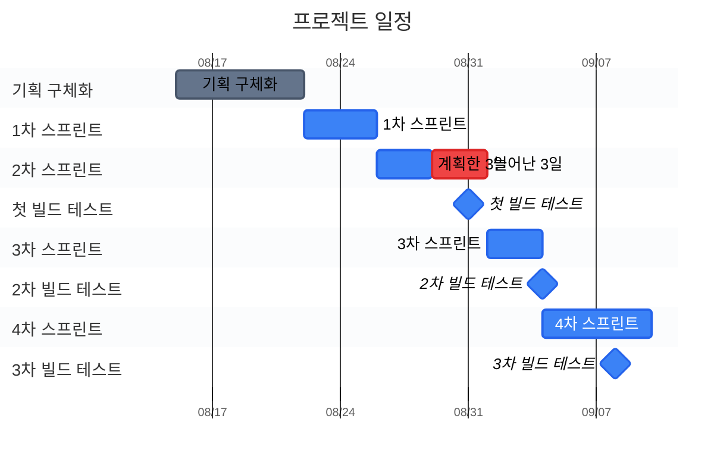

회색 막대는 기획, 파란 막대는 스프린트, 빨간 막대는 계획보다 늘어난 기간, 보라 ◆는 빌드 테스트 날입니다.

단계마다 목표는 다음과 같았습니다.

- **기획 구체화:** 기획을 구체화하고, 1차 스프린트의 계획과 작업 분배를 정했습니다.
- **1차 스프린트:** 플레이어 조작·물고기·자원 같은 기능을 팀원마다 나눠 만들고, 인게임 씬에 모았습니다.
- **2차 스프린트:** 개별 기능을 네트워크에 연결해 코어 루프를 완성하고, 첫 멀티플레이 빌드를 만드는 것이 목표였습니다.
- **3차 스프린트:** 첫 빌드 테스트 결과로 기획 방향을 확정하고, 물고기 콘텐츠를 늘렸습니다.
- **4차 스프린트:** 튜토리얼과 게임 흐름을 완성하고, 버그 수정과 폴리싱으로 최종 빌드를 안정화했습니다.

팀 운영은 1차 회고와 2차 스프린트의 네트워크 통합을 거치며 크게 바뀌었고, 게임 방향은 첫 빌드 테스트 뒤에 크게 바뀌었습니다.

### 2.3 협업 방식의 변화

1차 스프린트를 시작할 때 PM으로서 엄격한 작업 규칙을 세웠습니다. 스토리마다 브랜치를 만들고, 작업이 끝나면 PR로 올려 팀원의 코드 리뷰를 거친 뒤 합치는 방식이었습니다. 과제의 Git 운영 규칙(main 직접 push 금지, PR 기반)과 맞았고, 코드와 커밋 자체가 작업 문서가 되는 것을 목표로 했습니다.

1차 스프린트를 진행해 보니 개발 속도가 크게 느려졌습니다. 리뷰가 세밀한 PR 단위로 이뤄지면서 코드 수준의 검토에 치중했고, 기능들이 맞물리는 거시적인 흐름은 놓쳤습니다. 코드 검토와 디버깅에 드는 시간도 많았습니다. 작업·회의 기록도 여러 도구에 흩어져 있어, 진행 상황과 산출물을 보려면 여러 곳을 찾아야 했습니다.

그래서 1차 회고에서 모든 변경을 PR로 리뷰하던 규칙을 없애고, 도구도 함께 정리했습니다.

| 항목 | 1차 스프린트 | 1차 회고 뒤 |
|---|---|---|
| 코드 검토 | 모든 변경을 PR로 올려 팀원이 리뷰 | 3~4일 스프린트 단위로 구조를 리뷰<br>PR은 원하는 사람만 씀 |
| 작업 합치기 | 스토리 브랜치를 PR 리뷰 뒤 병합 | 각자 브랜치에서 작업한 뒤 직접 병합(main 직접 푸시는 계속 막음)<br>병합한 사람이 통합 씬에 바로 반영하고 문제가 없는지 확인<br>PM인 저는 통합 씬을 두 사람이 동시에 고치지 않도록 확인 |
| 작업·회의 기록 | 문서 도구·Asana·Discord에 흩어짐<br>1차 회의 정리는 문서 도구에만 있음 | Asana 한 곳 (파일은 작업 카드에, 의견은 댓글·멘션으로)<br>Discord는 가벼운 소통, 문서 도구는 제출 문서 검토 때만 |

코드 변경에 대한 검토를 줄여 작업 진행 속도를 향상시키고 기능 단위의 유의미한 리뷰를 진행할 수 있었습니다.

### 2.4 기능별 독립 개발과 시스템 통합

각 담당자는 독립적으로 구현할 수 있는 기능을 먼저 개발하고, 다른 시스템과의 연동이 필요한 경우 관련 담당자끼리 논의하여 별도의 연동 작업을 등록하도록 했습니다.

2차 스프린트에서는 이렇게 개발한 플레이어·물고기·자원 시스템을 네트워크에 연결하고 첫 멀티플레이 빌드를 완성하는 것을 목표로 했습니다. 서버 중계는 제가 담당하고, 각 기능의 동기화는 해당 기능을 개발한 팀원이 맡았습니다.

기능마다 따로 동작하는 것만으로는 의도한 협동이 나오지 않았습니다. 네 명이 서로 붙잡고 물고기를 옮기는 물리 결과가 모든 화면에서 같아야 했고, 그러려면 각 기능이 하나의 게임 상태로 묶여야 했습니다. 이를 위해 통합에 앞서 계산 기준을 호스트 한 곳에 두는 호스트 권한형 구조를 정해 두었습니다(3.2).

그러나 네트워크 통합 과정에서 두 가지 문제가 발생했습니다.

#### 작업 범위와 일정 산정 부족

서버 중계가 먼저 마련되어야 개별 게임 기능을 연동하고 검증할 수 있었지만, 이러한 선후관계를 충분히 고려하지 않고 두 작업에 동일한 마감을 설정했습니다.

또한 네트워크 연동 작업을 객체와 시스템 단위로 충분히 구체화하지 않았습니다. 처음 하나로 계획했던 서버 관련 작업은 개발 과정에서 17개로 늘어났습니다.

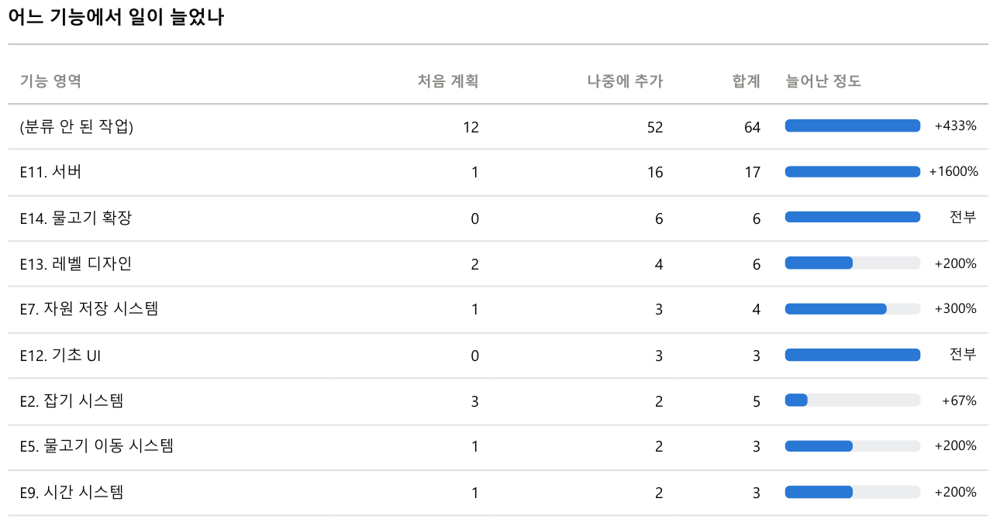

| 시점 | 서버 관련 작업 |
|---|---|
| 처음 계획 (1개) | 서버가 플레이어의 정보를 다른 플레이어에게 중계 |
| 통합 중에 추가 (16개) | 플레이어 물리 상태·게임 상태 동기화<br>물고기 상태를 게스트에서 Replica로 표현<br>자원·나무 물리 상태·다리 상태 동기화<br>게임 시간·게임 종료 상태 동기화<br>중간 입장(진행 중인 방 입장, 현재 상태 한 번에 받기, 이후 동기화 이어받기)<br>서버 반영·테스트 방법 정리, 스냅샷 중복 버그 수정<br>호스트 이전, 스냅샷 반영 지점 리팩토링(끝내지 못함) |


#### 호스트·게스트별 연동 명세 부족

호스트 권한형에서는 호스트가 게임 상태를 계산하고, 게스트는 계산된 결과를 받아 화면에 반영합니다.

따라서 기존 게임 기능을 네트워크에 연결하려면 같은 플레이어 객체라도 다음 세 가지 경우를 구분해야 했습니다.

| 구분 | 역할 |
|---|---|
| 호스트 자신의 플레이어 | 자신의 입력으로 게임 로직과 물리 계산 |
| 호스트 화면의 게스트 플레이어 | 전달받은 게스트 입력으로 게임 로직과 물리 계산 |
| 게스트 화면의 플레이어 | 호스트에서 계산한 결과 반영 |

하지만 각 경우에 어떤 로직을 실행하고 어떤 정보를 주고받아야 하는지에 대한 정보가 충분치 않았습니다. 연동 가이드를 작성했지만, 팀원들이 자신의 기능을 동기화하려면 네트워크 구조와 역할별 동작을 추가로 파악해야 했습니다.

#### 통합 과정과 결과

마감이 가까워지면서 네트워크 담당자인 제가 팀원들의 기능 연동에도 직접 참여했습니다. 이 과정에서 PM으로서 담당하던 팀원별 진행 상황 확인과 추가 업무 분배가 중단되었습니다.

플레이어·물고기·자원 시스템 자체는 예정대로 완성했지만, 네트워크 통합을 마치는 데 계획보다 사흘이 더 필요했습니다.

개별 기능의 작업을 세밀하게 나누는 것만으로는 충분하지 않았습니다. 여러 담당자의 기능이 하나의 시스템으로 통합되어야 하는 경우에는 선행 작업과 연동 시점을 구분하고, 각 담당자가 공통 시스템 전체를 이해하지 않아도 작업할 수 있도록 역할과 데이터 규약을 먼저 정의할 필요가 있었습니다(3.6).

### 2.5 빌드 테스트에 따른 기획 방향 조정

첫 빌드 테스트는 1장에서 의도한 경험이 실제 플레이에서 나타나는지 처음 확인하는 자리였습니다. 팀원들과 해 보니 조작이 생각보다 어려웠고, 처음 하는 사람은 조작에 적응하다가 낚시로 허기를 채우기 전에 죽는 일이 많았습니다.

이 테스트에서 가장 재미있었던 장면은 캐릭터들이 물고기를 잡으며 서로 좌충우돌하는 상황이었습니다. 물리 조작에 적응하고 서로의 행동을 맞춰 가는 과정 자체가 의도한 핵심 경험이었습니다. 하지만 물속이든 물 밖이든 계속 줄어드는 허기는 그 경험을 충분히 즐기기 전에 게임을 끝내고 있었습니다. 생존 압박이 협동의 재미를 가로막고 있었습니다.

그래서 생존 요소를 없애고, 다리를 넓히려고 새 지역을 탐사하는 쪽으로 게임 방향을 바꿨습니다.

| 항목 | 처음 기획 | 바꾼 기획 |
|---|---|---|
| 시간 압박 | 허기: 물속이든 물 밖이든 계속 줄어듦 | 스태미나: 물속에서는 줄고, 물 밖으로 나오면 채워짐 |
| 이동 수단과 목표 | 뗏목을 타고 표류하며 허기와 뗏목 내구도를 버팀 | 뗏목 대신 다리를 두고, 다리를 넓히려고 새 지역을 탐사함 |

새 지역을 탐사할 이유를 만들려고, 나무만 쓰던 다리 건설 조건에 물고기를 더하는 개편도 이때 함께 진행했습니다(4.7).

### 2.6 콘텐츠 확장과 마무리 단계의 범위 조정

기획 방향을 정한 뒤 남은 두 스프린트는 핵심 경험을 물고기 콘텐츠로 늘리는 일과 최종 빌드를 안정시키는 일에 썼습니다.

#### 공통 물고기 시스템 위의 콘텐츠 확장

3차 스프린트에서 공통 물고기 시스템이 마련된 뒤에는 팀원들이 각자 물고기 아이디어를 기획하고 직접 구현했습니다. 대왕 오징어, 전기 가오리, 지뢰 물고기 같은 물고기가 이때 추가됐습니다.

기획할 때는 아래 세 가지 재미를 공통 기준으로 공유했습니다.

- 물고기를 힘겹게 잡는 과정의 재미
- 물고기 자체의 특성에서 오는 재미
- 물고기를 무력화하는 과정의 재미

세 기준은 1장의 핵심 경험과 이렇게 이어집니다. 힘겹게 잡는 과정은 서로의 몸이 간섭하는 협동을, 물고기마다 다른 특성은 예상하지 못한 혼란과 대응을, 무력화하는 과정은 행동을 맞춰 함께 이뤄 내는 성취를 만듭니다.

물고기 종류를 늘리면서도 기존 구조와 공통 상태 머신은 그대로 유지했습니다. 대신 일부 상태의 행동을 물고기 이름이나 아이템 ID에 따라 분기했습니다. 남은 기간 안에 기존 시스템 위에서 콘텐츠를 더하기 위한 선택이었습니다. 그 결과 분기 조건이 공통 상태 코드에 들어가, 새 물고기를 더할 때마다 같은 코드를 다시 고쳐야 하는 한계가 남았습니다.

#### 마무리 단계의 범위 조정

4차 스프린트에서는 튜토리얼과 게임 흐름(메인 메뉴 → 인게임 → 결과)을 완성하고, UI·피드백 효과를 다듬었습니다. 물고기 버그와 네트워크 지연도 이때 고쳤습니다.

남은 기간에는 포획 시 스태미나 처리와 프리팹 설정값 같은 기존 물고기 시스템의 안정화를 우선했습니다.
그래서 물고기 간 먹이사슬 같은 추가 기능은 결국 최종 빌드에서 제거했습니다.

이벤트와 스냅샷을 분리하는 네트워크 작업도 같은 이유로 미뤘습니다(5.3).

---

## 3. 담당 역할 및 시스템 구조

개발 과정에서 제가 기술적으로 맡은 영역은 크게 두 가지였습니다. 하나는 여러 플레이어가 같은 물리적 상호작용과 게임 진행 상황을 공유하도록 네트워크 기반을 만드는 것이었고(2.4), 다른 하나는 빌드 테스트 뒤 바뀐 기획 방향에 맞춰 자원 수집과 탐험의 동기를 강화하는 것이었습니다(2.5).

### 3.1 담당 범위와 게임 내 역할

- **네트워크 동기화(루프 전체):** 서로 붙잡고 물고기를 옮기는 물리 결과와 공용 인벤토리·다리·낮과 밤·승패 같은 진행 상태가 네 화면에서 같아야 협동이 성립합니다. 호스트 권한형 입력 중계 서버, `RoomClient`의 스냅샷 생성 및 반영 흐름, 월드 아이템 ID, 게임 상태·종료 동기화와 중간 입장을 만들었습니다. 팀원들이 각자 기능을 연동하도록 연동 가이드를 쓰고, 인게임에서 네트워크 정보가 들어오는지 확인하는 디버그 도구도 만들었습니다. 구조는 이 장, 구현은 4.1~4.6과 4.8에서 다룹니다.
- **다리 건설 조건 개편(다리 건설 구간):** 탐험 중심으로 바뀐 기획에서는 새 지역을 탐사할 이유가 필요했습니다. 나무만 쓰던 건설 조건에 물고기를 더하는 개편에 참여했습니다. 4.7에서 다룹니다.

### 3.2 네트워크 동기화 모델 선정

이 게임에서는 플레이어와 물고기가 서로 물리적으로 영향을 주기 때문에, 어느 클라이언트의 계산 결과를 기준으로 삼을지부터 정해야 했습니다. 제가 알고 있던 간단한 네트워크 구조는 각 클라이언트가 자기 위치를 계산해 보내는 방식이었습니다. 이 구조에서는 여러 몸이 얽힌 물리 결과가 클라이언트마다 갈릴 수 있었습니다. 팀원들과 동기화 방식을 논의했고, 나온 안들을 계산 권한이 어디 있는지에 따라 세 모델로 정리해 비교했습니다.

| 대안                                        | 장점                                                               | 단점                                                        |
| ----------------------------------------- | ---------------------------------------------------------------- | --------------------------------------------------------- |
| A. 클라이언트 권한형 — 각자 계산한 결과를 보냄 (받은 뼈대 방식)   | 클라이언트 각자 자신이 조종하는 캐릭터는 입력 지연이 없음                                 | 붙잡기·물고기처럼 여러 몸이 얽힌 물리는 결과가 갈림<br> 누구 결과가 맞는지 정할 주인이 없음       |
| B. 호스트 권한형 — <br>게스트는 입력만, 호스트가 전부 계산, 서버는 중계 | 물리·랜덤·승패의 정답이 한 곳<br>Unity 물리를 서버로 옮길 필요 없음<br>기준이 분명해 초기 구현과 검증이 단순 | 물리 결과가 호스트에 종속됨<br>네트워크가 불안정하면 약함<br>호스트/게스트 분기 코드가 생김(5.1)<br>호스트가 나가면 상태가 사라짐 |
| C. 서버 권한형 — 서버가 받은 입력으로 직접 계산             | 가장 공정하고 호스트 이탈 문제가 없음                                            | Unity 2D 물리(관절)를 .NET 서버에 다시 만들어야 함<br>2주 일정으로는 불가능에 가까움    |

**최종 결정: B. 호스트 권한형.** "모든 유저가 동일한 물리 연산 화면을 보장받는 것"을 목표로, 클라이언트와 서버 중심 구조의 현실적 절충안을 골랐습니다. 동기화 기준을 호스트 한 곳으로 분명히 정해 개발 속도를 높이려는 목적도 있었습니다.

서버 파트를 맡은 제가 최종으로 정했습니다. 대안마다 이렇게 판단했습니다.

- 서버 권한형: Unity 물리를 서버에 직접 구현해야 합니다. 서버를 처음 맡은 입장에서 구현 위험이 크다고 봤습니다.
- 클라이언트 권한형: 다른 멀티플레이 게임을 하며 플레이어마다 게임 상황이 크게 갈리는 일을 많이 겪었습니다. 같은 문제에 빠질 가능성이 크다고 봤습니다.
- 호스트 권한형 + 서버 중계: 네트워크 불안정에 약합니다. 다만 강사님이 만든 기본 서버와 시연 환경(많아야 16명 동시 플레이)에서는 문제가 크지 않다고 봤습니다. 정답이 되는 화면(호스트)이 분명해 프로토타입을 빨리 만들 수 있었습니다.

**클라이언트 예측을 뺀 이유**

- 처음 안은 "호스트가 물리 처리 + 클라이언트는 미리 자체 이동 후 호스트 결과가 오면 보간"(클라이언트 예측 포함)이었습니다.
- 다만 예측까지 한 번에 구현하지 않고, "기본 호스트 기반 동기화 → 부자연스러우면 보간 추가 → 그래도 부자연스러우면 예측 추가" 순서로 단계를 밟기로 했습니다.
- 플레이어와 물체 모두 보간만 넣어도 생각보다 상당히 자연스러웠습니다. 그래서 클라이언트 예측은 중간에 덜어낸 방식으로 위치 동기화 작업을 마무리했습니다.

**다시 고른다면: 서버 권한형**

- 호스트 권한형에서는 게임 로직과 네트워크를 합칠 때, 기존 클라이언트 코드의 동작을 호스트 / 게스트 / 호스트 안의 게스트 더미 세 갈래로 나눠야 했습니다. 작업 명세와 코드 규칙이 정리되지 않으면 팀원들이 크게 헷갈렸습니다(5.1).
- 서버 권한형이면 각 플레이어는 입력만 서버로 보내고, 플레이어 위치·붙잡기 결과·물고기와 통나무 위치 같은 주요 동기화 정보는 모두 서버에서 받습니다. 클라이언트를 합칠 때 게임 구조가 더 직관적일 것이라고 봅니다.

### 3.3 전체 네트워크 흐름

모든 화면에 같은 물리 결과가 보이도록, **게스트는 입력만 보내고 화면에 보이는 결과는 모두 호스트가 계산한 스냅샷**으로 받게 했습니다. 서버는 게스트 입력을 모아 호스트에게 보내고, 호스트 스냅샷을 게스트들에게 전달합니다.

1.4.3의 루프 구간마다 네 화면에 같아야 하는 것은 아래와 같고, 모두 호스트 스냅샷 한 장에 담깁니다(4.2).

| 루프 구간 | 네 화면에 같아야 하는 것 | 스냅샷 필드 |
| --- | --- | --- |
| 자원 수집 | 서로 붙잡고 움직이는 플레이어 물리 | `Players` |
| 포획 및 운반 | 물고기·나무의 위치와 존재 | `Fishes`<br>`Planks` |
| 다리 건설 | 공용 인벤토리 자원과 지어진 다리 수 | `InventoryEntries`<br>`CurrentBridgeCount` |
| 루프 전체 | 낮/밤, 도착 인원, 승패 | `IsDay`<br>`ArrivedPlayerCount` 등 |

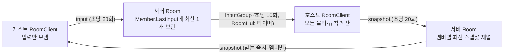

- 초당 횟수는 저장소의 설정값입니다. 게스트·호스트 송신 `sendPerSecond: 20`, 서버 입력 전달 `BroadcastPerSecond: 10`.
- 서버 → 게스트 전달에는 별도 주기가 없습니다. 호스트 스냅샷을 받을 때마다 바로 보냅니다.
- 이 채널 구조는 프로젝트 이후 개선한 버전입니다. 프로젝트 기간 내 버전과 개선 버전의 차이는 5.2에서 다룹니다.

### 3.4 네트워크 주요 클래스와 책임

| 구성요소          | 위치          | 책임 (그리고 하지 않는 일)                                                                                                |
| ------------- | ----------- | --------------------------------------------------------------------------------------------------------------- |
| `Program`     | 서버          | `/room?code=` WebSocket 요청을 받아 방 코드를 정규화하고 `RoomHub`에 넘김. 입력 중계 주기 루프를 시작함                                      |
| `RoomHub`     | 서버          | 방 코드 → 방 찾기/만들기/지우기, 인원 제한, 모든 방에 "호스트에게 게스트 입력 보내기"를 주기마다 시킴. 메시지 내용은 모름                                       |
| `Room`        | 서버          | 한 방의 멤버 관리, 메시지 종류별 처리(input/snapshot), 송신. 언제 보낼지는 RoomHub 타이머와 호스트 송신이 정함                                     |
| `Room.Member` | 서버          | 접속자 1명: 소켓, 마지막 입력(`LastInput`), 송신 잠금(`SendLock`), 최신 스냅샷 채널(`LatestSnapshotChannel`)                          |
| `Protocol`    | 서버·클라이언트 각각 | 메시지 클래스. `TypeOnly`로 종류를 먼저 읽고 맞는 클래스로 다시 역직렬화                                                                  |
| `RoomClient`  | 클라이언트       | 클라이언트 쪽 유일한 네트워크 창구. 접속, 수신 분기, 호스트면 스냅샷 생성·송신, 게스트면 입력 송신                                                      |
| 스냅샷 반영 대상     | 클라이언트 매니저들  | 게스트일 때 `RoomClient.OnSnapshot`이 아래 매니저들의 `ApplySnapshot`을 부름:<br>`Player`<br>`BridgeManager`<br>`InventoryItemDB`<br>`GameManager` 등 |

**네트워크 클래스 분할 이유 세부 설명**

- 방 생성·삭제를 담당하는 `RoomHub`와 방 내부의 메시지를 처리하는 `Room`의 역할을 분리했습니다. 기존 서버의 구조를 유지하면서 방 관리 기능은 거의 수정하지 않고 데이터 동기화 방식만 변경할 수 있었습니다.
- 클라이언트에서 소켓을 아는 클래스는 `RoomClient` 하나입니다. 다른 매니저는 `ApplySnapshot(값)`만 받아서, 다리·인벤토리 기능을 고칠 때 연결·수신·송신 코드를 볼 필요가 없습니다.
	- `ApplySnapshot`은 `RoomClient`의 수신 루프가 메인 스레드로 돌아온 뒤, Update 직전에 부릅니다. 그래서 매니저는 스레드나 프레임 순서를 신경 쓰지 않고 오브젝트를 바꿀 수 있습니다.

### 3.5 호스트·게스트의 역할 및 입력·상태 전달 흐름

2.4에서 연동할 때 구분해야 했던 세 경우는 실제 구조에서 다음처럼 나뉩니다.

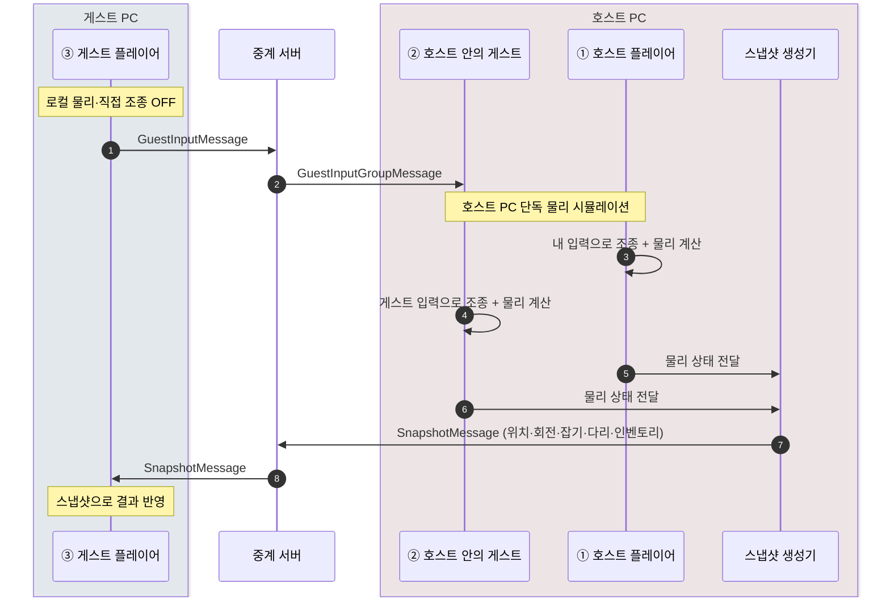

| 경우 | 조종 입력 | 물리 계산 여부 | 스냅샷 |
|---|---|---|---|
| ① 호스트 플레이어 | 호스트 키보드 | O | 스냅샷 생성 후 서버로 전송 |
| ② 호스트 안의 게스트 플레이어 | 서버가 모아 준 게스트 입력<br>(`ApplyInput`) | O | - |
| ③ 게스트 | 자기 입력을 서버로 보내기만 | X | 서버에서 받아서 반영<br>(`ApplySnapshot`) |

위 그림은 플레이어 객체의 세 역할을 보여 줍니다. 다음 흐름은 게스트 입력 한 번이 서버와 호스트를 거쳐 게스트 화면에 돌아오는 순서입니다.

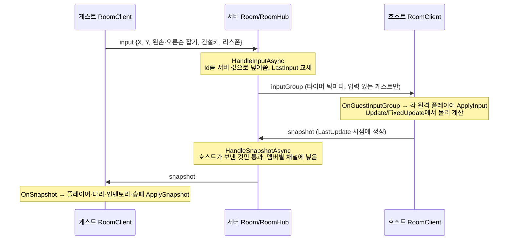

### 3.6 다른 게임 시스템과 네트워크의 연동 규약

클라이언트의 다른 클래스가 네트워크를 쓰려면 `RoomClient`의 아래 멤버만 알면 됩니다.

| 호출                                                | 하는 일                                              |
| ------------------------------------------------- | ------------------------------------------------- |
| `RoomClient.Instance.Join(code, nickName, color)` | 접속 시작. 접속에 성공하면 인게임 씬을 불러오고 hello를 보냅니다            |
| `RoomClient.Instance.Me.IsHost`                   | 이 클라이언트가 호스트인지. 게임 로직은 이 값으로 "확정할지, 결과만 받을지"를 고릅니다 |
| `RoomClient.Instance.RequestRespawn()`            | 게스트의 리스폰 요청을 다음 입력 메시지에 실어 보냅니다                    |
| `RoomClient.Instance.QuitGame()`                  | Close 알림을 보낸 뒤 바로 정리                              |

통합 때 연동 가이드로 공유한 동기화 순서는 세 단계입니다.

1. `Protocol`의 `SnapshotMessage`에 필드를 추가합니다.
2. 호스트 쪽 `SendSnapshotOrInputMessage`에서 그 필드를 채웁니다.
3. 게스트 쪽 `OnSnapshot`에서 그 값을 반영합니다.

서버는 메시지 규약으로 씁니다. 첫 메시지는 반드시 `hello`이고, 이후 `input`(게스트) 또는 `snapshot`(호스트)만 처리합니다.

이 가이드는 어떤 필드를 어디서 채우고 반영할지는 알려 주었지만, 2.4의 세 경우마다 무엇을 실행하고 무엇을 꺼야 하는지는 충분히 담지 못했습니다.

**다음에 보완할 역할별 명세**

다시 진행한다면 팀원들이 네트워크 구조를 모두 이해하지 않아도 각자 기능을 구현할 수 있도록, `Player`·`Fish` 같은 핵심 객체의 명세를 아래 수준으로 미리 정하겠습니다.

| 객체 | 미리 정해 둘 명세 수준 |
|---|---|
| 플레이어 조작<br>다리 | ① 경우별 책임: 호스트 / 호스트 안의 게스트 입력 적용 / 게스트 스냅샷 적용 세 경우에 각각 무엇을 하고 무엇을 끄는지 |
| 물고기 | ② ① + 데이터 계약: 스냅샷에 넣을 필드 목록, 게스트 반영 메서드와 호출 위치(`OnSnapshot`), 게스트 입력에서 쓰는 필드 |

---

## 4. 핵심 기능 구현

3.5 시퀀스의 구간 순서대로 봅니다. 서버는 게스트 입력을 모아 호스트에게 보냅니다(4.1). 호스트는 계산을 마친 게임 상태를 스냅샷 하나로 만듭니다(4.2). 서버는 그 스냅샷을 멤버별로 전달하고(4.3), 방 수명과 연결 예외를 처리합니다(4.4). 클라이언트에서는 `RoomClient`가 받는 시점과 보내는 시점을 고정합니다(4.5). 그 위에 붙는 월드 아이템(4.6)과 다리 건설(4.7)을 살펴본 뒤, 네트워크 값을 확인하는 도구(4.8)를 설명합니다.

| 절 | 3.5 흐름에서 맡는 구간 | 중심 코드 |
| --- | --- | --- |
| 4.1 | 게스트 `input` → 서버 → 호스트 `inputGroup` | `Room`<br>`RoomHub` |
| 4.2 | 호스트가 만드는 `snapshot` | `SnapshotMessage` |
| 4.3 | 서버 → 게스트 `snapshot` 전송 과정 | `LatestSnapshotChannel` |
| 4.4 | 흐름의 앞뒤: 입장·퇴장·끊김 | `RoomHub`<br>`Room` |
| 4.5 | 호스트, 게스트 클라이언트가 받고 보내는 말단 | `RoomClient` |
| 4.6 | 물고기·나무 동기화 | `WorldItemSnapshotSynchronizer` |
| 4.7 | 다리 수 동기화 | `BridgeManager` |
| 4.8 | 네트워크 값을 인게임에서 확인 | `NetworkDebugOnGUI` |

### 4.1 게스트 입력 모아서 호스트에게 보내기

1. 게스트 입력이 올 때마다 그 멤버의 `LastInput`을 최신 값으로 덮어씁니다. 
2. `RoomHub` 타이머가 틱마다 모든 방의 `SendGuestInputsToHostAsync`를 동시에 부릅니다.
3. 방은 게스트마다 `LastInput`을 "꺼내면서 비우고", 입력이 하나라도 있으면 묶어서 호스트에게 보냅니다

```csharp
public async Task SendGuestInputsToHostAsync()
{
    Member host = GetHost();
    // (Why) hello 처리 전에 타이머가 먼저 돌 수 있다. 호스트가 없으면 이번 틱은 건너뛴다.
    //       원본 주석: "이거 처리 안해줘서 처음에 가끔 의문사 당했구나... 서순 문제"
    if (host == null) return;

    GuestInputGroupMessage inputGroup = new GuestInputGroupMessage();
    foreach (Member member in members.Values)
    {
        if (member.User.IsHost) continue;

        // (Why) 읽기와 비우기를 한 번에(원자적으로) 한다.
        //       예전에는 읽고 → await 송신 → 나중에 전부 null로 비웠는데,
        //       송신을 기다리는 사이 들어온 새 입력까지 지워졌다. (6.2-1)
        GuestInputMessage input =
            Interlocked.Exchange(ref member.LastInput, null);

        if (input != null)
            inputGroup.Inputs.Add(input);
    }

    // (Why) 아무도 입력하지 않은 틱은 보내지 않는다.
    if (inputGroup.Inputs.Count == 0) return;

    LogGuestInputGroup(host, inputGroup);
    await SendAsync(host, inputGroup);
}
```

**입력이 없거나 늦게 오는 게스트**

```csharp
// RoomClient — 게스트 입력 송신 (발췌)
Vector2 input = SimpleInput.GetMoveAxisRaw();
Keyboard keyboard = Keyboard.current;
Mouse mouse = Mouse.current;
bool isPressRespawn = isRespawn;
await SendInputMessages(input, mouse.leftButton.isPressed, mouse.rightButton.isPressed,
    keyboard.fKey.isPressed, isPressRespawn);
```

- 프로토타입은 게스트 입력을 받을 때마다 바로 호스트에게 보냈습니다. 이때 두 가지를 고민했습니다. 핑이 느린 게스트의 입력이 늦게 오면 어떻게 할지, 그리고 "입력을 안 했음"과 "계속 이동 중"을 어떻게 구분할지였습니다.
- 입력 안 함: 게스트는 키를 누르지 않아도 송신 주기마다 지금 키 상태를 보냅니다. 아무 키도 누르지 않으면 이동 값 (0, 0)이 가고, 호스트는 이것을 받아 그 플레이어의 팔 방향을 지웁니다.
- 늦은 입력: 한 틱 동안 새 입력이 오지 않은 게스트는 묶음에서 빠집니다. 호스트는 그 게스트의 마지막 입력(팔 방향·잡기)을 그대로 유지합니다. 지연이 있어도 키 입력이 이어지는 것이 중요한 게임이기 때문입니다.

**예외·보안 경로**

- 호스트가 보낸 input은 무시합니다. 호스트는 자기 입력을 로컬에서 바로 쓰기 때문입니다.
- 클라이언트가 보낸 Id는 믿지 않고 서버가 정한 Id로 덮어씁니다.

### 4.2 호스트 스냅샷: 게임의 현재 상태 한 장

스냅샷은 호스트가 계산을 마친 게임의 현재 상태 전체를 담은 메시지입니다. 게스트는 입력만 보내고 물리를 계산하지 않으므로, 게스트 화면은 이 스냅샷만으로 그려집니다.

| 담는 것 | `SnapshotMessage` 필드 | 게스트에서 반영하는 곳 |
| --- | --- | --- |
| 플레이어 | `Players` | 원격 플레이어 `ApplySnapshot` |
| 월드 아이템(물고기·나무) | `Fishes`<br>`Planks` | `WorldItemSnapshotSynchronizer` (4.6) |
| 공용 인벤토리 | `InventoryEntries` | `InventoryItemDB` |
| 다리 | `CurrentBridgeCount` | `BridgeManager` (4.7) |
| 게임 진행(낮/밤·도착 인원·튜토리얼) | `IsDay`<br>`ActivePlayerCount`<br>`ArrivedPlayerCount`<br>`Tutorial…` | `GameManager` 등 |

- **만드는 때:** 호스트의 `RoomClient`가 물리·게임 로직이 끝난 LastUpdate에서 만듭니다(4.5). 그래서 스냅샷은 늘 그 프레임의 최종 결과입니다.
- **보내는 횟수:** 초당 20회입니다. 서버는 받는 즉시 게스트들에게 전달합니다(4.3).
- **반영하는 곳:** 게스트의 `RoomClient.OnSnapshot` 한곳에서 매니저마다 `ApplySnapshot`을 부릅니다(5.4).

**스냅샷이 "현재 상태 전체"라서 생기는 성질**

- **최신 1개면 충분합니다:** 밀린 과거 스냅샷은 보낼 의미가 없습니다. 서버는 멤버마다 가장 최신 것만 남깁니다(4.3).
- **중간 입장도 같은 길로 따라잡습니다:** 늦게 들어온 게스트는 별도 초기 메시지 없이 다음 스냅샷 하나로 현재 상태를 모두 받습니다.
- **사라짐을 따로 알리지 않습니다:** 이번 스냅샷에 없는 물고기는 호스트에서 사라진 것으로 봅니다(4.6).
- **한 번 일어나는 일은 담기 어렵습니다:** 다리 건설·승패처럼 한 번 일어나는 일도 스냅샷 값으로 보냈습니다. 그래서 이펙트·효과음처럼 특정 순간에 맞춰야 하는 연출은 동기화하기 어려웠습니다. 이 선택과 한계는 5.3에서 다룹니다.

### 4.3 멤버별 "최신 스냅샷 1개" 채널

**프로젝트 종료 뒤 개선한 현재 구조입니다.**

- 호스트 스냅샷이 오면 서버는 직접 보내지 않고, 호스트를 뺀 멤버마다 있는 채널에 넣기만 합니다.
- 멤버마다 송신 전담 루프가 하나씩 돌며 자기 채널에서 꺼내 보냅니다.
- 채널 크기는 1이고, 꽉 차면 오래된 것을 버립니다. 느린 멤버에게는 밀린 스냅샷이 쌓이지 않고 가장 최신 것만 갑니다.

```csharp
// Member 안: 멤버마다 크기 1짜리 채널
public readonly Channel<BroadcastWorkItem> LatestSnapshotChannel =
    Channel.CreateBounded<BroadcastWorkItem>(
        new BoundedChannelOptions(1)
        {
            SingleReader = true,                          // (Why) 읽는 쪽은 그 멤버의 송신 루프 하나뿐
            FullMode = BoundedChannelFullMode.DropOldest  // (Why) 스냅샷은 '현재 상태'라 최신 1개면 충분. 밀린 건 버린다
        });

// 받기 쪽: 넣기만 하고 바로 돌아간다 → 호스트 수신 루프가 송신을 기다리지 않음
private void EnqueueSnapshot(object message, string exceptId = null)
{
    foreach (Member member in members.Values)
    {
        if (member.User.Id == exceptId)
            continue;

        if (member.LatestSnapshotChannel.Writer.TryWrite(new BroadcastWorkItem(message, exceptId)) == false)
            Console.Error.WriteLine($"[{code}] 종료된 방송 큐에 메시지를 넣으려 했습니다.");
    }
}

// 보내기 쪽: 멤버마다 하나씩 독립 실행 → 느린 게스트는 자기 것만 늦는다
private async Task SendMemberChannelLoopAsync(Member member)
{
    await foreach (BroadcastWorkItem work in member.LatestSnapshotChannel.Reader.ReadAllAsync())
    {
        try
        {
            await SendAsync(member, work.Message);
        }
        catch (Exception e)
        {
            // (Why) 한 번 실패해도 루프는 계속. 끊긴 멤버는 SendRawAsync가 SendFailed로 막는다.
            Console.Error.WriteLine($"[{code}] 방송 처리 예외: {e}");
        }
    }
}
```

- join·leave처럼 한 번만 일어나고 놓치면 안 되는 메시지는 이 채널을 쓰지 않고 `BroadcastNowAsync`로 바로 보냅니다. 크기 1 + 오래된 것 버림 채널에 넣으면 스냅샷에 밀려 버려질 수 있기 때문입니다.
- 이 구조는 프로젝트 이후 개선한 결과입니다. 여기에 이르기까지의 변화와 이유는 5.2에서 다룹니다.

### 4.4 방 수명과 연결 예외 처리

**방 입장과 인원 제한(`RoomHub`)**

```csharp
lock (gate) // (Why) 여러 접속이 동시에 같은 방 코드로 들어와도 인원 수를 정확히 세기 위해
{
    bool hasCode = entries.TryGetValue(code, out Entry entry);
    if (hasCode == false || entry.Users < MaxRoomMember) // MaxRoomMember = 4
    {
        if (hasCode == false)
        {
            entry = new Entry() {Room = new Room(code, logMovesPerSecond), Users = 0};
            entries.Add(code, entry);
        }
        entry.Users++;
        return entry.Room;
    }
}
Console.WriteLine($"[Rejected][{code}] 방이 꽉차서 연결 거부");
return null; // (Why) 호출자 HandleAsync가 "Room Member Limit" 사유로 소켓을 닫는다
```

- 호스트 결정: 방이 비어 있을 때 들어온 사람이 호스트입니다. hello를 받은 뒤의 입장 처리는 `Room` 안의 `gate`(SemaphoreSlim)로 한 번에 한 명씩 합니다. 위 코드의 `lock (gate)`는 `RoomHub`의 다른 자물쇠입니다.
- 원자적 처리로 예방: 프로젝트 초반, 처음 들어온 플레이어가 아주 가끔 호스트가 아닌 게스트로 인식되는 문제가 있었습니다. 원인은 끝내 찾지 못했습니다. 그래서 공유 자원을 만지는 곳을 원자적으로 다뤄 같은 종류의 문제를 예방했습니다.
  - 방 입장·퇴장과 호스트 지정(`IsHost`)은 같은 `gate` 안에서 처리합니다.
  - 게스트 입력은 `Interlocked.Exchange`로 꺼내면서 비웁니다(4.1).
- 호스트 퇴장: 호스트가 나가면 `roomExpired = true`와 취소 토큰으로 남은 멤버의 수신 대기를 모두 깨워 연결을 닫습니다. 클라이언트도 연결이 끊기면 메인 메뉴 씬으로 돌아갑니다.
- 호스트 승계는 계획했지만 하지 않았습니다. 승계하려면 호스트 변경 메시지를 새로 만들어 서버가 그 상황에 보내고, 클라이언트에 그 메시지를 처리하는 로직을 추가해야 했습니다. 일정이 짧았고, 네트워크를 최대한 단순하게 두고 인게임 핵심 루프의 완성도에 집중하고 싶었습니다. 짧은 테스트 기간을 생각하면 유의미한 기능이 아니라고 판단했습니다.

**송신 타임아웃과 실패 표시(`Room`)**

```csharp
private async Task SendRawAsync(Member member, string json)
{
    if (member.Socket.State != WebSocketState.Open ||
        Volatile.Read(ref member.SendFailed) != 0) return;

    // (Why) 응답 없는 소켓 하나가 SendLock을 영원히 잡지 않도록 9초 제한
    using CancellationTokenSource sendTimeout =
        new CancellationTokenSource(SendTimeoutMilliseconds); // 9000
    bool lockTaken = false;
    try
    {
        // (Why) 한 소켓에 동시에 두 번 보내면 안 된다. await 안에서는 lock을 못 써서 SemaphoreSlim 사용
        await member.SendLock.WaitAsync(sendTimeout.Token);
        lockTaken = true;
        // ... 소켓 상태를 다시 확인
        byte[] bytes = Encoding.UTF8.GetBytes(json);
        await member.Socket.SendAsync(
            bytes, WebSocketMessageType.Text, true, sendTimeout.Token);
    }
    catch (OperationCanceledException) { MarkSendFailed(member, "송신 제한 시간 초과"); }
    catch (WebSocketException)          { MarkSendFailed(member, "소켓 송신 실패"); }
    finally { if (lockTaken) member.SendLock.Release(); }
}

private void MarkSendFailed(Member member, string reason)
{
    // (Why) 여러 송신이 동시에 실패해도 Abort와 로그는 딱 한 번
    if (Interlocked.Exchange(ref member.SendFailed, 1) != 0) return;
    Console.Error.WriteLine($"[{code}] {member.User.NickName}({member.User.Id}) {reason}");
    member.Socket.Abort();
}
```

소켓 연결 중 예외로 한쪽이 비정상 종료되면 반대편도 이상해질 수 있어, 송신 실패는 반드시 한 곳에서 처리하게 했습니다.

### 4.5 RoomClient: 받는 시점과 보내는 시점 고정

한 프레임 안에서 "네트워크 값 반영 → 게임 로직 → 결과 송신" 순서가 항상 같도록, 받기는 Update 직전, 보내기는 LastUpdate로 옮겼습니다.

```csharp
// 수신 루프
result = await socket
    .ReceiveAsync(new ArraySegment<byte>(buffer), destroyCancellationToken)
    .AsUniTask();
// 수신 값은 Update 직전에 반영
await UniTask.Yield(PlayerLoopTiming.Update);

// 송신 루프
await UniTask.Delay(delay, cancellationToken: token);
await UniTask.Yield(PlayerLoopTiming.LastUpdate);
if (Me == null) continue;
await SendSnapshotOrInputMessage();
```

- 호스트/게스트 분기: `SendSnapshotOrInputMessage`는 호스트면 플레이어 5부위 Transform, 물고기·나무, 인벤토리, 다리 개수, 낮/밤, 튜토리얼 상태를 모아 스냅샷을 보내고, 게스트면 입력만 보냅니다.
- 게스트 쪽 물리 끄기: 게스트에서 원격 플레이어를 만들 때 입력 컴포넌트를 끄고, 자식 Rigidbody2D를 Kinematic으로 바꿉니다. 아래는 `RoomClient.cs`의 원격 플레이어 생성 코드입니다.

```csharp
// RoomClient.cs — 원격 플레이어 생성 직후 (발췌)
if (Me.IsHost == false || (user.IsHost == false && Me.IsHost))
{
    remote.GetComponentInChildren<PlayerInputBranch>().enabled = false;
}
Rigidbody2D[] rigid = remote.GetComponentsInChildren<Rigidbody2D>();
for (int i = 0; i < rigid.Length; i++)
{
    if (Me.IsHost == false)
    {
        rigid[i].bodyType = RigidbodyType2D.Kinematic;
    }
}
```

- 수신 안전장치: 게스트가 inputGroup을 받으면 서버 버그로 보고 경고만 남깁니다.

### 4.6 월드 아이템(물고기·나무) 동기화: WorldItemId

물고기는 오브젝트 풀에서 꺼내고 돌려받고, 나무(Plank)는 씬에 미리 놓여 있습니다. 게스트가 "스냅샷 속 이 물고기가 내 화면의 어느 오브젝트인가"를 알려면 호스트와 게스트가 같은 ID를 써야 했습니다.
동기화할 월드 물체는 다리 건설 자원(물고기·나무)과 장애물(지뢰)뿐이었습니다.

원래는 `Collectible` 상속 구조 하나에 인벤토리·풀링·스폰·네트워크 동기화가 얽혀 있어, 새 물고기나 자원 규칙을 넣을 때 여러 시스템을 함께 고쳐야 했습니다. 그래서 종류와 개체를 나누고, 책임을 네 클래스로 나눴습니다. 이 리팩토링을 시작한 계기는 두 가지입니다.

- 여러 종류의 물고기를 한 풀로 관리하고, 물고기 스포너를 풀링과 떼어야 했습니다.
- 첫 빌드 테스트에서 동기화 버그가 나왔습니다. 게스트 화면에서 나무가 물고기로 보였고, 호스트에서 꺼진 물고기·나무가 게스트 화면에 반영되지 않았습니다.

| 클래스                             | 책임                                                                 |
| ------------------------------- | ------------------------------------------------------------------ |
| `WorldItem`                     | 월드에 놓인 아이템 1개. 종류(`ItemId`)와 개체 번호(`WorldItemId`)를 따로 가짐            |
| `WorldItemRegistry`             | `WorldItemId` 발급·등록·조회. 씬에 놓인 고정 나무와 풀에서 나온 물고기를 같은 표로 관리          |
| `FishObjectPool`                | 물고기를 종류별로 꺼내고 돌려받음. 돌려받을 때 Registry 등록도 함께 해제                       |
| `WorldItemSnapshotSynchronizer` | 호스트: 켜진 아이템을 스냅샷에 담음(`PackActiveWorldItems`). 게스트: 스냅샷을 화면에 반영(`ApplySnapshot`) |

**ID를 맞추는 규칙**

- 고정 나무: 호스트와 게스트 모두 `Awake`에서 "Plank Group"을 같은 순서로 재귀 순회해 0번부터 번호를 붙입니다. 씬이 같으면 번호도 같아서 따로 주고받을 필요가 없습니다.
- 물고기: 고정 번호 다음부터 호스트가 발급합니다(`RegisterNewDynamic`). 게스트는 처음 보는 번호를 받으면 풀에서 꺼내 **그 번호 그대로** 등록합니다(`RegisterDynamic`).
- 사라진 물고기: 이번 스냅샷에 없는 물고기는 호스트에서 사라진 것으로 보고 풀에 돌려줍니다. 그래서 "잡힘·사라짐"을 알리는 메시지를 따로 보내지 않습니다.
- 게스트의 고정 나무는 Rigidbody2D를 Kinematic으로 바꿔, 게스트 쪽 물리가 호스트 결과와 다투지 않게 합니다.

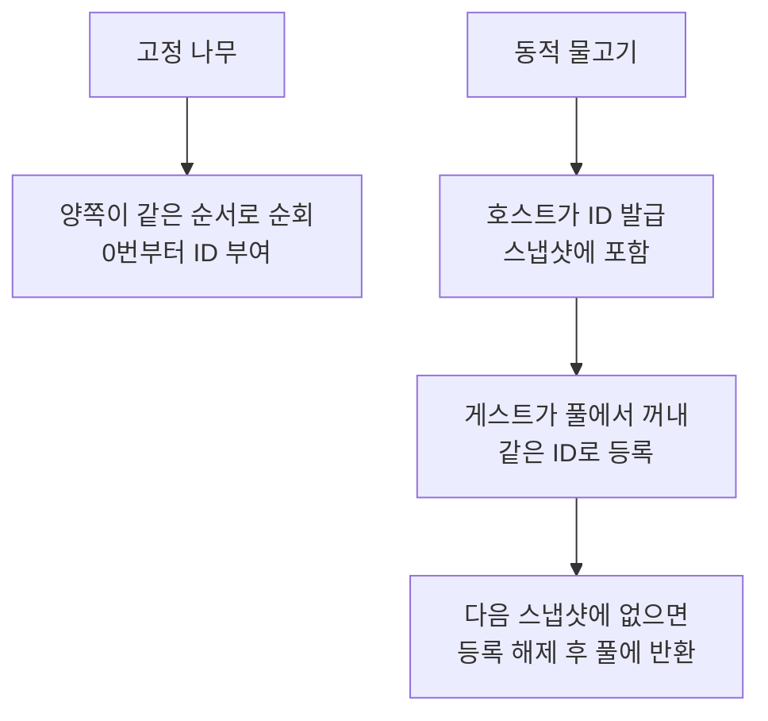

```html
<!-- deck-only -->
<div class="dg" data-dg="world-item-id">
<div class="dg-row">
<section class="dg-panel"><div><div class="dg-h">고정 객체 · 나무</div><div class="dg-sub">씬에 미리 배치된 객체</div></div>
<div class="dg-pair no-arrow"><div class="dg-side"><div class="dg-side-h">호스트</div><div class="dg-tiles"><span class="dg-tile"><svg viewBox="0 0 30 26" aria-hidden="true"><path d="M15 2 26 20H4Z" fill="currentColor"/><rect x="13" y="20" width="4" height="5" fill="currentColor"/></svg>0</span><span class="dg-tile"><svg viewBox="0 0 30 26" aria-hidden="true"><path d="M15 2 26 20H4Z" fill="currentColor"/><rect x="13" y="20" width="4" height="5" fill="currentColor"/></svg>1</span><span class="dg-tile"><svg viewBox="0 0 30 26" aria-hidden="true"><path d="M15 2 26 20H4Z" fill="currentColor"/><rect x="13" y="20" width="4" height="5" fill="currentColor"/></svg>2</span></div><div class="dg-cap">같은 순서로 재귀 순회</div></div><div class="dg-side"><div class="dg-side-h">게스트</div><div class="dg-tiles"><span class="dg-tile"><svg viewBox="0 0 30 26" aria-hidden="true"><path d="M15 2 26 20H4Z" fill="currentColor"/><rect x="13" y="20" width="4" height="5" fill="currentColor"/></svg>0</span><span class="dg-tile"><svg viewBox="0 0 30 26" aria-hidden="true"><path d="M15 2 26 20H4Z" fill="currentColor"/><rect x="13" y="20" width="4" height="5" fill="currentColor"/></svg>1</span><span class="dg-tile"><svg viewBox="0 0 30 26" aria-hidden="true"><path d="M15 2 26 20H4Z" fill="currentColor"/><rect x="13" y="20" width="4" height="5" fill="currentColor"/></svg>2</span></div><div class="dg-cap">같은 순서로 재귀 순회</div></div></div>
<div class="dg-note is-teal">같은 순회 순서로 각자 같은 ID 부여</div></section>
<section class="dg-panel"><div><div class="dg-h">동적 객체 · 물고기</div><div class="dg-sub">플레이 도중 생성되는 객체</div></div>
<div class="dg-pair"><div class="dg-side"><div class="dg-side-h">호스트</div><div class="dg-tiles"><span class="dg-tile is-plan"><svg viewBox="0 0 30 26" aria-hidden="true"><ellipse cx="13" cy="13" rx="10" ry="7" fill="currentColor"/><path d="M22 13 29 6V20Z" fill="currentColor"/><circle cx="8" cy="11" r="1.6" fill="#fff"/></svg>ID 3</span></div><div class="dg-cap"><b>ID 발급</b> · 고정 번호 다음부터</div></div><div class="dg-arrow">스냅샷<i>→</i></div><div class="dg-side"><div class="dg-side-h">게스트</div><div class="dg-tiles"><span class="dg-tile is-plan"><svg viewBox="0 0 30 26" aria-hidden="true"><ellipse cx="13" cy="13" rx="10" ry="7" fill="currentColor"/><path d="M22 13 29 6V20Z" fill="currentColor"/><circle cx="8" cy="11" r="1.6" fill="#fff"/></svg>ID 3</span></div><div class="dg-cap"><b>같은 ID 등록</b></div></div></div>
<div class="dg-note">호스트가 발급한 ID를 스냅샷으로 공유</div></section>
</div>
<div class="dg-title">스냅샷 기반 동적 객체 관리 (게스트)</div>
<div class="dg-branch"><div class="dg-start">스냅샷 수신<small>등록된 ID와 비교</small></div>
<div class="dg-cases"><div class="dg-case"><b>새 ID</b><span>풀에서 꺼내 같은 ID로 등록</span></div><div class="dg-case"><b>기존 ID</b><span>위치·각도·좌우 반전 반영</span></div><div class="dg-case"><b>빠진 ID</b><span>등록 해제 후 풀에 반환</span></div></div></div>
</div>
```

```csharp
// WorldItemSnapshotSynchronizer.ApplyFishes — 게스트에서 RoomClient.OnSnapshot이 부름 (발췌)
private void ApplyFishes(FishState[] fishStates)
{
    // (Why) "이번 스냅샷에 없는 것 = 호스트에서 사라진 것"으로 판단하려고,
    //       등록된 물고기 번호 전체에서 시작해 받은 것을 하나씩 지운다.
    HashSet<int> missingFishWorldItemIds = new HashSet<int>(worldItemRegistry.WorldItems.Keys);
    missingFishWorldItemIds.ExceptWith(worldItemRegistry.FixedWorldItemIds);

    foreach (FishState state in fishStates)
    {
        if (worldItemRegistry.TryGetWorldItem(state.WorldItemId, out WorldItem worldItem) == false)
        {
            // (Why) 처음 보는 번호 → 풀에서 꺼내 호스트와 같은 번호로 등록
            worldItem = FishObjectPool.Instance.Get(state.ItemId);
            if (worldItem == null)
                continue;

            if (worldItemRegistry.RegisterDynamic(worldItem, state.WorldItemId) == false)
            {
                FishObjectPool.Instance.Release(worldItem);   // 번호 충돌 → 되돌림
                continue;
            }
        }

        if (worldItem.TryGetComponent(out Fish fish) == false)
            continue;   // (원본은 에러 로그) 물고기 번호인데 Fish가 아님
        // (중략) 같은 번호인데 종류(ItemId)가 다르면 에러 로그 후 건너뜀

        bool wasActive = worldItem.gameObject.activeSelf;
        worldItem.SetIsPickUp(false);
        worldItem.gameObject.SetActive(true);
        LockFishForGuest(fish);                          // 게스트는 물고기 이동 로직을 멈춘다
        fish.ApplySnapshot(state, wasActive == false);   // 새로 켜진 것은 보간 없이 바로 그 자리에
        missingFishWorldItemIds.Remove(state.WorldItemId);
    }

    foreach (int worldItemId in missingFishWorldItemIds)
    {
        if (worldItemRegistry.UnregisterDynamic(worldItemId, out WorldItem worldItem))
        {
            FishObjectPool.Instance.Release(worldItem);
        }
    }
}
```

- 나무(`ApplyPlanks`)도 같은 방식입니다. 다만 고정 번호만 받으며, 스냅샷에 없는 고정 나무는 끕니다.

공용 아이템 구조를 바꾼 뒤에는 새 물고기를 추가할 때 필요한 설정을 팀원들에게 공유했습니다. 아이템 종류와 ID 등록, 물고기 프리팹과 풀 등록, 스폰 및 네트워크 동기화 연결 순서를 안내했습니다.

### 4.7 다리 건설 조건 개편과 비용 계산

루프의 다리 건설 구간(1.4.2)에서는 건설 조건을 바꿨습니다. 나무만 쓰던 재료에 물고기를 더하고, 다리 15칸의 건설 조건을 TSV 표로 관리했습니다. 플레이어가 **필요한 물고기를 직접 찾아 낚시하는 경험**과 **새로운 물고기를 찾기 위해 수중 공간을 탐험하는 경험**을 강화하려는 개편입니다.

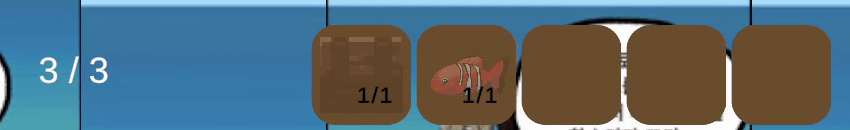

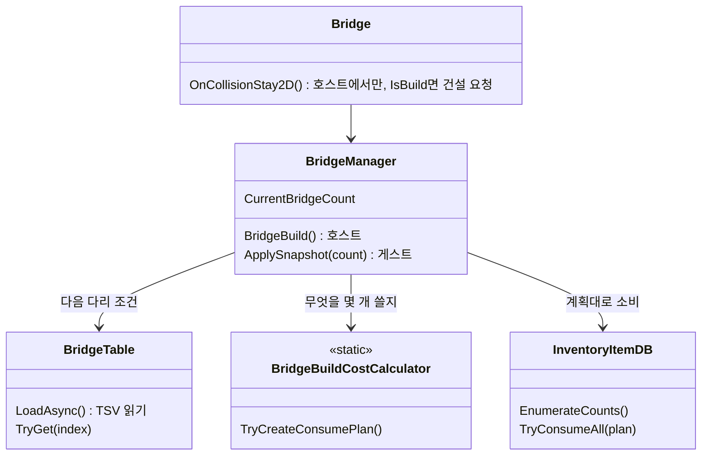

다리 건설에는 세 규칙을 둡니다. 다리마다 **꼭 필요한 재료**, **필요 가치 합**, **최소 낭비**를 정해 둡니다.

- 꼭 필요한 재료: 다리마다 정해 둔 재료를 반드시 모아야 합니다. 플레이어가 새 지역을 탐험하게 만듭니다.
- 필요 가치 합: 필수 재료 외에는 플레이어가 스스로 낚시해 모은 자원으로 자유롭게 채웁니다.
- 최소 낭비: 건설에 쓸 재료는 시스템이 골라, 모은 자원을 아낍니다.

**데이터 흐름**

- TSV(`BridgeData.tsv`) → `BridgeDto` → `BridgeRef`(아이템 참조로 바꾼 것) → 게임에서 사용.
- 표는 다리 번호, 필요 가치 합(`RequiredValue`), 꼭 필요한 재료(`MinimumItems`)로 되어 있습니다. 예를 들어 4번째 다리는 필요 가치 9, 꼭 필요한 재료 `0:1,1:2,2:1`(아이템 0을 1개, 1을 2개, 2를 1개)입니다.
- 표 데이터가 잘못되면(범위 밖 번호, 중복 ItemId, null) `BridgeTable` 생성 시 예외를 던지고, `BridgeManager.Start`가 로그로 남깁니다.

**데이터 흐름을 위해 먼저 바꾼 것**

- ScriptableObject로 관리하던 아이템 데이터를 TSV 표로 바꿨습니다. 네트워크 메시지가 숫자 ID(`ItemId`) 하나로 아이템을 찾게 하고, 다리·아이템 수치(가치·필요 재료)를 표 하나에서 보고 고치기 위해서입니다.
- 다리 조건 개편이 쉬워지도록 인벤토리도 먼저 나눴습니다. 전에는 화면(뷰) 쪽이 수량 데이터와 화면 갱신을 함께 맡아 다리 기능을 확장하기 어려웠습니다. 지금은 수량을 `InventoryItemDB`에서만 바꾸고, 바뀌면 `ItemCountChanged` 이벤트로 알려 UI가 구독해 갱신합니다.

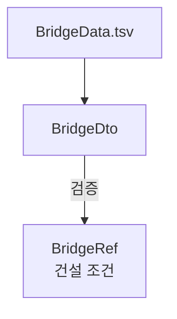

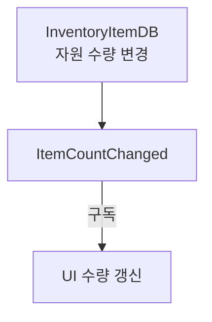

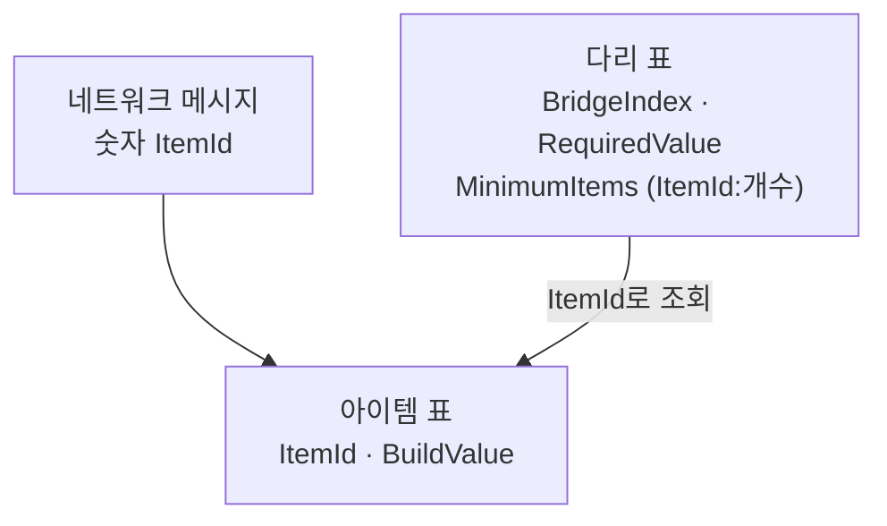

**건설 흐름: 계획을 먼저 세우고 소비합니다**

```csharp
public void BridgeBuild() // 호스트에서만 불림 (Bridge.OnCollisionStay2D)
{
    if (IsEnd) return;

    int nextBridgeIndex = currentBridgeCount + 1;
    if (bridgeTable.TryGet(nextBridgeIndex, out BridgeRef bridgeRef) == false)
        return;

    // (Why) 먼저 '무엇을 몇 개 쓸지' 계획을 세우고, 계획이 서야만 소비한다 → 재료가 반만 빠지는 일 없음
    if (BridgeBuildCostCalculator.TryCreateConsumePlan(
            bridgeRef, inventoryItemDB.EnumerateCounts(), itemManager.Items,
            out IReadOnlyDictionary<int, int> consumePlan) == false ||
        inventoryItemDB.TryConsumeAll(consumePlan) == false)
    {
        return;
    }

    StartCoroutine(BuildParticle(currentBridgeCount)); // 연출 후 다리 오브젝트 활성화
    // (Why) 개수는 연출과 상관없이 즉시 올린다. 예전엔 켜진 다리 수를 세서 연출 시간만큼 늦게 올랐다 (6.2-4)
    currentBridgeCount++;
    OnBridgeBuild?.Invoke();
}
```

**비용 계산 `TryCreateConsumePlan`의 세 단계**

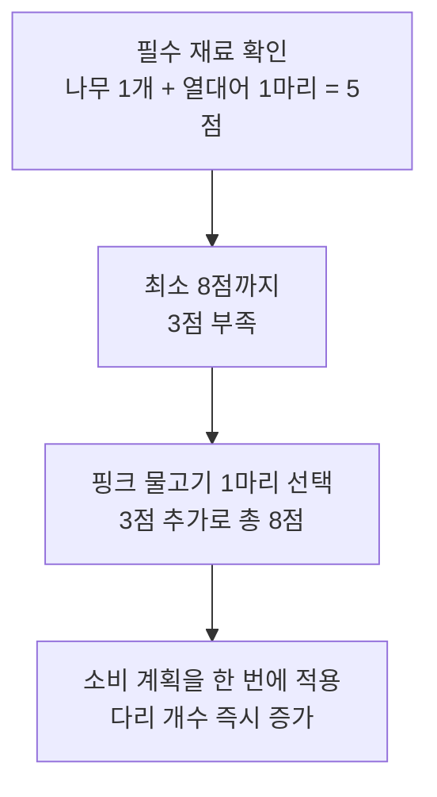

```html
<!-- deck-only -->
<div class="dg" data-dg="bridge-consume-plan">
<div class="dg-steps">
<div class="dg-group" style="grid-column: 1 / 4">소비 계획 생성 · 실제 자원 변경 없음</div><div class="dg-group is-teal" style="grid-column: 5">실제 자원 변경</div>
<section class="dg-step"><div class="dg-step-h"><span class="dg-num">1</span>필수 재료 검증</div><div class="dg-rule">필수 재료를 소비 계획에 등록</div><div class="dg-example">나무 1개(1점) + 열대어 1마리(4점)<span class="dg-big">5 / 8점</span><span class="dg-small">필수 재료 충족</span></div><div class="dg-foot">필수 재료가 없으면 중단</div></section>
<div class="dg-to">→</div>
<section class="dg-step"><div class="dg-step-h"><span class="dg-num">2</span>추가 재료 선택</div><div class="dg-rule">부족한 점수만큼 추가 재료 선택</div><div class="dg-example">핑크 물고기 1마리(+3점)<span class="dg-big">8 / 8점</span><span class="dg-small">목표 점수 충족</span></div><div class="dg-foot">같은 점수면 가치가 낮은 재료 우선</div></section>
<div class="dg-to">→</div>
<section class="dg-step is-teal"><div class="dg-step-h"><span class="dg-num">3</span>소비 계획 적용</div><div class="dg-rule">조건 충족 시 계획한 재료를 소비</div><div class="dg-example">계획한 재료 소비<span class="dg-big">다리 +1</span><span class="dg-small">핑크 물고기 1마리 남음</span></div><div class="dg-foot">다리 개수는 연출과 별개로 즉시 증가</div></section>
</div>
<div class="dg-bar">건설 조건 미충족 → 소비 계획 폐기 · 기존 자원 유지</div>
</div>
```

예를 들어, 다리 건설에 **나무 1개, 열대어 1마리가 필수**이며, **최소 8점**의 자원이 필요하다고 가정합니다.

플레이어들은 탐험을 통해 다음 자원을 모았습니다.

- 나무 1개: 1점
- 열대어 1마리: 4점
- 핑크 물고기 2마리: 3점 × 2 = 6점
- **보유 자원 총합: 11점**

이때 다리 건설에 소비할 자원을 다음 순서로 결정합니다.

1. **필수 자원 확인:** 나무 1개와 열대어 1마리가 있는지 확인합니다. 둘 중 하나라도 부족하면 건설할 수 없습니다.
2. **최소 필요 점수 확인:** 필수 자원의 점수는 5점(나무 1 + 열대어 4)이므로, 건설에 필요한 최소 8점을 충족하려면 추가로 3점이 필요합니다.
3. **추가 자원 선택:** 필수 자원을 제외한 나머지 물고기 중에서 필요한 점수를 충족할 조합을 찾습니다. 이때 불필요하게 많은 점수를 소비하지 않도록 하고, 같은 점수라면 가치가 낮은 물고기를 우선 소비합니다.

따라서 보유한 핑크 물고기 2마리 중 1마리(3점)만 추가로 소비하면 됩니다.

**최종 건설 결과**

- 소비한 자원: 나무 1개(1점) + 열대어 1마리(4점) + 핑크 물고기 1마리(3점) = **8점**
- 남은 자원: 핑크 물고기 1마리(3점)

즉, **필수 자원을 확보한 뒤 건설에 필요한 점수를 최대한 낭비 없이 충족하고, 나머지 자원은 플레이어가 보유하도록 합니다.**

- AI 도구는 내가 정한 명세대로 `BridgeManager`에서 쓸 가치 연산 모듈(`BridgeBuildCostCalculator`)을 만들고, TSV → DTO → Ref 데이터 파이프라인을 구축하는 데 썼습니다. 두 모듈 모두 `BridgeManager`만 사용합니다.

### 4.8 네트워크 개발·검증 도구

인게임 테스트 중 네트워크 정보가 들어오는지 확인하려고 디버그 도구를 만들었습니다. 게임을 실행한 채 호스트·게스트 역할, 입력 값, 플레이어·물고기·자원의 스냅샷 값을 화면에서 확인했습니다.

---

## 5. 기술적 고민과 선택

구현 과정에서 비교한 기술적 대안과 당시 선택, 이후 다시 검토한 내용을 설명합니다.

### 5.1 호스트·게스트 역할별 코드 구조

한 객체에서 호스트와 게스트 역할을 분기할지 결정해야 했습니다.

```csharp
// RoomClient — 같은 메시지를 IsHost로 갈라 처리 (발췌)
private void OnGuestInputGroup(GuestInputGroupMessage message)
{
    if (Me.IsHost == false) return;            // 게스트 입력은 호스트만 씀
    foreach (GuestInputMessage input in message.Inputs)
    {
        if (remotes.TryGetValue(input.Id, out PlayerController remote) == false) continue;
        remote.ApplyInput(new Vector2(input.X, input.Y),          // ② 호스트 안의 게스트
            input.IsLeftShiftHold, input.IsRightShiftHold, input.IsBuildKeyHold, ...);
    }
}

private void OnSnapshot(SnapshotMessage message)
{
    if (Me.IsHost) { SnapshotMessage = message; return; }       // 호스트는 반영 안 함
    foreach (PlayerState state in message.Players)
        if (remotes.TryGetValue(state.Id, out PlayerController remote))
            remote.ApplySnapshot(state, state.IsLeftGrab, state.IsRightGrab);  // ③ 게스트
    BridgeManager.Instance.ApplySnapshot(message.CurrentBridgeCount);
    // … 물고기·나무, 승패, 인벤토리, 낮/밤
}
```

| 대안                                                                   | 장점                                                                    | 단점                                                                                                   |
| -------------------------------------------------------------------- | --------------------------------------------------------------------- | ---------------------------------------------------------------------------------------------------- |
| A. 한 클래스 안에서 `RoomClient.Instance.Me.IsHost`로 분기 + 연동 가이드 공유 (실제 구현) | 파일이 늘지 않고, 기존 싱글 플레이 코드에 분기만 더하면 됨. 2주 일정에 맞음                         | 한 객체가 "호스트 / 호스트 화면 속 게스트 플레이어 / 게스트" 세 상황을 다 품어 읽기 어려움. `IsHost`를 검사하는 스크립트가 14개, 같은 판정 속성이 4곳에 복사됨 |
| B. 역할별로 책임을 나눈 코드(호스트 로직 / 게스트 적용 로직)와 세부 명세를 먼저 제공                  | 팀원이 새 기능을 만들 때 "호스트에서 무엇을 하고, 스냅샷에 무엇을 넣고, 게스트에서 무엇을 반영하는지" 바로 알 수 있음 | 초기 설계·문서 비용이 큼. 이미 만든 기능을 다시 나눠야 함                                                                   |

**최종 결정: A.** 해결 시도로 연동 가이드를 썼습니다. 가이드에는 플레이어와 인벤토리를 예로 "호스트는 무엇을, 게스트는 무엇을" 하는지 적었습니다.

```html
<!-- deck-only -->
<div class="dg" data-dg="host-guest-structure">
<div class="dg-row">
<section class="dg-panel is-main"><div class="dg-h">A. 클래스 안에서 분기<span class="dg-tag">실제 구현</span></div>
<div class="dg-tree"><div class="dg-node is-main">기존 기능 클래스</div><div class="dg-vl"></div><div class="dg-node">IsHost 판정</div><div class="dg-vl"></div>
<div class="dg-fork" style="--n:3"><div class="dg-node">호스트 자신<small>자기 입력으로 계산</small></div><div class="dg-node">호스트 안의 게스트<small>받은 입력으로 계산</small></div><div class="dg-node">게스트<small>계산 결과 반영</small></div></div></div>
<dl class="dg-pros"><dt>장점</dt><dd>기존 싱글 플레이 코드 재사용, 2주 일정 안에 연동</dd><dt>단점</dt><dd>한 클래스에 세 상황이 섞이고 같은 판정이 여러 곳에 복사됨</dd></dl></section>
<section class="dg-panel"><div class="dg-h">B. 역할별로 코드 분리<span class="dg-tag">검토한 대안</span></div>
<div class="dg-tree"><div class="dg-fork" style="--n:2; border-top: 0; padding-top: 0"><div class="dg-node">호스트 로직<small>상태 계산 · 스냅샷 생성</small></div><div class="dg-node">게스트 적용 로직<small>스냅샷 수신 · 상태 반영</small></div></div><div class="dg-vl"></div><div class="dg-node is-dashed">공통 데이터 명세</div></div>
<dl class="dg-pros"><dt>장점</dt><dd>새 기능마다 호스트·스냅샷·게스트에서 할 일을 바로 알 수 있음</dd><dt>단점</dt><dd>초기 설계·문서 비용, 이미 만든 기능을 다시 나눠야 함</dd></dl></section>
</div>
<div class="dg-stats"><p>2주 일정에 맞춰 A안 선택 →</p><div class="dg-stat"><b>14개</b><span>IsHost를 검사하는 스크립트</span></div><div class="dg-stat"><b>4곳</b><span>같은 판정 속성이 복사된 곳</span></div></div>
<div class="dg-after"><b>역할과 데이터 명세의 선행 정의</b>기능 구현 전에 호스트의 계산 책임, 게스트의 반영 책임, 주고받을 데이터를 정했다면 역할 판정 중복과 기능 연동 부담을 줄일 수 있었습니다.</div>
</div>
```

### 5.2 스냅샷을 어떻게 보낼 것인가 — 프로젝트 중·이후의 3단계 변화

호스트가 초당 20번 보내는 스냅샷을 최대 3명의 게스트에게 어떻게 전달할지가 문제였습니다. 문제점은 크게 2가지였습니다.

- **병목**: 느린 게스트 하나 때문에 스냅샷 브로드캐스트 전체가 대기합니다. 세션 하나의 지연이 방 전체의 플레이 경험을 떨어뜨립니다.
- **시스템 정지**: 호스트 수신 루프까지 멈추면서 방 전체 세션이 멈춥니다. 예외·타임아웃 처리를 안정적으로 해야 했습니다.

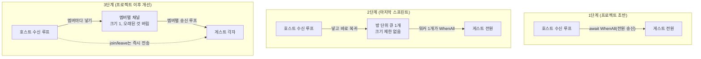

| 대안 | 장점 | 단점 |
|---|---|---|
| A. 받는 즉시 전원에게 WhenAll로 송신 (1단계) | 코드가 가장 짧고 흐름이 바로 보임 | 호스트 수신 루프가 가장 느린 게스트 송신이 끝날 때까지 다음 메시지를 못 읽음 → 방 전체가 멈춤 |
| B. 방 단위 큐 + 송신 워커 1개 + 송신 타임아웃 <br>(2단계) | 수신과 송신이 분리되어 호스트 수신 루프가 막히지 않음.<br>9초 타임아웃으로 죽은 소켓을 끊음 | 큐 크기 제한이 없어 오래된 스냅샷이 쌓임.<br>워커가 여전히 WhenAll이라 느린 게스트 한 명이 방 전체 송신을 늦춤 |
| C. 멤버별 크기 1 채널 + 오래된 것 버림 + 멤버별 송신 루프<br>(3단계, 현재) | 느린 게스트는 자기 것만 늦고, 쌓이지 않고 최신 상태만 받음 | 중간 스냅샷이 버려지므로 한 번만 일어나는 일을 실으면 놓칠 수 있음 → join/leave는 채널에서 뺌.<br>멤버 수만큼 비동기 루프가 생겨 종료 관리가 필요함 |

**최종 결정: C.** 스냅샷은 "지금 상태"라 밀린 과거 값을 보내는 것은 의미가 없다고 보고, 수신 루프 정지(2단계)와 느린 게스트 하나가 전체를 늦추는 문제(3단계)를 차례로 풀었습니다. 3단계는 구조상 게스트 한 명이 다른 느린 게스트의 송신을 기다리지 않게 바꾼 것이고, 단계별 지연 측정은 아직 하지 않았습니다.

**프로젝트 안에서는 2단계까지**

- 2단계를 넣은 뒤 테스트에서 방 전체가 멈추는 문제는 사라졌습니다.
- 3단계는 프로젝트 안에서 미뤘습니다. 마지막 스프린트에 남은 기간이 일주일이 채 안 됐고 폴리싱할 일이 남아 있었습니다. 2단계만으로도 큰 지연 문제는 사라졌습니다.
- 2단계의 송신 타임아웃은 방을 나간 소켓이 서버에 남아 방 전체가 느려지던 문제를 풀며 넣었습니다(6.3-1).

주기가 짧은 작업 안에 await가 여러 번 나뉘면(WhenAll 포함), 송신·수신을 기능에 맞게 나눠야 한다는 것이 이 과정에서 얻은 기준입니다.

### 5.3 모든 상태를 스냅샷 하나에 vs 스냅샷 + 이벤트 분리

스냅샷은 게임의 현재 상태 전체를 담습니다. 위치처럼 계속 변하는 값과, 다리 건설·승패·이펙트처럼 한 번 일어나는 일을 같은 메시지로 보낼지 정해야 했습니다.

| 대안                                         | 장점                                                              | 단점                                                                        |
| ------------------------------------------ | --------------------------------------------------------------- | ------------------------------------------------------------------------- |
| A. 스냅샷 하나에 전부                      | 메시지 종류가 하나라 서버·클라이언트 코드가 단순<br>늦게 들어온 사람도 다음 스냅샷 하나로 현재 상태를 모두 받음 | "언제 일어났는지"가 사라짐<br>게스트는 이전 값과 비교해서 연출을 틀어야 함<br>효과음·이펙트처럼 상태가 아닌 사건은 표현하기 어려움 |
| B. 스냅샷(연속 값) + 이벤트(한 번 일어나는 변화) 분리 | 획득·건설·승패를 사건으로 정확히 한 번 전달<br>게스트 연출이 쉬움                           | 메시지 종류와 처리 코드가 늘어남<br>이벤트 유실·순서 처리를 따로 고민해야 함                               |

**최종 결정: A로 구현했습니다.** 급하게 개발하느라 모든 내용을 스냅샷에 넣었고, 이벤트 분리는 작업으로 올렸지만 끝내지 못했습니다.

**결정 이유**

- 이벤트를 따로 보내면 좋겠다는 생각은 처음부터 있었습니다. 다만 1차 빌드 목표인 핵심 플레이 루프에는 사운드·VFX 같은 이벤트 정보가 없었습니다. 스냅샷에 모두 넣어도 문제가 없어 이벤트 분리를 뒤로 미뤘습니다.
- 프로젝트 후반 폴리싱에서 효과음·시각 이펙트를 넣으면서 이 방식의 문제가 커졌습니다. 그때 이벤트 분리의 필요성을 느꼈지만 시간이 부족해 실제로 진행하지는 않았습니다.

**실제로 드러난 장단점**

- A의 장점은 실제로 쓰였습니다. 중간 입장한 게스트는 별도 초기 메시지 없이, 스냅샷이 전체 상태를 담고 있어서 다음 스냅샷 하나로 현재 상태를 따라잡는 구조입니다.
- 단점도 그대로 드러났습니다. 실시간 위치 정보는 지속적으로 갱신되는 값인 반면, 이펙트·효과음은 특정 순간에 발생하는 일회성 사건입니다. 이처럼 생명주기가 다른 데이터를 모두 스냅샷으로 전달하다 보니, 이펙트·효과음을 정확하게 재현하는 데 한계가 있었습니다(6.5).

### 5.4 스냅샷 반영 지점: RoomClient 한곳에서 vs 각 매니저가 직접

게스트가 받은 스냅샷을 누가 각 시스템에 반영할지 고민했습니다.

| 대안                                                         | 장점                                           | 단점                                                  |
| ---------------------------------------------------------- | -------------------------------------------- | --------------------------------------------------- |
| A. `RoomClient.OnSnapshot`이 각 매니저의 `ApplySnapshot`을 차례로 부름 | 스냅샷 반영 흐름을 한 메서드에서 다 볼 수 있음.<br>반영 순서를 정할 수 있음.<br>각 매니저에 필요한 데이터만 정확히 전달할 수 있음  | RoomClient가 모든 매니저를 알아야 함.<br>기능이 늘 때마다 RoomClient를 고침 |
| B. 각 매니저가 `RoomClient.SnapshotMessage`를 직접 읽어 처리           | RoomClient가 매니저를 몰라도 됨.<br>기능 담당자가 자기 파일만 고치면 됨 | 누가 언제 스냅샷을 읽는지 한눈에 안 보임.<br>읽는 시점이 클래스마다 달라질 수 있음      |

**결과: 두 방식이 섞인 채로 끝났습니다.** A로 모으는 리팩토링 작업을 올렸지만 프로젝트 안에 끝내지 못했습니다. 

- 게임 상태 반영은 `RoomClient.OnSnapshot` 한곳에 모였습니다. 원격 플레이어, 다리, 물고기·나무, 승패, 인벤토리, 낮/밤, 튜토리얼이 모두 여기서 반영됩니다.
- `SnapshotMessage`를 직접 읽는 곳이 남았습니다. 관전 카메라, 호스트 쪽 튜토리얼, 네트워크 디버그 도구입니다.
- 리팩토링을 미룬 이유: 게임이 잘 동작하는 상태여서 폴리싱을 먼저 했습니다. 작업자 모두 스냅샷이 어디서 반영되는지 추적할 수 있어서 우선순위가 더 낮았습니다.

**떠오른 방안: 델리게이트 구독**

각 매니저가 처음에 `RoomClient`의 델리게이트를 구독하고, `OnSnapshot`에서는 Invoke만 하는 방안이 떠올랐습니다. 따져 보니 지금 규모(반영 대상 7개)에서는 A를 유지하는 편이 낫다고 판단했습니다.

- 반영 순서가 숨습니다. 구독 순서가 각 객체의 `Awake`·`Start` 순서를 따르게 됩니다.
- 반영 흐름이 흩어집니다. 누가 반영하는지 찾으려면 구독 코드를 모두 검색해야 합니다.
- 생명주기 위험이 늡니다. 구독 전에 온 첫 스냅샷을 놓치거나, 씬을 다시 불러올 때 해제를 빠뜨려 파괴된 객체가 불릴 수 있습니다.

대신 필요했던 것은 규칙과 명세입니다. "반영은 `OnSnapshot`에서만, 다른 곳은 읽기만" 규칙을 정하고, 객체마다 스냅샷에 넣을 상태와 이벤트를 명세해야 했습니다(3.6).

- 명세가 없어서 놓친 것도 있었습니다. 물고기 상태(`CurrentState`)는 스냅샷에 들어 있지만 게스트 물고기는 위치·각도·좌우 반전만 반영했습니다. 통합 때는 크게 막히지 않았습니다. 게스트 물고기는 위치와 상태를 모두 호스트에 기대고 있었기 때문입니다. 이 문제는 폴리싱 단계에서 VFX·SFX를 넣을 때 크게 드러났습니다.

### 5.5 다리 건설 조건과 자동 재료 선택

**왜 "가치 합 + 꼭 필요한 재료 + 최소 낭비"인가**

- 빌드 테스트 뒤 허기가 스태미나로 바뀌며 기획이 확정될 때, 탐험할 이유를 늘리려고 나무만 쓰던 다리 건설 조건을 넓혔습니다(2.5).
- 다리 조건으로 두 가지를 동시에 만족시키고 싶었습니다. 하나는 꼭 모아야 할 재료를 정해 플레이어에게 탐험을 강제하는 것, 다른 하나는 그 외에는 플레이어가 스스로 낚시해 모은 자원으로 자유롭게 채우는 재미를 잃지 않게 하는 것입니다.
- 그래서 세 규칙을 모두 두었습니다. 셋 중 하나가 빠지면 이 문제를 풀기 어렵다고 판단했습니다.
- 넣을 재료는 플레이어가 고르지 않고 시스템이 최소 낭비로 자동으로 고릅니다. 플레이가 15분 안팎(최대 30분)인 게임에서, 처음 하는 플레이어에게 "나중에 필요한 물고기를 남겨 두기" 같은 선택은 불필요한 단계라고 봤습니다. 자동으로 고르면 남은 물고기가 자연스럽게 다음 다리의 재료가 됩니다.

**다시 본 점: "가치 합 + 물고기 종류 수" 조건**

- 다리마다 꼭 필요한 재료를 정하는 대신 "서로 다른 물고기 N종 이상"을 요구하는 조건도 있었습니다.
- 당시에는 버렸습니다. 낮·밤에 따라 물고기 풀이 바뀌어, 얕은 바다에서 낚시만 해도 종류 수가 쉽게 차기 때문입니다. 그러면 깊은 바다를 탐사할 이유가 사라진다고 봤습니다.
- 문서를 쓰며 다시 보니, 깊은 곳 탐사는 통나무 배치가 이미 강제합니다. 플레이가 15분 안팎(최대 30분)인 게임에서는 이 조건이 더 단순하고 직관적인 시스템일 수 있습니다.

---

## 6. 결과 및 배운 점

### 6.1 프로젝트 결과

- 4명까지 같은 방에서 호스트 1명이 계산한 물리·인벤토리·다리·승패를 게스트가 따라가는 구조로 최종 빌드와 발표 시연까지 마쳤습니다.
- 실제 플레이어 14명이 동시에 플레이한 테스트에서 별 문제가 없었습니다.
- **아쉬운 점** — 지연 시간(ms) 같은 동기화 수치를 재지 못한 점이 아쉽습니다. 5.2에서 스냅샷 송신 구조를 단계별로 바꿨지만, 각 단계의 지연과 게스트 화면 반영 지연을 숫자로 비교하지는 못했습니다.

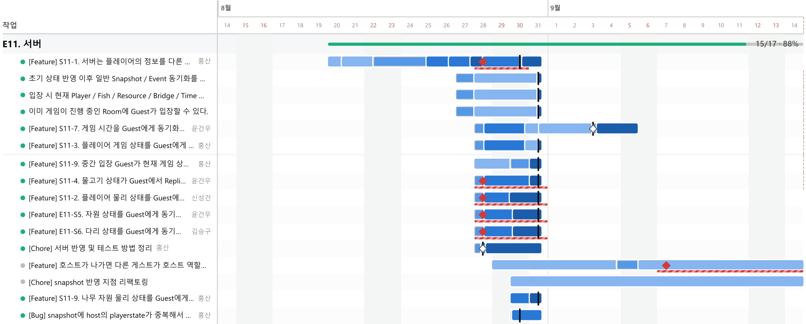

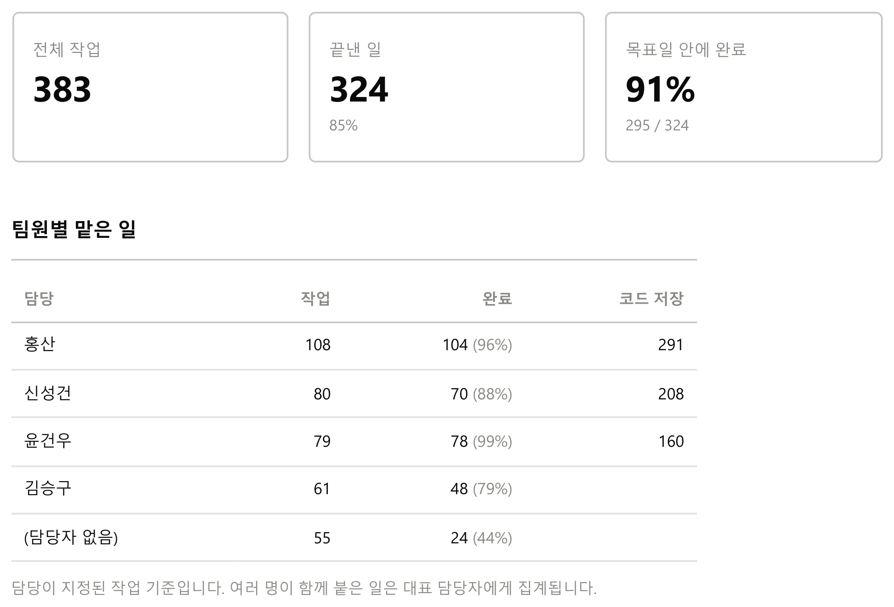

### 6.2 문제 해결 경험

#### 6.2.1 게스트 입력이 가끔 사라짐 (서버)

- **문제**: 서버와 클라이언트가 게스트를 다르게 인식하는 버그로 드러났습니다.
- **원인**: 입력을 읽어 묶음에 넣고 → `await` 송신 → 그 뒤에 모든 게스트의 `LastInput`을 null로 비웠습니다. 송신을 기다리는 사이 새로 들어온 입력도 같이 지워졌습니다.
- **해결**: `Interlocked.Exchange(ref member.LastInput, null)`로 꺼내기와 비우기를 한 번에 합니다(4.1).
- **배운 점**: 한 줄 단위 원자성은 `Interlocked`, 여러 줄 단위 원자성은 `lock`으로 구분해야 합니다.

#### 6.2.2 접속 직후 가끔 원인 모를 끊김 (서버)

- **문제**: 방에 처음 들어온 직후 가끔 이유 없이 연결이 끊겼습니다.
- **원인**: 입력 중계 타이머(`RoomHub`)와 접속 처리(hello)가 서로 다른 흐름으로 동시에 돕니다. 호스트는 hello를 받은 뒤에야 정해지는데, 그 전에 타이머가 먼저 방에 들어가 호스트가 없는 상태로 송신을 시도했습니다.
- **해결**: 두 흐름의 순서를 강제로 맞추는 대신, 순서가 어긋나도 안전하게 만들었습니다.
  - 멤버는 hello를 받고 `gate` 안에서 호스트 여부가 정해진 **뒤에야** 멤버 목록에 들어갑니다.
  - 타이머 쪽 `SendGuestInputsToHostAsync`와 입력 처리 `HandleInputAsync`는 둘 다 `GetHost()`가 null이면 그 틱·그 입력을 버립니다.
- **배운 점**: 방 입장·퇴장, 공유 데이터 읽기·쓰기처럼 여러 흐름이 같은 자원을 만지는 곳은 race condition을 먼저 의심해야 합니다.

#### 6.2.3 스냅샷에 호스트 플레이어가 두 번 들어감 (클라이언트)

- **문제**: 스냅샷에 호스트 플레이어가 두 번 들어갔습니다.
- **원인**: 플레이어 목록 `remotes`에 자기 자신도 들어 있는데, 스냅샷을 만들 때 `Me`를 따로 한 번 더 넣었습니다.
- **해결**: 별도 추가를 지우고 `remotes`만 순회합니다.

#### 6.2.4 다리 개수가 늦게 오르고 게스트와 어긋남 (클라이언트)

- **문제**: 다리 개수가 늦게 오르고 게스트와 어긋났습니다.
- **원인**: 개수를 "켜진 다리 오브젝트 수"로 셌는데 다리는 연출 2초 뒤에 켜졌고, 게스트는 매 스냅샷마다 0번부터 다시 켰습니다.
- **해결**: 개수를 필드로 즉시 올리고, 게스트는 늘어난 칸만 켭니다(4.7).
- **배운 점**: 인게임 오브젝트(뷰)로 개수를 추적하지 않고 자체 데이터로 증감해야 처리가 일관되고, 변경과 확장에도 쉽습니다.

#### 6.2.5 강의실 키보드가 동시에 2~3키만 인식함 (환경)

- **문제**: 기존 조작(WASD + 왼쪽 Shift + 오른쪽 Shift)은 여러 키를 동시에 눌러야 했는데, 강의실 키보드가 동시 입력을 2~3개만 인식했습니다.
- **해결**: 잡기를 마우스 좌·우 클릭으로 바꿨습니다. 네트워크 메시지 필드 이름(`IsLeftShiftHold`, `IsRightShiftHold`)은 그대로 두고 값만 마우스 버튼에서 채웁니다.
- **배운 점**: 기획 단계의 입력 설계가 실제 실행 환경에서 그대로 동작하는지 먼저 확인해야 합니다.

### 6.3 네트워크 데이터 생애주기 관리

다른 배운 점은 "무언가를 설계할 때 생명주기를 반드시 설계할 것"입니다. 네트워크 데이터, 소켓, `RoomClient`도 마찬가지입니다. 아래 사례는 모두 연결·방·씬이 언제 시작하고 언제 끝나는지와 관련된 문제입니다.

첫 빌드 테스트에서는 플레이 도중 한 명이 나가면 게임이 멈췄습니다. 원인은 하나가 아니었습니다. 클라이언트와 서버 모두 소켓 생애주기를 제대로 관리하지 못해 연결이 비정상적으로 끝났습니다(6.3-1).

#### 6.3.1 방을 나간 소켓이 정리되지 않아 다른 방이 멈추고 느려짐 (클라이언트·서버)

- **문제**: 방을 나갔다 다시 들어가면 모든 것이 멈춘 방에 들어가거나, 남아 있던 방에 갑자기 렉이 심해졌습니다. 소켓 종료 예외가 처리되지 않아 `RoomClient`가 멈추기도 했습니다.
- **원인**: 기존의 방에서 나가기 처리는 `CloseAsync`로 소켓을 닫았습니다. `CloseAsync`는 Close를 보낸 뒤 상대의 Close 응답을 기다리는 방식이라, 나간 소켓의 생애주기가 제대로 정리되지 않았습니다. 서버에는 송신 타임아웃도 별도 큐도 없어서, 소켓 하나가 늦으면 방 전체가 계속 늦어졌습니다.
- **해결**: 두 단계로 고쳤습니다.
  - 1차, 종료 방식: 응답을 기다리지 않는 한쪽 종료로 바꿨습니다. 나가는 쪽은 `CloseOutputAsync`로 Close만 알리고 바로 `Dispose`합니다. 받는 쪽도 Close를 받으면 응답 없이 `Dispose`합니다. 수신 중 연결이 끊기면 메인 화면으로 돌아갑니다.
  - 2차, 송신 제한: 서버 송신을 방 단위 큐로 모으고, 송신마다 9000ms 제한을 두어 넘으면 그 소켓을 끊습니다(5.2의 2단계, 4.4).
- **배운 점**: 소켓과 `RoomClient`처럼 연결에 묶인 데이터는 언제 시작하고 언제 끝나는지를 먼저 설계해야 합니다.

#### 6.3.2 인원 제한과 재입장 초기화 (서버·클라이언트)

- **인원 제한**: 방이 4명으로 차면 다섯 번째 접속은 `RoomHub`가 입장 단계에서 거부하고, "Room Member Limit" 사유로 소켓을 닫습니다(4.4).
- **재입장 초기화**
  - **문제**: 게임 종료 후 같은 방으로 다시 들어가면 이전 판의 종료 상태가 그대로 보였습니다.
  - **해결**: welcome을 받을 때 플레이어 목록과 승패 집계 등 매니저의 주요 멤버를 모두 초기화합니다(`ClearInfo`, `GameManager.ResetNetworkPlayerCounts`).

#### 6.3.3 호스트 퇴장과 연결 수명 (서버·클라이언트)

- **호스트 퇴장**: 호스트가 나가면 서버는 방 토큰을 취소해 남은 연결을 함께 끝냅니다. 게스트는 연결이 끊기면 메인 화면으로 돌아갑니다. 호스트 승계는 하지 않았습니다(4.4).
- **취소 토큰의 수명**
  - 클라이언트: 비동기 작업이 살아 있어야 하는 기간은 소켓 연결 기간과 같다고 봤습니다. 그래서 토큰을 나누지 않고 `destroyCancellationToken` 하나로 접속·수신·송신을 묶었습니다.
  - 서버: 연결마다 요청 토큰과 방 토큰을 이어 씁니다. 호스트가 나가면 방 토큰을 취소합니다. 송신마다 9000ms짜리 토큰을 따로 둡니다.
- **씬에 묶인 싱글톤**: 싱글톤에 `DontDestroyOnLoad`가 없다는 경고가 있었습니다. 씬에 묶인 싱글톤이라 문제가 없을 것으로 보고 백로그로 남겼습니다.

### 6.4 아쉬운 점 (기술 부채)

**메시지·프로토콜 설계**

- **클라이언트·서버 Protocol 불일치**: 두 저장소에 같은 `Protocol.cs`를 손으로 복사해 맞춥니다. 클라이언트에만 추가된 필드(`IsRespawnPressed` 등)는 서버가 스냅샷을 자기 클래스로 다시 직렬화할 때 사라집니다. 프로젝트 마지막에 빌드 테스트에서 게스트 리스폰이 제대로 되지 않고, 게스트가 계속 처음 리스폰 위치에서만 스폰되던 문제가 이 때문이었습니다.
- **한 번만 일어나는 이벤트도 덮어쓰기 채널로 보냄**: 4.1의 "최신 입력 1개" 방식은 키를 꾹 누르는 입력에는 잘 작동했습니다. 하지만 리스폰·튜토리얼 시작 버튼처럼 한 번만 정확히 전달해야 하는 이벤트성 입력까지 실어서, 클라이언트 쪽 보정 코드와 오버헤드가 늘었습니다.
- **모든 상태를 스냅샷 하나에**: 생명주기가 다른 데이터를 구분하지 못해 연출·효과음 동기화가 어려웠습니다(5.3). 폴리싱 때 Codex로 효과음·이펙트를 넣을 지점의 추천 목록을 만들었고, 효과는 호스트와 게스트 모두에서 나와야 했습니다. 스냅샷만으로는 게스트 쪽 연출을 정확히 맞추기 어려웠습니다.
- **입력 필드 이름과 실제 입력이 다름**: `IsLeftShiftHold`에 마우스 왼쪽 버튼 값이 들어가 읽는 사람이 헷갈린다<!-- (6.2-5) -->.

**구조**

- **호스트/게스트 분기의 중복**: 같은 판정 속성이 여러 클래스에 복사되어 있습니다(5.1).
- **소비 검증의 단일 의존**: `InventoryItemDB.TryConsumeAll`의 검증 코드가 주석 처리되어 있어 계산기가 만든 계획만 믿고 뺍니다. 다른 곳에서 부르면 수량이 음수가 될 수 있습니다.
- **보간이 고정 간격 기준**: 이론상 스냅샷 간격은 일정하지만 실제 지연은 변동이 훨씬 큽니다. 지금 보간은 고정 간격(1/20초)으로 계산해, 실제 스냅샷 간격을 반영하지 못하고 있습니다. 평소에는 드러나지 않지만, 지연이 심해질때 보간이 제대로 이루어지지 않고 있습니다.

**미해결·미확인**

- **끝내 못 맞춘 동기화 버그 2건**: 지뢰 물고기의 지뢰가 게스트에게 동기화되지 않는 문제와, 다리를 다 지은 뒤의 이동이 게스트에게 보이지 않는 문제는 해결하지 못했습니다.
- **멤버별 송신 루프 종료 시점**: 방이 서버에 정리되지 않고 남던 문제는 프로젝트 중 지적을 받고 해결했습니다. 다만 3단계 구조에서는 마지막 멤버가 나간 뒤 채널 종료가 아무 멤버에게도 불리지 않아, 멤버별 송신 루프가 끝나지 않고 남을 수 있어 보입니다. 코드를 읽고 추정한 것이고 측정으로 확인하지는 않았습니다.
- **호스트 승계와 `RoomClient` 반복 코드**: 호스트 승계는 인게임 플레이에 집중하기 위해 뺐습니다(4.4). `RoomClient`의 반복 코드도 난잡하지만 잘 동작하고 재사용하지 않는 코드라 우선순위를 낮게 두었습니다.

### 6.5 향후 개선 계획

- 메시지를 "상태 스냅샷"과 "사건 이벤트"로 나눕니다. 획득·건설·승패·이펙트, 그리고 리스폰 같은 이벤트성 입력은 이벤트 메시지로 보냅니다.
- 스냅샷 반영은 `OnSnapshot`에서만 하고 다른 곳은 읽기만 한다는 규칙을 정하고, 객체마다 스냅샷에 넣을 상태와 이벤트를 명세합니다(5.4).
- 호스트 로직 / 게스트 적용 로직을 나누고, 중복된 판정 속성을 한곳으로 모읍니다(5.1).
- `Protocol.cs`를 한 곳에서만 관리합니다. 서버가 스냅샷을 원문 그대로 중계할지, 지금처럼 검증 후 다시 직렬화할지도 비교해 정합니다.
- 보간을 고정 간격이 아니라 실제 스냅샷 도착 간격 기준으로 계산합니다.
- 멤버가 나갈 때 그 멤버의 채널을 바로 닫아 송신 루프를 확실히 끝냅니다.

### 6.6 기술 개발에서 배운 점

- 네트워크 멀티플레이는 여러 명이 동시에 접속해 테스트해야 하는데, 혼자서는 이 환경을 만들기 어렵습니다. 팀 프로젝트였기 때문에 실제 플레이어 14명이 동시에 플레이하는 테스트까지 해 볼 수 있었습니다(6.1).
- 상용 네트워크 솔루션 없이 서버를 직접 만들어 동기화를 구현하면서, 동기화가 왜 어려운지와 어떤 구조로 풀어야 하는지를 직접 겪었습니다(3.2·3.5·5.1).
- 비동기 서버에서 한 줄짜리 원자성(`Interlocked`)과 여러 줄 원자성(`lock`/`SemaphoreSlim`)을 구분해 써야 한다는 것을 직접 버그로 배웠습니다(6.2-1, 6.2-2).
- 주기가 짧은 작업 안에 await가 여러 번 있으면 받기와 보내기를 나눠야 하고, 느린 상대 하나가 전체를 막지 않게 상대별로 나눠야 합니다(5.2).
- 데이터의 생명주기(최신 값이면 되는 것 vs 한 번 일어나는 것)를 먼저 정하지 않으면 메시지 설계가 꼬입니다(5.3).
- 입력 설계는 실제 실행 환경에서 먼저 확인해야 합니다(6.2-5).
- 연결·방·씬처럼 수명이 있는 것은 언제 시작하고 언제 끝나는지를 먼저 설계해야 합니다(6.3).

### 6.7 팀 개발 및 프로젝트 관리 회고

- 네트워크처럼 모두가 붙어야 하는 구조는 코드보다 역할별 명세와 의존관계 정리가 먼저입니다. PM으로서 스프린트마다 구조적 논의를 위한 멈춤의 시간을 가지고, 동기화 데이터 설계를 깊이 고민해야 한다는 것을 깨달았습니다(2.4·3.6).

개별 작업을 세밀하게 정의하고 Asana 백로그를 관리하는 데 많은 시간을 썼습니다. 하지만 실제 개발에서는 작업 사이의 의존관계와 공용 시스템의 명세 부족이 더 큰 병목으로 드러났습니다. 다음에는 작업 카드 수보다 선행 작업과 통합 시점을 먼저 살피고, 여러 팀원이 함께 사용하는 구조의 책임과 연동 규약을 개발 전에 정리하겠습니다.
