# Hive Purge 기술 문서

> **쏟아지는 몬스터 물량을 헤쳐 나가는 1·3인칭 전환 PvE 호드 FPS — 몬스터 AI·웨이브 담당**

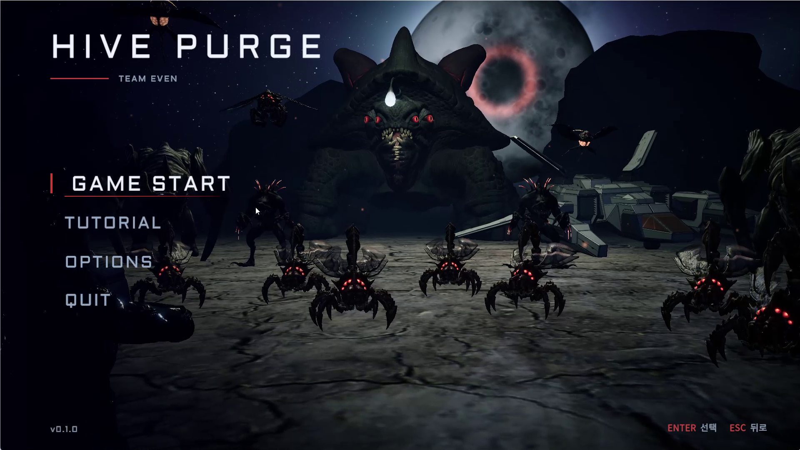

| 항목    | 내용                                                                                                            |
| ----- | ------------------------------------------------------------------------------------------------------------- |
| 장르    | 1인칭과 3인칭을 오가는 PvE 호드(horde) FPS                                                                               |
| 개발 인원 | 4 (팀 프로젝트)                                                                                                    |
| 내 역할  | 몬스터 전반 — 상태 머신·공격 6종, 피격·약점·시체, 웨이브·스폰·풀, 몬스터 이동, 밸런스 관리                                                      |
| 엔진    | Unity 6000.3.15f1 (URP 17.3.0, AI Navigation 2.0.12)                                                          |
| 도구    | Rider, Claude Code                                                                                            |
| 개발 기간 | 2026.10.15 — 11.03                                                                                            |
| 링크    | [GitHub](https://github.com/KooHoo-Dev/3rd_3D_1-3D-Project-team_even) · [소개 영상](https://youtu.be/cZSxjdhHFfA) · [쇼츠](https://youtube.com/shorts/KHwjLXVvaJo) |

---

## 1. 개요 · 팀 · 역할

### 1.1 프로젝트 소개

**플레이어가 라운드마다 몰려오는 몬스터 무리를 버티고, 얻은 재화로 강화해 3라운드 보스를 쓰러뜨리는 PvE 호드 FPS**

### 1.2 주제 선정 이유

팀원들과 아이디어를 정리한 결과, 쏟아지는 적을 헤쳐 나가는 물량 게임 중에서도 다수의 몬스터가 몰려오는 3D FPS를 프로젝트 주제로 선택했습니다.

이 주제를 선택한 이유는 두 가지입니다.

첫째, 다수의 몬스터를 동시에 처리하면서 발생하는 성능 문제를 직접 다뤄보고 싶었습니다. 많은 몬스터가 각자 이동하고 공격하는 상황에서 AI 처리와 군중 이동을 어떻게 구현하고 최적화할지 고민할 수 있었습니다.

둘째, 3D 환경에서 다양한 게임 개발 기술을 적용할 수 있다는 점이었습니다. 몬스터 AI, 3차원 공간에서의 이동과 충돌, 사격 판정 등 여러 시스템을 하나의 전투 환경에서 구현하고 연결해볼 수 있다고 판단했습니다.

### 1.3 핵심 경험 — 물량을 극복하는 성취감

이 프로젝트의 핵심 경험은 **압도적인 수의 몬스터에 밀리는 상황에서, 플레이어가 다양한 위협에 대응하며 물량을 극복하는 성취감**입니다.

서로 다른 대응을 요구하는 몬스터를 조합해, 물량을 돌파하는 과정을 다양하게 만들고자 했습니다.

<!-- 촬영: 라운드 전투 중 몬스터 무리가 몰려오는 장면 -->

#### 1.3.1 레퍼런스와 설계 방향

물량을 극복하는 경험을 만들기 위해 《Earth Defense Force》와 《Helldivers 2》의 전투 특징을 참고했습니다.

| 레퍼런스 | 주목한 특징 | 프로젝트에 적용한 방향 |
| --- | --- | --- |
| Earth Defense Force | 압도적인 수의 적을 상대하고 물량을 돌파하는 경험 | 여러 방향에서 대량의 몬스터를 등장시켜 지속적인 압박 형성 |
| Helldivers 2 | 다양한 행동과 공격 방식을 가진 적들을 상대하는 전투 | 몬스터별로 다른 대응을 요구하도록 행동을 구성하고, 웨이브에 따라 위협의 종류를 변화 |

이를 바탕으로 몬스터의 수로 압박을 형성하고, 몬스터별 행동의 차이를 통해 플레이어가 상황에 맞는 대응을 선택하도록 설계했습니다.

#### 1.3.2 몬스터별 위협과 플레이어의 대응

몬스터의 행동과 공격 방식에 차이를 두어, 플레이어가 위협의 종류에 따라 대응 방식을 바꾸도록 의도했습니다.

| 전투 요소 | 위협 | 유도한 플레이어의 대응 |
| --- | --- | --- |
| 기본 몬스터 물량 | 다수의 몬스터가 몰려와 플레이어를 압박 | 적을 모아 수류탄으로 효율적으로 처치 |
| 돌진 몬스터 | 돌진으로 플레이어를 위협 | 돌진을 회피하거나 돌진 전에 우선 처치 |
| 독안개 몬스터 | 장판 공격으로 특정 위치를 위험하게 만듦 | 장판 범위를 파악하고 안전한 위치로 이동 |


또한 라운드 내 시간의 흐름에 따라 몬스터 구성과 밀도를 바꾸어, 플레이어가 한 가지 대응만 반복하지 않도록 했습니다. 초반에는 근접 몬스터의 물량으로 압박하고, 중반에는 장판과 측면·공중 공격, 후반에는 돌진형 몬스터와 물량 증가로 위협을 변화시켰습니다.

이를 통해 **압박 → 대응 → 일시적 극복 → 새로운 압박**이 반복되는 전투를 만들고자 했습니다.

### 1.4 핵심 게임 루프

게임의 반복 구조는 **라운드 전투에서 버티고, 얻은 재화로 강화해 더 강한 몬스터 무리에 맞서는 과정**입니다.

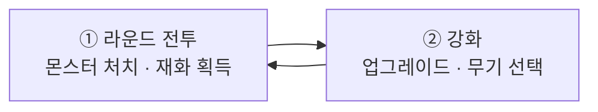

- **① 라운드 전투:** 한 라운드 동안 몬스터를 처치하며 재화를 얻고 생존합니다. 라운드 안에서도 시간대마다 등장하는 몬스터의 구성이 달라집니다.
- **② 강화:** 라운드가 끝나면 얻은 재화로 업그레이드를 구매하고 무기를 선택해 다음 라운드를 준비합니다.

이 과정을 거쳐 3라운드 최종 보스를 처치하는 것이 플레이어의 목표입니다.

| 종료 조건 | 언제 |
| --- | --- |
| 승리 | 3라운드 보스를 처치했을 때 |
| 패배 | 플레이어의 모든 목숨과 체력이 바닥났을 때 |

### 1.5 팀과 내 역할

| 구분 | 내용 |
| --- | --- |
| 내가 한 것 | 몬스터 상태 머신·공격 6종, 피격·약점·시체, 웨이브·스폰·풀, 라운드 유형(섬멸·생존·섬멸 후 보스), 몬스터 이동(군중 제어 포함), 몬스터 애니메이션 연결(공용 Override 상태 설계), 몬스터 밸런스 관리 |
| 팀원이 한 것 (이 문서에서 다루지 않음) | 팀 공용 코어(`ServiceLocator`·`EventBus`·데이터 테이블), 보스, 무기, 플레이어, UI |
| 외부 에셋 | 몬스터 모델과 애니메이션 클립 |
| AI가 작성한 것 | 몬스터·독 장판 셰이더 5개(매터리얼 값만 내가 조정). 그 밖의 코드도 Claude Code와 함께 작성했고, 설계 판단과 검증 방식은 4.1절에서 설명합니다 |

내 담당은 이 루프의 라운드 전투 구간, 몬스터 전체입니다. 핵심은 3가지입니다.

1. **상태 머신과 공격** — 모든 몬스터가 같은 상태 5개를 쓰고, 공격 6종을 갈아 끼우는 구조
2. **피격 ~ 시체** — 상시 체력바 없이 피격 방향·저체력·약점·시체로 몬스터 상태를 읽게 하는 표현
3. **웨이브와 풀** — 표(TSV) 데이터로 라운드마다 몬스터를 시간대별로 소환하고 재사용하는 흐름

군중 이동은 마지막에 크게 축소됐지만 시도가 가장 많았던 고민이라 3.1.7에서 자세히 설명합니다.

---

## 2. 시스템 구조

몬스터 파트는 웨이브가 풀에서 몬스터를 꺼내고, 꺼낸 몬스터 한 마리가 스스로 판단하고 움직이는 구조입니다.

### 2.1 구성요소와 책임

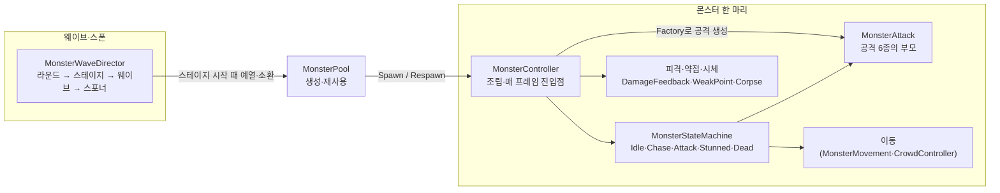

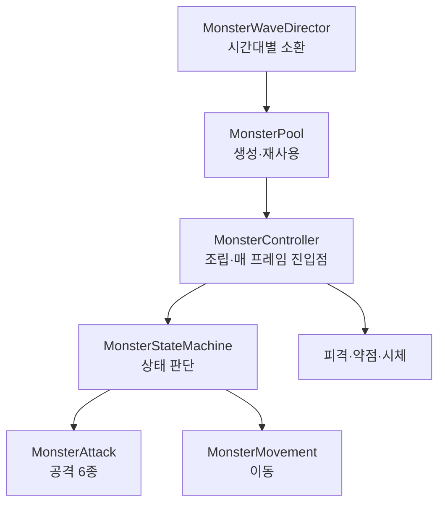

이 그림에서 볼 것은 **몬스터 한 마리 안의 모든 모듈이 `MonsterController` 하나를 통해 조립되고 움직인다**는 점입니다.

**다른 파트와는 직접 참조하지 않습니다.** 팀 아키텍처 규칙이 "파트끼리 직접 참조 금지, 통신은 인터페이스·`ServiceLocator`·`EventBus`"였습니다. 몬스터 풀은 자신을 `IMonsterFactory`로 등록하고(`code/MonsterPool.cs:44`), 몬스터는 플레이어를 `ServiceLocator`로 찾으며, 플레이어 사망·라운드 정리 같은 일은 이벤트로 받습니다(`code/MonsterController.cs:257-260`). 이 구조에 대한 생각은 4.2절에서 설명합니다.

---

## 3. 핵심 기능

2장 그림의 두 묶음을 차례로 설명합니다. 3.1은 「몬스터 한 마리」가 판단하고 공격하고 쓰러지기까지, 3.2는 「웨이브·스폰」이 그 몬스터를 라운드 시간표에 맞춰 풀에서 꺼내고 재사용하는 흐름입니다.

### 3.1 몬스터 구조

#### 3.1.1 개요

몬스터 한 마리는 `MonsterController`가 상태·공격·이동·표현 네 묶음을 조립해 움직입니다.

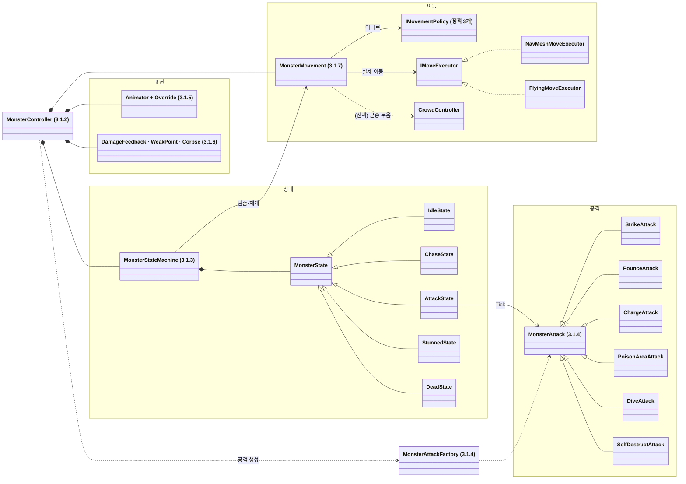

**한 프레임의 흐름** — 컨트롤러가 상태 머신을 부르고, 공격 단계가 바뀌면 컨트롤러가 Animator에 단계에 맞는 클립을 재생시킵니다.

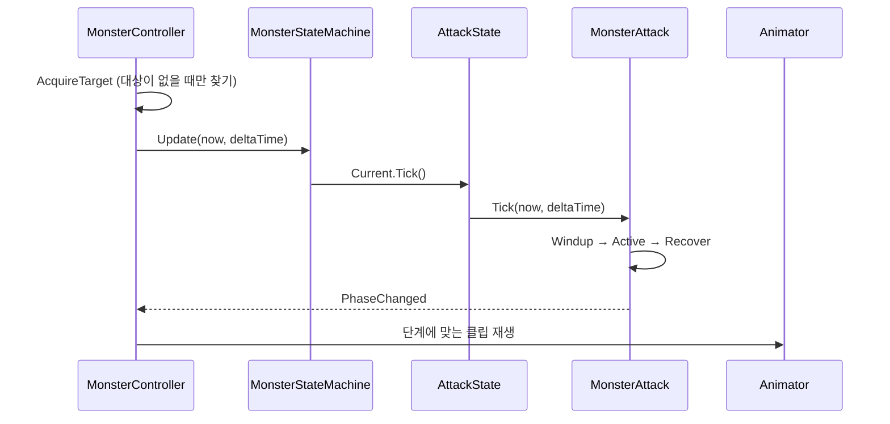

한 마리의 생명 주기부터 시작해 상태 5개, 공격의 단계와 6종, 그 결과를 보여 주는 Animator와 피격 표현·셰이더 순서로 설명합니다.

#### 3.1.2 객체 생명 주기

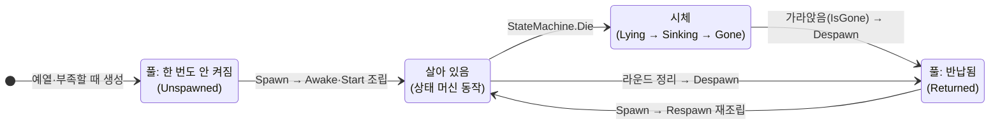

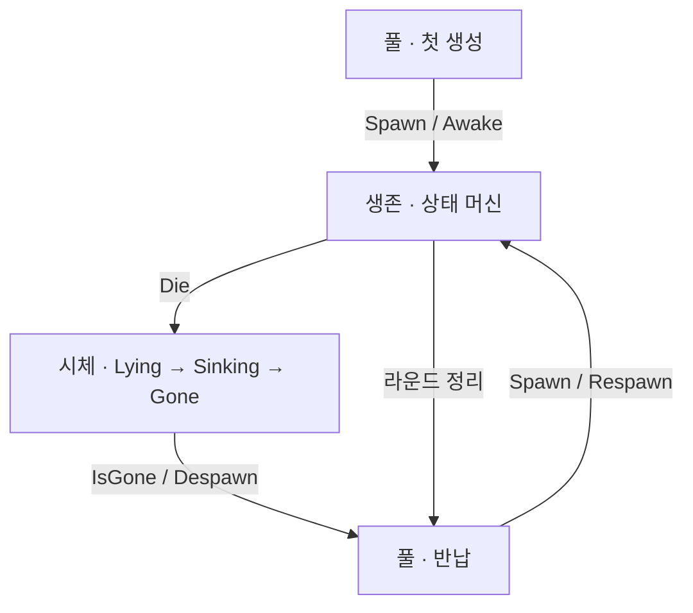

몬스터 한 마리는 풀에서 꺼내져 조립되고, 살아 있는 동안 매 프레임 판단하고 공격하다가, 죽으면 시체가 된 뒤 다시 풀로 돌아갑니다. 같은 개체를 라운드 내내 다시 쓰기 때문에, 단계마다 무엇을 켜고 무엇을 되돌릴지를 정해 두었습니다.


##### ① 꺼내기와 조립

풀은 처음 켜는 개체와 반납된 개체를 다르게 꺼냅니다. 처음 켜는 개체는 Unity가 `Awake`·`Start`를 돌려 조립하고, 반납된 개체는 `Awake`가 다시 돌지 않으므로 `Respawn()`으로 직접 되살립니다.

```csharp
// code/MonsterPool.cs:186-200
if (idleMonsters.Returned.Count > 0)
{
    // 꺼진 채 옮긴 뒤 켜야 NavMeshAgent 가 새 위치에서 시작한다
    monster = idleMonsters.Returned.Pop();
    monster.transform.SetPositionAndRotation(position, rotation);
    monster.transform.SetParent(null);
    monster.gameObject.SetActive(true);
    monster.Respawn();
}
else
{
    // 위치를 먼저 바꾼다. 씬 루트로 옮기는 순간 처음 켜지며 Awake·OnEnable 이 돈다
    monster = idleMonsters.Unspawned.Pop();
    monster.transform.SetPositionAndRotation(position, rotation);
    monster.transform.SetParent(null);
}
```

- 두 길은 같은 조립 메서드 `AssembleStateMachine()`에서 만납니다. 테이블(`MonsterDef`)로 공격 목록과 상태 머신을 새로 만들고 이벤트를 구독합니다. 처음 조립은 `Start`가, 재조립은 `Respawn`이 부릅니다.
- Dead는 상태 머신의 끝 상태라서, 재사용할 때는 상태 머신을 되돌리지 않고 새로 만듭니다.
- `Respawn`은 조립 전에 체력·피격 반응·꺼 둔 콜라이더·시체 물리·붉은 기를 처음 값으로 되돌립니다. 마지막에 `enabled = true`로 `OnEnable`을 태워 이동과 게임 이벤트 구독을 다시 켭니다.
- 꺼낼 때 위치를 먼저 옮기고 켭니다. 켠 뒤에 옮기면 NavMeshAgent가 옛 위치에서 시작합니다.

##### ② 살아 있는 동안: 매 프레임

살아 있는 몬스터의 한 프레임은 `Update` 하나로 읽힙니다. 죽었으면 시체만 진행하고, 살아 있으면 대상 확보 → 공격 튜닝 → 피격 슬로우 종료 → 상태 판단 → 이동 애니메이션 순서로 돕니다.

```csharp
// code/MonsterController.cs:281-295
private void Update()
{
    if (StateMachine.IsDead)
    {
        corpse.Tick(Time.time);
        if (corpse.IsGone) Despawn();
        return;
    }

    AcquireTarget();
    ApplyAttackTuning();
    EndHitSlowIfExpired();
    StateMachine.Update(Time.time, Time.deltaTime);
    UpdateMoveAnimation();
}
```

- 죽는 순간 상태 머신이 Dead로 바뀌면서 진행 중인 공격을 취소하고 이동을 멈춥니다. 그 뒤로는 첫 `if`에서 시체만 진행하고 `return`하므로 공격·상태 판단 코드가 더 돌지 않습니다. 별도의 "공격 중 사망" 처리 없이 이 구조로 막았습니다.
- 상태 판단(`StateMachine.Update`)의 속은 3.1.3 상태 머신과 3.1.4 역할과 공격에서 설명합니다.

##### ③ 사망과 시체

체력이 0이 되면 상태 머신이 Dead로 들어가고, 컨트롤러가 몸을 물리 시체로 바꿉니다. 대상을 놓고, 피를 터뜨리고, 이동을 끈 뒤 `MonsterDiedEvent`를 발행합니다. 처치 보상과 라운드 집계는 이 이벤트를 받는 쪽이 맡습니다.

- 시체는 `Lying`(물리로 구르며 사망 애니메이션) → `Sinking`(물리를 멈추고 바닥 아래로) → `Gone` 순서로 진행합니다. 연출은 3.1.6 피드백에서 설명합니다.
- 보스 등장 공격의 잡몹 정리(`MonsterWipeRequestedEvent`)도 같은 `StateMachine.Die`를 거칩니다. 그래서 정리된 몬스터도 쓰러지고 가라앉는 연출을 그대로 보여 줍니다.

##### ④ 반납

시체가 다 가라앉으면(`IsGone`) 컨트롤러가 `Despawn()`으로 풀에 돌려줍니다. 풀은 개체를 끄고, 배정 정보를 지운 뒤, 종류별 반납 스택에 넣습니다.

```csharp
// code/MonsterController.cs:701-709
private void Despawn()
{
    if (despawned) return;
    despawned = true;
    StateMachine.Cleanup();
    movement.enabled = false;
    enabled = false;
    ServiceLocator.Get<IMonsterFactory>().Despawn(gameObject);
}
```

- 라운드가 끝나면(`RoundCleanupEvent`) 시체 단계를 건너뛰고 바로 `Despawn()`합니다. 처치 이벤트도 내지 않습니다.
- 두 길에서 함께 불려도 `despawned` 한 줄로 한 번만 반납합니다.
- 개체가 꺼지면 `OnDisable`이 상태 머신을 정리하고 게임 이벤트 구독을 풉니다. 쉬는 개체는 이벤트를 받지 않습니다.

#### 3.1.3 상태 머신 (Plain Old C# Object)

모든 몬스터는 같은 상태 5개(Idle·Chase·Attack·Stunned·Dead)를 씁니다. 상태 머신 `MonsterStateMachine`은 Unity 컴포넌트가 아닌 순수 C# 클래스이고, `MonsterController.Update`가 매 프레임 `Update(now, deltaTime)`를 불러 현재 상태의 `Tick`을 돌립니다.

- 상태마다 `Enter`(들어올 때 1번)·`Tick`(머무는 동안 매 프레임)·`Exit`(나갈 때 1번)가 있고, 다음 상태로 갈지는 각 상태의 `Tick` 안에서 직접 판단합니다.
- 이동은 상태가 `MonsterMovement`를 멈추거나 다시 움직이게 하는 것으로만 제어합니다. 실제 경로 이동은 이동 쪽이 맡습니다.

**순수 C# 클래스로 만든 이유**

상태마다 컴포넌트로 두면 실행 순서와 상태끼리의 참조를 따로 관리해야 해서, 상태 머신을 순수 C# 클래스로 만들었습니다.

- 실행 순서: 상태가 컴포넌트면 각자의 `Update` 순서를 Script Execution Order로 맞춰야 합니다. 지금은 `MonsterController.Update` 한곳에서 사망 확인 → 대상 확보 → 상태 판단 순서를 코드로 정합니다(3.1.2 ②).
- 몬스터 구성: 상태 5개를 컴포넌트로 두면 상태끼리 `GetComponent`로 서로를 찾아야 하고, 몬스터 오브젝트에 컴포넌트가 늘고, 풀에서 재사용할 때 각자 `OnEnable`에서 값을 되돌려야 합니다. 순수 클래스라서 재조립 때 상태 머신을 `new`로 새로 만들면 됩니다(3.1.2 ①).
- 테스트: 상태 머신이 시각을 인자로 받으므로(`Update(now, deltaTime)`), 테스트에서 상태 머신을 `new`로 만들고 시각을 직접 넣어 전이를 확인했습니다(테스트 29개). 이동 부품은 컴포넌트라서 이 테스트는 PlayMode에서 돌렸습니다.

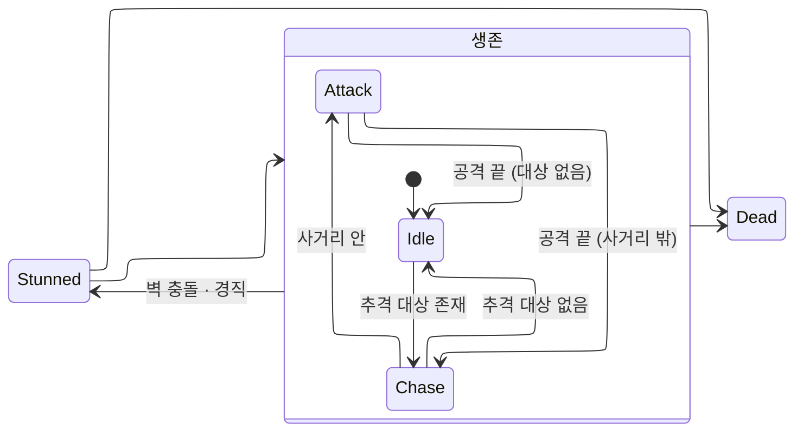

**기본 세 상태(Idle·Chase·Attack)는 「생존」 안에서 돌고, 기절·사망은 그 안 어디서든 끼어듭니다.** 풀에서 꺼낸 몬스터는 Idle에서 시작하고, 죽은 뒤 시체가 가라앉으면 풀로 반납됩니다(3.1.2). 아래에서 상태를 하나씩 짚습니다.

##### Idle

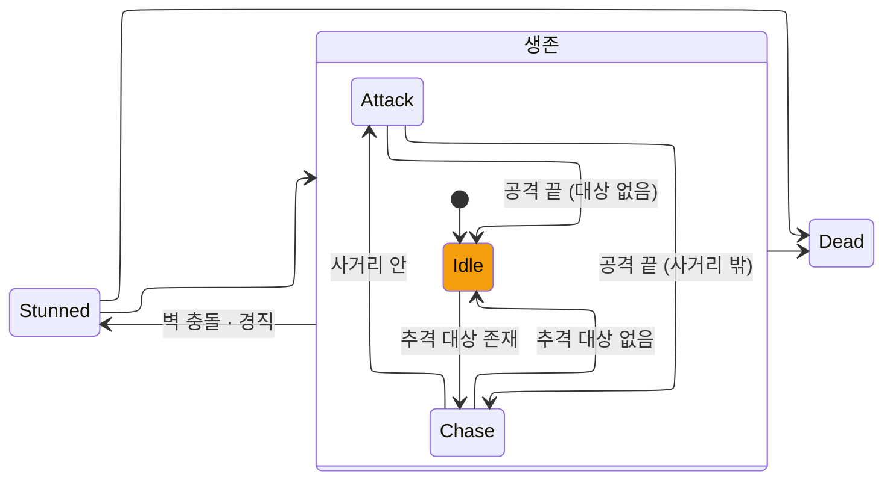

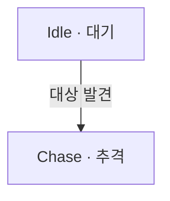

- 들어오면 제자리에 멈춥니다.
- 대상이 생기면 Chase로 갑니다.
- 공격 뒤 휴식 중이면 공격의 준비 동작(돌진 방향 맞추기)을 돌립니다. 끝나면 사거리 안일 때 Attack, 아니면 Chase로 갑니다.

##### Chase

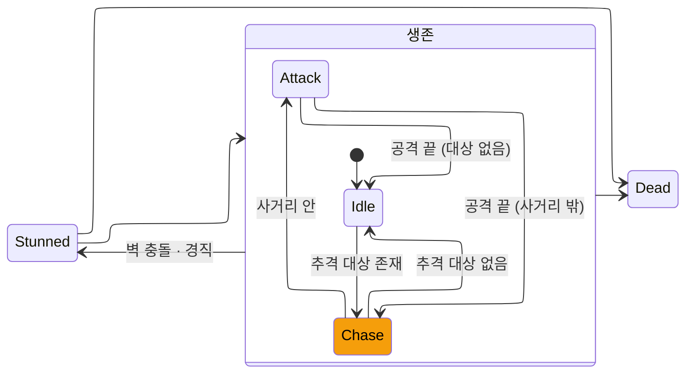

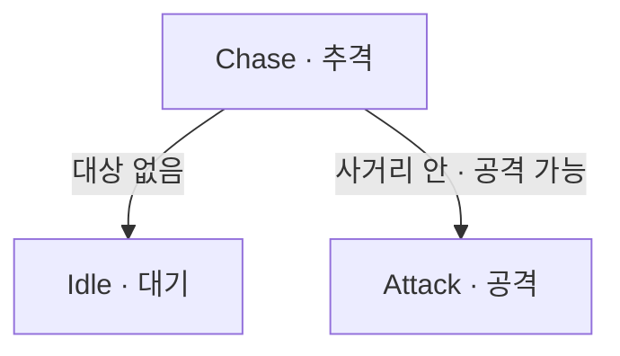

- 들어오면 멈춰 있던 이동을 다시 시작합니다.
- 대상이 없으면 Idle로 갑니다.
- 사거리 안이면 Attack으로 갑니다. 쿨다운 대기·재정비 중에는 Attack으로 가지 않습니다.

##### Attack

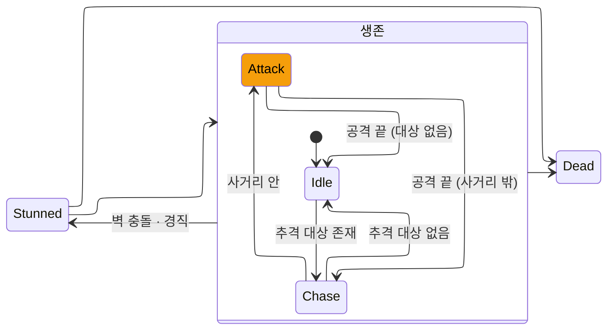

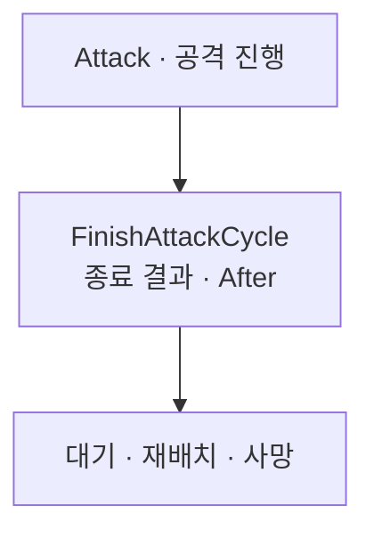

- 들어오면 멈춥니다.
- 공격이 진행 중이면 사거리를 벗어나도 끝까지 진행합니다. 예고 중 피하기가 플레이어의 대응 수단이라서입니다.
- 공격 중이 아니면 대상 없음 → Idle, 유지 사거리 밖 → Chase, 그 밖에는 다음 공격을 시작합니다.

##### Stunned·Dead

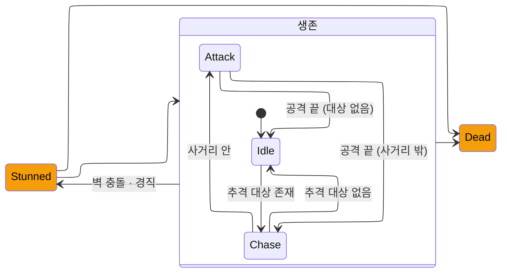

두 상태는 「생존」 안 어느 상태에서든 끼어듭니다.

| 상태 | 들어가는 조건 | 하는 일 | 나오는 곳 |
| --- | --- | --- | --- |
| Stunned | 돌진이 벽에 부딪힘<br>누적 피해가 경직 임계값을 넘음 | 멈추고 기절이 끝나는 시각을 정함 | 기절 끝: 대상이 있으면 Chase, 없으면 Idle |
| Dead | 체력 0<br>자폭 | 이동을 멈추고 사망을 알림 | 없음(종료 상태). 시체가 가라앉으면 풀로 반납(3.1.2) |

##### 공격이 끝난 뒤 행선지

몬스터마다 공격 사이의 행동을 다르게 했습니다. 공격 쿨타임 동안 대기할지, 계속 추적할지를 몬스터마다 정합니다.

공격 클래스마다 `After` 값 하나로 이 공격 뒤 행동을 정하고, `AttackState`가 공격 한 주기가 끝나는 순간 그 값대로 보냅니다.

| `After` | 쓰는 공격 | 공격 뒤 행동 |
| --- | --- | --- |
| `ChaseUntilReady` (기본) | 근접·도약·독 포격 | 쿨다운 동안 Chase로 따라가고, 쿨다운이 끝나면 다시 Attack |
| `RestInIdle` | 돌진 | Idle에서 다음 돌진 방향을 맞춘 뒤 다시 공격 |
| `RepositionInChase` | 급강하 | Chase에서 선회·재정비가 끝날 때까지 공격하지 않음 |
| `Die` | 자폭 | 자폭이 끝나면 Dead |

```csharp
// code/AttackState.cs:23-43, 51-77
public override void Tick()
{
    var currentAttack = Owner.CurrentAttack;
    if (currentAttack.IsAttacking)
    {
        currentAttack.Tick(Owner.Now, Owner.DeltaTime);
        if (currentAttack.IsAttacking == false) FinishAttackCycle(currentAttack);
        return;
    }

    if (Owner.HasTarget == false)
        Owner.ChangeState(Owner.Idle);
    else if (Owner.IsTargetInAttackHoldRange == false || Owner.CanAttack == false)
        Owner.ChaseAgain();
    else
    {
        var nextAttack = Owner.ChooseNextAttack();
        if (nextAttack.CanStart(Owner.Now))
            nextAttack.Begin(Owner.Target, Owner.Now);
    }
}

private void FinishAttackCycle(MonsterAttack attack)
{
    if (attack.LastResult == AttackResult.WallHit)
    {
        Owner.Stun(attack.WallHitStunTime);
        return;
    }
    if (attack.LastResult != AttackResult.Completed) return;

    switch (attack.After)
    {
        case AfterAttack.Die:
            Owner.Die(false);
            return;
        case AfterAttack.RestInIdle:
            Owner.RestInIdle();
            return;
        case AfterAttack.RepositionInChase:
            Owner.RepositionInChase();
            return;
        case AfterAttack.ChaseUntilReady:
            Owner.ChaseUntilReady();
            return;
        case AfterAttack.StayInAttack:
            return;
    }
}
```

- 상태 머신과 공격이 만나는 곳은 `AttackState` 하나입니다. 공격이 진행 중이면 공격의 `Tick`만 부르고, 공격이 끝난 그 프레임에 `FinishAttackCycle`이 행선지를 정합니다.
- 돌진이 벽에 막혀 끝나면(`WallHit`) 행선지 대신 기절(Stunned)로 갑니다.

##### 상태 전이: ChangeState

상태를 바꿀 때는 모두 `ChangeState` 하나를 거칩니다.

```csharp
// code/MonsterStateMachine.cs:174-184
public void ChangeState(MonsterState next)
{
    if (next == null) throw new ArgumentNullException(nameof(next));
    if (next == Current || Current == Dead) return;

    var previous = Current;
    previous.Exit();
    Current = next;
    next.Enter();
    StateChanged?.Invoke(previous, next);
}
```

- 순서는 이전 상태 `Exit` → 새 상태 `Enter` → `StateChanged` 알림입니다. `MonsterController`가 이 알림을 받아 Animator 파라미터를 바꿉니다.
- Dead가 된 뒤의 변경은 무시합니다. 피격으로 죽으면 `AttackState.Exit`가 진행 중인 공격을 취소하므로, 공격 도중에 죽어도 따로 처리할 것이 없습니다.

#### 3.1.4 역할과 공격

##### 몬스터 공격 진행 흐름과 단계별 동작

플레이어가 공격을 보고 피하거나 먼저 처치할 틈을 주려고, 준비(Windup) → 공격(Active) → 회복(Recover) 3단계 공격 시스템을 설계했습니다. 모든 몬스터의 공격이 이 순서를 따릅니다. 공격 클래스는 **템플릿 메서드** 형태로 되어 있습니다. 부모 `MonsterAttack`의 `Tick`이 단계 순서와 시간을 고정하고, 자식 클래스(공격 6종)는 각 단계에서 실제로 할 일만 훅 4개(`OnWindup`·`OnActive`·`OnRecover`·`OnCancel`)로 채웁니다.

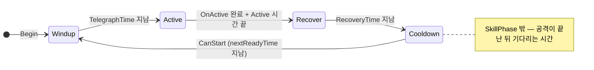

쿨다운은 회복이 끝난 뒤 다음 `Begin`까지 기다리는 시간입니다. 공격 단계(`SkillPhase`)에는 들어 있지 않습니다.

```csharp
// code/MonsterAttack.cs:197-228
public void Tick(float now, float deltaTime)
{
    switch (Phase)
    {
        case SkillPhase.Windup:
            Body.TurnToward(WindupLookPoint, WindupTurnSpeed, deltaTime);
            if (now < phaseEndTime) return;
            activeStartTime = now;
            SetPhase(SkillPhase.Active, now);
            return;
        case SkillPhase.Active:
            bool isBeforeHitTime = now < activeStartTime + ActiveDuration * cycleHitTimeRatio;
            if (isBeforeHitTime) return;

            if (isActionDone == false) isActionDone = OnActive(now, deltaTime);
            if (Phase != SkillPhase.Active) return; // OnActive 안에서 EndEarly 로 끝난 경우 (벽 충돌 등)

            bool isActiveTimeOver = now >= activeStartTime + ActiveDuration;
            if (isActionDone == false) return;
            if (isActiveTimeOver == false) return;
            SetPhase(SkillPhase.Recover, now + Spec.RecoveryTime);
            OnRecover();
            return;
        case SkillPhase.Recover:
            if (now < phaseEndTime) return;
            nextReadyTime = now + cycleCooldown;
            Finish(AttackResult.Completed);
            return;
        default:
            throw new InvalidOperationException("진행 중이 아닌 공격은 Tick 할 수 없다");
    }
}
```

- **Windup 예고** — 매 틱 대상 쪽으로 몸을 돌리고, 예고 시간(`TelegraphTime`)이 지나면 Active로 넘어갑니다.
- **Active 공격** — 판정 시각(Active 시작 + Active 길이 × `HitTimeRatio`)부터 `OnActive`를 매 틱 부릅니다. 동작이 끝나고 Active 시간도 지나야 Recover로 넘어갑니다.
- **Recover 회복** — 회복 시간(`RecoveryTime`) 동안 멈춰, 플레이어에게 반격 기회를 줍니다.
- **Cooldown 대기** — 회복이 끝나는 순간 `nextReadyTime`을 정하고 공격을 끝냅니다. 그 시각까지가 쿨다운입니다. 예고·공격·회복·쿨다운을 각각 독립 값으로 두어서, 공격 애니메이션 길이가 다른 몬스터도 공격 시간을 따로 맞출 수 있습니다(처음 정의와 바꾼 이유는 3.1.7).

**자식 클래스가 채우는 훅**

```csharp
// code/MonsterAttack.cs:259-272
/// <summary>예고 시작 (목표 확정, 예고 범위 표시). 회전은 Tick 이 WindupLookPoint 로 한다</summary>
protected virtual void OnWindup() { }

/// <summary>실제 공격 (판정 시각부터 매 틱 호출)</summary>
/// <param name="now">현재 시각 (s)</param>
/// <param name="deltaTime">지난 틱부터 경과 시간 (s)</param>
/// <returns>true = 공격 동작 완료, 이후 다시 부르지 않고 Active 시간이 끝나면 회복으로 넘어간다. false = 다음 틱에 다시 부른다</returns>
protected abstract bool OnActive(float now, float deltaTime);

/// <summary>회복(경직) 시작</summary>
protected virtual void OnRecover() { }

/// <summary>처치 등으로 중간에 끊길 때</summary>
protected virtual void OnCancel() { }
```

| 훅 | 언제 불리나 | 돌진(`ChargeAttack`)의 예 |
| --- | --- | --- |
| `OnWindup` | 예고가 시작될 때 1번 | 이번 돌진 상태(속도·이동 거리·명중 여부)를 비웁니다 |
| `OnActive` (반드시 구현) | 공격 단계의 판정 시각부터, `true`를 돌려줄 때까지 매 틱 | 조준 → 달리기 → 감속 순서로 진행하고 멈추면 `true`. 벽에 막히면 `EndEarly(WallHit)`로 회복 없이 끝냅니다 |
| `OnRecover` | 회복이 시작될 때 1번 | 지금 공격 6종 중에는 쓰는 공격이 없습니다 |
| `OnCancel` | 기절·사망·대상 상실로 중간에 끊길 때 | 돌진을 멈춥니다 |

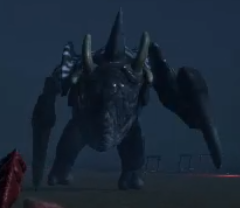

공격 전 — 플레이어에게 다가가는 중

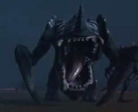

공격 직전 예고 단계

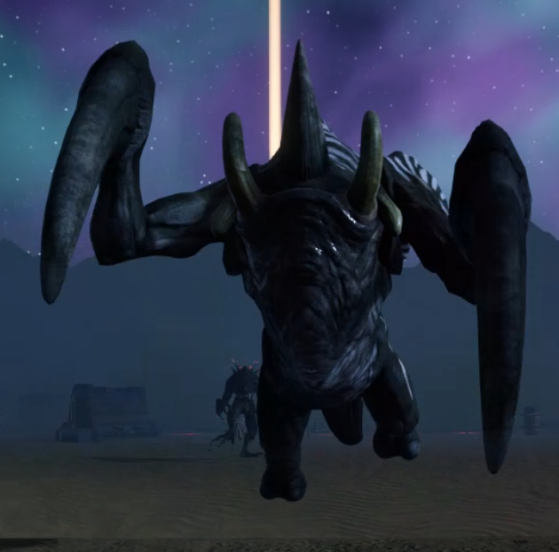

공격 중

##### 몬스터 역할과 공격 구현

몬스터 역할(Role) 하나에 공격 클래스 하나가 대응합니다. 새 공격 방식은 공격 클래스 1개와 `case` 1줄로 추가합니다.

```csharp
// code/MonsterAttackFactory.cs:27-42
public static MonsterAttack CreateAttack(MonsterRole role, in AttackSpec spec, MonsterBody body,
                                          Func<IPlayerTarget, IDamageable> findDamageable,
                                          IReadOnlyList<MonsterAttackSettingsComponent> settings,
                                          MonsterMovement movement, FlyingMoveExecutor flyingExecutor)
{
    switch (role)
    {
        case MonsterRole.Melee: return new StrikeAttack(spec, body, findDamageable);
        case MonsterRole.SelfDestruct: return new SelfDestructAttack(spec, body, findDamageable, FindSettings<SelfDestructSettings>(settings));
        case MonsterRole.Infiltrator: return new PounceAttack(spec, body, findDamageable, FindSettings<PounceSettings>(settings));
        case MonsterRole.ZonePressure: return new PoisonAreaAttack(spec, body, findDamageable, FindSettings<PoisonAreaSettings>(settings));
        case MonsterRole.Rusher: return new ChargeAttack(spec, body, findDamageable, movement, FindSettings<ChargeSettings>(settings));
        case MonsterRole.Air: return new DiveAttack(spec, body, findDamageable, movement, FindSettings<DiveSettings>(settings), flyingExecutor);
        default: throw new NotSupportedException($"{role} 역할의 공격은 아직 구현되지 않았다");
    }
}
```

| 역할 | 공격 | 하는 일 |
| --- | --- | --- |
| Melee | `StrikeAttack` | 다가가서 근접 공격 |
| Infiltrator | `PounceAttack` | 시야 밖으로 접근해 도약 공격 |
| Rusher | `ChargeAttack` | 돌진, 큰 벽에 부딪히면 기절 |
| ZonePressure | `PoisonAreaAttack` | 플레이어가 머문 자리에 독 장판 포격 |
| Air | `DiveAttack` | 공중에서 급강하 공격 |
| SelfDestruct | `SelfDestructAttack` | 다가가서 자폭 |

- 공격마다 필요한 추가 설정(돌진 속도, 도약 높이 등)은 프리팹에 붙은 설정 컴포넌트에서 `FindSettings<T>`로 꺼냅니다. 이 방식의 한계는 3.1.7절에서 설명합니다.

#### 3.1.5 Animator 연동

상태·전이는 공용 Base Controller 한 곳에만 두고, 몬스터마다 Override Controller로 클립만 바꿔 끼웁니다(11개). 새 몬스터는 Placeholder 자리에 자기 클립을 넣으면 됩니다.

C# 상태 머신과 Animator 상태는 1:1이 아닙니다. C# 쪽은 "무엇을 할지"를 정하고, Animator는 그 결과를 파라미터로 받아 어떤 클립을 재생할지 정합니다. 둘을 잇는 곳은 `MonsterController` 한 곳입니다. 상태가 바뀌면 `OnStateChanged`, 공격 단계가 바뀌면 `OnAttackPhaseChanged`가 Animator 파라미터를 넣습니다.

| C# 쪽에서 일어난 일 | 넣는 Animator 파라미터 |
| --- | --- |
| 상태 바뀜 | `IsStunned`·`IsDead` |
| Chase 중 이동 | `IsMoving` + 이동 속도 배율 |
| 공격 Active 시작 | `Attack` Trigger + `AttackSpeed` |

```csharp
// code/MonsterController.cs:330-352, 364-372
private void OnStateChanged(MonsterState previous, MonsterState current)
{
    animator.speed = 1f;
    animator.SetBool("IsMoving", false);

    if (current == StateMachine.Stunned)
    {
        animator.SetBool("IsStunned", true);
        Stunned?.Invoke(StateMachine.StunDuration);
        return;
    }
    if (current == StateMachine.Dead)
    {
        animator.SetBool("IsStunned", false);
        animator.SetBool("IsDead", true);
        animator.SetTrigger("Death");
        return;
    }
    if (current == StateMachine.Attack) return;

    // 여기부터 Idle / Chase 진입: 기절에서 나왔으면 Stunned → Idle 전이가 일어난다
    animator.SetBool("IsStunned", false);
}

private void OnAttackPhaseChanged(MonsterAttack attack, SkillPhase phase)
{
    AttackPhaseChanged?.Invoke(FindAttackDef(attack), phase); // 소리: 모든 단계를 알린다 (예고음 = Windup)
    if (phase != SkillPhase.Active) return;
    if (attack.UsesMoveAnimation) return;

    animator.SetFloat("AttackSpeed", ReadAttackClipSeconds() / attack.ActiveDuration);
    animator.SetTrigger("Attack");
}
```

- 공격 클립은 **공격 Active 단계가 시작될 때** 재생합니다. 재생 배율 `AttackSpeed` = 클립 길이 ÷ Active 길이라서, 공격 애니메이션 길이가 다른 몬스터도 클립이 Active 동안 정확히 한 번 재생됩니다. 예고·회복 동안 Animator는 이미 Idle에 돌아가 있습니다.
- Chase 안의 멈춤·이동은 C# 상태를 늘리지 않고 `IsMoving` 하나로 Animator에서 나눕니다. Move 재생 배율은 실제 속도 ÷ 클립 기준 속도로 맞춰 발 미끄러짐을 줄입니다.
- 이동 자체가 공격인 돌진은 Attack 클립을 쓰지 않고, Move 클립을 돌진 속도에 맞춰 재생합니다.

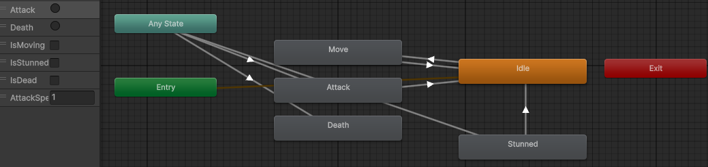

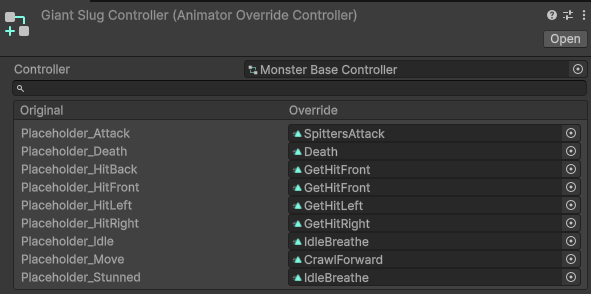


#### 3.1.6 피드백

##### 피격 ~ 시체: 상시 체력바 없이 상태를 읽게 하기

| 표현 | 어떻게 | 코드 |
| --- | --- | --- |
| 피격 방향 모션 | 맞은 쪽(앞·뒤·좌·우)의 피격 모션을 Animator의 Hit 레이어(Additive)에 겹쳐 재생. 이동·공격 상태는 바뀌지 않습니다 | `code/MonsterDamageFeedback.cs:90-98` |
| 저체력 | 이동 감속 + 몸에 붉은 기. 매터리얼 에셋은 바꾸지 않고 렌더러별 `MaterialPropertyBlock`으로 덮습니다 | `code/MonsterDamageFeedback.cs:122-131` |
| 경직 | 피해가 쌓여 임계값을 넘으면 경직 또는 슬로우(몬스터마다 Inspector에서 고름) | `MonsterController` |
| 약점 | 맞았을 때만 Flash. 보스는 처음 등장 몇 초만 강조 | `code/MonsterWeakPoint.cs:156-159` |
| 시체 | 누움 → 가라앉기 → 회수. 총의 위력에 밀려 구르는 물리는 유지 | `code/MonsterCorpse.cs:101-118` |

```csharp
// code/MonsterDamageFeedback.cs:90-98
public void PlayHitAnimation(Vector3 incomingDirection)
{
    if (Time.time < nextHitAnimationTime) return;

    nextHitAnimationTime = Time.time + hitAnimationCooldown;
    Vector3 localDirection = transform.InverseTransformDirection(incomingDirection);
    HitSide side = ToHitSide(localDirection);
    animator.CrossFadeInFixedTime("Hit" + side, hitAnimationBlend, hitLayerIndex, 0f);
}
```

- 처음에는 피격 표현으로 시각 효과만 원했습니다. 
- 경직은 팀장의 플레이 피드백(몬스터가 피격되면 경직되어서 플레이어가 물량에 너무 휩쓸리지 않았으면 좋겠습니다)을 반영했습니다. 다만 피격마다 경직을 넣으면 거대한 몬스터도 한 번에 경직되어 몰입감을 해칠 수 있어서, **누적 피해 임계값**을 넘었을 때만 경직되게 했습니다. 물량과 기존 플레이 밸런스를 유지하면서 피드백을 반영하는 방법이었습니다.
- 약점은 처음에 늘 빛났는데, 팀원들에게서 게임 분위기에 맞지 않고 몬스터 비주얼을 해친다는 피드백이 나와 명중할 때만 보이게 바꿨습니다.

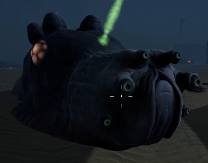

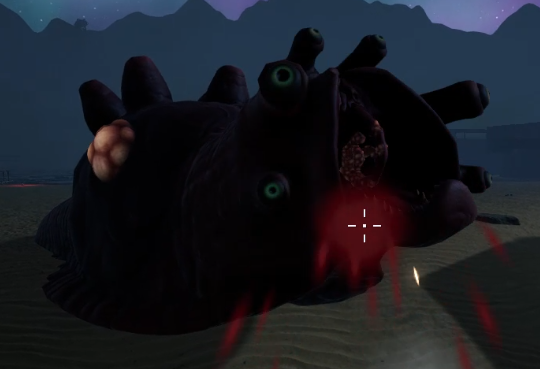


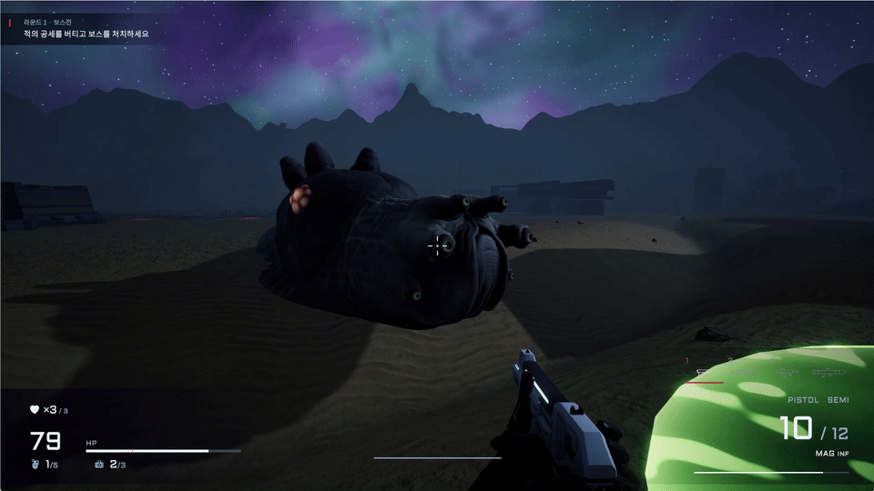


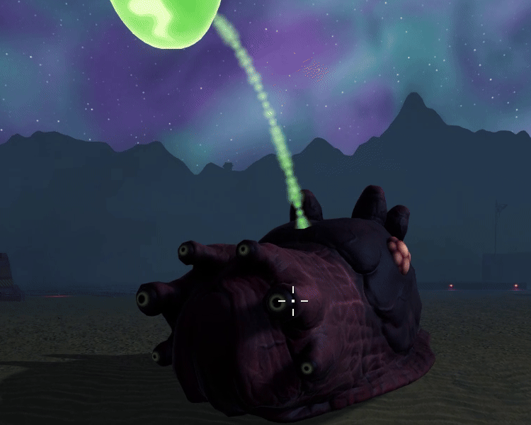

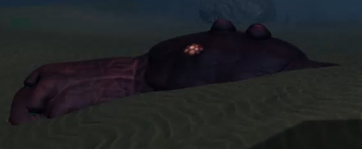

시체는 단계 enum 하나(`Alive → Lying → Sinking → Gone`)로 진행하고, `Gone`이 되면 컨트롤러가 풀에 돌려줍니다.

```csharp
// code/MonsterCorpse.cs:101-118
public void Tick(float now)
{
    float elapsed = now - stageStartTime;
    switch (stage)
    {
        case CorpseStage.Lying:
            // 남은 시간에 맞춰 현재 회전 속도를 줄이고, 침강 시작 시 0으로 만든다.
            float remaining = lyingSeconds - elapsed;
            float spinFade = remaining > 0f ? Time.deltaTime / (remaining + Time.deltaTime) : 1f;
            body.angularVelocity = Vector3.Lerp(body.angularVelocity, Vector3.zero, spinFade);
            if (elapsed >= lyingSeconds) StartSinking();
            return;
        case CorpseStage.Sinking:
            MoveDownWhileSinking(elapsed);
            if (elapsed >= sinkSeconds) EnterStage(CorpseStage.Gone);
            return;
    }
}
```

##### 위협을 눈에 띄게: 약점·강화형·독 장판 셰이더

플레이어가 장판 범위를 보고 피할 수 있게, 착탄 예고 표식과 장판이 지형을 따라 보이도록 했습니다. 몬스터의 피격 이펙트, 독 장판 VFX에 사용된 셰이더 5개는 AI(Claude Code)가 작성한 URP용 HLSL 셰이더입니다. 나는 요구 사항을 정하고, 씬에서 눈으로 확인하며 매터리얼 값만 직접 조정했습니다. 지형 에셋과의 위화감을 줄이는데 집중했습니다.

| 셰이더 | 어디에 | 렌더 단계 |
| --- | --- | --- |
| WeakPointGlow | 약점 부위 | 반투명(Transparent), 깊이 안 씀 |
| EliteAura | 강화형·자폭형 몬스터 | 반투명, 원래 재질 위에 두 번째 재질로 덧그림 |
| PoisonPuddle | 독 장판 | 반투명 |
| PoisonMarker | 착탄 예고 표식 | 반투명, 장판보다 나중에 그림(`Transparent+10`) |
| PoisonBlob | 독 투사체 | 불투명(Opaque), 깊이 패스 포함 |

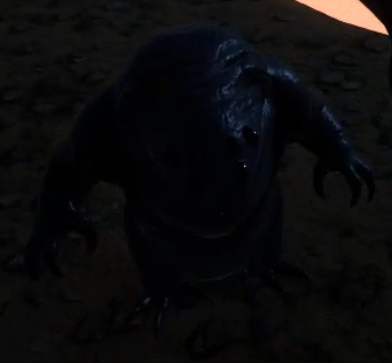


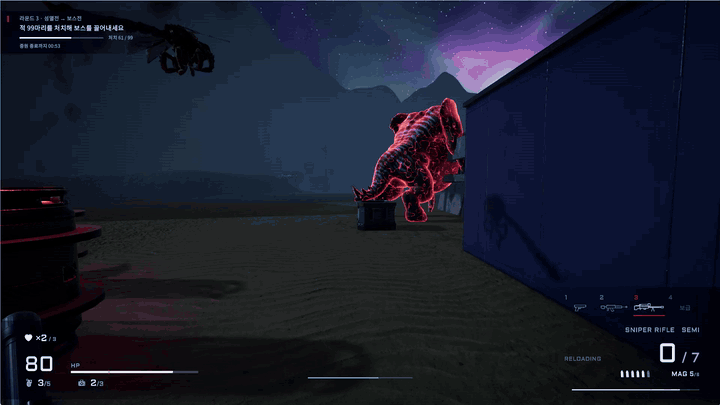

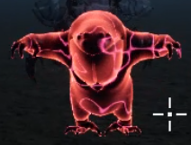

- 장판·표식이 지형 굴곡을 따르게 하는 것은 C# `TerrainDiscMesh`입니다. Terrain 높이를 따라 원판 메시를 새로 만듭니다(`code/TerrainDiscMesh.cs:24-61`).

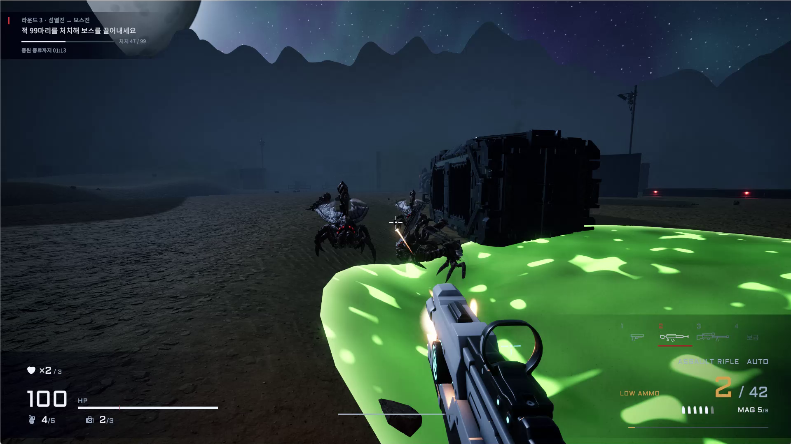

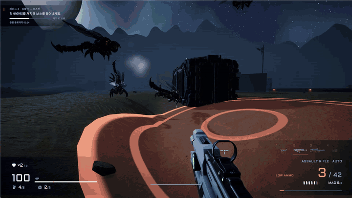

#### 3.1.7 몬스터 파트 회고

##### 공격 구조: 인터페이스 + 추상 클래스에서 추상 클래스로

**당시 상황**

- 몬스터 공격은 핵심 기능이면서도 바뀔 가능성이 높았습니다. 1차 빌드 전 백로그에 이미 몬스터 종류별 이야기가 여러 개 있었고(기본 근접형·공중 공격형·독안개 위치 압박형·시야 밖 침투형·돌진형 무리), 공격 방식도 다가가서 공격·도약 공격·공중 다이빙 공격·돌진 공격으로 다양했습니다.
- 몬스터마다 공통 애니메이션 클립도 있지만 공격 클립은 다양했고, 1차 빌드 뒤 공격 기능 피드백이 들어올 확률이 높다고 판단했습니다. 프로토타입부터 상태 전이·공격을 유연한 구조로 설계하지 않으면 나중에 힘들어질 것 같았습니다.

그래서 AI와의 계획 단계에서 이렇게 요청했습니다.

> 몬스터 행동 상태, 공격 전략 모두 바뀔 가능성이 크니까 oop, 디자인 패턴을 적극적으로 적용해서 먼저 어떻게 설계할지 나에게 설명해봐.

테스트 방식은 Unity 없이 도는 NUnit 테스트였습니다. 이동 작업 때 내가 먼저 고른 방식입니다. 테스트에 드는 AI 토큰을 줄이려고 Unity CLI로 EditMode·PlayMode 테스트를 돌리지 않을 방법을 AI에게 물었고, NUnit 테스트가 있다는 답을 받아 프롬프트에 넣었습니다. 공격 설계에서는 AI가 이 방식을 그대로 이어 받아 제안했습니다.

**처음 구조와 정리한 구조**

| | 처음 | 정리 후 (지금) |
| --- | --- | --- |
| 공격 | 인터페이스 `IMonsterAttack` + 추상 클래스 `MonsterAttack` | 추상 클래스 `MonsterAttack` 하나 |
| 몬스터 몸·이동 | `IMonsterBody`<br>`IMonsterMover`<br>`ISlotNavigation` | 인터페이스 삭제 |
| 남긴 인터페이스 | — | `IHitArea`(구현 4개)<br>`IMovementPolicy`(구현 3개)<br>`IMoveExecutor`(공중형 이동 예정) |
| 테스트 | Unity 없이 도는 EditMode + 가짜 객체 | 실제 객체로 도는 PlayMode 중심 |

**AI와 함께 한 과정**

| 단계 | AI가 한 것 | 내가 판단·수정한 것 |
| --- | --- | --- |
| 첫 설계 | 디자인 패턴 8종 설계안(State·전이 테이블·Template Method·Strategy·Composite·Factory 등)을 제안하고, 이동 작업의 NUnit 테스트 방식을 이어 받음. 피드백 반영안에 `IMonsterMover`·`IMonsterBody`가 들어옴 | 전이는 내가 준 상태 패턴 예시대로, Composite는 쓰는 이유를 되물음. 돌진은 공격 전략 안에서 처리하게 하고, 공중·부위는 뺌. 나머지는 제안대로 받아들임 |
| 구현 | 계획에 없던 `IMonsterAttack`을 추가. 테스트는 Unity 밖 러너로만 돌림 | — |
| 문제 발견 | `IMonsterBody`를 실제로 쓰는 곳이 테스트 가짜 객체뿐이라고 인정 | 메서드·클래스가 너무 많아 리뷰에 며칠이 걸림. 인터페이스가 추상 클래스와 다를 바 없다고 봄("~할 수 있음" 계약이어야 함). 논리 테스트 대신 PlayMode 테스트를 기준으로 삼음 |
| 기준·리팩토링 | 리팩토링 요청 문서 초안을 씀 | 인터페이스 기준을 정해 내 코딩 지침에 넣음. "계획 → 내 승인 → 단계별 구현" 순서로 진행하고, 인터페이스마다 별도 커밋으로 지우며 테스트를 PlayMode로 옮기는 방식을 고름 |
| 검증 | 단계마다 Unity CLI로 테스트를 돌려 결과 XML을 남김 | 인터페이스 하나당 한 단계로 나누고, 단계마다 Unity CLI로 테스트를 돌려 보고하게 함 |

정리를 시작하며 보낸 요청의 핵심 문장은 이렇습니다.

> 사실상 지금 Assets/Scripts/Monster 여기에 사용된 인터페이스 몇개는 추상클래스와 다를바가 없거든?

> 테스트를 편하게 하려는 목적만으로는 만들지 않는다.

**왜 정리했나**

- 처음 구조는 한 번에 크게 들어왔고, 커밋된 코드를 본 뒤에야 내가 코드 리뷰하기 힘든 너무 넓은 범위의 작업을 AI에게 맡겼다는 걸 깨달았습니다.
- 인터페이스가 테스트를 위한 일회용 추상화 그 이상, 그 이하도 아니어서 코드 읽기가 너무 힘들었습니다. 처음에는 제대로 피드백을 할 수 없을 정도로 헷갈렸습니다.
- 그래서 기준을 직접 정했습니다: **인터페이스는 구현이 2개 이상이거나 백로그에 확장 예정이 있을 때만 만듭니다.** 유의미한 추상화(실제로 확장 가능하고 다형성이 당장 필요한 지점)와 과한 추상화·오버 엔지니어링을 구분하고 싶었습니다.
- 공격 정보를 감싸는 메서드와 공격 사이클 같은 공통 정보가 필요해서 추상 클래스는 남겼습니다.

**결과**

- 정리 전후 테스트 48개가 모두 통과했습니다(정리 전 EditMode 48개 → 정리 후 EditMode 14 + PlayMode 34, Unity CLI 결과 기록).
- 인터페이스 4개(`IMonsterAttack`·`IMonsterBody`·`IMonsterMover`·`ISlotNavigation`)를 지웠습니다.
- 테스트를 PlayMode로 옮겼지만 체감 차이는 없었습니다. 테스트 수가 아주 많지 않아서, 지금도 PlayMode 테스트 전체가 1분 안에 끝납니다.

**공격 설정 전달도 같은 고민이었습니다**

| 단계 | 방식 | 문제 |
| --- | --- | --- |
| 1 | 공격 설정 묶음 구조체 | 공격이 늘 때마다 `CreateAttack` 매개변수가 늘어납니다. 공격 4개만 되어도 비슷한 역할의 설정을 쭉 나열하게 되어, 순서를 조금만 실수해도 잘 드러나지 않는 버그가 생기고 매번 순서를 떠올려야 했습니다 |
| 2 (지금) | 프리팹에 붙은 설정 컴포넌트 목록 + `FindSettings<T>` | 공격이 추가되면 팩토리가 그 공격의 설정 타입을 알아야 해서 팩토리를 한 번 더 고쳐야 합니다 |
| To-Be | 설정 묶음만 넘기고, 각 공격 클래스가 필요한 설정을 직접 꺼냄 | 일부 공격만 쓰는 설정은 그 공격 클래스만 알면 됩니다 |

몬스터 시스템은 이미 클래스가 많습니다. 정말로 여러 모듈을 엮어야 하는 `MonsterController` 같은 곳을 빼면, 클래스 사이 의존성을 최대한 낮추는 것이 내가 코드 리뷰할 때도, 다른 사람이 내 코드를 볼 때도 좋다고 생각했습니다.

##### 공격 단계 시간: 쿨다운에서 빼던 정의를 독립 값으로

**처음 정의** — 처음에는 Active = Cooldown − Telegraph − Recovery로 정의했습니다. 공격 페이즈를 이렇게 자세히 나눈 첫 프로젝트라 각 페이즈의 의미를 잘 몰랐습니다. 한 주기 길이가 Cooldown 하나로 고정돼, 공격 빈도(몇 초에 한 번 때리는지)를 숫자 하나로 조절하기 쉬운 장점은 있었습니다.

**바꾼 이유** — 몬스터마다 공격 시간을 다르게 해야 할 때 Active가 세 값에 의해 간접적으로 정해졌습니다. 그래서 예고·공격·회복·쿨다운을 각각 독립 값으로 바꿨습니다(3.1.4).

**돌아보면** — 기본적인 검색을 먼저 했다면 처음부터 지금 구조로 갈 수 있었습니다.

##### 공격 사거리: 진입·유지·판정 거리를 나누기

**문제** — 근접 몬스터가 사거리 앞에서 서서히 느려지고, 공격해도 플레이어가 너무 쉽게 피했습니다.

원인은 여러 문제가 겹친 것이었습니다.

1. NavMeshAgent는 목표 지점에 도착할 때 자연스럽게 서서히 멈추려고 감속합니다.
2. 그런데 이동 목표 지점이 공격 사거리 지점과 같았습니다.
3. 경로 계산(`CalculatePath`) 부하를 막으려고 경로를 일정 간격으로만 다시 계산했습니다(최소 0.25초, 목표가 0.5m 넘게 움직였을 때). 재계산하지 않는 프레임에 플레이어가 움직이면 "목표 앞 감속 → 목표 변경으로 가속"이 반복됐습니다.
4. 설령 공격해도 공격 거리가 너무 짧으면 플레이어가 쭉 도망칠 때 쉽게 회피됐습니다.

**선택지와 고른 것**

| 방법 | 결과 |
| --- | --- |
| 사거리 하나로 진입과 명중을 같이 판정 (처음) | 감속 문제 + 쉽게 회피 |
| 이동 정지 거리를 0으로 바꿔 사거리 앞 감속 없애기 | 감속은 사라집니다. 하지만 이것만으로는 짧은 사거리 때문에 여전히 쉽게 회피됩니다 |
| 공격 유지 거리를 크게 늘려 버티기 (임시) | 공격은 유지됩니다. 하지만 이동 정책 설정이나 사거리를 조금만 바꿔도 문제가 다시 생깁니다 |
| **진입·유지·판정 거리를 나누기 (지금)** | 진입 = 사거리, 공격 유지·근접 명중 = 사거리 × `HitRangeRatio`. 쿨다운 동안에는 Chase로 따라갑니다 |

**최종 결정** — 원인을 감속과 거리 구분 두 가지로 나눈 뒤, 감속 문제를 먼저 해결하고 진입·유지·판정 거리를 나눴습니다.

**원인을 나누기 전에는 값을 늘려 버텼습니다**

처음에는 두 원인이 겹친 것을 한 문제로 봤습니다.

1. `HitRangeRatio`를 예고(Windup) 뒤에도 공격을 유지하는 거리로 바꿔 쓰고, 그 범위를 크게 늘렸습니다.
2. 공격은 억지로 유지됐지만, `FlankPolicy` 같은 이동 정책 설정이나 사거리를 조금만 바꿔도 문제가 다시 생겼습니다.
3. 그래서 원인을 둘로 나눴습니다. 감속 문제를 먼저 해결하고, 그다음 `HitRangeRatio`를 지금의 형태(사거리 × 비율로 유지·명중 판정)로 바꿨습니다.

진입·유지·판정을 나눠야 한다는 것을 확실히 안 것은 NavMesh 감속 문제를 해결한 **뒤**였습니다. 감속이 사라지자 "공격해도 플레이어가 너무 쉽게 피합니다"가 테스트에서 바로 드러났기 때문입니다. 판정 범위는 씬에서 보이게 하는 시각화 도구로 확인했습니다.

<!-- 촬영: 공격 범위 시각화(진입 범위와 사거리 × HitRangeRatio)가 켜진 근접 몬스터 -->

**돌아보면:** 원인을 나눠 파악하지 못한 채 값만 늘린 해법은 설정이 조금만 바뀌어도 다시 터졌습니다. 증상이 여러 개 겹쳐 보이면 원인부터 나눠야 합니다.

##### 애니메이션: 코드 강제 전환 대신 Animator 상태 전이

**문제** — 공격 클립이 끝나기 전에 상태가 바뀌어 `attack → idle → attack`처럼 부자연스러웠습니다. 외부 에셋의 Animator Controller 8개는 공통 상태(Idle·전진 이동·공격·피격·Death)만 있고 파라미터·전이가 없는 데모용이었습니다.

| 방법 | 장점 | 단점 |
| --- | --- | --- |
| 코드에서 `CrossFade`로 강제 전환 | 코드 한 곳에서 제어 | 전이가 코드에만 있고 Animator 창·Inspector에 드러나지 않습니다 |
| **Animator 상태 전이 + 공용 Base + 몬스터별 Override (지금)** | 팀원이 Animator 창에서 바로 확인. 상태·전이는 한 곳에서만 고침 | 코드와 Animator 파라미터를 맞춰야 합니다 |

내 결과물을 확인하려면 코드까지 깊게 봐야 한다면, 팀장이나 다른 팀원이 피드백·검증하거나 사소한 변경을 테스트하기가 힘들어집니다. 그래서 Unity 내의 Animator 상에 애니메이션 상태 전이가 보이도록 재설계했습니다.

- 공용 Base Controller 1개 + 몬스터별 Override Controller 11개. 새 몬스터는 클립만 끼우면 됩니다.
- 공격 Active 단계에 맞춰 클립을 재생하고, 클립 길이와 실제 이동 속도로 재생 배율을 맞췄습니다.
- 다만 고정 상태 5개로 모든 몬스터를 표현하기에는 한계가 명확했습니다. 몬스터에 따라 걷기·달리기 클립이 따로 있거나 옆으로 걷기도 하고, 공격 클립은 몬스터마다 종류가 달랐습니다. 공통 상태 5개 안에서 필요할 때 서브 상태 머신을 갈아 끼우는 방법을 조사했지만 구현하지는 못했고, 이 프로젝트에서는 재생 배율과 `IsMoving`으로 버텼습니다.
- 이동 속도에 따라 달리기 클립을 따로 쓰는 것도 계획했지만 넣지 않았습니다. 시간이 모자랐고, 몬스터 이동 속도 폭이 동적으로 크게 달라지지 않고 과도하게 빠른 몬스터도 없어서 달리기 애니메이션 없이도 이질감이 없었습니다.

##### 몬스터 이동: 전원 포위에서 묶음별 군중으로, 그리고 축소

군중 이동은 이 프로젝트에서 시도가 가장 많았던 고민입니다.

몬스터마다 플레이어에게 접근하는 방식은 다르게 구성했습니다. 어디로 갈지는 이동 정책(`IMovementPolicy`, 구현 3개)이 정합니다.

- 플레이어를 향해 일직선으로 이동
- 넓게 퍼져서 이동
- 플레이어 시야 밖으로 이동(`FlankPolicy`)

군중 이동은 이렇게 다가오는 여러 몬스터에게 플레이어 둘레의 자리를 나눠 주는 일입니다.

**당시 상황** — NavMesh로 여러 몬스터를 움직이는 비용이 크다는 것은 알았지만, 무거운 3D 에셋을 넣은 상태에서 프레임 드랍을 감당할 수 있을지 감이 오지 않았습니다.

**목표** — 플레이어를 둘러싼 위치를 몬스터마다 하나씩 겹치지 않게 나눠 주어, 몬스터가 플레이어를 둘러싸며 다가오게 하려 했습니다.

- 입력: 몬스터 위치·이름, 플레이어 위치
- 조건: 몬스터가 받은 위치는 서로 겹치지 않습니다. 매 프레임 실행하고, 몬스터끼리 겹침을 줄입니다.

**시도와 결과**

| 단계 | 방식 | 결과 |
| --- | --- | --- |
| 1 | 모든 몬스터가 전역 군중 조정자(`CrowdCoordinator`)를 따름. 플레이어 둘레에 접근 링과 대기 링 슬롯 | 멀리 있는 몬스터가 가까운 슬롯을 받아, 가까운 몬스터가 멈춰 서 있었습니다. 슬롯으로 가다가 공격할 수 있게 되면 그 자리에서 멈춰 공격해서 슬롯이 의미가 없었습니다 |
| 1-보완 | 접근 링·대기 링을 다중 링 하나로 합침 | 첫 링은 접근, 바깥 링은 대기라는 역할 구분은 남았습니다 |
| 임시 우회 | 군중 제어를 잠깐 끄고, 제한 없는 이동(unrestricted)을 기본으로 스폰 | 플레이테스트에서 "몬스터들이 강강술래 하듯 빙빙 돌며 플레이어를 제대로 공격하지 못합니다"는 의견이 나왔습니다 |
| 2 (지금) | 스폰 묶음마다 `CrowdController`를 두고, 배정받지 못한 몬스터는 직접 추적 | 모든 몬스터가 군중에 속하지 않아도 플레이어를 쫓습니다 |
| 대안 | FlowField(따로 시험) | 지형에 맞게 구역을 나누는 방법을 풀지 못해 최종 빌드에 넣지 않았습니다 |

**최종 결정** — 마지막에 군중 이동을 크게 줄였습니다. 최종 라운드 편성에서는 군중 묶음(Crowd) 스폰을 쓰지 않아, 모든 몬스터가 이동 정책에 따라 플레이어를 직접 쫓습니다.

- 가장 큰 이유는 슬롯·토큰 방식이 실제 플레이에서 효과가 작았던 것입니다.
- Claude를 쓰기 시작한 초기에 만든 코드라 `MonsterMovement`와 `CrowdController`의 책임이 많이 엉켜 있었고, 유지보수가 매우 힘들었습니다.

**문제 정의부터 다시**

처음 막혔을 때 "모든 몬스터가 군중에 속해야 하나?"를 다시 물었습니다. 원래 구현은 모든 몬스터가 `CrowdCoordinator`를 따르게 되어 있어서, 군중에 속하지 않은 몬스터는 추적을 하지 못했습니다. 그래서 군중 소속을 스폰 묶음 단위로 다시 정했습니다.

군중 이동을 처음 설계할 때도 AI에게 바로 구현을 맡기지 않고, 문제 정의 → 입출력 명세 → 설계 순서로 요청했습니다.


<!-- 촬영: 군중 슬롯 링 Gizmo가 보이는 몬스터 무리 -->

**남은 문제** — `MonsterMovement`에는 군중 제어·자체 추적·정책 이동이 섞여 있고, `CrowdController`에는 토큰·슬롯 방식이 섞여 있습니다. 개선 방향은 5.4절에서 설명합니다.

### 3.2 몬스터 관리

#### 3.2.1 개요

몬스터 소환은 네 단계로 나뉩니다.

- **라운드**: 플레이어가 한 번 치르는 군중전 한 판입니다(3분). 시작할 때 편성 후보 중 하나를 무작위로 고릅니다.
- **스테이지**: 라운드를 시간대로 나눈 구간입니다(예: 0~55초). 구간마다 몬스터 구성과 밀도가 다릅니다.
- **웨이브**: 스테이지 시작 기준으로 정한 시각에 함께 시작하는 스포너 묶음입니다.
- **스포너**: 표의 한 줄입니다. 몬스터 한 종류를 정한 수·간격·위치로 소환합니다.

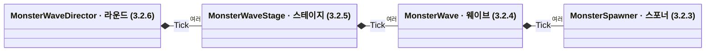

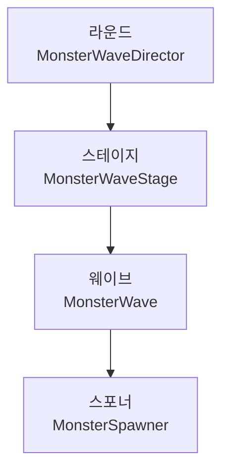

스포너·웨이브·스테이지는 모두 위에서 `Tick`을 받아 움직이고, 끝나면 `Finished`로 알립니다.

**왜 라운드 안에 스테이지를 뒀나**

처음 모듈 구조를 잡을 때부터 라운드를 시간 단계로 나누려고 했습니다. 한 라운드 안에서도 시간대마다 몬스터 구성과 밀도를 바꿔, 플레이어가 한 자리에 머물지 않고 한 가지 대응만 반복하지 않게 하고 싶었습니다.

아래 표는 한 라운드 편성의 예입니다. 실제 구성은 라운드를 시작할 때 편성 후보 중 하나를 무작위로 고릅니다.

| 구간 | 위협의 변화 | 유도한 대응 |
| --- | --- | --- |
| 초반 | 사방에서 근접 몬스터가 접근 | 유리한 위치로 이동하며 적을 처치 |
| 중반 | 독 장판, 측면·공중 공격 등 새로운 위협 등장 | 안전한 위치와 공격 우선순위를 다시 판단 |
| 후반 | 돌진형 몬스터 합류와 물량 증가 | 수류탄과 회복 보급을 활용해 포위를 돌파 |

플레이어는 몬스터를 처치하거나 이동하면서 일시적으로 주도권을 회복하지만, 새로운 위협이 추가되면 대응 방식을 다시 바꿔야 합니다. 이렇게 시간대별 몬스터 묶음을 나누려고 라운드와 웨이브 사이에 스테이지를 하나 더 두었습니다.

**표 4개가 몬스터 한 마리가 되기까지**

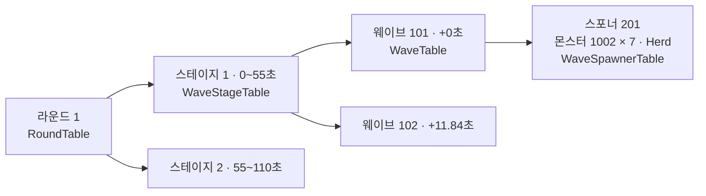

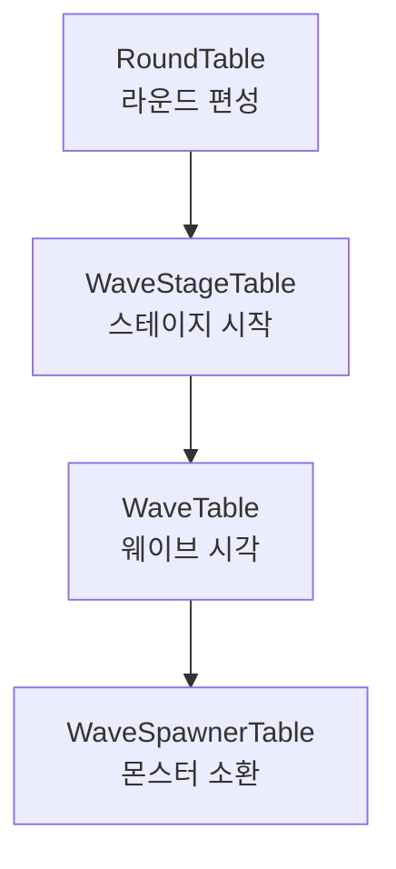

| 표 | 한 행에 들어 있는 것 |
| --- | --- |
| `RoundTable.tsv` | 라운드 시작마다 웨이브 편성 후보 중 하나를 무작위로 고름 |
| `WaveStageTable.tsv` | 웨이브 라운드 번호에 대응해, 시작 시각에 따라 순서대로 시작하는 웨이브 스테이지들. 스테이지마다 진행할 웨이브 번호들 |
| `WaveTable.tsv` | 이 웨이브가 스테이지 시작 기준 몇 초 뒤에 실행되는지, 이 웨이브가 맡은 스포너들 |
| `WaveSpawnerTable.tsv` | 이 스포너가 소환하는 몬스터 id, 소환 개수, 소환 방식 |

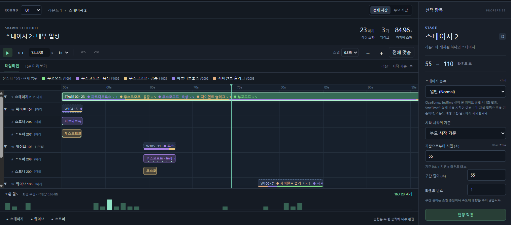

> **아쉬운 점 · 개선할 점** — 라운드 → 스테이지 → 웨이브 → 스포너 4계층은 다른 팀원이 한눈에 읽기 어려웠고 수치 조절도 힘들었습니다. 이 구조를 고른 과정과 단계를 줄이는 개선 방향은 3.2.7절에서 설명합니다.

#### 3.2.2 풀

```mermaid
classDiagram
    direction LR
    class MonsterSpawner["MonsterSpawner"]
    class IMonsterFactory
    class MonsterPool["MonsterPool · 풀 (3.2.2)"]
    class MonsterController
    MonsterSpawner --> IMonsterFactory : Spawn
    IMonsterFactory <|.. MonsterPool
    MonsterPool --> MonsterController : 꺼내 주기 / 돌려받기
```

스포너는 풀이 어떻게 생겼는지 모르고 `IMonsterFactory`만 압니다.

풀은 종류마다 쉬는 개체 스택을 두 개 둡니다(`code/MonsterPool.cs:38-39`). 한 번도 안 켜진 개체(`Unspawned`)와 반납된 개체(`Returned`)입니다. 두 개체를 꺼내고 되살리는 순서는 3.1.2 객체 생명 주기에서 설명합니다.

- 스테이지를 시작하기 직전에 그 스테이지에서 나올 몬스터 수의 50%(종류마다 최소 10마리)를 풀에 미리 만들어 둡니다(`code/MonsterPool.cs:25-26,98-108`).
- 꺼낼 개체가 없으면 그 자리에서 1개를 만들어 꺼냅니다(`code/MonsterPool.cs:183`).

#### 3.2.3 스포너: 한 줄을 시간에 맞춰 소환

스포너는 표의 한 줄을 그대로 실행합니다. "`StartDelay`초 뒤부터 `SpawnInterval` 간격으로 몬스터를 `Count`마리, `SpawnPattern` 위치에" 소환합니다.

```csharp
// code/MonsterSpawner.cs:91-98, 118-132
public void Tick(float deltaTime)
{
    if (IsFinished) return;

    elapsedTime += deltaTime;
    SpawnDueMonsters();
    NotifySpawnFinished();
}

private void SpawnDueMonsters()
{
    while (spawnedCount < spawner.Count && elapsedTime >= GetSpawnTime(spawnedCount))
    {
        SpawnOne();
        spawnedCount++;
    }
}

private float GetSpawnTime(int index) => spawner.StartDelay + index * spawner.SpawnInterval;
```

- 한 프레임에 소환 시각이 여러 번 지났으면 몰아서 소환합니다. `SpawnInterval`이 0이면 전부 한 번에 나옵니다.
- 위치를 5번까지 다시 뽑고, 다 실패하면 경고를 남기고 그 차례를 건너뜁니다.
- 소환한 몬스터는 기억하지 않습니다. 제거는 풀(`MonsterPool.WipeAll`)과 라운드 정리 이벤트가 맡습니다.
- `Count`마리를 다 처리한 프레임에 `Finished`를 한 번 알립니다.

#### 3.2.4 웨이브: 스포너를 함께 시작

웨이브는 만들어지는 순간 자기 스포너를 전부 함께 시작합니다. 스포너 사이의 시차는 각 스포너의 `StartDelay`로만 생깁니다.

```csharp
// code/MonsterWave.cs:44-58
public MonsterWave(ISpawnGroupFactory spawnGroups, WaveDef wave, IMonsterFactory monsterFactory, ISpawnZoneProvider spawnZones)
{
    var nestsByStartDelay = new Dictionary<float, SpawnNest>();
    var crowdNestsByStartDelay = new Dictionary<float, SpawnNest>();
    var crowdsByStartDelay = new Dictionary<float, ISpawnGroup>();

    foreach (WaveSpawnerDef spawner in wave.Spawners)
    {
        SpawnNest nest = FindOrCreateNest(spawner, nestsByStartDelay, crowdNestsByStartDelay, spawnZones);
        ISpawnGroup crowd = FindOrCreateCrowd(wave, spawner, crowdsByStartDelay, spawnGroups);
        var runningSpawner = new MonsterSpawner(crowd, spawner, monsterFactory, spawnZones, nest);
        runningSpawner.Finished += OnSpawnerFinished;
        runningSpawners.Add(runningSpawner);
    }
}
```

- 같은 `StartDelay`의 Nest 스포너들은 둥지(`SpawnNest`) 하나를 나눠 씁니다. 몬스터 종류가 달라도 한 지점 주위에서 나옵니다.
- 같은 `StartDelay`의 Crowd 스포너들은 한 묶음입니다. 둥지 하나와 군중 묶음(`CrowdController`) 하나를 나눠 씁니다. 최종 라운드 편성에서는 이 묶음을 쓰지 않습니다(3.1.7 몬스터 이동).
- 마지막 스포너가 끝나는 프레임에 웨이브도 `Finished`를 한 번 알립니다.

#### 3.2.5 스테이지: 웨이브를 시작 시각에 맞춰

스테이지는 시작 뒤 지난 시간을 재고, 각 웨이브를 자기 `StartTime`에 시작합니다.

```csharp
// code/MonsterWaveStage.cs:75-82, 108-117
public void Tick(float deltaTime)
{
    if (IsFinished) return;

    elapsedTime += deltaTime;
    TickRunningWaves(deltaTime);
    StartDueWaves();
}

private void StartDueWaves()
{
    while (nextWaveIndex < stage.Waves.Count && stage.Waves[nextWaveIndex].StartTime <= elapsedTime)
    {
        var wave = new MonsterWave(spawnGroups, stage.Waves[nextWaveIndex], monsterFactory, spawnZones);
        wave.Finished += OnWaveFinished;
        runningWaves.Add(wave);
        nextWaveIndex++;
    }
}
```

- 앞 웨이브가 일찍 끝나도 다음 웨이브를 앞당기지 않습니다. 웨이브 시작은 `StartTime`으로만 정합니다.
- 스테이지의 `Finished`는 "더 소환할 것이 없다"는 뜻입니다. 스테이지 시간이 끝났다는 뜻은 아닙니다.
- 다음 스테이지가 시작돼도 이전 스테이지를 멈추지 않습니다. 이전 스테이지는 남은 소환을 끝까지 이어 갑니다.

#### 3.2.6 라운드: 스테이지를 진행하고 끝을 판단

라운드 진행 쪽이 `StartRound(라운드 번호)`를 부르면, 디렉터가 그 라운드의 스테이지를 찾아 0초부터 진행을 시작합니다.

```csharp
// code/MonsterWaveDirector.cs:83-104
public void StartRound(int roundNumber)
{
    StopRound();

    List<WaveStageDef> stagesOfRound = FindStagesOfRound(roundNumber);
    if (stagesOfRound.Count == 0)
    {
        // 끝 신호를 줄 스테이지가 없어 진행 중으로 두면 영원히 끝나지 않는다
        Debug.LogWarning($"[MonsterWaveDirector] 라운드 {roundNumber} 스테이지 데이터 없음. 군중 소환 안 함", this);
        return;
    }

    roundNo = roundNumber;
    roundStages = stagesOfRound;
    roundElapsedTime = 0f;
    nextStageIndex = 0;
    isRoundRunning = true;
    pendingClearBonusStages = FindClearBonusStagesOfRound(roundNumber);
    aliveMonsters.Clear();

    StartDueStages();
}
```

그 뒤 매 프레임 라운드 시간을 진행하고, 실행 중인 스테이지를 `Tick`한 다음 시작 시각이 된 스테이지를 시작합니다. 마감 전에 다 잡으면 특수 웨이브를 시작하고, 마지막에 라운드 군중전이 끝났는지 봅니다.

```csharp
// code/MonsterWaveDirector.cs:125-134
private void Update()
{
    if (isRoundRunning == false) return;

    roundElapsedTime += Time.deltaTime;
    TickRunningStages(Time.deltaTime);
    StartDueStages();
    StartClearBonusIfEarned();
    EndHordePhaseIfAllDone();
}
```

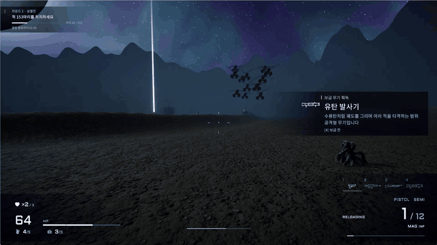

특수 웨이브는 실행 중인 스테이지와 살아 있는 몬스터가 모두 없고, 마감 전 보너스 스테이지를 찾았을 때 시작합니다. 군중전 종료는 모든 일반 스테이지를 시작했고 실행 중인 스테이지와 기다리는 보너스가 없을 때 확정합니다. 다음 코드는 두 메서드의 실행 줄을 각각 발췌한 것입니다.

```csharp
// code/MonsterWaveDirector.cs:163-176, 223-234 (각 메서드의 실행 줄 발췌)
// StartClearBonusIfEarned()
bool hasNoRunningStage = runningStages.Count == 0;
bool hasNoAliveMonster = aliveMonsters.Count == 0;
if (hasNoRunningStage == false) return;
if (hasNoAliveMonster == false) return;
WaveStageDef earnedStage = FindEarnedClearBonusStage();
if (earnedStage == null) return;
pendingClearBonusStages.Remove(earnedStage);
StartStage(earnedStage);

// EndHordePhaseIfAllDone()
bool hasStartedAllStages = nextStageIndex >= roundStages.Count;
bool hasNoRunningStage = runningStages.Count == 0;
bool isWaitingClearBonus = IsWaitingClearBonus();
if (hasStartedAllStages == false) return;
if (hasNoRunningStage == false) return;
if (isWaitingClearBonus) return;
isRoundRunning = false;
```

#### 3.2.7 몬스터 관리 파트 회고

##### 웨이브 데이터: 라운드 안에 스테이지를 하나 더 두기

**당시 상황** — 플레이어가 페이즈마다 다른 유형의 몬스터 그룹에 대처하게 하는 것이 목표였습니다. 코드를 고치지 않고 웨이브 설정을 바꿀 수 있게 데이터를 분리해야 했습니다. 시간대별 시나리오는 3.2.1절에서 설명합니다.

**최종 결정** — 라운드 → 스테이지 → 웨이브 → 스포너 4계층의 표(TSV) 4개로 나눴습니다.

- 이름은 보스 페이즈와 헷갈리지 않게 `WaveStage`로 정했습니다.
- 소환 위치 전략은 `SpawnPattern`의 switch를 늘리는 방식으로 정했습니다.
- 구현은 백로그 하나씩 "계획 → 구현" 세션으로 나눠 AI에게 맡기고, 결과는 직접 테스트했습니다.

**결과**

- 장점: 웨이브 편집 도구(Wave Studio)로 보면 스테이지마다 패턴이 심화되는 구분이 보였습니다.
- 단점: 4계층 코드가 한눈에 읽히지 않아 다른 팀원이 이해하기 어려웠고, 재사용도 잘 되지 않았습니다. 수치 조절이 힘들어 사실상 AI가 수치를 조절했습니다. 보스 대기 스테이지는 숙련된 플레이어 말고는 거의 느끼지 못했다는 피드백을 받았습니다.

**다시 고른다면:** 3단(라운드 → 웨이브 → 스포너)으로 줄이되, 시간이 지날수록 웨이브 기믹이 강화되는 특성만 잘 표현할 방법을 찾을 것입니다. 컴포지트 패턴으로 묶는 방법도 생각했지만, 계층이 가려질 것 같아 걱정됐습니다.

---

## 4. 고민과 선택

몬스터 파트 전체에 걸쳐 내린 판단은 두 가지입니다. AI 도구에 무엇을 맡길지, 팀 공용 구조를 어떻게 쓸지입니다.

### 4.1 AI 도구를 어떻게 썼나

| 맡긴 것 | 내가 정한 것 |
| --- | --- |
| 공격 구조 첫 설계와 구현 | 결과를 보고 인터페이스 정리 기준을 정함(3.1.7) |
| 셰이더 5개 작성 | 요구 사항, 씬 확인, 매터리얼 값 조정(3.1.6) |
| 웨이브 테마 추가 제안, 물량 수치 조절 | 밸런스 기준선과 웨이브 테마 초안, 플레이 테스트 판단 |

- 밸런스는 한 라운드(3분) 동안 보급·수류탄·총기·명중률을 고려한 예상 화력을 기준선으로 정하고, 그에 맞는 몬스터 전체 체력을 웨이브에 배분했습니다.
- **체력보다 수.** 몬스터 하나하나를 단단하게 만들기보다 수를 늘려 압박했습니다. 라운드마다 몬스터 체력을 올리는 안은 버리고, 체력은 고정한 채 수량을 조정했습니다. 처음부터 원한 물량 경험에 맞는 스폰 방식이었고, 1차 빌드 팀원 피드백과 AI 계산 결과도 같은 쪽이었습니다. 그 뒤로도 팀원 피드백에 맞춰 수치를 조정해 나갔습니다.
- 웨이브 테마는 현재 몬스터로 만들 수 있는 테마(공중 몬스터 물량전, 독안개 난사 등)를 내가 초안으로 잡고, 그것을 바탕으로 AI에게 다른 테마를 뽑게 했습니다. 나와 팀원들이 플레이 테스트한 뒤 테마를 유지하는 선에서 기본·특수 몬스터 물량을 AI로 조절했습니다. 라운드·스테이지마다 대응되는 스포너가 위계적으로 나뉘어 있어 AI가 수치를 조절하기 쉬울 거라고 판단했습니다.
- 처음 공격 구조를 한 번에 크게 맡긴 것은 너무 넓었습니다. Unity에서 바로 확인할 수 없는 것을 계속 만들었고, 내가 백로그를 나눴던 단위대로 AI에게 맡기고 직접 확인했어야 했다고 돌아봤습니다.
- 그래서 내가 감당할 수 있는 규모로 맡기되, 개념·Unity 씬·코드 세 수준이 함께 잡혀야 주도권이 넘어가지 않는다고 결론 내렸습니다.

### 4.2 팀 구조: ServiceLocator와 EventBus를 쓰면서

`ServiceLocator`·`EventBus`는 팀원이 만든 팀 공용 구조입니다. 나는 이 구조를 몬스터 코드에서 썼습니다.

- **처음 부딪힌 점** — 몬스터가 쓸 플레이어 위치·방향 정보를 노출하려다 구조가 꼬였다고 느꼈습니다. 처음에는 인터페이스 없이 `Transform` 레퍼런스만 들고 있으려 했고, 플레이어 쪽에 구조체로 정보를 모으는 방법도 생각했습니다. 그러다 내가 만든 것은 데이터를 "어떻게 모을지"이고, 서비스 로케이터는 "어떻게 가져올지"라는 것을 알았습니다. 그래서 모은 데이터를 로케이터에 등록하는 인터페이스 안에 넣었습니다.

- **편했던 점** — 플레이어 객체 같은 주요 개체를 싱글톤으로 만들거나 특정 클래스에서 노출할 필요 없이, `ServiceLocator` 하나가 주요 정보를 인터페이스로 저장해 공유할 수 있었습니다. 스폰 위치 정보, 몬스터 풀, 플레이어 주요 정보(위치·시점)를 해당 클래스를 직접 참조하지 않고 가져올 수 있었습니다.
- 아직 구현되지 않은 부분을 다른 팀원이 미리 명세를 보고 규약으로 정해 두어서, 실제 클래스가 없어도 모두가 그 규약을 가정하고 빠르게 진행할 수 있었습니다. 임시·테스트 클래스가 흩어지고 나중에 통합할 때 생기는 문제를 줄여 줬습니다.
- **의문** — 몬스터 풀처럼 직접 참조해도 무방해 보이는 것까지 인터페이스로 한 번 거르는 게 맞는지는 아직 확신이 없습니다. 인터페이스 주입을 많이 써 보지 않아 판단할 식견이 부족하다고 느꼈습니다.

---

## 5. 결과 및 배운 점

### 5.1 결과

- 모든 몬스터가 같은 상태 머신 위에서 공격 6종을 쓰고, 몬스터 프리팹 6종(강화형 변형 포함)이 같은 구조로 조립됩니다.
- 처음 하는 플레이어에게는 기존 물량도 꽤 도전적이었습니다. 시간이 지날수록 스테이지 1의 패턴이 심화되는 느낌을 줄 수 있었습니다.
- 플레이테스트에서 "잡몹을 적극적으로 처치할 이유가 부족합니다"는 의견이 나와 섬멸 라운드를 넣었습니다. 섬멸 라운드에서는 남은 몬스터를 일정 수 아래로 줄여야 보스가 등장합니다. 라운드 진행은 팀원이 만든 흐름을 그대로 쓰고, 그 위에 라운드 유형을 더했습니다. 그 뒤 플레이어가 잡몹을 더 잡았고, 몬스터를 잡지 않고 회피만 하는 플레이도 줄었습니다. 생존 유형도 코드로는 지원하지만, 섬멸이 처치 동기에 더 맞아 라운드 데이터에서는 뺐습니다.
- **아쉬운 점** — 몬스터 수에 따른 프레임 시간·GC를 Profiler로 재지 못한 점이 아쉽습니다. 위 결과는 모두 플레이 테스트에서 체감한 것입니다.

### 5.2 문제 해결 경험

#### 5.2-1 슬러그 시체가 바닥을 뚫고, 사망 애니메이션 도중 사라짐

- **문제** — 슬러그 몬스터가 죽으면 바닥을 뚫고 떨어지고, 일부 몬스터는 사망 애니메이션이 끝나기 전에 사라졌습니다.
- **원인** — 시체 처리가 루트의 콜라이더만 몸통으로 잡았는데, 슬러그는 몸통 콜라이더가 자식에 있어 시체 전환 때 콜라이더 없이 중력만 받았습니다. 회수는 사망 후 2초 고정이었는데 사망 클립이 그보다 길었습니다.
- **해결** — 시체 단계를 `Alive → Lying → Sinking → Gone`으로 나누고, 고정 시간 대신 `Gone`이 되면 회수하게 했습니다. 몬스터 처치 피드백으로 팀장은 처음에 시체가 터지는 연출을 원했습니다. 시체를 남기지 않고 폭발시킬지, 시체가 남되 총의 위력에 따라 강하게 밀쳐지는 느낌을 줄지 고민했는데, 후자가 플레이어에게 처치 피드백을 더 강하게 준다고 생각해 **구르는 물리는 유지**하고 가라앉기 전에 회전만 서서히 줄였습니다.
- **결과** — 시체가 누웠다가 가라앉은 뒤 풀로 돌아갑니다.

#### 5.2-2 도약 몬스터가 다른 몬스터 때문에 착지하지 못함

- **문제** — 도약 착지 지점에 다른 몬스터가 있으면, 그 몬스터가 비킬 때까지 공격 상태 전이가 제대로 되지 않았습니다.
- **원인** — 도약은 착지점의 바닥과 몸이 들어갈 공간을 물리 검사(레이캐스트·캡슐 겹침)로 확인합니다. NavMesh는 걸을 수 있는 바닥만 알고 그 위의 몬스터·기둥은 모르기 때문입니다. 그런데 몬스터에 총 피격용 콜라이더를 붙인 뒤, 도약 몬스터가 Default 레이어에 있었고 검사 마스크에도 Default가 들어 있어 다른 몬스터의 몸을 장애물로 봤습니다.
- **해결** — 처음에는 마스크에서 Default를 뺐는데, Default 레이어인 맵 기둥·벽까지 장애물에서 빠졌습니다. 그래서 도약 몬스터를 Monster 레이어로 옮기고 마스크를 원래대로 되돌렸습니다.
- **결과** — 다른 몬스터는 장애물·바닥으로 보지 않으면서, 맵 구조물은 다시 장애물로 봅니다.

#### 5.2-3 소환이 끝났다고 라운드가 끝나 특수 웨이브가 빠짐

- **문제** — 웨이브 디렉터가 일찍 끝나서 마지막 특수 웨이브(마감 전 전멸 보너스)가 빠졌습니다.
- **발견** — 웨이브 조기 종료 조건 코드를 리뷰하다가 발견했습니다. 게임 중에는 눈에 띄지 않는 버그였습니다.
- **해결** — "소환 일정이 끝남"과 "살아 있는 적이 다 죽음"을 나누고, 스테이지마다 보너스를 판정하게 했습니다(`code/MonsterWaveDirector.cs:163-176`).
- **돌아보면** — 보너스 웨이브는 튜토리얼에도 없었고, 처음 하는 사람에게는 웨이브가 도전적이어서 보너스 웨이브를 만나는 사람이 없었습니다. 오히려 쓸데없는 웨이브 설계였던 것 같습니다.

### 5.3 아쉬운 점 (기술 부채)

| 부채 | 내용 |
| --- | --- |
| 재조립 비용 | `AssembleStateMachine`이 리스폰마다 이미 연결된 컴포넌트를 `GetComponent`로 다시 찾습니다(`code/MonsterController.cs:206-238`). 처음 초기화와 리스폰 때 필요한 것만 나눠야 합니다 |
| 시체 회전 | 가라앉기 전에 시체가 구르는 속도를 서서히 줄였더니, 거대 몬스터는 시체가 괴상하게 선 채로 회전이 줄어 오히려 더 부자연스러웠습니다. 시체에 마찰을 주거나 시체 콜라이더를 서서히 줄이는 방향이 나았을 것입니다 |
| 약점 안내 | 일반 몬스터도 스폰 뒤 잠깐 약점을 강조하거나 튜토리얼로 알려 줬으면 좋았을 것 |
| 측정 | 개발 초반부터 매 프레임 처리의 부하를 걱정해 Profiler 사용법을 꼭 익혀야 한다고 생각했지만, 부하는 측정 없이 체감으로만 판단했습니다. 몬스터 수에 따른 프레임 시간을 Profiler로 잰 적이 없습니다. 웨이브 스테이지 시작 때 프레임 드랍을 의심해 라운드 전체 예열을 따로 만들어 봤지만, 마지막 빌드에서 렉이 체감되지 않아 넣지 않았습니다 |

### 5.4 향후 개선 계획 (To-Be)

- 이동: `MonsterMovement`의 군중 제어·자체 추적·정책 이동을 나누고, `CrowdController`의 토큰·슬롯 방식을 하나의 규칙으로 정리합니다.
- 재조립: `AssembleStateMachine`에서 처음 초기화와 리스폰 때 다시 연결할 것만 나눕니다.
- 웨이브: 3.2.7 「다시 고른다면」처럼 3단(라운드 → 웨이브 → 스포너)으로 줄입니다.
- 공격 설정: 설정 묶음만 넘기고 각 공격 클래스가 필요한 설정을 꺼냅니다(3.1.7).
- Profiler로 현재 버전 부하를 먼저 재고, 개선안과 비교합니다.

### 5.5 배운 점

- **추상화는 필요한 만큼만.** 실제로 확장되고 다형성이 당장 필요한 지점에만 인터페이스를 둡니다. 필요한 정도만 엔지니어링하고, 플레이어 루프에 드러나는 기능부터 개발합니다.
- **AI에게 맡길 때도 설계 주도권은 내가 가집니다.** 한 번에 크게 맡긴 결과는 내가 읽고 피드백할 수 없었습니다. 백로그 단위로 작게 나눠 맡기고 Unity에서 바로 확인해야 했습니다.
- **팀원이 볼 수 있는 곳에 드러내기.** Animator 상태 전이처럼 Unity 에디터에서 보이는 방식은 팀원의 피드백·검증을 쉽게 만듭니다.
- **처음 정한 정의를 의심하기.** 쿨다운 정의처럼 익숙하지 않은 개념은 먼저 찾아보고, 두 방식의 장단점을 비교한 뒤 정해야 합니다.
