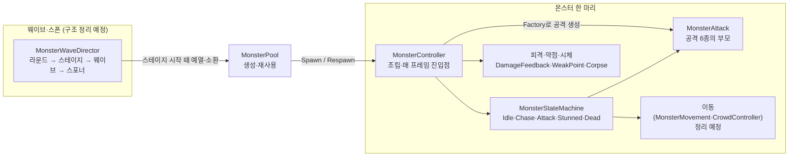
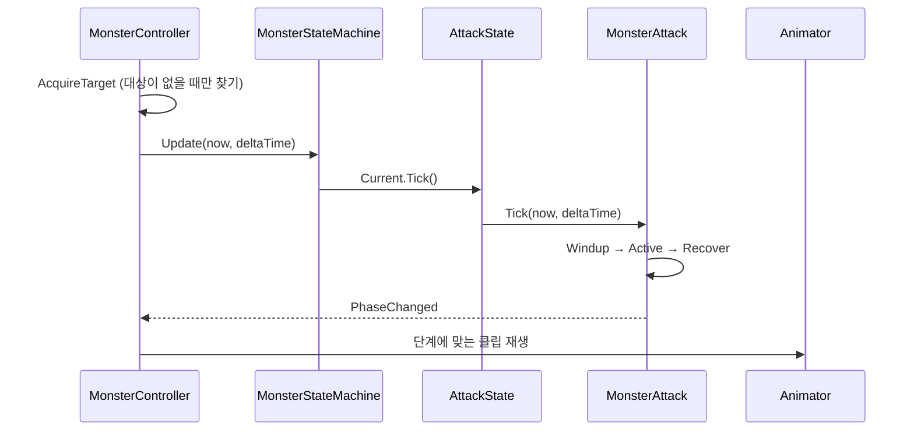

# Hive Purge 기술 문서

> **쏟아지는 몬스터 물량을 헤쳐 나가는 1·3인칭 전환 PvE 호드 FPS — 몬스터 AI·웨이브 담당**


| 항목    | 내용 |
| ----- | --- |
| 장르    | 1인칭과 3인칭을 오가는 PvE 호드(horde) FPS |
| 개발 인원 | 4 (팀 프로젝트) |
| 내 역할  | 몬스터 전반 — 상태 머신·공격 6종, 피격·약점·시체, 웨이브·스폰·풀, 몬스터 이동, 밸런스 관리 |
| 엔진    | Unity 6000.3.15f1 (URP 17.3.0, AI Navigation 2.0.12) |
| 도구    | Rider, Claude Code |
| 개발 기간 | 2026.10.15 — 11.03 |
| 링크    | [GitHub](https://github.com/KooHoo-Dev/3rd_3D_1-3D-Project-team_even) · 시연 영상 준비 중 |

---

## 1. 개요 · 팀 · 역할

### 1.1 프로젝트 소개

**플레이어가 라운드마다 몰려오는 몬스터 무리를 버티고, 얻은 재화로 강화해 3라운드 보스를 쓰러뜨리는 PvE 호드 FPS**

- 플레이어는 한 라운드 동안 몬스터를 죽이며 재화를 얻고 생존한다.
- 라운드가 끝나면 얻은 재화로 업그레이드를 사고 무기를 골라 다음 라운드를 준비한다.
- 3라운드 보스를 처치할 때까지 이 흐름을 반복한다.

**레퍼런스와 가져온 점**

| 레퍼런스 | 가져온 점 |
| --- | --- |
| Earth Defense Force | 플레이어를 향해 쏟아지는 많은 물량을 플레이어가 이겨내는 것 |
| Helldivers 2 | 다양한 웨이브 특징, 다양한 행동 패턴을 보여 줄 수 있는 몬스터 구조 |

Helldivers 2의 적처럼 몬스터마다 플레이어에게 다가가는 방법이 다르게 하고 싶었다.

- 접근 패턴: 플레이어를 향해 일직선으로 이동, 넓게 퍼져서 이동, 플레이어 시야 밖으로 이동
- 공격 사이: 공격 쿨타임 동안 대기할지, 계속 플레이어를 추적할지, 적정 대기 거리는 어떻게 할지

이 문서는 게임 전체가 아니라 내가 맡은 몬스터 쪽을 다룬다. 메인은 세 가지다.

1. **상태 머신과 공격** — 모든 몬스터가 같은 상태 5개를 쓰고, 공격 6종을 갈아 끼우는 구조
2. **피격 ~ 시체** — 상시 체력바 없이 피격 방향·저체력·약점·시체로 몬스터 상태를 읽게 하는 표현
3. **웨이브와 풀** — 표(TSV) 데이터로 라운드마다 몬스터를 시간대별로 소환하고 재사용하는 흐름

군중 이동·독 장판·셰이더는 사이드로 짧게 다룬다. 군중 이동은 마지막에 크게 축소됐고, 지금 구조를 다시 정리하는 중이라 자세한 구조는 정리 뒤에 쓴다.

### 1.2 왜 만들었나

게임에서 플레이어에게 주고 싶은 경험은 **압도적인 물량을 헤쳐 나가는 경험**이었다.

그래서 몬스터를 단순히 플레이어를 따라다니며 공격하는 적이 아니라, 지능적으로 플레이어를 포위하려 하거나 돌진·독 장판 같은 다양한 패턴으로 공격하는 적으로 만들고, 이 몬스터들을 섞어 웨이브마다 다른 특성이 나오게 설계하려고 했다.

개발 의도는 두 가지다.

1. **공통 상태 머신 위에서 공격만 갈아 끼우기** — 상태 5개(Idle·Chase·Attack·Stunned·Dead)는 모든 몬스터가 같이 쓰고, 공격 6종(근접·도약·돌진·독 포격·급강하·자폭)은 같은 "예고 → 공격 → 회복" 순서를 따른다. 몬스터 공격 명세가 1차 빌드 뒤에 바뀔 가능성이 높았기 때문에, 몬스터마다 공격을 결합도 높게 만들지 않으려 했다.
2. **공용 Animator 하나 + 몬스터별 Override Controller** — 외부 에셋의 애니메이션 클립은 몬스터마다 공통된 부분이 많았다. 상태·전이는 공용 Base Controller 한 곳에서만 고치고, 새 몬스터는 클립만 끼운다. 상태 전이를 Animator 창에 드러내서 팀원이 코드를 열지 않고도 확인할 수 있게 했다.

### 1.3 팀과 내 역할

| 구분 | 내용 |
| --- | --- |
| 내가 한 것 | 몬스터 상태 머신·공격 6종, 피격·약점·시체, 웨이브·스폰·풀, 몬스터 이동(군중 제어 포함), 몬스터 애니메이션 연결(공용 Override 상태 설계), 몬스터 밸런스 관리 |
| 팀원이 한 것 (이 문서에서 다루지 않음) | 팀 공용 코어(`ServiceLocator`·`EventBus`·데이터 테이블), 보스, 무기, 플레이어, UI |
| 외부 에셋 | 몬스터 모델과 애니메이션 클립만 썼다 |
| AI가 작성한 것 | 몬스터·독 장판 셰이더 5개(매터리얼 값만 내가 조정). 그 밖의 코드도 Claude Code와 함께 작성했고, 설계 판단과 검증 방식은 4.4절에 적었다 |

---

## 2. 시스템 구조

### 2.1 구성요소와 책임



이 그림에서 볼 것은 **몬스터 한 마리 안의 모든 모듈이 `MonsterController` 하나를 통해 조립되고 움직인다**는 점이다.

| 클래스 | 맡은 일 |
| --- | --- |
| `MonsterController` | 몬스터 객체 자체를 관리한다. 인스펙터에서 몬스터 수치를 관리하면서, 상태 머신·이동·피격·시체 컴포넌트를 묶어 주는 총체적인 객체다. 매 프레임 진입점(`Update`)도 여기 하나다 |
| `MonsterStateMachine` | 몬스터 상태 머신을 관리한다. 상태 5개 사이의 전이와 현재 상태의 판단(`Tick`)을 맡는다 |
| `MonsterAttack` | `ChargeAttack` 같은 세부 공격 클래스의 부모. 공격 사이클(공격 준비 → 공격 → 회복 → 쿨타임)을 관리하고, 공격 데이터(attackSpec) 중 필요한 정보를 상태 머신에 노출한다 |
| `MonsterAttackFactory` | 몬스터 역할(Role)에 따라 공격 클래스를 만드는 팩토리 |
| `MonsterPool` | 몬스터를 미리 만들어 두고, 죽은 몬스터를 돌려받아 다시 쓴다 |
| `MonsterWaveDirector` | 현재 라운드의 웨이브를 관리한다. 하위 `MonsterWaveStage`·`MonsterWave`·`MonsterSpawner`를 계층적으로 호출하며 소환한다 |
| `MonsterDamageFeedback`·`MonsterWeakPoint`·`MonsterCorpse` | 피격 모션·저체력 표현, 약점 판정과 명중 표시, 사망 뒤 시체 단계 |

> **아쉬운 점 · 개선할 점** — `MonsterMovement`에는 군중 제어·자체 추적·정책 이동이 한 파일에 섞여 있고, `CrowdController`에는 토큰 방식과 슬롯 방식이 섞여 있어 책임 경계가 흐리다. 그래서 이 표와 그림에서는 두 클래스를 "이동" 하나로 묶었다. `MonsterController.AssembleStateMachine`도 리스폰 때 다시 조립하는 범위가 넓다. 책임을 나누는 리팩토링을 계획하고 있다(5.3·5.4절).

### 2.2 왜 이렇게 나눴나

- **공격은 추상 클래스 하나로 묶었다.** 공격 정보를 감싸는 메서드와 공격 사이클 같은 공통 정보가 필요했기 때문에, 단순한 인터페이스 규약보다는 추상 클래스로 관리하는 게 맞다고 판단했다. 처음에는 인터페이스와 추상 클래스가 함께 있었는데, 인터페이스는 과한 추상화여서 정리했다(4.1절).
- **몬스터의 판단은 `MonsterController.Update` 하나에 매달린다.** 상태 머신과 시체는 컨트롤러가 매 프레임 순서대로 부르고, 이동은 상태 머신이 멈추거나 다시 움직이게 한다. 그래서 피격으로 사망 처리되면 진행 중이던 공격은 취소되고 이동은 멈추며, 다음 프레임부터 상태 머신 대신 시체만 진행된다. 공격 도중에 죽어도 기존 행동이 다 무효가 되고 바로 사망 처리된다.
- **다른 파트와는 팀 규칙대로 직접 참조하지 않는다.** 팀 아키텍처 규칙이 "파트끼리 직접 참조 금지, 통신은 인터페이스·`ServiceLocator`·`EventBus`"였다. 몬스터 풀은 자신을 `IMonsterFactory`로 등록하고(`code/MonsterPool.cs:44`), 몬스터는 플레이어를 `ServiceLocator`로 찾으며, 플레이어 사망·라운드 정리 같은 일은 이벤트로 받는다(`code/MonsterController.cs:257-260`). 이 구조에 대한 생각은 4.5절에 적었다.

### 2.3 한 프레임의 흐름



---

## 3. 핵심 기능

### 3.1 매 프레임 진입점: `MonsterController.Update`

몬스터 한 마리의 하루는 이 메서드 하나로 읽힌다. 죽었으면 시체만 진행하고, 살아 있으면 대상 확보 → 공격 튜닝 → 피격 슬로우 종료 → 상태 판단 → 이동 애니메이션 순서로 돈다.

```csharp
// code/MonsterController.cs:281-295
private void Update()
{
    if (StateMachine.IsDead)
    {
        corpse.Tick(Time.time);
        if (corpse.IsGone) Despawn();
        return;
    }

    AcquireTarget();
    ApplyAttackTuning();
    EndHitSlowIfExpired();
    StateMachine.Update(Time.time, Time.deltaTime);
    UpdateMoveAnimation();
}
```

- 죽는 순간 상태 머신이 Dead로 바뀌면서 진행 중인 공격을 취소하고 이동을 멈춘다. 그 뒤로는 첫 `if`에서 시체만 진행하고 `return`하므로 공격·상태 판단 코드가 더 돌지 않는다. 별도의 "공격 중 사망" 처리 없이 이 구조로 막았다.

### 3.2 공격 사이클: `MonsterAttack.Tick`

모든 공격은 같은 순서(예고 Windup → 공격 Active → 회복 Recover)를 따른다. 순서는 부모 클래스가 고정하고, 각 단계에서 실제로 할 일은 자식 클래스가 `OnWindup`·`OnActive`·`OnRecover`·`OnCancel`로 채운다(`code/MonsterAttack.cs:260-272`).

```csharp
// code/MonsterAttack.cs:197-228
public void Tick(float now, float deltaTime)
{
    switch (Phase)
    {
        case SkillPhase.Windup:
            Body.TurnToward(WindupLookPoint, WindupTurnSpeed, deltaTime);
            if (now < phaseEndTime) return;
            activeStartTime = now;
            SetPhase(SkillPhase.Active, now);
            return;
        case SkillPhase.Active:
            bool isBeforeHitTime = now < activeStartTime + ActiveDuration * cycleHitTimeRatio;
            if (isBeforeHitTime) return;

            if (isActionDone == false) isActionDone = OnActive(now, deltaTime);
            if (Phase != SkillPhase.Active) return; // OnActive 안에서 EndEarly 로 끝난 경우 (벽 충돌 등)

            bool isActiveTimeOver = now >= activeStartTime + ActiveDuration;
            if (isActionDone == false) return;
            if (isActiveTimeOver == false) return;
            SetPhase(SkillPhase.Recover, now + Spec.RecoveryTime);
            OnRecover();
            return;
        case SkillPhase.Recover:
            if (now < phaseEndTime) return;
            nextReadyTime = now + cycleCooldown;
            Finish(AttackResult.Completed);
            return;
        default:
            throw new InvalidOperationException("진행 중이 아닌 공격은 Tick 할 수 없다");
    }
}
```

- 쿨다운은 **회복이 끝난 뒤 기다리는 시간**이다. 예고·공격·회복·쿨다운을 각각 독립 값으로 두어서, 공격 애니메이션 길이가 다른 몬스터도 공격 시간을 따로 맞출 수 있다(처음 정의와 바꾼 이유는 5.3절).
- 단계가 바뀔 때마다 `PhaseChanged`를 알리고, `MonsterController`가 그 단계에 맞는 Animator 클립을 재생한다.


### 3.3 공격 갈아 끼우기: `MonsterAttackFactory.CreateAttack`

몬스터 역할(Role) 하나에 공격 클래스 하나가 대응한다. 새 공격 방식은 공격 클래스 1개와 `case` 1줄로 추가한다.

```csharp
// code/MonsterAttackFactory.cs:27-42
public static MonsterAttack CreateAttack(MonsterRole role, in AttackSpec spec, MonsterBody body,
                                          Func<IPlayerTarget, IDamageable> findDamageable,
                                          IReadOnlyList<MonsterAttackSettingsComponent> settings,
                                          MonsterMovement movement, FlyingMoveExecutor flyingExecutor)
{
    switch (role)
    {
        case MonsterRole.Melee: return new StrikeAttack(spec, body, findDamageable);
        case MonsterRole.SelfDestruct: return new SelfDestructAttack(spec, body, findDamageable, FindSettings<SelfDestructSettings>(settings));
        case MonsterRole.Infiltrator: return new PounceAttack(spec, body, findDamageable, FindSettings<PounceSettings>(settings));
        case MonsterRole.ZonePressure: return new PoisonAreaAttack(spec, body, findDamageable, FindSettings<PoisonAreaSettings>(settings));
        case MonsterRole.Rusher: return new ChargeAttack(spec, body, findDamageable, movement, FindSettings<ChargeSettings>(settings));
        case MonsterRole.Air: return new DiveAttack(spec, body, findDamageable, movement, FindSettings<DiveSettings>(settings), flyingExecutor);
        default: throw new NotSupportedException($"{role} 역할의 공격은 아직 구현되지 않았다");
    }
}
```

| 역할 | 공격 | 하는 일 |
| --- | --- | --- |
| Melee | `StrikeAttack` | 다가가서 근접 공격 |
| Infiltrator | `PounceAttack` | 시야 밖으로 접근해 도약 공격 |
| Rusher | `ChargeAttack` | 돌진, 큰 벽에 부딪히면 기절 |
| ZonePressure | `PoisonAreaAttack` | 플레이어가 머문 자리에 독 장판 포격 |
| Air | `DiveAttack` | 공중에서 급강하 공격 |
| SelfDestruct | `SelfDestructAttack` | 다가가서 자폭 |

- 공격마다 필요한 추가 설정(돌진 속도, 도약 높이 등)은 프리팹에 붙은 설정 컴포넌트에서 `FindSettings<T>`로 꺼낸다. 이 방식의 한계는 4.1절에 적었다.
- 엄밀히 말하면 공격 클래스 안쪽은 "순서는 부모가 고정, 단계 내용만 자식이 채움"이라 **템플릿 메서드**에 가깝다. 상태 머신 쪽에서 보면 어떤 공격이든 같은 방법으로 부르니 전략처럼 쓰인다. 구현이 여러 개인 인터페이스로 갈아 끼우는 진짜 전략 패턴은 공격 판정 범위 `IHitArea`(원·부채꼴·직선·근접 4개)와 이동 정책 `IMovementPolicy`(3개)다.

### 3.4 피격 ~ 시체: 상시 체력바 없이 상태를 읽게 하기

| 표현 | 어떻게 | 코드 |
| --- | --- | --- |
| 피격 방향 모션 | 맞은 쪽(앞·뒤·좌·우)의 피격 모션을 Animator의 Hit 레이어(Additive)에 겹쳐 재생. 이동·공격 상태는 바뀌지 않는다 | `code/MonsterDamageFeedback.cs:90-98` |
| 저체력 | 이동 감속 + 몸에 붉은 기. 매터리얼 에셋은 바꾸지 않고 렌더러별 `MaterialPropertyBlock`으로 덮는다 | `code/MonsterDamageFeedback.cs:122-131` |
| 경직 | 피해가 쌓여 임계값을 넘으면 경직·슬로우 | `MonsterController` |
| 약점 | 맞았을 때만 Flash. 보스는 처음 등장 몇 초만 강조 | `code/MonsterWeakPoint.cs:156-159` |
| 시체 | 누움 → 가라앉기 → 회수. 총의 위력에 밀려 구르는 물리는 유지 | `code/MonsterCorpse.cs:101-118` |

```csharp
// code/MonsterDamageFeedback.cs:90-98
public void PlayHitAnimation(Vector3 incomingDirection)
{
    if (Time.time < nextHitAnimationTime) return;

    nextHitAnimationTime = Time.time + hitAnimationCooldown;
    Vector3 localDirection = transform.InverseTransformDirection(incomingDirection);
    HitSide side = ToHitSide(localDirection);
    animator.CrossFadeInFixedTime("Hit" + side, hitAnimationBlend, hitLayerIndex, 0f);
}
```

- 경직은 팀장의 플레이 피드백(몬스터가 피격되면 경직되어서 플레이어가 물량에 너무 휩쓸리지 않았으면 좋겠다)을 반영했다. 다만 피격마다 경직을 넣으면 거대한 몬스터도 한 번에 경직되어 몰입감을 해칠 수 있어서, **누적 피해 임계값**을 넘었을 때만 경직되게 했다. 물량과 기존 플레이 밸런스를 유지하면서 피드백을 반영하는 방법이었다.
- 약점은 처음에 늘 빛났는데, 팀원들에게서 게임 분위기에 맞지 않고 몬스터 비주얼을 해친다는 피드백이 나와 명중할 때만 보이게 바꿨다.


시체는 단계 enum 하나(`Alive → Lying → Sinking → Gone`)로 진행하고, `Gone`이 되면 컨트롤러가 풀에 돌려준다.

```csharp
// code/MonsterCorpse.cs:101-118
public void Tick(float now)
{
    float elapsed = now - stageStartTime;
    switch (stage)
    {
        case CorpseStage.Lying:
            // 남은 시간에 맞춰 현재 회전 속도를 줄이고, 침강 시작 시 0으로 만든다.
            float remaining = lyingSeconds - elapsed;
            float spinFade = remaining > 0f ? Time.deltaTime / (remaining + Time.deltaTime) : 1f;
            body.angularVelocity = Vector3.Lerp(body.angularVelocity, Vector3.zero, spinFade);
            if (elapsed >= lyingSeconds) StartSinking();
            return;
        case CorpseStage.Sinking:
            MoveDownWhileSinking(elapsed);
            if (elapsed >= sinkSeconds) EnterStage(CorpseStage.Gone);
            return;
    }
}
```


### 3.5 웨이브와 풀

**표 4개가 몬스터 한 마리가 되기까지**

| 표 | 한 행에 들어 있는 것 |
| --- | --- |
| `RoundTable.tsv` | 라운드에 대응되는 웨이브 라운드 번호 |
| `WaveStageTable.tsv` | 웨이브 라운드 번호에 대응해, 시작 시각에 따라 순서대로 시작하는 웨이브 스테이지들. 스테이지마다 진행할 웨이브 번호들 |
| `WaveTable.tsv` | 이 웨이브가 스테이지 시작 기준 몇 초 뒤에 실행되는지, 이 웨이브가 맡은 스포너들 |
| `MonsterSpawnerTable.tsv` | 이 스포너가 소환하는 몬스터 id, 소환 개수, 소환 방식 |

라운드 진행 쪽이 `StartRound(라운드 번호)`를 부르면, 디렉터가 그 라운드의 스테이지를 찾아 0초부터 진행을 시작한다.

```csharp
// code/MonsterWaveDirector.cs:83-104
public void StartRound(int roundNumber)
{
    StopRound();

    List<WaveStageDef> stagesOfRound = FindStagesOfRound(roundNumber);
    if (stagesOfRound.Count == 0)
    {
        // 끝 신호를 줄 스테이지가 없어 진행 중으로 두면 영원히 끝나지 않는다
        Debug.LogWarning($"[MonsterWaveDirector] 라운드 {roundNumber} 스테이지 데이터 없음. 군중 소환 안 함", this);
        return;
    }

    roundNo = roundNumber;
    roundStages = stagesOfRound;
    roundElapsedTime = 0f;
    nextStageIndex = 0;
    isRoundRunning = true;
    pendingClearBonusStages = FindClearBonusStagesOfRound(roundNumber);
    aliveMonsters.Clear();

    StartDueStages();
}
```

그 뒤 매 프레임 라운드 시간을 진행하고, 실행 중인 스테이지를 `Tick`한 다음 시작 시각이 된 스테이지를 시작한다. 마감 전에 다 잡으면 특수 웨이브를 시작하고, 마지막에 라운드 군중전이 끝났는지 본다.

```csharp
// code/MonsterWaveDirector.cs:125-134
private void Update()
{
    if (isRoundRunning == false) return;

    roundElapsedTime += Time.deltaTime;
    TickRunningStages(Time.deltaTime);
    StartDueStages();
    StartClearBonusIfEarned();
    EndHordePhaseIfAllDone();
}
```

- 스테이지를 시작하기 직전에 그 스테이지에서 나올 몬스터 수의 50%(종류마다 최소 10마리)를 풀에 미리 만들어 둔다(`code/MonsterPool.cs:25-26,98-108`).
- 다음 스테이지가 시작돼도 이전 스테이지를 멈추지 않는다. 이전 스테이지는 남은 소환을 끝까지 이어 간다.


> **아쉬운 점 · 개선할 점** — 라운드 → 스테이지 → 웨이브 → 스포너 4계층은 다른 팀원이 한눈에 읽기 어려웠고 수치 조절도 힘들었다. 단계를 줄이는 방향으로 개선할 계획이다(5.3·5.4절).

**풀: 처음 만든 개체와 돌려받은 개체**

풀은 종류마다 스택을 두 개 둔다(`code/MonsterPool.cs:38-39`). 처음 켜지는 개체는 Unity가 `Awake`·`OnEnable`을 돌려 처음부터 조립하고, 돌려받은 개체는 `Awake`가 다시 돌지 않으므로 `Respawn()`으로 체력·상태 머신·약점·시체·피격 표현을 직접 되돌린다.

```csharp
// code/MonsterPool.cs:180-205
public GameObject Spawn(MonsterDef def, Vector3 position, Quaternion rotation)
{
    IdleMonsters idleMonsters = GetIdleMonsters(def.Id);
    if (idleMonsters.Count == 0) CreateUnspawned(def);

    MonsterController monster;
    if (idleMonsters.Returned.Count > 0)
    {
        // 꺼진 채 옮긴 뒤 켜야 NavMeshAgent 가 새 위치에서 시작한다
        monster = idleMonsters.Returned.Pop();
        monster.transform.SetPositionAndRotation(position, rotation);
        monster.transform.SetParent(null);
        monster.gameObject.SetActive(true);
        monster.Respawn();
    }
    else
    {
        // 위치를 먼저 바꾼다. 씬 루트로 옮기는 순간 처음 켜지며 Awake·OnEnable 이 돈다
        monster = idleMonsters.Unspawned.Pop();
        monster.transform.SetPositionAndRotation(position, rotation);
        monster.transform.SetParent(null);
    }

    EventBus<MonsterSpawnedEvent>.Publish(new MonsterSpawnedEvent(monster.Def, monster.gameObject));
    return monster.gameObject;
}
```

- 돌려받은 개체는 **꺼진 채로 위치를 옮긴 뒤 켠다.** 먼저 켜고 옮기면 한 프레임 동안 옛 자리·옛 자세로 보이거나 NavMeshAgent가 옛 위치에서 시작한다.
- 시체가 남아 있는 동안은 회수하지 않는다. 시체 단계가 `Gone`이 된 뒤에 돌려받는다.

### 3.6 사이드: 셰이더 (AI 작성)

몬스터·독 장판 셰이더 5개는 AI(Claude Code)가 작성한 URP용 HLSL 셰이더다. 나는 요구 사항을 정하고, 씬에서 눈으로 확인하며 매터리얼 값만 직접 조정했다. 지형 에셋과의 위화감을 줄이고 로우 폴리 느낌을 내는 데 집중했다.

| 셰이더 | 어디에 | 렌더 단계 |
| --- | --- | --- |
| WeakPointGlow | 약점 부위 | 반투명(Transparent), 깊이 안 씀 |
| EliteAura | 강화형·자폭형 몬스터 | 반투명, 원래 재질 위에 두 번째 재질로 덧그림 |
| PoisonPuddle | 독 장판 | 반투명 |
| PoisonMarker | 착탄 예고 표식 | 반투명, 장판보다 나중에 그림(`Transparent+10`) |
| PoisonBlob | 독 투사체 | 불투명(Opaque), 깊이 패스 포함 |


- 장판·표식이 지형 굴곡을 따르는 것은 셰이더가 아니라 C#이다. `TerrainDiscMesh`가 Terrain 높이를 따라 원판 메시를 새로 만든다(`code/TerrainDiscMesh.cs:24-61`).


---

## 4. 고민과 선택

### 4.1 공격 구조: 인터페이스 + 추상 클래스에서 추상 클래스로

**당시 상황**

- 1차 빌드 전 백로그에 이미 몬스터 종류별 이야기가 여러 개 있었다(기본 근접형·공중 공격형·독안개 위치 압박형·시야 밖 침투형·돌진형 무리). 단순히 몬스터가 근접 공격하는 게 아니라 다가가서 공격, 도약 공격, 공중 다이빙 공격, 돌진 공격처럼 핵심 기능임에도 변할 가능성이 높았다.
- 몬스터마다 공통 애니메이션 클립도 있지만 공격 클립은 다양했고, 1차 빌드 뒤 공격 명세가 바뀔 것이 분명했다. 프로토타입부터 상태 전이·공격을 하드 코딩하면 나중에 힘들어질 것 같았다.
- NavMesh로 여러 몬스터를 움직이는 비용이 크다는 것은 알았지만, 무거운 3D 에셋을 넣은 상태에서 프레임 드랍을 감당할 수 있을지 감이 오지 않았다.

그래서 AI와의 계획 단계에서 "행동 상태와 공격이 자주 바뀔 것이니 OOP·디자인 패턴을 적극 적용한 설계"를 요청했다. 테스트는 Unity CLI 없이 돌리고 싶어 NUnit으로 진행하라고 했다.

**처음 구조와 정리한 구조**

| | 처음 | 정리 후 (지금) |
| --- | --- | --- |
| 공격 | 인터페이스 `IMonsterAttack` + 추상 클래스 `MonsterAttack` | 추상 클래스 `MonsterAttack` 하나 |
| 몬스터 몸·이동 | `IMonsterBody`·`IMonsterMover` 인터페이스 | 인터페이스 삭제 |
| 남긴 인터페이스 | — | 구현이 여럿인 `IHitArea`(4개)·`IMovementPolicy`(3개) |
| 테스트 | Unity 없이 도는 EditMode + 가짜 객체 | 실제 객체로 도는 PlayMode 중심 |

**왜 정리했나**

- 처음 구조는 한 번에 크게 들어왔고, 커밋된 코드를 본 뒤에야 "설계까지 내가 다 관여해야 한다"고 반성했다.
- 인터페이스가 테스트를 위한 일회용 추상화 그 이상, 그 이하도 아니어서 코드 읽기가 너무 힘들었다. 처음에는 제대로 피드백을 할 수 없을 정도로 헷갈렸다.
- 그래서 기준을 직접 정했다: **인터페이스는 구현이 2개 이상이거나 백로그에 확장 예정이 있을 때만 만든다.** 유의미한 추상화(실제로 확장 가능하고 다형성이 당장 필요한 지점)와 과한 추상화·오버 엔지니어링을 구분하고 싶었다. 이 기준은 지금도 유지한다.
- 공격 정보를 감싸는 메서드와 공격 사이클 같은 공통 정보가 필요해서 추상 클래스는 남겼다.

**결과**

- 정리 전후 테스트 48개가 통과했다(그 시점 기록: EditMode 14 + PlayMode 34).
- 테스트를 PlayMode로 옮겼지만 체감 차이는 없었다. 테스트 수가 아주 많지 않아서, 지금도 PlayMode 테스트 전체가 1분 안에 끝난다.

**공격 설정 전달도 같은 고민이었다**

| 단계 | 방식 | 문제 |
| --- | --- | --- |
| 1 | 공격 설정 묶음 구조체 | 공격이 늘 때마다 `CreateAttack` 매개변수가 늘어난다. 공격 4개만 되어도 비슷한 역할의 설정을 쭉 나열하게 되어, 순서를 조금만 실수해도 잘 드러나지 않는 버그가 생기고 매번 순서를 떠올려야 했다 |
| 2 (지금) | 프리팹에 붙은 설정 컴포넌트 목록 + `FindSettings<T>` | 공격이 추가되면 팩토리가 그 공격의 설정 타입을 알아야 해서 팩토리를 한 번 더 고쳐야 한다 |
| To-Be | 설정 묶음만 넘기고, 각 공격 클래스가 필요한 설정을 직접 꺼냄 | 일부 공격만 쓰는 설정은 그 공격 클래스만 알면 된다 |

몬스터 시스템은 이미 클래스가 많다. 정말로 여러 모듈을 엮어야 하는 `MonsterController` 같은 곳을 빼면, 클래스 사이 의존성을 최대한 낮추는 것이 내가 코드 리뷰할 때도, 다른 사람이 내 코드를 볼 때도 좋다고 생각했다.

### 4.2 공격 사거리: 진입·유지·판정 거리를 나누기

**문제** — 근접 몬스터가 사거리 앞에서 서서히 느려지고, 공격해도 플레이어가 너무 쉽게 피했다.

원인은 여러 문제가 겹친 것이었다.

1. NavMeshAgent는 목표 지점에 도착할 때 자연스럽게 서서히 멈추려고 감속한다.
2. 그런데 이동 목표 지점이 공격 사거리 지점과 같았다.
3. 경로 계산(`CalculatePath`) 부하를 막으려고 경로를 매 프레임이 아니라 일정 간격으로만 다시 계산했다(최소 0.25초, 목표가 0.5m 넘게 움직였을 때). 재계산하지 않는 프레임에 플레이어가 움직이면 "목표 앞 감속 → 목표 변경으로 가속"이 반복됐다.
4. 설령 공격해도 공격 거리가 너무 짧으면 플레이어가 쭉 도망칠 때 쉽게 회피됐다.

**선택지와 고른 것**

| 방법 | 결과 |
| --- | --- |
| 사거리 하나로 진입과 명중을 같이 판정 (처음) | 감속 문제 + 쉽게 회피 |
| 이동 정지 거리를 0으로 바꿔 사거리 앞 감속 없애기 | 감속은 사라진다. 하지만 이것만으로는 짧은 사거리 때문에 여전히 쉽게 회피된다 |
| **진입·유지·판정 거리를 나누기 (지금)** | 진입 = 사거리, 공격 유지·근접 명중 = 사거리 × `HitRangeRatio`. 쿨다운 동안에는 Chase로 공격 자리 예약을 지킨 채 따라간다 |

진입·유지·판정을 나눠야 한다는 것을 확실히 안 것은 NavMesh 감속 문제를 해결한 **뒤**였다. 감속이 사라지자 "공격해도 플레이어가 너무 쉽게 피한다"가 테스트에서 바로 드러났기 때문이다. 판정 범위는 씬에서 보이게 하는 시각화 도구로 확인했다.

### 4.3 애니메이션: 코드 강제 전환 대신 Animator 상태 전이

**문제** — 공격 클립이 끝나기 전에 상태가 바뀌어 `attack → idle → attack`처럼 부자연스러웠다. 외부 에셋의 Animator Controller 8개는 공통 상태(Idle·전진 이동·공격·피격·Death)만 있고 파라미터·전이가 없는 데모용이었다.

| 방법 | 장점 | 단점 |
| --- | --- | --- |
| 코드에서 `CrossFade`로 강제 전환 | 코드 한 곳에서 제어 | 전이가 코드에만 있고 Animator 창·Inspector에 드러나지 않는다 |
| **Animator 상태 전이 + 공용 Base + 몬스터별 Override (지금)** | 팀원이 Animator 창에서 바로 확인. 상태·전이는 한 곳에서만 고침 | 코드와 Animator 파라미터를 맞춰야 한다 |

내 결과물을 확인하려면 코드까지 깊게 봐야 한다면, 팀장이나 다른 팀원이 피드백·검증하거나 사소한 변경을 테스트하기가 힘들어진다. 그래서 Animator라는 Unity 시스템을 활용했다.

- 공용 Base Controller 1개 + 몬스터별 Override Controller 11개. 새 몬스터는 클립만 끼우면 된다.
- 공격 Active 단계에 맞춰 클립을 재생하고, 클립 길이와 실제 이동 속도로 재생 배율을 맞췄다.
- 상태 5개로 모든 몬스터를 표현하는 데 크게 걸린 곳은 없었다. 몬스터별 서브 상태 머신 교체는 조사만 하고 구현하지 않았다.

### 4.4 AI 도구를 어떻게 썼나

| 맡긴 것 | 내가 정한 것 |
| --- | --- |
| 공격 구조 첫 설계와 구현 | 결과를 보고 인터페이스 정리 기준을 정함(4.1) |
| 셰이더 5개 작성 | 요구 사항, 씬 확인, 매터리얼 값 조정(3.6) |
| 웨이브 테마 추가 제안, 물량 수치 조절 | 밸런스 기준선과 웨이브 테마 초안, 플레이 테스트 판단 |

- 밸런스는 한 라운드(3분) 동안 보급·수류탄·총기·명중률을 고려한 예상 화력을 기준선으로 정하고, 그에 맞는 몬스터 전체 체력을 웨이브에 배분했다.
- 웨이브 테마는 현재 몬스터로 만들 수 있는 테마(공중 몬스터 물량전, 독안개 난사 등)를 내가 초안으로 잡고, 그것을 바탕으로 AI에게 다른 테마를 뽑게 했다. 나와 팀원들이 플레이 테스트한 뒤 테마를 유지하는 선에서 기본·특수 몬스터 물량을 AI로 조절했다. 라운드·스테이지마다 대응되는 스포너가 위계적으로 나뉘어 있어 AI가 수치를 조절하기 쉬울 거라고 판단했다.
- 처음 공격 구조를 한 번에 크게 맡긴 것은 너무 넓었다. Unity에서 바로 확인할 수 없는 것을 계속 만들었고, 내가 백로그를 나눴던 단위대로 AI에게 맡기고 직접 확인했어야 했다고 돌아봤다.

### 4.5 팀 구조: ServiceLocator와 EventBus를 쓰면서

`ServiceLocator`·`EventBus`는 팀원이 만든 팀 공용 구조다. 나는 이 구조를 몬스터 코드에서 썼다.

- **편했던 점** — 플레이어 객체 같은 주요 개체를 싱글톤으로 만들거나 특정 클래스에서 노출할 필요 없이, `ServiceLocator` 하나가 주요 정보를 인터페이스로 저장해 공유할 수 있었다. 스폰 위치 정보, 몬스터 풀, 플레이어 주요 정보(위치·시점)를 해당 클래스를 직접 참조하지 않고 가져올 수 있었다.
- 아직 구현되지 않은 부분을 다른 팀원이 미리 명세를 보고 규약으로 정해 두어서, 실제 클래스가 없어도 모두가 그 규약을 가정하고 빠르게 진행할 수 있었다. 임시·테스트 클래스가 흩어지고 나중에 통합할 때 생기는 문제를 줄여 줬다.
- **의문** — 몬스터 풀처럼 직접 참조해도 무방해 보이는 것까지 인터페이스로 한 번 거르는 게 맞는지는 아직 확신이 없다. 인터페이스 주입을 많이 써 보지 않아 판단할 식견이 부족하다고 느꼈다.

---

## 5. 결과 및 배운 점

### 5.1 결과

- 모든 몬스터가 같은 상태 머신 위에서 공격 6종을 쓰고, 몬스터 프리팹 6종(강화형 변형 포함)이 같은 구조로 조립된다.
- 처음 하는 플레이어에게는 기존 물량도 꽤 도전적이었다. 시간이 지날수록 스테이지 1의 패턴이 심화되는 느낌을 줄 수 있었다.
- **아쉬운 점** — 몬스터 수에 따른 프레임 시간·GC를 Profiler로 잰 기록이 없다. 그래서 이 절은 플레이 테스트의 체감으로만 적었다. 현재 버전의 부하를 먼저 재는 것을 개선 계획에 넣었다(5.4절).

### 5.2 문제 해결 경험

#### 5.2-1 슬러그 시체가 바닥을 뚫고, 사망 애니메이션 도중 사라짐

- **문제** — 슬러그 몬스터가 죽으면 바닥을 뚫고 떨어지고, 일부 몬스터는 사망 애니메이션이 끝나기 전에 사라졌다.
- **원인** — 시체 처리가 루트의 콜라이더만 몸통으로 잡았는데, 슬러그는 몸통 콜라이더가 자식에 있어 시체 전환 때 콜라이더 없이 중력만 받았다. 회수는 사망 후 2초 고정이었는데 사망 클립이 그보다 길었다.
- **해결** — 시체 단계를 `Alive → Lying → Sinking → Gone`으로 나누고, 고정 시간 대신 `Gone`이 되면 회수하게 했다. 몬스터 처치 피드백을 시체를 남기지 않고 폭발시킬지, 시체가 남되 총의 위력에 따라 강하게 밀쳐지는 느낌을 줄지 고민했는데, 후자가 플레이어에게 처치 피드백을 더 강하게 준다고 생각해 **구르는 물리는 유지**하고 가라앉기 전에 회전만 서서히 줄였다.
- **결과** — 시체가 누웠다가 가라앉은 뒤 풀로 돌아간다.

#### 5.2-2 도약 몬스터가 다른 몬스터 때문에 착지하지 못함

- **문제** — 도약 착지 지점에 다른 몬스터가 있으면, 그 몬스터가 비킬 때까지 공격 상태 전이가 제대로 되지 않았다.
- **원인** — 도약은 착지점의 바닥과 몸이 들어갈 공간을 물리 검사(레이캐스트·캡슐 겹침)로 확인한다. NavMesh는 걸을 수 있는 바닥만 알고 그 위의 몬스터·기둥은 모르기 때문이다. 그런데 몬스터에 총 피격용 콜라이더를 붙인 뒤, 도약 몬스터가 Default 레이어에 있었고 검사 마스크에도 Default가 들어 있어 다른 몬스터의 몸을 장애물로 봤다.
- **해결** — 처음에는 마스크에서 Default를 뺐는데, Default 레이어인 맵 기둥·벽까지 장애물에서 빠졌다. 그래서 도약 몬스터를 Monster 레이어로 옮기고 마스크를 원래대로 되돌렸다.
- **결과** — 다른 몬스터는 장애물·바닥으로 보지 않으면서, 맵 구조물은 다시 장애물로 본다.

#### 5.2-3 소환이 끝났다고 라운드가 끝나 특수 웨이브가 빠짐

- **문제** — 웨이브 디렉터가 일찍 끝나서 마지막 특수 웨이브(마감 전 전멸 보너스)가 빠졌다.
- **발견** — 웨이브 조기 종료 조건 코드를 리뷰하다가 발견했다. 게임 중에는 눈에 띄지 않는 버그였다.
- **해결** — "소환 일정이 끝남"과 "살아 있는 적이 다 죽음"을 나누고, 스테이지마다 보너스를 판정하게 했다(`code/MonsterWaveDirector.cs:163-176`).
- **돌아보면** — 보너스 웨이브는 튜토리얼에도 없었고, 처음 하는 사람에게는 웨이브가 도전적이어서 보너스 웨이브를 만나는 사람이 없었다. 오히려 쓸데없는 웨이브 설계였던 것 같다.

### 5.3 아쉬운 점 (기술 부채)

| 부채 | 내용 |
| --- | --- |
| 이동 코드 | `MonsterMovement`에 군중 제어·자체 추적·정책 이동이 다 들어 있고, `CrowdController`는 토큰·슬롯 방식이 섞여 있다. 그대로 두면 안 되는 구조다 |
| 재조립 비용 | `AssembleStateMachine`이 리스폰마다 이미 연결된 컴포넌트를 `GetComponent`로 다시 찾는다(`code/MonsterController.cs:206-238`). 처음 초기화와 리스폰 때 필요한 것만 나눠야 한다 |
| 웨이브 단계 | 라운드 → 스테이지 → 웨이브 → 스포너 4계층이 다른 팀원에게 한눈에 읽히지 않았고, 재사용도 잘 안 됐다. 수치 조절(스테이지 전체 배율, 특정 몬스터 물량)이 힘들어 사실상 AI가 수치를 조절했다. 보스 대기 스테이지는 숙련된 플레이어 말고는 거의 느끼지 못했다 |
| 공격 설정 전달 | 팩토리가 공격별 설정 타입을 알아야 한다(4.1) |
| 약점 안내 | 일반 몬스터도 스폰 뒤 잠깐 약점을 강조하거나 튜토리얼로 알려 줬으면 좋았을 것 |
| 쿨다운 정의 | 처음에는 Active = Cooldown − Telegraph − Recovery로 정의했다. 공격 페이즈를 이렇게 자세히 나눈 첫 프로젝트라 각 페이즈의 의미를 잘 몰랐다. 몬스터마다 공격 시간을 다르게 해야 할 때 Active가 세 값에 의해 간접적으로 정해져 고쳤는데, 기본적인 검색을 먼저 했다면 처음부터 지금 구조로 갈 수 있었다 |
| 측정 | 몬스터 수에 따른 프레임 시간을 Profiler로 잰 적이 없다 |

### 5.4 향후 개선 계획 (To-Be)

- 이동: `MonsterMovement`의 군중 제어·자체 추적·정책 이동을 나누고, `CrowdController`의 토큰·슬롯 방식을 하나의 규칙으로 정리한다.
- 재조립: `AssembleStateMachine`에서 처음 초기화와 리스폰 때 다시 연결할 것만 나눈다.
- 웨이브: 3단(라운드 → 웨이브 → 스포너)으로 줄이되, 시간이 지날수록 웨이브 기믹이 강화되는 특성을 표현할 방법을 찾는다.

- 공격 설정: 설정 묶음만 넘기고 각 공격 클래스가 필요한 설정을 꺼낸다(4.1).
- Profiler로 현재 버전 부하를 먼저 재고, 개선안과 비교한다.

### 5.5 배운 점

- **추상화는 필요한 만큼만.** 실제로 확장되고 다형성이 당장 필요한 지점에만 인터페이스를 둔다. 필요한 정도만 엔지니어링하고, 플레이어 루프에 드러나는 기능부터 개발한다.
- **AI에게 맡길 때도 설계 주도권은 내가 가진다.** 한 번에 크게 맡긴 결과는 내가 읽고 피드백할 수 없었다. 백로그 단위로 작게 나눠 맡기고 Unity에서 바로 확인해야 했다.
- **팀원이 볼 수 있는 곳에 드러내기.** Animator 상태 전이처럼 Unity 에디터에서 보이는 방식은 팀원의 피드백·검증을 쉽게 만든다.
- **처음 정한 정의를 의심하기.** 쿨다운 정의처럼 익숙하지 않은 개념은 먼저 찾아보고, 두 방식의 장단점을 비교한 뒤 정해야 한다.
